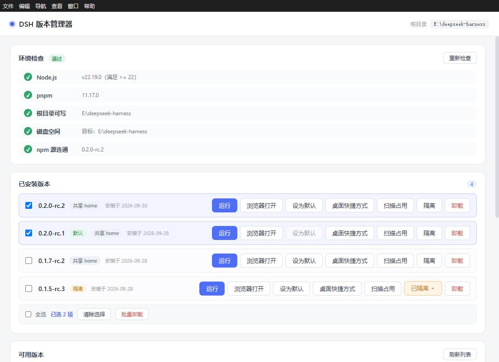
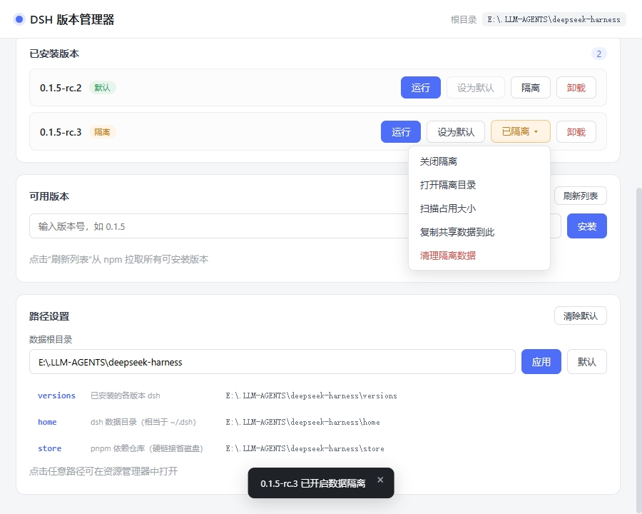

<h1 align="center">
  
</h1>

<p align="center"><strong>A lightweight, portable version manager for DeepSeek Harness</strong><br>
One home can be mounted to multiple versions; one version can run multiple isolated instances.</p>

<p align="center"><strong>English</strong> | <a href="README.md">简体中文</a> | <a href="README.ja.md">日本語</a> | <a href="README.ko.md">한국어</a> | <a href="README.zh-TW.md">繁體中文</a></p>

<p align="center">
  <a href="https://github.com/K1-lihongrong/dsh-multiver/releases"></a>
  
  <a href="https://github.com/K1-lihongrong/dsh-multiver/releases"></a>
  <a href="https://github.com/K1-lihongrong/dsh-multiver/stargazers"></a>
  <a href="LICENSE"></a>
</p>

<p align="center">
  <a href="#download">Download</a> ·
  <a href="#quick-start">Quick start</a> ·
  <a href="docs/使用手册.md">Manual</a> ·
  <a href="docs/插件兼容矩阵.md">Plugin compatibility</a> ·
  <a href="docs/问题日志查看指南.md">Troubleshooting</a>
</p>

dsh-multiver is a lightweight, portable manager for DeepSeek Harness. It installs and switches versions, runs each version in an embedded window, and manages isolated instances that can share data across versions. A headless CLI covers the same operations for scripts and automation.

## Highlights

- 🪶 **Lightweight and portable**: Windows ~10 MB single exe, no installation required, just double-click to use from any writable directory.
- 💾 **Multi-version management**: Install, switch, set default version, and batch uninstall; pnpm store hard links share dependencies to save disk space.
- 🧬 **Multiple instances per version**: One home can be mounted to multiple versions, and multiple independent instance windows can be opened for the same version; runtime status is visible across versions.
- 🖥️ **Embedded execution**: WebView2 embedded in the app directly opens dsh, with each version/instance using independent cache; or hand off to the system browser with one click.
- 🧩 **Plugin management**: View, install, uninstall, and update community plugins, supporting instance home, recommended page, compatibility hints, and update checks.
- ⌨️ **CLI automation**: 24 commands covering version, instance, run, import/export, and maintenance, supporting `--json` and `--dry-run`.

## Full Capabilities

- 🪶 **Ultra-lightweight**: Windows single exe around 10 MB, no installation required, double-click to use
- 💾 **Disk-saving**: Uses pnpm store hard links, multiple versions share dependency files
- 📖 **Version update notes**: Click the version number to view update notes for that version in-place (data from dsh upstream Releases), understand changes before installing
- 🩺 **Pre-install self-check + guidance**: Automatically checks Node / pnpm / disk / source connectivity, provides download links and installation steps if missing
- 📊 **Fine-grained progress**: Real-time display of installation stage and dependency progress percentage
- 🔁 **Retry with source switch on failure**: On installation failure, prompts by category (network / private package / incomplete version), network issues can be retried with one-click npm source switch
- 🚫 **Failed version marking**: Versions with dependencies that have been delisted are automatically grayed out, avoiding repeated pitfalls
- ☑️ **Batch operations**: Multi-select versions for one-click batch uninstallation (including anti-mistake disable)
- 🔒 **Instance data isolation**: Each version can choose to share home or mount independent instances, testing plugins without polluting the main environment
- 🧬 **Multiple instances per version**: One dataset can be mounted on multiple versions; multiple independent instance windows can be opened for the same version, with running status visible across versions
- 🔗 **Reusable official configuration**: One-click reuse of dsh official `~/.dsh` (sessions/credentials/plugins ready to use), disabled by default, can be re-enabled anytime
- 🔄 **Auto-update**: Checks for new versions after startup; upon confirmation, downloads, performs SHA256 verification, replaces its own exe, and restarts (automatically falls back to mirror if GitHub direct connection fails)
- 🧩 **Recommended plugin page**: Built-in community plugin list, categorized filtering + starred top; list pulled from remote with 30-minute throttling, falls back to compiled-in copy when offline
- 📦 **Configuration export/import**: One-click export configuration + version list as JSON, can preview differences and import when migrating to another machine
- ⚙️ **Fully customizable**: Data root directory, DSH_HOME, store location can all be configured in the interface
- 🖥️ **Embedded window operation**: Click "Run" to open dsh Web interface directly within the app (each version has independent WebView2 cache, no cross-pollution), or open in system browser with one-click
- 🚀 **Desktop shortcuts**: Generate `DSH <version>.lnk` on desktop for any version, double-click to launch corresponding version
- 🧩 **dsh plugin management** (v0.3.0+): View installed plugins for a version directly in the interface, install/uninstall/check updates, and one-click install community plugins from "Recommended" page (including categorized filtering, starred top, descriptions switching with interface language)
- 🧹 **Auto-maintenance**: Cleans up orphaned webview cache on startup, regularly recycles pnpm store
- ⌨️ **Headless CLI**: Subcommand style (v0.3.0+), covering queries (`list` / `info` / `versions` / `env` / `which`), operations (`install` / `uninstall` / `set-default` / `isolate` / `clean`), operations (`doctor` / `maintenance` / `export` / `import` / `run` / `set-root`), and instances (`instance`) etc. 24 commands, supports `--json` (machine-readable), `--dry-run` (preview); all operations can be completed without starting the interface, convenient for scripting

## Screenshot

Main interface — environment check, installed versions (including batch operations), available versions and installation:



Data isolation (independent data directory) and path configuration:



## Download

Download from [Releases](https://github.com/K1-lihongrong/dsh-multiver/releases):

| Platform | File | Description |
| :--- | :--- | :--- |
| **Windows** | `dsh-multiver.exe` | Portable version, place in a **regular writable directory** and run by double-clicking (requires WebView2, which is included in Win11 and Win10 1803+). Do not place in DSH workspace, `C:\Program Files`, or read-only directories |

> Linux is currently **not packaged or released** (neither AppImage nor deb are provided); only CI builds and unit tests are retained. Packaging will be restored when conditions are suitable in the future.

📖 **For complete instructions, see the [User Manual](docs/使用手册.md)** — including environment setup, all features, and troubleshooting common issues.

🔍 **Having issues? See the [Log Viewing Guide](docs/问题日志查看指南.md)** — where logs are located, what each records, and how to troubleshoot based on symptoms.

🐧 **Linux**: Currently not packaged or released; only source compilation and CI tests are retained. The instance feature has not been validated on Linux desktop environments.

## Quick start

1. Launch the application (double-click `dsh-multiver.exe` on Windows)
2. The top of the interface will **automatically check the environment** (Node / pnpm / disk / source); missing items will provide download links and installation steps
3. Click "Refresh List" to pull installable versions from npm
4. Click a version number to install, observe the phased progress; on failure, prompts are given by category; for network issues, you can retry by changing the source
5. Click "Run" to open that version's `dsh web` in the application's **embedded window**, or click "Open in Browser" to open it in the system browser
6. Click the "**Plugin**" button for a version to view / install / uninstall that version's dsh plugin, or install community plugins with one click from the "Recommended" page

Data is stored by default in the **directory where the exe is located** (`versions/`, `home/`, `store/`), so this directory must be writable; you can also change it to any location in the interface's "Path Settings".

### Running Methods

After installation, each version has three launch methods:

- **Run (Embedded Window)**: Opens the dsh Web interface directly within the application (default 1100×760). Each version uses an independent WebView2 data directory (`<data root>/webview/<version>`); long-term accumulated cookies/cache do not pollute each other, and header bloat will not trigger dsh's `431 / Failed to load plugins`. Closing the window automatically terminates the process for that version; running the same version again will first terminate the old instance before reopening.
- **Open in Browser**: Launches dsh in a new console window and lets dsh automatically open the system default browser (port fixed at `3080`). If the port is occupied, a dialog will pop up asking you to choose "Switch to Random Port" or cancel; if that version is already running in an embedded window, a dialog will also pop up to confirm whether to open another instance.
- **Desktop Shortcut**: Clicking the button generates a `DSH <version>.lnk` on the desktop for the current version; double-clicking it launches that version directly—suitable for frequently used versions to place directly on the desktop.

### Handling Installation Failures

When installation fails, targeted prompts are given based on the error category:

- **Network Issues**: A dialog to switch sources pops up; you can choose from official / Alibaba Cloud npmmirror / Tencent Cloud / Huawei Cloud, or enter a custom source, then retry with one click
- **Private Package Removed / Incomplete Version**: Prompts to switch to a newer version and provides advanced solutions
- Failed versions are grayed out and crossed out in the list; users can manually "Clear Mark" and retry

### Batch Operations

The installed list supports multi-selection:

- Each version has a checkbox on the left; after checking, a batch operation bar appears at the bottom
- "Select All" selects the entire group with one click; "Clear Selection" deselects
- "Batch Uninstall" uninstalls one by one after a single confirmation, displaying progress in real-time; failed items are summarized in a prompt
- While batch operations are in progress, buttons for selected items are disabled (anti-error), preventing duplicate operations

### Terminal Short Commands

After clicking "Set as Default" on a version, a `dsh.cmd` forwarding script is generated in `%APPDATA%\npm\` (this directory is already in the system PATH). Afterward, typing `dsh` directly in **any terminal** will run the version set as default.

In particular, dsh's Web interface can also be launched via terminal short commands — execute:

```bash
dsh web
```

This command forwards requests to the version set as "Default" and launches its Web interface, with the same effect as the "Run" button on the interface. Other dsh subcommands (such as `dsh doctor`, `dsh --version`) will also hit the default version.

### Data Isolation

The "Instance" dropdown on the right side of the version row is used to select/manage isolated instances. Instances are global entities; one `homes/<id>` can be mounted to multiple versions, and multiple instances can be created for the same version; sessions, plugins, configurations, and shared environments do not interfere with each other, making it suitable for testing incompatible plugins or comparing version behaviors.

The instance menu also provides:

- Run / Focus, open instance directory
- Rename, delete (deletion goes to Recycle Bin)
- Create instance, switch the main button target for this version
- Global panel "Instance Management" to centrally view orphans, mount/unmount, and scan for usage

The internal ID of an instance is used only for paths, CLI/JSON, and logs; the interface displays only the instance name.

### Viewing Version Update Notes

Clicking the version number chip of "Available Versions" or the version number of "Installed Versions" will expand the update notes for that version in place
(data comes from dsh upstream GitHub Releases, Markdown is rendered to HTML by GitHub and displayed after whitelist sanitization).
The entire title bar row can be clicked to collapse, with a "Open Original in Browser" button attached. You can understand what changed in each version before installing.
Notes are cached by version: after viewing a version once, clicking again (from any path) will immediately display it.

### Path Settings

The "Path Settings" panel can directly open each data directory (clicking any path row opens it in the file manager).
By default, 5 core directories are displayed (`versions` / `home` / `store` / `cache` / `state`),
click " **Expand All Directories** " to view other directories such as `logs` / `webview` / `trash` / `assets`.
The data root directory can be modified here (leading/trailing spaces are automatically removed).

### Automatic Maintenance

When the program starts, it runs in the background (without blocking the interface):

- Cleans up isolated webview data directories (for versions that have been uninstalled)
- If more than 7 days have passed since the last run, low-priority execution of `pnpm store prune` reclaims unreferenced packages

Logs are written to `<data root>/logs/maintenance.log`.

### Command Line Mode (CLI)

From v0.3.0, it adopts a **subcommand style** — when any CLI subcommand is present, the graphical interface is not launched, and it exits upon completion according to the exit code (success `0` / failure `1`):

```bash
dsh-multiver.exe list                                    # List installed versions
dsh-multiver.exe install <version> [--registry <url>]     # Headless install
dsh-multiver.exe uninstall <version>                      # Headless uninstall
dsh-multiver.exe set-default <version>                    # Set default version
dsh-multiver.exe maintenance [--cleanup|--prune]          # Headless maintenance
dsh-multiver.exe instance create --name for-comparison --attach <version>   # Create instance
dsh-multiver.exe instance list --json                     # Instance list (includes orphans; usage not counted by default)
dsh-multiver.exe instance list --sizes --json             # Scan usage for all instances simultaneously
dsh-multiver.exe run <version> --instance <id>            # Launch with specified instance
dsh-multiver.exe install <version> --dry-run              # Preview only, do not execute
dsh-multiver.exe help                                      # Help
```

- `list` shows one version number per line (default version marked with `* ` prefix); output can be piped directly
- Installation progress goes to stderr, stdout remains clean
- Destructive commands have **no interactive confirmation**; ensure parameters are correct
- **Upgrading from v0.2.x**: Old `--flag` syntax has been removed; current commands are in the command table above or run `dsh-multiver.exe help`

See [User Manual · Command Line Mode](docs/使用手册.md#八命令行模式cli).

## Differences from other dsh tools

There are several related tools in the dsh ecosystem, but `dsh-multiver` has a different positioning:

| Tool | Positioning | Data Isolation | Disk Space Saving | Environment Check | Form |
| :--- | :--- | :--- | :--- | :--- | :--- |
| **dsh-multiver** | Version management + Plugin management + Disk space saving + Self-check | ✅ Optional | ✅ pnpm store hard links | ✅ 5 items (including disk/source) + Boot | ~10 MB single exe |
| [dshvm](https://github.com/dsh-so/dshvm) | Version management + Data isolation | ✅ (Core feature) | Not emphasized | ✅ Boot page | Tauri + CLI |
| [dsh-launcher](https://github.com/NevermindZZT/dsh-launcher) | One-click launch | ❌ | N/A | ✅ doctor | 2 MB single file |

**In short**:

- Need **most thorough data isolation** → Recommend dshvm
- Only need **one-click launch** → Recommend dsh-launcher
- Want **disk space saving + pre-installation self-check + portable single file** → Use dsh-multiver

## Core Mechanism

### Why Use `node-linker=hoisted`

The dsh runtime resolves dependencies in the standard Node.js manner. pnpm's default **symlink** structure causes:

```
Error: Cannot find package '...\node_modules\.pnpm\node_modules\@deepseek-ai\cordis\index.js'
```

Therefore, each version directory writes `.npmrc`:

```
node-linker=hoisted
```

This generates a flattened, real `node_modules` (compatible with dsh), while the underlying store still uses hard links for deduplication.

### Why Allow Build Scripts

pnpm 10+ defaults to **not executing** build scripts for dependencies, which causes `ERR_PNPM_IGNORED_BUILDS` (missing native modules like node-pty, koffi, etc.). Use the following during installation:

```
--config.dangerouslyAllowAllBuilds=true
```

## Development

> 📋 **Roadmap for future versions** see [`docs/后续版本路线图.md`](docs/后续版本路线图.md) — complete task list, acceptance criteria, and engineering guidelines for v0.3.7 → v0.4.0.

```bash
# Install dependencies
pnpm install

# Development mode (hot reload)
pnpm tauri dev

# Windows: build portable single exe
pnpm tauri build --no-bundle

# Linux: development/debugging only, no packaging
pnpm tauri dev

# Regenerate icons (after modifying icon-source.svg)
node gen-icons.mjs
```

Output location:
- Windows: `src-tauri/target/release/dsh-multiver.exe`
- Linux: no release artifacts produced (CI build/test only)

### Environment Requirements

**Run (using pre-built artifacts):**
- Windows: WebView2 (included in Win11 / Win10 1803+)
- Linux: no pre-built artifacts; source development/CI uses dependencies like WebKitGTK 4.1

**Development / Build from source:**
- Node.js `^22.19.0` or `>=24.2`
- pnpm 10+ (recommended 11.x or higher; portable version includes 12.11.2)
- Rust toolchain
- Windows: MSVC C++ build tools + Windows SDK
- Linux: `libwebkit2gtk-4.1-dev`, `libgtk-3-dev`, `libayatana-appindicator3-dev`, `librsvg2-dev`, `libdbus-1-dev`, `libxdo-dev`, `libssl-dev`, `build-essential`, `pkg-config`, etc.

## Tech Stack

- **Shell**: Tauri 2 (Rust)
- **Frontend**: Vite 8 + Vue 3
- **Packaging**: Portable single exe

## Known Limitations

- The portable single-exe version does not include WebView2; Windows 11 / Windows 10 1803+ includes UCRT. The current build **does not depend on VC++ Redistributable** (verified via import table, relying only on system UCRT); very old systems may still require manual installation of WebView2
- The terminal `dsh` forwarding script writes to `%APPDATA%\npm\`, which must be in PATH
- Portable runtime (Node/pnpm) is automatically downloaded **only on Windows**; on Linux, install Node.js and pnpm using the system package manager
- pnpm requires **10+**: allowBuilds build script approval depends on its syntax; environments below version 10 will be prompted to upgrade
- Installing plugins from GitHub / Git sources requires system git (environment check will prompt, but is not fatal)
- Windows system proxy will be automatically used for downloads/updates (only when HTTP(S)_PROXY environment variable is not set)
- Windows icons are cached; after updating the exe, if the icon does not change, clear the cache (`ie4uinit.exe -show`) or restart Explorer
- Some early dsh versions depend on private packages that have been delisted; no source can install them (the interface will be grayed out and prompt to switch versions)
- When using the npm official source, downloads may be slow in China; the Taobao mirror may be out of sync, potentially missing sub-packages (if installation fails, try switching to the official source)
- **Single instance**: restarting multiple times will focus the already running manager window; version shortcuts will open the corresponding embedded window within the manager when it is running; CLI is unaffected
- **macOS is not yet supported**
- **Linux is not currently packaged or released** (no AppImage / deb provided); CI compilation and unit tests are retained, but real desktop multi-instance acceptance is deferred (GAP-020)

## Seeking Assistance (Non-Windows Platforms)

This project is primarily developed on Windows; Linux is currently **not packaged or released** (only CI compilation/testing is retained). Real Linux desktop and macOS have not yet been verified.
If you have the corresponding environment, we welcome you to help with actual testing or adaptation. See **[Seeking Assistance](docs/征求协助.md)** for details.

## Acknowledgments

- [DeepSeek Harness](https://github.com/deepseek-ai/deepseek-harness) — The object managed by this project
- [Tauri](https://tauri.app/) — Application shell
- [Vue](https://vuejs.org/) — Frontend framework

## License

[MIT](LICENSE)
