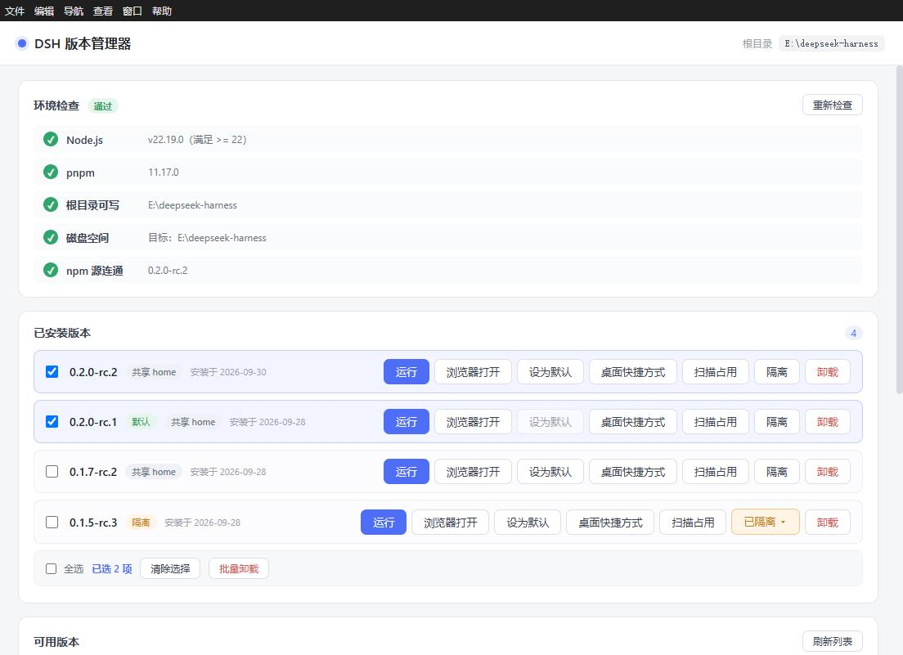
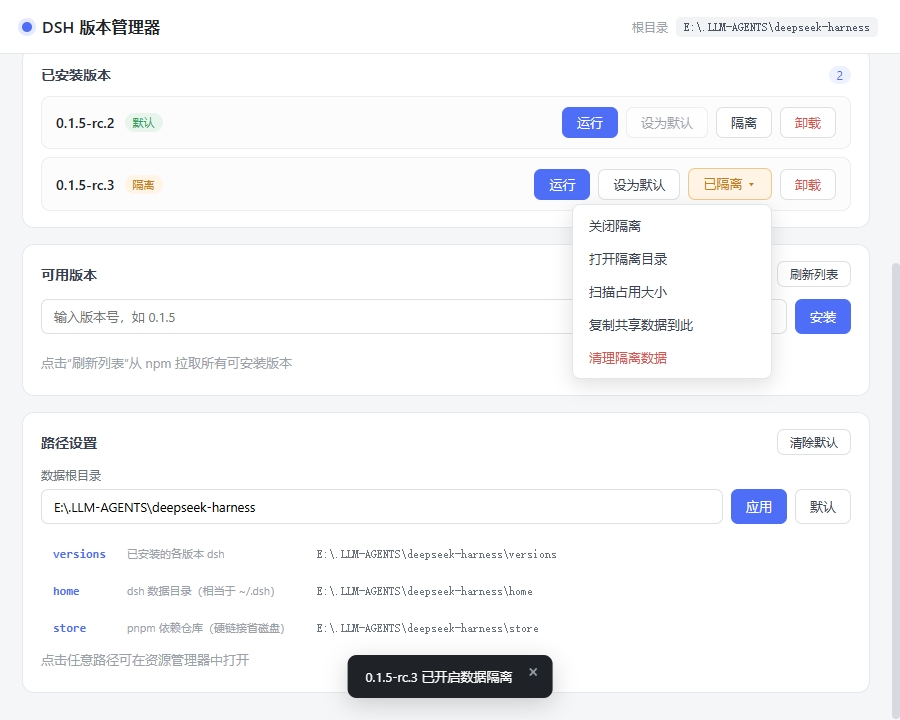

<h1 align="center">
  
</h1>

<p align="center"><strong>軽量でポータブルな DeepSeek Harness バージョンマネージャー</strong><br>
1 つの home を複数バージョンで共有し、同じバージョンで複数の独立したインスタンスを実行できます。</p>

<p align="center"><a href="README.en.md">English</a> | <a href="README.md">简体中文</a> | <strong>日本語</strong> | <a href="README.ko.md">한국어</a> | <a href="README.zh-TW.md">繁體中文</a></p>

<p align="center">
  <a href="https://github.com/K1-lihongrong/dsh-multiver/releases"></a>
  
  <a href="https://github.com/K1-lihongrong/dsh-multiver/releases"></a>
  <a href="https://github.com/K1-lihongrong/dsh-multiver/stargazers"></a>
  <a href="LICENSE"></a>
</p>

<p align="center">
  <a href="#ダウンロード">ダウンロード</a> ·
  <a href="#クイックスタート">クイックスタート</a> ·
  <a href="docs/使用手册.md">マニュアル</a> ·
  <a href="docs/插件兼容矩阵.md">プラグイン互換性</a> ·
  <a href="docs/问题日志查看指南.md">トラブルシューティング</a>
</p>

dsh-multiver は DeepSeek Harness 用の軽量でポータブルなバージョンマネージャーです。バージョンのインストールと切り替え、組み込みウィンドウでの実行、バージョンをまたいでデータを共有できる独立インスタンスの管理を行えます。スクリプトや自動化向けのヘッドレス CLI も備えています。

## ハイライト

- 🪶 **軽量でポータブル**：Windows 版は約 10 MB の単一 exe ファイルで、インストール不要。通常の書き込み可能なディレクトリに配置し、ダブルクリックで起動します。
- 💾 **多バージョン管理**：インストール、切り替え、デフォルトバージョンの指定、バッチアンインストールに対応。pnpm store はハードリンクで依存関係を共有し、ディスク容量を節約します。
- 🧬 **同一バージョンの複数インスタンス**：1 つの home に複数のバージョンをマウントでき、同一バージョンでも複数の独立したインスタンスウィンドウを起動できます。実行状態はバージョンを跨いで確認可能です。
- 🖥️ **埋め込み実行**：アプリ内の WebView2 から直接 dsh を起動でき、各バージョン/インスタンスで独立したキャッシュを使用します。また、ワンクリックでシステムブラウザに引き渡すこともできます。
- 🧩 **プラグイン管理**：コミュニティプラグインの確認、インストール、アンインストール、更新に対応。インスタンス home、推奨ページ、互換性警告、更新チェックをサポートします。
- ⌨️ **CLI 自動化**：24 のコマンドで、バージョン、インスタンス、実行、インポート/エクスポート、メンテナンスをカバーし、`--json` と `--dry-run` をサポートします。

## 完全機能

- 🪶 **極限軽量**：Windows で約 10 MB の単一 exe、インストール不要、ダブルクリックで即起動
- 💾 **ディスク節約**：pnpm store をハードリンクで利用し、複数のバージョンで依存ファイルを共有
- 📖 **バージョン更新説明**：バージョン番号をクリックすると、そのバージョンの更新説明をその場で確認可能（データは dsh の上流 Releases から取得）。インストール前に変更内容を把握
- 🩺 **インストール前チェック + ガイド**：Node / pnpm / ディスク / ソースの接続を自動チェックし、不足している場合はダウンロードリンクとインストール手順を表示
- 📊 **細粒度の進捗表示**：インストール段階と依存関係の進捗率をリアルタイム表示
- 🔁 **失敗時のソース切り替え再試行**：インストール失敗時にカテゴリ別に提示（ネットワーク / 私有パッケージ / バージョン不整合）。ネットワーク問題の場合はワンクリックで npm ソースを切り替えて再試行可能
- 🚫 **失敗バージョンのマーク**：依存関係から削除されたバージョンは自動的にグレーアウトされ、同じミスを繰り返すのを防ぐ
- ☑️ **バッチ操作**：複数のバージョンを選択してワンクリックでバッチ削除（防呆機能付き）
- 🔒 **インスタンスデータの隔離**：各バージョンで home を共有するか、独立したインスタンスをマウントするか選択可能。テスト用プラグインでメイン環境を汚染しない
- 🧬 **同一バージョンの複数インスタンス**：1 つのデータを複数のバージョンにマウント可能。同一バージョンでも複数の独立したインスタンスウィンドウを開き、実行状態をバージョン間で確認可能
- 🔗 **公式設定の再利用**：ワンクリックで dsh 公式 `~/.dsh`（セッション / 認証情報 / プラグイン）を再利用可能（セッション / 認証情報 / プラグインは即座に利用可能）。デフォルトはオフで、いつでも無効化可能
- 🔄 **自動更新**：起動時に新バージョンをチェック。確認後、ダウンロードし SHA256 で検証し、自身を置き換えて再起動（GitHub 直結が失敗した場合は自動的にミラーに切り替え）
- 🧩 **推奨プラグインページ**：コミュニティプラグインリストを内蔵。カテゴリ別フィルタリング + 星付きトップ表示。リストは遠隔から取得し、30 分間隔で更新。ネットワーク切断時はコンパイル期間中に内蔵されたコピーに切り替え
- 📦 **設定のエクスポート/インポート**：ワンクリックで設定 + バージョンリストを JSON にエクスポート。マシン変更時に差異をプレビュー後、インポート可能
- ⚙️ **完全カスタマイズ**：データルートディレクトリ、DSH_HOME、store の位置をインターフェースで設定可能
- 🖥️ **埋め込みウィンドウでの実行**：「実行」をクリックすると、アプリ内で dsh Web インターフェースを直接開く（各バージョンで独立した WebView2 キャッシュを使用し、相互に汚染しない）。ワンクリックでシステムブラウザで開くことも可能
- 🚀 **デスクトップショートカット**：任意のバージョンのためにデスクトップに `DSH <バージョン番号>.lnk` を生成し、ダブルクリックで対応するバージョンに直接アクセス
- 🧩 **dsh プラグイン管理**（v0.3.0+）：インターフェース内でそのバージョンにインストールされたプラグインを確認、インストール / 削除 / 更新チェック、および「推奨」ページからワンクリックでコミュニティプラグインをインストール（カテゴリ別フィルタリング、星付きトップ表示、説明はインターフェース言語に合わせて切り替え）
- 🧹 **自動メンテナンス**：起動時に孤立した webview キャッシュを削除し、定期的に pnpm store を回収
- ⌨️ **ヘッドレス CLI**：サブコマンドスタイル（v0.3.0+）。クエリ（`list` / `info` / `versions` / `env` / `which`）、操作（`install` / `uninstall` / `set-default` / `isolate` / `clean`）、運用（`doctor` / `maintenance` / `export` / `import` / `run` / `set-root`）およびインスタンス（`instance`）などの 24 つのコマンドをカバー。`--json`（機械可読）、`--dry-run`（プレビュー）をサポート。インターフェースを起動せずにすべての操作を完了でき、スクリプト化に便利

## スクリーンショット

メイン画面 —— 環境チェック、インストール済みバージョン（バッチ操作を含む）、利用可能なバージョンとインストール：



データ隔離（独立したデータディレクトリ）とパス設定：



## ダウンロード

[Releases](https://github.com/K1-lihongrong/dsh-multiver/releases) からダウンロード：

| 平台 | 文件 | 说明 |
| :--- | :--- | :--- |
| **Windows** | `dsh-multiver.exe` | 便携版，放到**普通可写目录**双击运行（需 WebView2，Win11 及 Win10 1803+ 自带）。不要放 DSH workspace、`C:\Program Files` 或只读目录 |

> Linux 当前**不打包、不发布**（AppImage/deb 均不提供）；仅保留 CI 编译与单测。未来条件合适再恢复。

📖 **完整操作说明见 [使用手册](docs/使用手册.md)** —— 含环境准备、各项功能、常见问题排查。

🔍 **遇到问题？见 [问题日志查看指南](docs/问题日志查看指南.md)** —— 日志在哪、各记录什么、按现象怎么查。

🐧 **Linux**：当前不打包、不发布；仅保留源码编译与 CI 测试。实例功能未在 Linux 真桌面验收。

## クイックスタート

1. 程序を起動（Windows では `dsh-multiver.exe` をダブルクリック）
2. 画面の上部で**環境が自動的にチェック**されます（Node / pnpm / ディスク / ソース）；不足している項目にはダウンロードリンクとインストール手順が表示されます
3. 「リストの更新」をクリックして npm からインストール可能なバージョンをプルします
4. バージョン番号をクリックしてインストールし、段階的な進捗を確認します；失敗した場合はカテゴリ別にヒントが表示され、ネットワーク問題の場合はソースを変更して再試行できます
5. 「実行」をクリックすると、アプリ**埋め込みウィンドウ**でそのバージョンの `dsh web` が開かれます；または「ブラウザで開く」をクリックしてシステムブラウザで開きます
6. 特定のバージョンの「**プラグイン**」ボタンをクリックすると、そのバージョンの dsh プラグインの表示 / インストール / 解除ができます；または「推奨」ページからコミュニティプラグインをワンクリックでインストールできます

データはデフォルトで**exe があるディレクトリ**下に保存されます（`versions/`、`home/`、`store/`）；したがってこのディレクトリは書き込み可能である必要があります；また、画面の「パス設定」で任意の場所に変更することもできます。

### 実行方法

インストールが完了すると、各バージョンには 3 つの起動方法があります：

- **実行（埋め込みウィンドウ）**：アプリ内で直接 dsh Web インターフェースを開きます（デフォルト 1100×760）。各バージョンは独立した WebView2 データディレクトリ（`<データ根>/webview/<バージョン>`）を使用し、長期間蓄積された cookie/キャッシュが相互に汚染されることもなく、リクエストヘッダーの膨張で dsh の `431 / Failed to load plugins` が発生することもないように設計されています。ウィンドウを閉じるとそのバージョンのプロセスが自動的に終了します；同じバージョンを再度実行すると、古いインスタンスを終了してから再度開きます。
- **ブラウザで開く**：新しいコンソールウィンドウで dsh を起動し、dsh が自動的にシステムデフォルトのブラウザを開きます（ポートは固定 `3080`）。ポートが占有されている場合、「ランダムポートに変更」またはキャンセルを選択するダイアログが表示されます；また、埋め込みウィンドウで既にそのバージョンが実行されている場合、再度開くかどうかを確認するダイアログが表示されます。
- **デスクトップショートカット**：ボタンをクリックして現在のバージョンのデスクトップに `DSH <バージョン>.lnk` を生成します；ダブルクリックするとそのバージョンに直接アクセスできます——よく使うバージョンはデスクトップに直接置くのに適しています。

### インストール失敗時の処理

インストールが失敗した場合は、エラーカテゴリに応じて具体的なヒントが表示されます：

- **ネットワーク問題**：ソース変更ダイアログが表示され、公式 / 阿里云 npmmirror / 腾讯云 / 華為クラウドから選択できます；またはカスタムソースを入力してワンクリックで再試行できます
- **プライベートパッケージの削除 / バージョンが不完全**：より新しいバージョンを使用するよう促し、高度な解決策を示します
- 失敗したバージョンはリストで灰色の線付きでマークされます；ユーザーは手動で「マークをクリア」して再試行できます

### バッチ操作

インストール済みリストは複数選択をサポートします：

- 各バージョンの左側にチェックボックスがあり、チェックすると下部にバッチ操作バーが表示されます
- 「全選択」でこのグループをワンクリックで選択；「選択をクリア」で解除
- 「バッチアンインストール」で一度確認すると順次アンインストールされ、進捗がリアルタイムで表示され、失敗した項目は集約してヒントが表示されます
- バッチ操作中、選択された項目のボタンは無効化（防呆）され、重複操作を防ぎます

### 端末ショートコマンド

バージョン上で「デフォルトに設定」をクリックすると、`%APPDATA%\npm\` に `dsh.cmd` 転送スクリプトが生成されます（このディレクトリはシステム PATH に既に登録済み）。その後、**任意の端末**で直接 `dsh` と入力すると、デフォルトに設定されたバージョンを実行できます。

特に、dsh の Web インターフェースも端末ショートコマンドで起動できます —— 実行：

```bash
dsh web
```

このコマンドはリクエストをデフォルトに設定されたバージョンに転送し、その Web インターフェースを起動します；画面の「実行」ボタンと同じ効果があります。他の dsh サブコマンド（例：`dsh doctor`、`dsh --version`）もデフォルトバージョンにヒットします。

### データの隔離

バージョン行右側の「インスタンス」ドロップダウンで隔離インスタンスを選択/管理できます。インスタンスはグローバルなエンティティであり、1 つの `homes/<id>` を複数のバージョンにマウントでき、同じバージョンにも複数のインスタンスを作成できます；セッション、プラグイン、設定と共有環境は相互に干渉せず、互換性のないプラグインのテストやバージョンの動作比較に適しています。

インスタンスメニューには以下も提供されます：

- 実行 / フォーカス、インスタンスディレクトリを開く
- 名前変更、削除（削除はゴミ箱へ）
- インスタンスの作成、このバージョンのメインボタンターゲットの切り替え
- グローバルパネル「インスタンス管理」で孤児、マウント/解除、占有スキャンを一括で確認

インスタンスの内部 id はパス、CLI/JSON、ログにのみ使用され、画面にはインスタンス名のみが表示されます。

### バージョン更新説明の確認

「利用可能なバージョン」のバージョン番号 chip、または「インストール済みバージョン」のバージョン番号をクリックすると、そのバージョンの更新説明をその場で展開できます
（データは dsh 上流の GitHub Releases から取得され、Markdown は GitHub で HTML にレンダリングされ、ホワイトリストで消毒された後に表示されます）。
タイトルバーの一行全体をクリックして折りたたむことができ、「ブラウザで原文を開く」ボタンが付いています。インストール前に各バージョンの変更点を理解できます。
説明はバージョンごとにキャッシュされます；同じバージョンを一度見た後、再度クリック（どのパスからでも）すると即座に表示されます。

### パス設定

「パス設定」パネルで直接各データディレクトリを開くことができます（任意のパス行をクリックするとファイルマネージャーで開きます）。
デフォルトでは 5 つのコアディレクトリが表示されます（`versions` / `home` / `store` / `cache` / `state`）。
「**すべてのディレクトリを展開**」をクリックすると、`logs` / `webview` / `trash` / `assets` などの他のディレクトリも確認できます。
データルートディレクトリはここで変更できます（自動で先頭と末尾の空白が削除されます）。

### 自動メンテナンス

プログラム起動時にバックグラウンドで（インターフェースをブロックせずに）：

- 孤立した webview データディレクトリをクリーンアップ（対応するバージョンがアンインストールされた場合）
- 前回から 7 日以上経過した場合、低優先度で `pnpm store prune` を実行して参照されていないパッケージを回収

ログは `<データ根>/logs/maintenance.log` に書かれます。

### コマンドラインモード（CLI）

v0.3.0 以降は**サブコマンドスタイル** —— 任意の CLI サブコマンドを指定するとグラフィカルインターフェースは起動せず、実行後に終了コードで終了（成功 `0` / 失敗 `1`）：

```bash
dsh-multiver.exe list                                    # インストール済みバージョンをリスト
dsh-multiver.exe install <バージョン> [--registry <url>]       # ヘッドレスインストール
dsh-multiver.exe uninstall <バージョン>                        # ヘッドレスアンインストール
dsh-multiver.exe set-default <バージョン>                      # デフォルトバージョンを設定
dsh-multiver.exe maintenance [--cleanup|--prune]         # ヘッドレスメンテナンス
dsh-multiver.exe instance create --name 対照用 --attach <バージョン>   # インスタンスを作成
dsh-multiver.exe instance list --json                    # インスタンスリスト（孤児を含む；デフォルトでは占有は含まれない）
dsh-multiver.exe instance list --sizes --json            # 各インスタンスの占有を同時にスキャン
dsh-multiver.exe run <バージョン> --instance <id>              # インスタンスを指定して起動
dsh-multiver.exe install <バージョン> --dry-run                # 確認のみ、実行しない
dsh-multiver.exe help                                    # ヘルプ
```

- `list` は 1 行に 1 つのバージョン番号（デフォルトバージョンは `* ` プレフィックスでマーク）、出力はパイプ可能
- インストール進捗は stderr を経由し、stdout はクリーンに保たれます
- 破壊的コマンドは**インタラクティブ確認なし**；パラメータが正しいことを確認してください
- **v0.2.x からアップグレード**：旧 `--flag` 構文は削除されました；現在のコマンドは上記コマンド表または `dsh-multiver.exe help` を実行してください

詳細は [使用マニュアル · コマンドラインモード](docs/使用手册.md#八命令行模式cli) を参照してください。

## 他の dsh ツールとの違い

dsh エコシステムには既にいくつかの関連ツールが存在しますが、`dsh-multiver` の位置づけはそれらとは異なります：

| ツール | 位置づけ | データ隔離 | 省ディスク | 環境自己診断 | 形態 |
| :--- | :--- | :--- | :--- | :--- | :--- |
| **dsh-multiver** | バージョン管理 + プラグイン管理 + 省ディスク + 自己診断 | ✅ 選択可能 | ✅ pnpm store ハードリンク | ✅ 5 項目（ディスク/ソース含む）+ ガイダンス | 約 10 MB の単一 exe |
| [dshvm](https://github.com/dsh-so/dshvm) | バージョン管理 + データ隔離 | ✅（コア機能） | 強調されていない | ✅ ガイダンスページ | Tauri + CLI |
| [dsh-launcher](https://github.com/NevermindZZT/dsh-launcher) | ワンクリック起動 | ❌ | N/A | ✅ doctor | 2 MB の単一ファイル |

**一言で言えば**：

- **最も徹底的なデータ隔離**が必要 → dshvm を推奨
- **ワンクリック起動**のみで十分 → dsh-launcher を推奨
- **省ディスク + インストール前の自己診断 + ポータブル単一ファイル**を希望 → dsh-multiver を使用

## 核心メカニズム

### なぜ `node-linker=hoisted` を使用するか

dsh のランタイムは、Node の標準的な方法で依存関係を解析します。pnpm のデフォルトの**シンボリックリンク**構造は以下のエラーを引き起こします：

```
Error: Cannot find package '...\node_modules\.pnpm\node_modules\@deepseek-ai\cordis\index.js'
```

そのため、各バージョンディレクトリには `.npmrc` が書き込まれます：

```
node-linker=hoisted
```

これにより、平坦化された実際の `node_modules` が生成され（dsh と互換性あり）、同時に底層ではストアのハードリンクを使用して重複を排除します。

### なぜビルドスクリプトの実行を許可するか

pnpm 10+ ではデフォルトで依存関係のビルドスクリプトは**実行されません**。これにより、`ERR_PNPM_IGNORED_BUILDS`（node-pty、koffi などのネイティブモジュールが欠落）が発生します。インストール時には以下のオプションを使用します：

```
--config.dangerouslyAllowAllBuilds=true
```

## 開発

> 📋 **次期バージョンのロードマップ**は [`docs/后续版本路线图.md`](docs/后续版本路线图.md) を参照してください。v0.3.7 → v0.4.0 の完全なタスクリスト、受入基準、およびエンジニアリングガイドライン。

```bash
# 依存関係のインストール
pnpm install

# 開発モード（ホットリロード）
pnpm tauri dev

# Windows：ポータブル単一 exe のパッケージ化
pnpm tauri build --no-bundle

# Linux：開発・デバッグ用のみ、パッケージ化は行わない
pnpm tauri dev

# アイコンの再生成（icon-source.svg を変更した後）
node gen-icons.mjs
```

生成物位置：
- Windows：`src-tauri/target/release/dsh-multiver.exe`
- Linux：生成物なし（CI でのコンパイル/テストのみ）

### 環境要件

**実行（既存の生成物を使用）**：
- Windows：WebView2（Win11 / Win10 1803+ に標準搭載）
- Linux：既存の生成物なし；ソースコード開発/CI には WebKitGTK 4.1 などの依存関係を使用

**開発 / ソースコードからのビルド**：
- Node.js `^22.19.0` または `>=24.2`
- pnpm 10+（11.x 以上を推奨；ポータブル版には 12.11.2 が内蔵）
- Rust ツールチェーン
- Windows：MSVC C++ ビルドツール + Windows SDK
- Linux：`libwebkit2gtk-4.1-dev`、`libgtk-3-dev`、`libayatana-appindicator3-dev`、`librsvg2-dev`、`libdbus-1-dev`、`libxdo-dev`、`libssl-dev`、`build-essential`、`pkg-config` など

## 技術スタック

- **シェル**: Tauri 2（Rust）
- **フロントエンド**: Vite 8 + Vue 3
- **パッケージング**: ポータブル単一 exe

## 既知の制限

- 携帯版単一 exe は WebView2 を含まず、Win11 / Win10 1803+ には UCRT が標準搭載されています。現在のビルドは**VC++ Redistributable に依存しません**（インポートテーブルで検証済み、システム UCRT のみ依存）；非常に古いシステムでは手動で WebView2 をインストールする必要がある場合があります
- 端末 `dsh` 転送スクリプトは `%APPDATA%\npm\` に書き込み、このディレクトリは PATH に含まれている必要があります
- 携帯ランタイム（Node/pnpm）は**Windows 専用**で自動ダウンロードされます；Linux についてはシステムパッケージマネージャーで Node.js と pnpm をインストールしてください
- pnpm は **10+** が必要です：allowBuilds ビルドスクリプトは依存関係のその構文を承認するため、10 未満の環境チェックはアップグレードを促すメッセージを表示します
- GitHub / Git ソースからのプラグインのインストールにはシステム git が必要です（環境チェックは促しますが、致命的ではありません）
- Windows システムではプロキシが自動的にダウンロード/更新に使用されます（HTTP(S)_PROXY 環境変数が設定されていない場合のみ）
- Windows アイコンにはキャッシュがあり、exe を更新してもアイコンが変わらない場合はキャッシュをクリアしてください（`ie4uinit.exe -show` またはエクスプローラーの再起動）
- 一部の早期 dsh バージョンは廃止されたプライベートパッケージに依存しており、どのソースでもインストールできません（インターフェースは灰色で表示され、バージョン変更を促すメッセージが表示されます）
- npm 公式ソースを使用する場合、国内でのダウンロードは遅くなる可能性があります；淘宝ミラーの同期が遅れ、サブパッケージが欠落する場合があります（インストール失敗の場合は公式ソースで再試行してください）
- **単一インスタンス**：重複して起動すると、既に実行中のマネージャーウィンドウにフォーカスが移ります；バージョンのショートカットはマネージャー実行中にそのバージョンの埋め込みウィンドウを開きます；CLI は影響を受けません
- **macOS はまだサポートされていません**
- **Linux は現在パッケージ化されず、リリースされていません**（AppImage / deb は提供しません）；CI ビルドと単一テストのみを維持し、真のデスクトップマルチインスタンスの検証は延期されています（GAP-020）

## 協力依頼（Windows 以外のプラットフォーム）

本プロジェクトは主に Windows 上で開発されています。Linux は現在**パッケージ化・リリースされていません**（CI でのビルド/テストのみ）。実際の Linux デスクトップおよび macOS はまだ検証されていません。
対応する環境をお持ちの場合は、実機テストや適応にご協力ください。詳細は **[協力依頼](docs/征求协助.md)** を参照してください。

## 謝辞

- [DeepSeek Harness](https://github.com/deepseek-ai/deepseek-harness) — 本プロジェクトで管理する対象
- [Tauri](https://tauri.app/) — アプリケーションのシェル
- [Vue](https://vuejs.org/) — フロントエンドフレームワーク

## ライセンス

[MIT](LICENSE)
