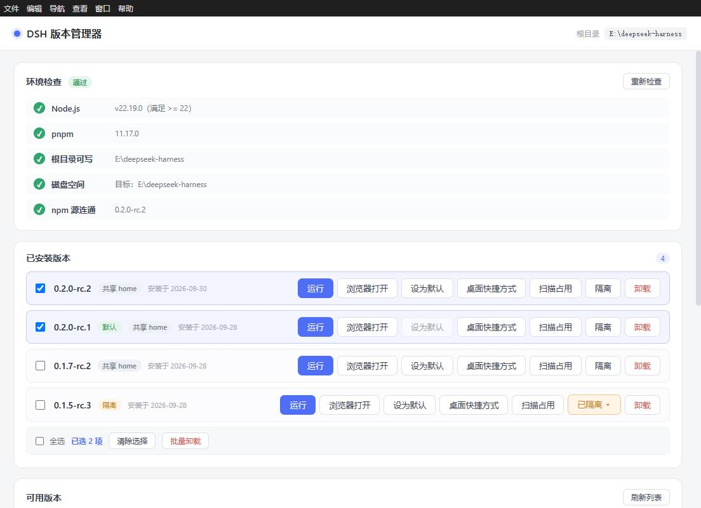
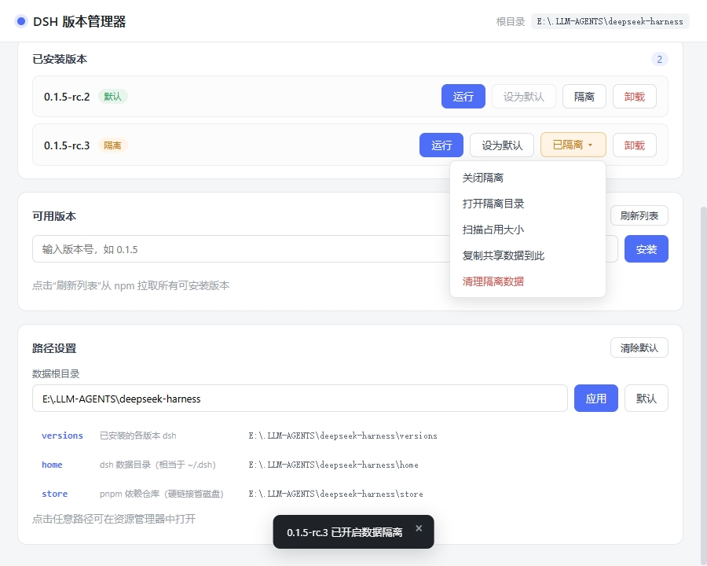

<h1 align="center">
  
</h1>

<p align="center"><strong>가볍고 휴대 가능한 DeepSeek Harness 버전 관리자</strong><br>
하나의 home을 여러 버전에 연결하고, 같은 버전에서 여러 개의 독립 인스턴스를 실행할 수 있습니다.</p>

<p align="center"><a href="README.en.md">English</a> | <a href="README.md">简体中文</a> | <a href="README.ja.md">日本語</a> | <strong>한국어</strong> | <a href="README.zh-TW.md">繁體中文</a></p>

<p align="center">
  <a href="https://github.com/K1-lihongrong/dsh-multiver/releases"></a>
  
  <a href="https://github.com/K1-lihongrong/dsh-multiver/releases"></a>
  <a href="https://github.com/K1-lihongrong/dsh-multiver/stargazers"></a>
  <a href="LICENSE"></a>
</p>

<p align="center">
  <a href="#다운로드">다운로드</a> ·
  <a href="#빠른-시작">빠른 시작</a> ·
  <a href="docs/使用手册.ko.md">사용 설명서</a> ·
  <a href="docs/插件兼容矩阵.md">플러그인 호환성</a> ·
  <a href="docs/问题日志查看指南.md">문제 해결</a>
</p>

dsh-multiver는 DeepSeek Harness를 위한 가볍고 휴대 가능한 버전 관리자입니다. 버전 설치와 전환, 내장 창에서의 실행, 버전 간 데이터를 공유하는 독립 인스턴스 관리를 지원합니다. 스크립트와 자동화를 위한 헤드리스 CLI도 제공합니다.

## 하이라이트

- 🪶 **경량 및 휴대성**: Windows 에서 약 10 MB 의 단일 exe 파일로, 설치 없이 일반 쓰기 가능 디렉토리에 배치한 후 더블 클릭하여 바로 실행할 수 있습니다.
- 💾 **다중 버전 관리**: 설치, 전환, 기본 버전 설정 및 일괄 제거를 지원하며, pnpm store 의 하드 링크를 통해 의존성을 공유하여 디스크 공간을 절약합니다.
- 🧬 **동일 버전 다중 인스턴스**: 하나의 home 에 여러 버전을 연결할 수 있으며, 동일한 버전에서도 여러 독립적인 인스턴스 창을 열 수 있고, 실행 상태는 버전 간에 공유됩니다.
- 🖥️ **내장 실행**: 앱 내 WebView2 를 통해 dsh 를 직접 열 수 있으며, 각 버전/인스턴스는 독립적인 캐시를 사용합니다. 또한 시스템 브라우저로 한 번에 넘길 수도 있습니다.
- 🧩 **플러그인 관리**: 커뮤니티 플러그인의 확인, 설치, 제거, 업데이트를 지원하며, 인스턴스 home, 추천 페이지, 호환성 경고 및 업데이트 확인을 제공합니다.
- ⌨️ **CLI 자동화**: 버전, 인스턴스, 실행, 내보내기/가져오기 및 유지보수를 포함하는 24 개의 명령어를 지원하며, `--json` 과 `--dry-run` 을 지원합니다.

## 전체 기능

- 🪶 **극도로 경량**: Windows 약 10 MB 단일 exe, 설치 불필요, 더블 클릭 즉시 사용
- 💾 **디스크 절약**: pnpm store 하드 링크 사용, 여러 버전이 의존성 파일 공유
- 📖 **버전 업데이트 설명**: 버전 번호를 클릭하면 해당 버전의 업데이트 설명을 현장에서 바로 확인 가능 (데이터는 dsh 상류 Releases 에서 제공), 설치 전에 변경 사항 미리 파악
- 🩺 **설치 전 자체 점검 + 가이드**: Node / pnpm / 디스크 / 소스 연결성 자동 점검, 누락 시 다운로드 링크 및 설치 단계 제공
- 📊 **세밀한 진행률**: 설치 단계 및 의존성 진행률 퍼센트 실시간 표시
- 🔁 **실패 시 소스 변경 재시도**: 설치 실패 시 카테고리별로 안내 (네트워크 / 사설 패키지 / 버전 불완전), 네트워크 문제 시 한 번에 npm 소스 변경 재시도 가능
- 🚫 **실패 버전 표시**: 의존성이下架된 버전은 자동으로 회색 표시, 반복적인 문제 방지
- ☑️ **배치 작업**: 여러 버전 선택 후 한 번에 배치 제거 (오류 방지 기능 포함)
- 🔒 **인스턴스 데이터 격리**: 각 버전마다 home 공유 또는 독립 인스턴스 마운트 선택 가능, 테스트 플러그인이 메인 환경 오염 방지
- 🧬 **동일 버전 다중 인스턴스**: 하나의 데이터를 여러 버전 마운트 가능, 동일 버전에서 여러 독립 인스턴스 창 열기, 실행 상태가 버전 간에 가시화
- 🔗 **재사용 가능한 공식 설정**: 한 번에 dsh 공식 `~/.dsh`(세션/인증서/플러그인 즉시 사용) 재사용, 기본값은 비활성화, 언제든지 되돌릴 수 있음
- 🔄 **자동 업데이트**: 시작 후 새 버전 확인, 확인 후 다운로드, SHA256 검증 및 자체 exe 교체 후 재시작 (GitHub 직접 연결 실패 시 자동으로 미러로 회귀)
- 🧩 **추천 플러그인 페이지**: 커뮤니티 플러그인 목록 내장, 분류 필터링 + 스타置顶; 목록은 원격에서 가져오며 30 분节流, 인터넷 연결 끊김 시 컴파일 기간 내장 복사본으로 회귀
- 📦 **설정 내보내기/입력**: 한 번에 설정 + 버전 목록을 JSON 으로 내보내기, 기기 변경 시 차이점 미리보기 후 입력 가능
- ⚙️ **완전 커스터마이징**: 데이터 루트 디렉토리, DSH_HOME, store 위치 모두 인터페이스에서 설정 가능
- 🖥️ **내장 창 실행**: 「실행」클릭하여 앱 내에서 dsh 웹 인터페이스 직접 열기 (각 버전 독립 WebView2 캐시, 상호 오염 없음), 시스템 브라우저에서 한 번에 열기 가능
- 🚀 **데스크톱 단축키**: 임의 버전의 경우 데스크톱에 `DSH <버전번호>.lnk` 생성, 더블 클릭하여 해당 버전 직접 접근
- 🧩 **dsh 플러그인 관리**(v0.3.0+): 인터페이스 내에서 해당 버전 설치된 플러그인 확인, 설치/제거/업데이트 확인, 「추천」페이지에서 한 번에 커뮤니티 플러그인 설치 (분류 필터링, 스타置顶, 설명이 인터페이스 언어에 따라 변경)
- 🧹 **자동 유지보수**: 시작 시 고립된 webview 캐시 정리, 정기적으로 pnpm store 회수
- ⌨️ **헤드리스 CLI**: 서브 명령어 스타일 (v0.3.0+), 조회 (`list` / `info` / `versions` / `env` / `which`), 작업 (`install` / `uninstall` / `set-default` / `isolate` / `clean`), 운영 (`doctor` / `maintenance` / `export` / `import` / `run` / `set-root`) 및 인스턴스 (`instance`) 등 24 개 명령어 지원, `--json`(기계 읽기), `--dry-run`(미리보기) 지원, 인터페이스 시작 없이 모든 작업 완료, 스크립팅 용이

## 스크린샷

메인 인터페이스 — 환경 자체 진단, 설치된 버전 (배치 작업 포함), 사용 가능한 버전 및 설치:



데이터 격리 (독립 데이터 디렉토리) 및 경로 설정:



## 다운로드

[Releases](https://github.com/K1-lihongrong/dsh-multiver/releases) 에서 다운로드하세요:

| 플랫폼 | 파일 | 설명 |
| :--- | :--- | :--- |
| **Windows** | `dsh-multiver.exe` | **일반 쓰기 가능 디렉토리**에 배치하여 더블 클릭하여 실행합니다 (WebView2 필요, Win11 및 Win10 1803+ 에 기본 제공됨). DSH workspace, `C:\Program Files` 또는 읽기 전용 디렉토리에 배치하지 마세요 |

> Linux 는 현재 **패키징 및 배포되지 않습니다** (AppImage/deb 모두 제공되지 않음); CI 컴파일 및 단위 테스트만 유지합니다. 향후 조건이 적절해지면 다시 시작합니다.

📖 **완전한 작업 설명은 [사용 매뉴얼](docs/使用手册.ko.md)** 에서 확인하세요 — 환경 준비, 각 기능, 일반적인 문제 해결 포함.

🔍 **문제가 발생했습니다? [문제 로그 확인 가이드](docs/问题日志查看指南.md)** 를 참조하세요 — 로그 위치, 각 로그가 기록하는 내용, 현상에 따라 어떻게 확인하는지.

🐧 **Linux**: 현재 패키징 및 배포되지 않습니다; 소스 코드 컴파일 및 CI 테스트만 유지합니다. 인스턴스 기능은 Linux 데스크톱에서 검증되지 않았습니다.

## 빠른 시작

1. 프로그램을 시작합니다 (Windows 에서 `dsh-multiver.exe` 를 더블 클릭).
2. 인터페이스 상단에서 **환경을 자동으로 확인**합니다 (Node / pnpm / 디스크 / 소스). 누락된 항목에 대해 다운로드 링크와 설치 단계를 제공합니다.
3. 「목록 새로고침」을 눌러 npm 에서 설치 가능한 버전을 가져옵니다.
4. 버전 번호를 눌러 설치하고, 단계별 진행 상황을 관찰합니다. 실패 시 범주별로 알림을 받으며, 네트워크 문제의 경우 소스를 변경하여 다시 시도할 수 있습니다.
5. 「실행」을 누르면 응용 프로그램 **내장 창**에서 해당 버전의 `dsh web` 을 열 수 있으며, 시스템 브라우저에서 열려면 「브라우저로 열기」를 누릅니다.
6. 특정 버전의 「**플러그인**」버튼을 누르면 해당 버전의 dsh 플러그인을 확인/설치/제거할 수 있으며, 「추천」페이지에서 커뮤니티 플러그인을 한 번에 설치할 수 있습니다.

데이터는 기본적으로 **exe 가 있는 디렉토리** (`versions/`, `home/`, `store/`) 에 저장되므로 해당 디렉토리는 쓰기 가능해야 합니다. 또한 인터페이스의 「경로 설정」에서 임의의 위치로 변경할 수 있습니다.

### 실행 방법

설치가 완료되면 각 버전마다 세 가지 시작 경로가 있습니다:

- **실행 (내장 창)**: 응용 프로그램 내에서 직접 dsh Web 인터페이스를 엽니다 (기본값 1100×760). 각 버전은 독립적인 WebView2 데이터 디렉토리를 사용합니다 (`<데이터근>/webview/<버전>`). 장기적으로 누적된 쿠키/캐시는 서로 오염되지 않으며, 요청 헤더 팽창으로 인해 dsh 의 `431 / Failed to load plugins` 를 유발하지도 않습니다. 창을 닫으면 해당 버전 프로세스가 자동으로 종료됩니다. 동일한 버전을 다시 실행하면 기존 인스턴스를 먼저 종료한 후 다시 엽니다.
- **브라우저로 열기**: 새 콘솔 창으로 dsh 를 시작하고 dsh 가 시스템 기본 브라우저를 자동으로 엽니다 (포트는 `3080` 으로 고정). 포트가 사용 중일 경우 「랜덤 포트 변경」을 선택하거나 취소할 수 있는 대화상자가 표시됩니다. 해당 버전이 이미 내장 창에서 실행 중일 경우에도 추가 창을 여는지 확인하는 대화상자가 먼저 표시됩니다.
- **데스크톱 단축키**: 버튼을 눌러 현재 버전의 `DSH <버전번호>.lnk` 를 데스크톱에 생성합니다. 더블 클릭하면 해당 버전으로 바로 이동할 수 있습니다. 자주 사용하는 버전은 데스크톱에 직접 배치하는 것이 좋습니다.

### 설치 실패 처리

설치가 실패할 경우 오류 범주에 따라 구체적인 알림을 제공합니다:

- **네트워크 문제**: 소스 변경 대화상자가 표시되며, 공식 / 알리바바 npmmirror / 텐센트 클라우드 / 화웨이 클라우드 중 선택하거나 사용자 정의 소스를 입력할 수 있으며, 한 번에 다시 시도할 수 있습니다.
- **사유 패키지下架 / 버전 불완전**: 더 최신 버전을 사용하도록 안내하고, 고급 해결책을 제공합니다.
- 실패한 버전은 목록에서 회색으로 표시되고 밑줄이 그어집니다. 사용자는 수동으로 「표시 제거」를 누른 후 다시 시도할 수 있습니다.

### 배치 작업

설치된 목록에서 다중 선택이 지원됩니다:

- 각 버전 왼쪽에 체크박스가 있으며, 선택하면 하단에 배치 작업 표시줄이 나타납니다.
- 「전체 선택」을 누르면 해당 그룹을 한 번에 선택하고, 「선택 해제」를 누르면 선택을 취소합니다.
- 「배치 제거」를 누르면 한 번 확인 후 순차적으로 제거하며, 진행 상황을 실시간으로 표시하고 실패 항목을 요약하여 알림합니다.
- 배치 작업 중에는 선택된 항목의 버튼이 비활성화되어 (오류 방지) 중복 작업을 방지합니다.

### 터미널 단축 명령어

특정 버전에서 「기본값 설정」을 누르면 `%APPDATA%\npm\` 에서 `dsh.cmd` 포워딩 스크립트가 생성됩니다 (해당 디렉토리는 시스템 PATH 에 이미 등록됨). 이후 **임의 터미널**에서 `dsh` 를 입력하면 기본값으로 설정된 버전을 실행할 수 있습니다.

특히, dsh 의 Web 인터페이스도 터미널 단축 명령어로 시작할 수 있습니다. 다음 명령을 실행합니다:

```bash
dsh web
```

이 명령은 요청을 기본값으로 설정된 버전으로 포워딩하고 Web 인터페이스를 시작하며, 인터페이스상의 「실행」버튼과 동일한 효과를 냅니다. 다른 dsh 서브 명령어 (예: `dsh doctor`, `dsh --version`) 도 기본 버전으로 연결됩니다.

### 데이터 격리

버전 행 오른쪽의 「인스턴스」드롭다운을 사용하여 격리된 인스턴스를 선택하거나 관리합니다. 인스턴스는 전역 엔티티이며, 하나의 `homes/<id>` 는 여러 버전으로 연결될 수 있고, 동일한 버전에도 여러 인스턴스를 생성할 수 있습니다. 세션, 플러그인, 설정 및 공유 환경은 서로 간섭하지 않아서, 호환되지 않는 플러그인을 테스트하거나 버전 동작을 비교하는 데 적합합니다.

인스턴스 메뉴에서는 다음을 제공합니다:

- 실행/초점, 인스턴스 디렉토리 열기
- 이름 변경, 삭제 (삭제는 휴지통으로 이동)
- 새 인스턴스 생성, 해당 버전의 주요 버튼 목표 전환
- 전역 패널 「인스턴스 관리」에서 고아, 마운트/해제, 사용량 스캔을 한눈에 확인

인스턴스의 내부 id 는 경로, CLI/JSON 및 로그에만 사용되며, 인터페이스에는 인스턴스 이름만 표시됩니다.

### 버전 업데이트 설명 보기

「사용 가능한 버전」의 버전 번호 칩이나 「설치된 버전」의 버전 번호를 누르면 해당 버전의 업데이트 설명을 즉시 확장할 수 있습니다.
(데이터는 dsh 상류 GitHub Releases 에서 가져오며, Markdown 은 GitHub 에서 HTML 로 렌더링되어 화이트리스트를 통해 정화한 후 표시됩니다.)
제목 표시줄 전체를 클릭하여 접을 수 있으며, 「브라우저에서 원문 열기」버튼이 있습니다. 설치 전에 각 버전의 변경 사항을 미리 알 수 있습니다.
설명은 버전별로 캐싱되며, 동일한 버전을 한 번 본 후 다시 누르면 (어떤 경로든) 즉시 표시됩니다.

### 경로 설정

「경로 설정」패널에서 각 데이터 디렉토리를 직접 열 수 있습니다 (임의의 경로 행을 클릭하면 파일 관리자에서 엽니다).
기본적으로 5 개 핵심 디렉토리 (`versions` / `home` / `store` / `cache` / `state`) 가 표시됩니다.
「**전체 디렉토리 확장**」을 누르면 `logs` / `webview` / `trash` / `assets` 등 나머지 디렉토리를 볼 수 있습니다.
데이터 루트 디렉토리를 여기서 수정할 수 있습니다 (자동으로 앞뒤 공백 제거).

### 자동 유지보수

프로그램 시작 시 백그라운드에서 (인터페이스를 차단하지 않고) 다음 작업을 수행합니다:

- 격리된 webview 데이터 디렉토리를 정리합니다 (해당 버전이 제거된 경우).
- 마지막 작업으로부터 7 일 이상 지났을 경우, 낮은 우선순위로 `pnpm store prune` 을 실행하여 참조되지 않는 패키지를 회수합니다.

로그는 `<데이터근>/logs/maintenance.log` 에 기록됩니다.

### 명령줄 모드 (CLI)

v0.3.0 부터 **서브 명령어 스타일**을 사용합니다 — CLI 서브 명령어 중 하나를 포함하면 그래픽 인터페이스가 시작되지 않으며, 실행 후 종료 코드로 종료합니다 (성공 `0` / 실패 `1`):

```bash
dsh-multiver.exe list                                    # 설치된 버전 목록 표시
dsh-multiver.exe install <버전> [--registry <url>]       # 헤드리스 설치
dsh-multiver.exe uninstall <버전>                        # 헤드리스 제거
dsh-multiver.exe set-default <버전>                      # 기본 버전 설정
dsh-multiver.exe maintenance [--cleanup|--prune]         # 헤드리스 유지보수
dsh-multiver.exe instance create --name 비교용 --attach <버전>   # 인스턴스 생성
dsh-multiver.exe instance list --json                    # 인스턴스 목록 (고아 포함; 기본적으로 사용량 제외)
dsh-multiver.exe instance list --sizes --json            # 각 인스턴스 사용량 동시 스캔
dsh-multiver.exe run <버전> --instance <id>              # 인스턴스 지정으로 시작
dsh-multiver.exe install <버전> --dry-run                # 미리보기만, 실행 안 함
dsh-multiver.exe help                                    # 도움말
```

- `list` 는 각 행마다 버전 번호를 표시하며 (기본 버전은 `* ` 접두사로 표시), 출력을 파이프할 수 있습니다.
- 설치 진행 상황은 stderr 를 통해 표시되고, stdout 은 깨끗하게 유지됩니다.
- 파괴적 명령어는 **대화형 확인 없이** 실행되므로, 매개변수가 정확한지 확인하세요.
- **v0.2.x 에서 업그레이드**: 이전 `--flag` 구문이 제거되었으며, 현재 명령은 위의 명령 표나 `dsh-multiver.exe help` 를 실행하여 확인할 수 있습니다.

자세한 내용은 [사용 매뉴얼 · 명령줄 모드](docs/使用手册.ko.md#s8) 를 참조하세요.

## 다른 dsh 도구와의 차이점

dsh 생태계에는 이미 관련 도구들이 몇 가지 존재하며, `dsh-multiver` 의 위치는 그들과 다릅니다:

| 도구 | 위치 | 데이터 격리 | 디스크 절약 | 환경 자체 점검 | 형태 |
| :--- | :--- | :--- | :--- | :--- | :--- |
| **dsh-multiver** | 버전 관리 + 플러그인 관리 + 디스크 절약 + 자체 점검 | ✅ 선택 가능 | ✅ pnpm store 하드 링크 | ✅ 5 항목 (디스크/소스 포함) + 부팅 | 약 10 MB 단일 exe |
| [dshvm](https://github.com/dsh-so/dshvm) | 버전 관리 + 데이터 격리 | ✅ (핵심 기능) | 강조되지 않음 | ✅ 부팅 페이지 | Tauri + CLI |
| [dsh-launcher](https://github.com/NevermindZZT/dsh-launcher) | 원클릭 시작 | ❌ | N/A | ✅ doctor | 2 MB 단일 파일 |

**간단히 말해**:

- **가장 철저한 데이터 격리**가 필요함 → dshvm 추천
- **원클릭 시작**만 필요함 → dsh-launcher 추천
- **디스크 절약 + 설치 전 자체 점검 + 휴대용 단일 파일**을 원함 → dsh-multiver 사용

## 핵심 메커니즘

### `node-linker=hoisted`를 사용하는 이유

dsh 런타임은 Node 의 일반적인 방식으로 의존성을 해석합니다. pnpm 의 기본 **심볼릭 링크** 구조는 다음과 같은 문제를 일으킵니다:

```
Error: Cannot find package '...\node_modules\.pnpm\node_modules\@deepseek-ai\cordis\index.js'
```

따라서 각 버전 디렉토리에 `.npmrc` 를 작성합니다:

```
node-linker=hoisted
```

이로써 dsh 와 호환되는 평탄화된 실제 `node_modules` 를 생성하면서도, 하단 레이어에서는 스토어 하드 링크를 사용하여 중복 제거를 유지합니다.

### 빌드 스크립트 실행을 허용해야 하는 이유

pnpm 10+ 는 기본적으로 의존성의 빌드 스크립트를 **실행하지 않아** `ERR_PNPM_IGNORED_BUILDS`(node-pty, koffi 등 네이티브 모듈 누락) 문제가 발생합니다. 설치 시에는 다음을 사용합니다:

```
--config.dangerouslyAllowAllBuilds=true
```

## 개발

> 📋 **다음 버전 로드맵**은 [`docs/后续版本路线图.md`](docs/后续版本路线图.md)에서 확인하실 수 있습니다. — v0.3.7 → v0.4.0 의 전체 작업 목록, 인수 기준 및 엔지니어링 규칙.

```bash
# 의존성 설치
pnpm install

# 개발 모드 (핫 리로드)
pnpm tauri dev

# Windows: 포터블 단일 exe 패키징
pnpm tauri build --no-bundle

# Linux: 개발/디버깅 전용, 패키징 없음
pnpm tauri dev

# 아이콘 재생성 (icon-source.svg 수정 후)
node gen-icons.mjs
```

생성물 위치:
- Windows: `src-tauri/target/release/dsh-multiver.exe`
- Linux: 생성물 없음 (CI 컴파일/테스트 전용)

### 환경 요구 사항

**실행 (준비된 생성물 사용)**:
- Windows: WebView2 (Win11 / Win10 1803+ 기본 포함)
- Linux: 준비된 생성물 없음; 소스 코드 개발/CI 전용으로 WebKitGTK 4.1 등 의존성 사용

**개발 / 소스 코드에서 빌드**:
- Node.js `^22.19.0` 또는 `>=24.2`
- pnpm 10+ (11.x 이상 권장; 포터블 버전에는 12.11.2 내장)
- Rust 툴체인
- Windows: MSVC C++ 빌드 도구 + Windows SDK
- Linux: `libwebkit2gtk-4.1-dev`, `libgtk-3-dev`, `libayatana-appindicator3-dev`, `librsvg2-dev`, `libdbus-1-dev`, `libxdo-dev`, `libssl-dev`, `build-essential`, `pkg-config` 등

## 기술 스택

- **셸**: Tauri 2 (Rust)
- **프론트엔드**: Vite 8 + Vue 3
- **패키징**: 포터블 단일 exe

## 알려진 제한 사항

- 포터블 버전 단일 exe 는 WebView2 를 포함하지 않습니다. Win11 / Win10 1803+ 에는 UCRT 가 기본으로 포함되어 있습니다. 현재 빌드는 **VC++ Redistributable 에 의존하지 않습니다**(이미지 테이블로 검증됨, 시스템 UCRT 만 의존); 매우 오래된 시스템에서는 여전히 WebView2 를 수동으로 설치해야 할 수 있습니다
- 터미널 `dsh` 포워딩 스크립트는 `%APPDATA%\npm\` 에 작성되며, 이 디렉토리는 PATH 에 포함되어야 합니다
- 포터블 런타임 (Node/pnpm) 은 **Windows 만** 자동으로 다운로드됩니다. Linux 는 시스템 패키지 관리자를 사용하여 Node.js 와 pnpm 을 설치하세요
- pnpm 은 **10+** 를 필요로 합니다: allowBuilds 빌드 스크립트는 그 문법을 승인하며, 10 미만 환경은 업그레이드를 제안합니다
- GitHub / Git 소스 플러그인을 설치하려면 시스템 git 이 필요합니다 (환경 검사가 제안하지만 치명적이지는 않음)
- Windows 시스템 프록시는 다운로드/업데이트에 자동으로 사용됩니다 (HTTP(S)_PROXY 환경 변수가 설정되지 않은 경우에만)
- Windows 아이콘은 캐싱되며, exe 를 업데이트한 후에도 아이콘이 변경되지 않으면 캐시를 지우거나 ( `ie4uinit.exe -show` 또는 리소스 관리자 재시작)
- 일부 초기 dsh 버전은 이미下架된 사설 패키지에 의존하며, 어떤 소스에서도 설치할 수 없습니다 (인터페이스는 회색으로 표시되고 버전 변경을 제안합니다)
- npm 공식 소스를 사용할 때, 중국 내에서는 다운로드 속도가 느릴 수 있습니다. Taobao 미러는 동기화가 늦어질 수 있으며, 서브패키지가 누락될 수 있습니다 (설치 실패 시 공식 소스로 다시 시도할 수 있습니다)
- **단일 인스턴스**: 반복 실행 시 실행 중인 관리자 창에 포커스가 이동합니다. 버전 단축방식은 관리자 실행 시 해당 버전의 내장 창을 여는 데 사용됩니다. CLI 는 영향을 받지 않습니다
- **macOS 는 아직 지원되지 않습니다**
- **Linux 는 현재 패키징되지 않으며, 배포되지 않습니다**(AppImage / deb 제공 안 함); CI 컴파일 및 단일 테스트만 유지되며, 실제 데스크톱 다중 인스턴스 검수는 연기됩니다 (GAP-020)

## 지원 요청 (Windows 외 플랫폼)

이 프로젝트는 주로 Windows 에서 개발되며, Linux 는 현재 **패키징 및 배포되지 않습니다**(CI 빌드/테스트만 유지). 실제 Linux 데스크톱 및 macOS 는 아직 검증되지 않았습니다.
해당 환경이 있으신 경우, 테스트나 호환성 작업을 도와주시면 감사하겠습니다. 자세한 내용은 **[지원 요청](docs/征求协助.md)** 을 참조하세요.

## 감사의 말씀

- [DeepSeek Harness](https://github.com/deepseek-ai/deepseek-harness) — 이 프로젝트가 관리하는 대상
- [Tauri](https://tauri.app/) — 애플리케이션 쉘
- [Vue](https://vuejs.org/) — 프론트엔드 프레임워크

## 라이선스

[MIT](LICENSE)
