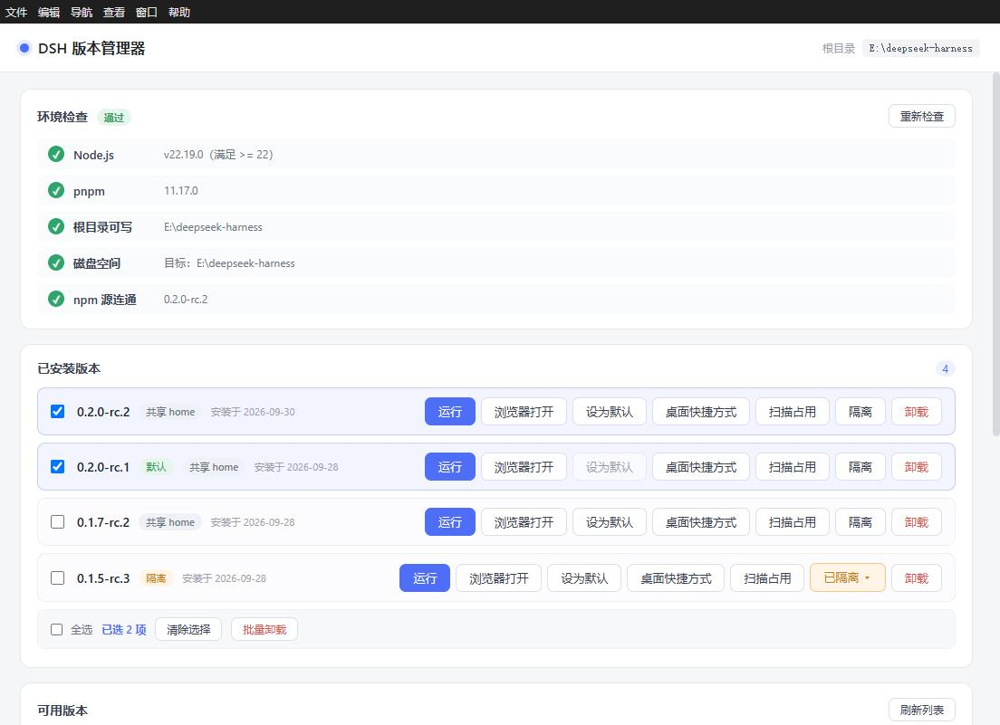
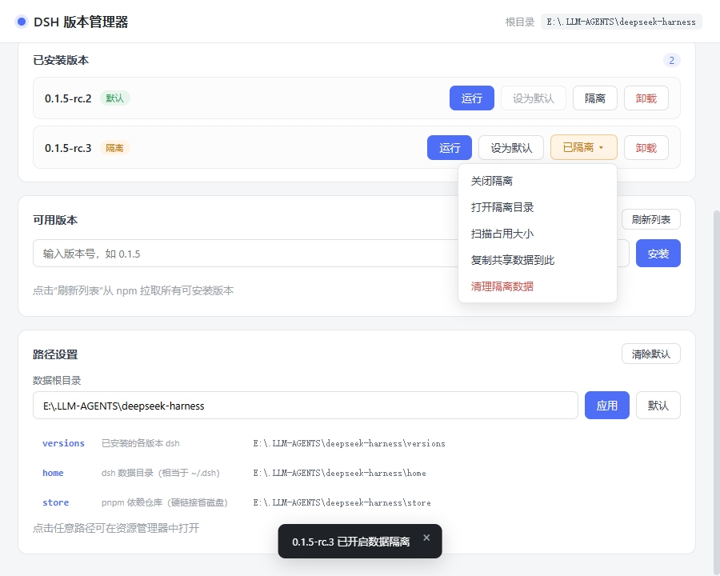

<h1 align="center">
  
</h1>

<p align="center"><strong>輕量、可攜的 DeepSeek Harness 版本管理器</strong><br>
同一份 home 可掛載多個版本，同一版本可開啟多個獨立執行個體。</p>

<p align="center"><a href="README.en.md">English</a> | <a href="README.md">简体中文</a> | <a href="README.ja.md">日本語</a> | <a href="README.ko.md">한국어</a> | <strong>繁體中文</strong></p>

<p align="center">
  <a href="https://github.com/K1-lihongrong/dsh-multiver/releases"></a>
  
  <a href="https://github.com/K1-lihongrong/dsh-multiver/releases"></a>
  <a href="https://github.com/K1-lihongrong/dsh-multiver/stargazers"></a>
  <a href="LICENSE"></a>
</p>

<p align="center">
  <a href="#下載">下載</a> ·
  <a href="#快速開始">快速開始</a> ·
  <a href="docs/使用手册.md">使用手冊</a> ·
  <a href="docs/插件兼容矩阵.md">外掛相容</a> ·
  <a href="docs/问题日志查看指南.md">問題排查</a>
</p>

dsh-multiver 是 DeepSeek Harness 的輕量、可攜版本管理器。它可安裝與切換版本、在內嵌視窗中執行，並管理可跨版本共用資料的獨立執行個體；同時提供適合腳本與自動化的無頭 CLI。

## 亮點

- 🪶 **輕量便攜**：Windows 約 10 MB 單 exe，無需安裝，放在普通可寫目錄雙擊即用。
- 💾 **多版本管理**：安裝、切換、預設版本與批次解除安裝；pnpm store 硬連結共享依賴，省磁碟。
- 🧬 **同版本多執行個體**：一份 home 可掛多個版本，同一版本可開多個獨立執行個體視窗，執行狀態跨版本可見。
- 🖥️ **內嵌執行**：應用程式內 WebView2 直接開啟 dsh，每個版本/執行個體使用獨立快取；也可一鍵交給系統瀏覽器。
- 🧩 **外掛管理**：檢視、安裝、解除安裝、更新社群外掛，支援執行個體 home、推薦頁、相容提示與更新檢查。
- ⌨️ **CLI 自動化**：24 個命令，涵蓋版本、執行個體、執行、匯入匯出與維護，支援 `--json` 和 `--dry-run`。

## 完整功能

- 🪶 **極致輕量**：Windows 約 10 MB 單 exe，無需安裝，雙擊即用
- 💾 **省磁碟**：使用 pnpm store 硬連結，多個版本共享依賴檔案
- 📖 **版本更新說明**：點按版本號即可就地查看該版本的更新說明（資料來自 dsh 上游 Releases），安裝前先了解改動內容
- 🩺 **安裝前自檢 + 引導**：自動檢查 Node / pnpm / 磁碟 / 源連線，缺失時提供下載連結與安裝步驟
- 📊 **細粒度進度**：即時顯示安裝階段與依賴進度百分比
- 🔁 **失敗換源重試**：安裝失敗按類別提示（網路 / 私有的套件 / 版本不完整），網路問題可一鍵換 npm 源重試
- 🚫 **失敗版本標記**：依賴已下架的版本自動標灰，避免反覆踩坑
- ☑️ **批次操作**：多選版本一鍵批次解除安裝（含防呆禁用）
- 🔒 **執行個體資料隔離**：每個版本可選擇共享 home 或掛載獨立執行個體，測試外掛不汙染主力環境
- 🧬 **同版本多執行個體**：一份資料可掛多個版本；同一版本可開多個獨立執行個體視窗，執行狀態跨版本可見
- 🔗 **可複用官方配置**：一鍵複用 dsh 官方 `~/.dsh`（會話/憑證/外掛立即可用），預設關閉、隨時可退
- 🔄 **自動更新**：啟動後檢查新版本；確認後可下載、SHA256 校驗並替換自身 exe 後重啟（GitHub 直連失敗時自動回退鏡像）
- 🧩 **推薦外掛頁**：內建一份社群外掛清單，分類篩選 + 星標置頂；清單從遠端拉取、帶 30 分鐘節流，斷網時回退編譯期內建副本
- 📦 **配置匯出/匯入**：一鍵匯出配置 + 版本清單為 JSON，換機遷移時可預覽差異後匯入
- ⚙️ **完全自訂**：資料根目錄、DSH_HOME、store 位置都可在介面配置
- 🖥️ **內嵌視窗執行**：點「執行」在應用程式內直接開啟 dsh Web 介面（每個版本獨立 WebView2 快取，互不汙染），也可一鍵在系統瀏覽器開啟
- 🚀 **桌面捷徑**：為任意版本在桌面產生 `DSH <版本號>.lnk`，雙擊直達對應版本
- 🧩 **dsh 外掛管理**（v0.3.0+）：直接在介面裡查看某版本已裝的外掛、安裝 / 解除安裝 / 檢查更新，以及從「推薦」頁一鍵安裝社群外掛（含分類篩選、星標置頂、描述隨介面語言切換）
- 🧹 **自動維護**：啟動時清理孤立 webview 快取，定期回收 pnpm store
- ⌨️ **無頭 CLI**：子命令風格（v0.3.0+），涵蓋查詢（`list` / `info` / `versions` / `env` / `which`）、
  操作（`install` / `uninstall` / `set-default` / `isolate` / `clean`）、
  維運（`doctor` / `maintenance` / `export` / `import` / `run` / `set-root`）與執行個體（`instance`）等 24 個命令，
  支援 `--json`（機讀）、`--dry-run`（預覽）；不啟動介面即可完成全部操作，方便腳本化

## 截圖

主介面 —— 環境自檢、已安裝版本（含批次操作）、可用版本與安裝：



資料隔離（獨立資料目錄）與路徑設定：



## 下載

從 [Releases](https://github.com/K1-lihongrong/dsh-multiver/releases) 下載：

| 平台 | 檔案 | 說明 |
| :--- | :--- | :--- |
| **Windows** | `dsh-multiver.exe` | 便攜版，放到**普通可寫目錄**雙擊執行（需 WebView2，Win11 及 Win10 1803+ 自帶）。不要放 DSH workspace、`C:\Program Files` 或只讀目錄 |

> Linux 當前**不打包、不發布**（AppImage/deb 均不提供）；僅保留 CI 編譯與單測。未來條件合適再恢復。

📖 **完整操作說明見 [使用手冊](docs/使用手册.md)** —— 含環境準備、各項功能、常見問題排查。

🔍 **遇到問題？見 [問題日誌查看指南](docs/问题日志查看指南.md)** —— 日誌在哪、各記錄什麼、按現象怎麼查。

🐧 **Linux**：當前不打包、不發布；僅保留原始碼編譯與 CI 測試。執行個體功能未在 Linux 真桌面驗收。

## 快速開始

1. 啟動程序（Windows 雙擊 `dsh-multiver.exe`）
2. 介面頂部會**自動檢查環境**（Node / pnpm / 磁碟 / 源）；缺失項會給出下載連結與安裝步驟
3. 點「刷新列表」從 npm 拉取可安裝的版本
4. 點版本號安裝，觀察階段式進度；失敗時按類別提示，網路問題可換源重試
5. 點「執行」即可在應用**內嵌視窗**中開啟該版本的 `dsh web`，或點「瀏覽器開啟」在系統瀏覽器中開啟
6. 點某版本的「**外掛**」按鈕，可查看 / 安裝 / 解除安裝該版本的 dsh 外掛，或從「推薦」頁一鍵安裝社群外掛

資料預設存放在 **exe 所在目錄**下（`versions/`、`home/`、`store/`），因此該目錄必須可寫；也可在介面「路徑設定」裡改到任意位置。

### 執行方式

安裝完成後，每個版本都有三種啟動途徑：

- **執行（內嵌視窗）**：在應用內直接開啟 dsh Web 介面（預設 1100×760）。每個版本使用獨立的 WebView2 資料目錄（`<資料根>/webview/<版本>`），長期累積的 cookie/快取互不污染，也不會因請求頭膨脹觸發 dsh 的 `431 / Failed to load plugins`。關閉視窗會自動終止該版本進程；同一版本再次執行會先結束舊執行個體再重新開啟。
- **瀏覽器開啟**：用一個新主控台視窗啟動 dsh，並讓 dsh 自動開啟系統預設瀏覽器（端口固定在 `3080`）。若端口被佔用，會彈出對話框讓你選擇「換隨機端口」或取消；若該版本已在內嵌視窗執行，也會先彈窗確認是否再開一個。
- **桌面捷徑**：點按鈕為當前版本在桌面產生 `DSH <版本號>.lnk`，雙擊即可直達該版本——適合常玩的版本直接放桌面。

### 安裝失敗處理

安裝失敗時按錯誤類別給出針對性提示：

- **網路問題**：彈出換源對話框，可從官方 / 阿里雲 npmmirror / 騰訊雲 / 華為雲中選擇，或填自訂源，一鍵重試
- **私有包下架 / 版本不完整**：提示換用更新的版本，並給出進階方案
- 失敗的版本會在列表中标灰劃線；使用者可手動「清除標記」後重試

### 批次操作

已安裝列表支援多選：

- 每個版本左側有複選框，勾選後底部出現批次操作欄
- 「全選」一鍵選中本組；「清除選擇」取消
- 「批次解除安裝」一次確認後逐個解除安裝，即時顯示進度，失敗項彙總提示
- 批次進行中，選中項的按鈕會被禁用（防呆），避免重複操作

### 終端短命令

在某個版本上點「設為預設」後，會在 `%APPDATA%\npm\` 產生 `dsh.cmd` 轉發腳本（該目錄已在系統 PATH）。之後在**任意終端**直接敲 `dsh` 即可執行已設為預設的版本。

特別是，dsh 的 Web 介面也可以用終端短命令啟動 —— 執行：

```bash
dsh web
```

這條命令會把請求轉發到已「設為預設」的版本並啟動它的 Web 介面，效果與介面上的「執行」按鈕一致。其他 dsh 子命令（如 `dsh doctor`、`dsh --version`）同樣會命中預設版本。

### 資料隔離

版本行右側的「執行個體」下拉用於選擇/管理隔離執行個體。執行個體是全域實體，一份 `homes/<id>` 可掛到多個版本，同一版本也可建多個執行個體；會話、外掛、設定與共用環境互不干擾，適合測試不相容外掛或對比版本行為。

執行個體選單還提供：

- 執行 / 聚焦、開啟執行個體目錄
- 改名、刪除（刪除走回收站）
- 新建執行個體、切換該版本的主按鈕目標
- 全域面板「執行個體管理」集中查看孤兒、掛載/解除、掃描佔用

執行個體的內部 id 只用於路徑、CLI/JSON 和日誌，介面只顯示執行個體名稱。

### 查看版本更新說明

點「可用版本」的版本號 chip、或「已安裝版本」的版本號，即可就地展開該版本的更新說明
（資料來自 dsh 上游 GitHub Releases，Markdown 已由 GitHub 渲染為 HTML，經白名單消毒後展示）。
標題欄整行可點收起，附「在瀏覽器開啟原文」按鈕。裝之前就能了解每個版本改了什麼。
說明按版本快取：同一個版本看過一次後，再點（無論從哪條路徑）都會立即顯示。

### 路徑設定

「路徑設定」面板可直接開啟各資料目錄（點擊任意路徑行即在檔案管理器開啟）。
預設展示 5 個核心目錄（`versions` / `home` / `store` / `cache` / `state`），
點「**展開全部目錄**」可查看 `logs` / `webview` / `trash` / `assets` 等其餘目錄。
資料根目錄可在此修改（自動去除首尾空格）。

### 自動維護

程序啟動時會在後台（不阻擋介面）：

- 清理孤立的 webview 資料目錄（對應版本已解除安裝的）
- 距上次 7 天以上時，低優先級執行 `pnpm store prune` 回收未引用的包

日誌寫在 `<資料根>/logs/maintenance.log`。

### 命令列模式（CLI）

v0.3.0 起為**子命令風格** —— 帶任一 CLI 子命令時不啟動圖形介面，執行完按退出碼退出（成功 `0` / 失敗 `1`）：

```bash
dsh-multiver.exe list                                    # 列出已安裝版本
dsh-multiver.exe install <版本> [--registry <url>]       # 無頭安裝
dsh-multiver.exe uninstall <版本>                        # 無頭解除安裝
dsh-multiver.exe set-default <版本>                      # 設預設版本
dsh-multiver.exe maintenance [--cleanup|--prune]         # 無頭維護
dsh-multiver.exe instance create --name 對比用 --attach <版本>   # 建立執行個體
dsh-multiver.exe instance list --json                    # 執行個體列表（含孤兒；預設不算佔用）
dsh-multiver.exe instance list --sizes --json            # 同時掃描各執行個體佔用
dsh-multiver.exe run <版本> --instance <id>              # 指定執行個體啟動
dsh-multiver.exe install <版本> --dry-run                # 只預覽，不執行
dsh-multiver.exe help                                    # 幫助
```

- `list` 一行一個版本號（預設版本以 `* ` 前綴標記），輸出可直接管道
- 安裝進度走 stderr，stdout 保持乾淨
- 破壞性命令**無互動確認**，請確保參數正確
- **從 v0.2.x 升級**：舊 `--flag` 語法已移除；當前命令見上方命令表或執行 `dsh-multiver.exe help`

詳見 [使用手冊 · 命令列模式](docs/使用手册.md#八命令行模式cli)。

## 與其他 dsh 工具的区别

dsh 生態裡已有幾個相關工具，`dsh-multiver` 的定位與它們不同：

| 工具 | 定位 | 數據隔離 | 省磁碟 | 環境自檢 | 形態 |
| :--- | :--- | :--- | :--- | :--- | :--- |
| **dsh-multiver** | 版本管理 + 外掛管理 + 省磁碟 + 自檢 | ✅ 可選 | ✅ pnpm store 硬連結 | ✅ 5 項（含磁碟/源）+ 引導 | 約 10 MB 單 exe |
| [dshvm](https://github.com/dsh-so/dshvm) | 版本管理 + 數據隔離 | ✅（核心特性） | 未強調 | ✅ 引導頁 | Tauri + CLI |
| [dsh-launcher](https://github.com/NevermindZZT/dsh-launcher) | 一鍵啟動 | ❌ | N/A | ✅ doctor | 2 MB 單檔案 |

**簡而言之**：

- 需要**最徹底的数据隔離** → 推薦 dshvm
- 只需要**一鍵啟動** → 推薦 dsh-launcher
- 想要**省磁碟 + 安裝前自檢 + 便攜單檔案** → 用 dsh-multiver

## 核心機制

### 為什麼使用 `node-linker=hoisted`

dsh 執行個體按 Node 常規方式解析依賴。pnpm 預設的**符號連結**結構會導致：

```
Error: Cannot find package '...\node_modules\.pnpm\node_modules\@deepseek-ai\cordis\index.js'
```

因此每個版本目錄會寫入 `.npmrc`：

```
node-linker=hoisted
```

生成扁平化的真實 `node_modules`（兼容 dsh），同時底層仍用 store 硬連結保持去重。

### 為什麼要允許構建腳本

pnpm 10+ 預設**不執行**依賴的構建腳本，會導致 `ERR_PNPM_IGNORED_BUILDS`（node-pty、koffi 等原生模組缺失）。安裝時使用：

```
--config.dangerouslyAllowAllBuilds=true
```

## 開發

> 📋 **後續版本路線圖**見 [`docs/后续版本路线图.md`](docs/后续版本路线图.md) —— v0.3.7 → v0.4.0 的完整任務清單、驗收標準與工程守則。

```bash
# 安裝依賴
pnpm install

# 開發模式（熱重載）
pnpm tauri dev

# Windows：打包便攜版單 exe
pnpm tauri build --no-bundle

# Linux：僅開發除錯，不打包發布
pnpm tauri dev

# 重新生成圖標（修改 icon-source.svg 後）
node gen-icons.mjs
```

產物位置：
- Windows：`src-tauri/target/release/dsh-multiver.exe`
- Linux：不產出發布物（僅 CI 編譯/測試）

### 環境要求

**執行（使用現成產物）**：
- Windows：WebView2（Win11 / Win10 1803+ 自帶）
- Linux：無現成產物；僅原始碼開發/CI 使用 WebKitGTK 4.1 等依賴

**開發 / 從原始碼構建**：
- Node.js `^22.19.0` 或 `>=24.2`
- pnpm 10+（建議 11.x 及以上；便攜版內建 12.11.2）
- Rust 工具鏈
- Windows：MSVC C++ 構建工具 + Windows SDK
- Linux：`libwebkit2gtk-4.1-dev`、`libgtk-3-dev`、`libayatana-appindicator3-dev`、`librsvg2-dev`、`libdbus-1-dev`、`libxdo-dev`、`libssl-dev`、`build-essential`、`pkg-config` 等

## 技術棧

- **外殼**：Tauri 2（Rust）
- **前端**：Vite 8 + Vue 3
- **打包**：便攜版單 exe

## 已知限制

- 便攜版單 exe 不含 WebView2；Win11 / Win10 1803+ 自帶 UCRT。當前構建**不依賴 VC++ Redistributable**（已用導入表驗證，僅依賴系統 UCRT）；極老系統仍可能需要手動安裝 WebView2
- 終端 `dsh` 轉發腳本寫入 `%APPDATA%\npm\`，該目錄需在 PATH 中
- 便攜執行時（Node/pnpm）自動下載**僅 Windows**；Linux 請用系統包管理器安裝 Node.js 與 pnpm
- pnpm 需 **10+**：llowBuilds 構建腳本審批依賴其語法；低於 10 環境檢查會提示升級
- 安裝 GitHub / Git 來源外掛需要系統 git（環境檢查會提示，非致命）
- Windows 系統代理會自動用於下載/更新（僅在未設定 HTTP(S)_PROXY 環境變量時）
- Windows 圖標有快取，更新 exe 後若圖標未變，需清快取（`ie4uinit.exe -show` 或重啟資源管理器）
- 部分早期 dsh 版本依賴已下架的私有包，任何源都無法安裝（介面會標灰並提示換版本）
- 使用 npm 官方源時，國內下載可能較慢；淘寶鏡像同步滯後，可能出現子包缺失（安裝失敗可換官方源重試）
- **單執行個體**：重複啟動會聚焦已執行的管理器視窗；版本快捷方式在管理器執行時會在其中打開對應版本的內嵌視窗；CLI 不受影響
- **macOS 暫未支援**
- **Linux 當前不打包、不發布**（不提供 AppImage / deb）；僅保留 CI 編譯與單測，真桌面多執行個體驗收暫緩（GAP-020）

## 徵求協助（非 Windows 平台）

本專案主要在 Windows 上開發；Linux 目前**不打包、不發布**（僅保留 CI 編譯/測試），真實 Linux 桌面與 macOS 尚未驗證。
若你有對應環境，歡迎幫忙實測或適配，詳見 **[徵求協助](docs/征求协助.md)**。

## 致謝

- [DeepSeek Harness](https://github.com/deepseek-ai/deepseek-harness) — 本專案管理的物件
- [Tauri](https://tauri.app/) — 應用程式外殼
- [Vue](https://vuejs.org/) — 前端框架

## 授權條款

[MIT](LICENSE)
