# DSH Version Manager — User Manual

> For **dsh-multiver v0.4.0+** (Windows portable edition; Linux not packaged for release yet)
> Project homepage: https://github.com/K1-lihongrong/dsh-multiver

<p align="center"><a href="使用手册.md">简体中文</a> | <a href="使用手册.zh-TW.md">繁體中文</a> | <strong>English</strong> | <a href="使用手册.ja.md">日本語</a> | <a href="使用手册.ko.md">한국어</a></p>

---


## Table of Contents

- [1. What is this](#s1)
- [2. Installation and Startup](#s2)
- [3. Quick Start](#s3)
- [4. Interface Features](#s4)
- [5. Three Ways to Run dsh](#s5)
- [6. Terminal Short Command dsh](#s6)
- [7. Data Isolation and Instances](#s7)
- [8. Command Line Mode (CLI)](#s8)
- [8.1. Appearance and Language](#s81)
- [8.2. Managing Versions in dsh](#s82)
- [9. Data Storage Structure](#s9)
- [10. Automatic Maintenance](#s10)
- [11. Frequently Asked Questions](#s11)
- [12. Uninstallation](#s12)
- [13. Linux Support (Not Yet Released)](#s13)

---

<a id="s1"></a>

## I. What is this

**DSH Version Manager** (dsh-multiver) is a lightweight Windows desktop utility (Linux source is compilable, but not packaged for release currently) used to manage multiple versions of **DeepSeek Harness (dsh)**.

It solves these problems:

- Want to install multiple dsh versions simultaneously; manually running `pnpm add` is too tedious
- Installing multiple copies of dependencies consumes too much disk space
- Switching versions and configuring `DSH_HOME` is easy to get mixed up
- Want to give test versions a separate data directory without polluting the main environment
- Want to run multiple independent instances of the same version to compare different plugins/configurations

**Features**: Single-file exe, no installation required, double-click to use.

**From v0.4.0**: Instances are global entities—a single `homes/<id>` can be mounted to multiple versions, and multiple instances of the same version can also be mounted and opened in separate windows simultaneously; runtime status is visible across versions.

---

<a id="s2"></a>

## II. Installation and Startup

### Environment Requirements

| Item | Requirement | Description |
| :--- | :--- | :--- |
| Operating System | Windows 10 1803+ / Windows 11 (x64) | Linux is compiled only in CI; no release artifacts |
| WebView2 (Windows only) | Built-in | Included in Win11 and Win10 1803+; older systems require [manual installation](https://developer.microsoft.com/microsoft-edge/webview2/) |
| VC++ Runtime (Windows only) | No additional installation needed | Current build does not depend on VC++ Redistributable (UCRT is included in Win10+; verified via import table) |
| Node.js | `^22.19.0` or `>=24.2` | Used to install and run dsh |
| git (optional) | Any recent version | Required only when installing plugins from GitHub / Git sources |
| pnpm | 10+ (recommended 11+; portable version includes 12.11.2) | Used to pull dsh dependencies; versions below 10 cannot approve build scripts |

> Linux is currently **not packaged or released** (no AppImage/deb); only CI compilation and source builds are retained; system dependencies are listed in [Section 13](#s13).

> Node and pnpm are **not** prerequisites for running this tool, but are prerequisites for **installing the dsh version**. After the tool starts, it automatically checks for them and provides download links and installation steps if they are missing.

### Download and Startup

1. Download the latest `dsh-multiver.exe` from [Releases](https://github.com/K1-lihongrong/dsh-multiver/releases)
2. Place it in a **regular writable directory** (it is recommended to create a separate directory, e.g., `D:\dsh-multiver\`); do not place it in the DSH workspace, `C:\Program Files`, or a read-only directory
3. Double-click to run

> 💡 **Why it is recommended to create a separate directory**: The default data root directory is the directory where the exe is located. Placing it on the desktop will generate a bunch of folders like `versions/`, `store/`, etc., on the desktop. This directory must also be writable; the DSH workspace has sandbox ACLs, and WebView2 may fail to initialize. You can also change it to another location later in the interface.

---

<a id="s3"></a>

## III. Quick Start

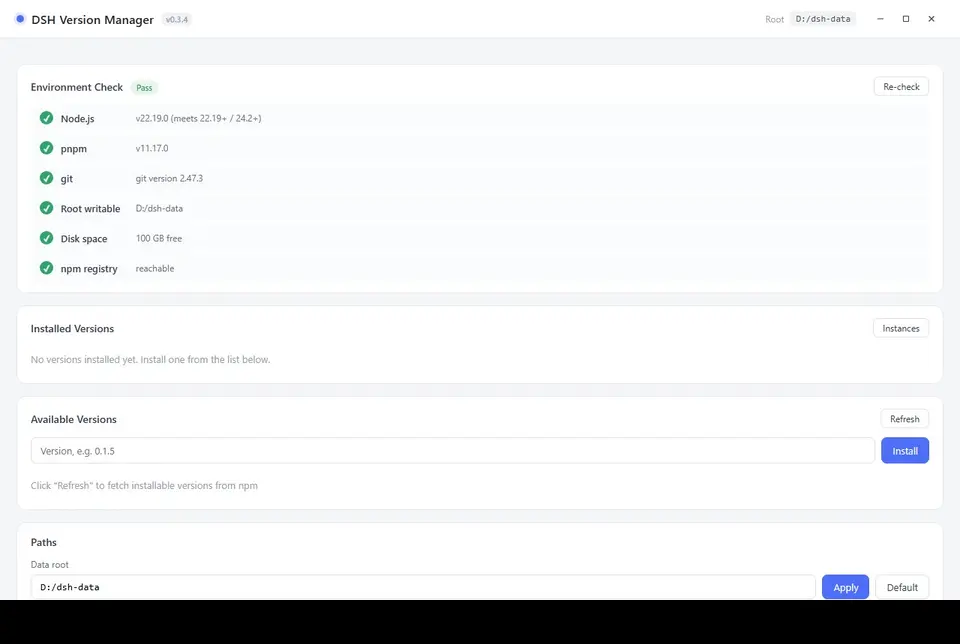

On first launch, follow these four steps:

1. **Check Environment** — The interface automatically checks for Node / pnpm / disk space / npm registry at the top. Missing items will provide download links and installation instructions. **Install critical items (Node, pnpm) first**.
2. **Click «Refresh List»** — Pull all installable dsh versions from npm.
3. **Install a Version** — Click the version number in the available versions list; it will **populate the input box**, then click «Install». Watch the progress bar complete.
4. **Click «Run»** — Open the dsh Web interface for that version in the embedded application window. The main button runs based on the **current target**; if multiple instances are running for that version, click the small triangle on the right to select an instance first (see [Section VII](#s7)).

To make it the default `dsh` command in the terminal? See [Section VI](#s6).

---

<a id="s4"></a>

## IV. Interface Features

### Environment Self-Check

Windows startup automatically checks 6 items:

| Item | Fatal | Description |
| :--- | :--- | :--- |
| Node version | ✅ Fatal | Requires `^22.19.0` or `>=24.2` |
| pnpm available | ✅ Fatal | Requires pnpm 10+ (upgrade prompt if below 10) |
| Data root writable | ✅ Fatal | |
| git available | ⚠️ Non-fatal | Required when installing GitHub/Git source plugins |
| Disk space | ⚠️ Non-fatal | |
| npm registry connectivity | ⚠️ Non-fatal | 8s timeout HTTP ping; offline status explicitly fails (no false positives for reachable) |

Missing items provide a **one-click download link** and installation steps:

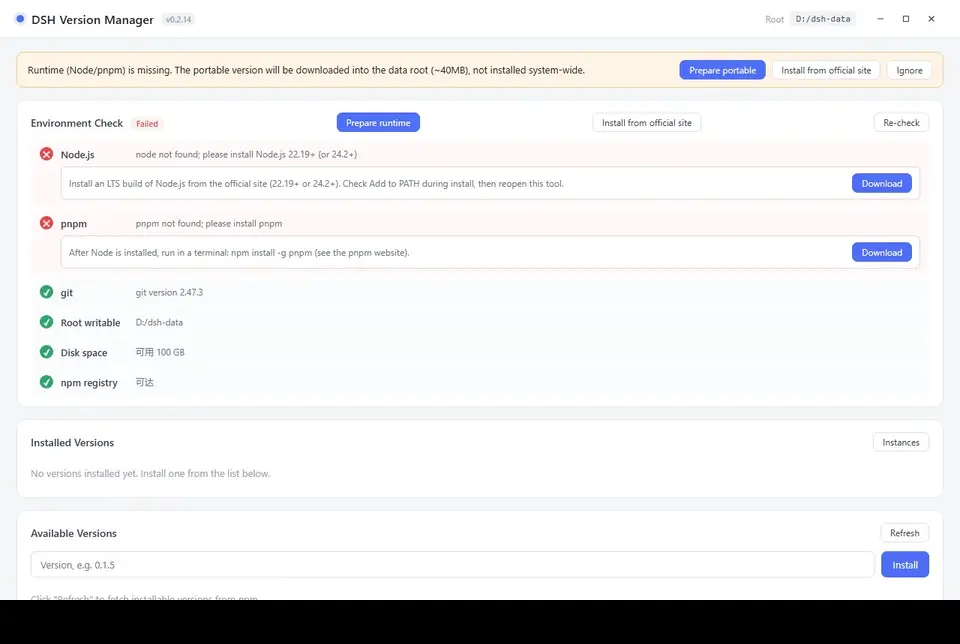

### Window Title Bar

The main window uses a **custom-drawn top bar**, not displaying the system native title bar, to avoid double title bars.

- **Drag window**: Hold and drag on the blank area of the top bar.
- **Double-click top bar**: Maximize / Restore.
- **Three buttons on the right**: Minimize / Maximize (Restore) / Close. Button text switches with interface language.
- **Startup loading page**: Also draggable, with an independent close button in the top right—no need to wait for it to finish if startup hangs.

> Taskbar icons and window grouping are unaffected: Manager windows and dsh embedded windows still belong to separate groups.

### Single Instance Explanation

This tool **allows only one manager process to run** (here, "instance" refers to the manager process, not the data instances in Section VII). Double-clicking the icon again immediately exits the new process, and the existing manager window restores from minimized state and gains focus.

- **Compare multiple versions/instances**: Click "Run" separately within the same manager for each version; each version and instance can have its own embedded window without interference; each instance allows at most one window.
- **Version desktop shortcuts** (`DSH <version>.lnk`) remain valid while the manager is running: they do not open a new manager but instead open the embedded window for that version directly in the running manager.
- **Command line unaffected**: CLI commands like `dsh-multiver list --json` execute immediately and return normally while the manager is running, without being handed off to the GUI.
- **Copies in different directories**: The single-instance lock applies globally by application identifier; copies in two different directories under the same user cannot run simultaneously. The later-started copy will **pop up a dialog explaining** (including paths of both copies) and focus the running window—it will not silently exit nor transfer the shortcut's intent to another copy.

### Installed Versions

Each version displays: version number, installation date, default status, **shared home / default instance**, and size occupied.

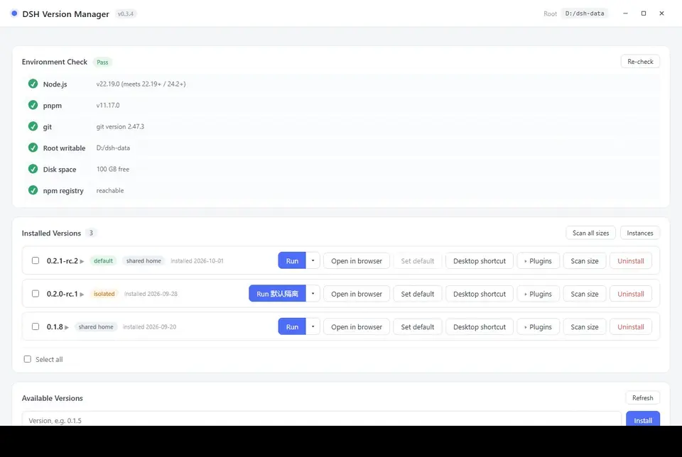

Available actions:

- **Run (main button split)** —— Opens embedded window on the left based on current target; small triangle on the right opens the **instance overlay** (see Section VII). When target is an instance, button text becomes "Run <instance name>" or "Focus <instance name>".
- **Open in browser** —— Opens a new console window to run dsh, with system browser opened by dsh (closing window stops it); uses current main button target.
- **Set as default** —— Generates terminal `dsh` short command
- **Instance dropdown** —— Shared home / instance switching, run/focus, open directory, rename, delete, create (see Section VII)
- **Shortcut** —— Generates `DSH <version>.lnk` on desktop
- **Plugins** —— Manages dsh plugins for this version (see "dsh Plugins" below); when panel is expanded, this button becomes **highlighted** (light blue background, blue border, blue text, left triangle arrow rotates 90°), click again to collapse
- **Scan usage** —— Displays `Usage 1.38 GB (Shared 1.10 GB / Exclusive 288 MB)`
- **Uninstall**
- **Instance management** —— Global button in top right of version list; orphan instance count shown in badge (see Section VII)

> **Button feedback on interface** (v0.3.4+): Buttons become light background + main color outline on hover; darken background and slightly shrink on press; 2px main color focus ring shown when switching focus with Tab key. Dangerous operation buttons (e.g., uninstall) become **solid red background with white text** on hover, distinguished from normal buttons. All button text colors remain unchanged on hover.

> **What "Shared / Exclusive" in usage means**: Multiple versions share the same dependency files via pnpm store hard links. "Shared" is the part shared with other versions, "Exclusive" is the part unique to this version. Therefore, **space released by uninstalling a version is often much less than its displayed total usage**.

### dsh Plugins (v0.3.0+)

Click a version's "**Plugins**" button to expand the dsh plugin panel for that version:

- **Installed** tab: Lists all **profiles** (usually only `web`) and their plugins (package name + version; `bundle` marks built-in layers of the profile).

  

- **Recommended** tab: A plugin catalog filtered by category; click "Install" to install directly to current profile.

  

**Operations on Installed tab**:

- **Install**: Click "＋ Add Plugin" → enter npm package name, GitHub address, or local directory → select install source → inspect → confirm → installation complete. Dialog displays package name/version/description to be installed, install source, and trust prompt; handle failures by category if installation fails.

  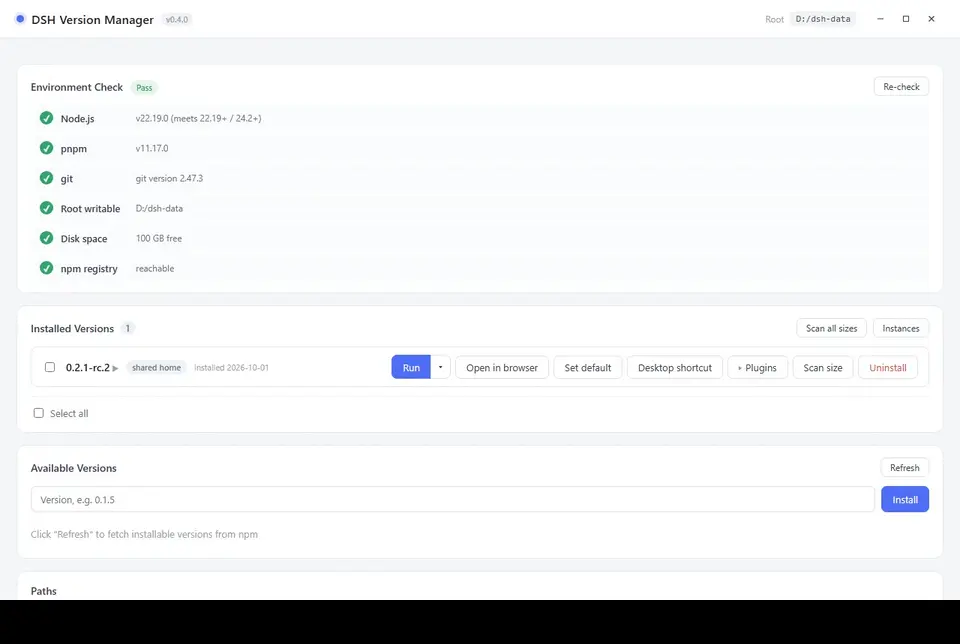

- **Uninstall**: Click "Uninstall" on the right of the plugin. Large plugins may take tens of seconds; a spinning icon and elapsed seconds appear on the item.
- **Check for updates**: Click "Check for updates" on the toolbar; new versions show a red badge and "Update" button on items; or click "Update All" to update individually (failures automatically rollback that item).
- **Shared home health check**: Click the 🩺 button on the toolbar to read-only scan links to shared profiles, reporting old version remnants, dangling links, and duplicate sources, without modifying files.
- **Open directory**: 📂 button in top right of panel to open the profile directory in File Explorer.

Each plugin occupies two rows: first row is icon and package name (long names wrap fully), second row is version, source tags, and operation buttons.

**Usage of Recommended tab**:

- Top tab bar filters by category (All / Tool Enhancements / Content Aggregation ...); scroll buttons `‹ ›` appear on the right when many categories exist.
- First row of card is package name and "Install" button; second row is GitHub/npmjs link and one-sentence description.
- Descriptions switch with interface language (Simplified Chinese / Traditional Chinese / English / Japanese / Korean); items without translation display original Chinese text.
- When descriptions are too long, they fade out on the right; hover description or click "View Full Description" to see full text.
- Category tab bar can be dragged left/right by holding left mouse button.
- Items with ⭐ are recommended or works by the same author, placed at the top of the list.
- List automatically checks for updates when opened (no repeated check within 30 minutes); click **↻** on the right of category bar to force check.
- If check fails, top prompts "Recommended list may not be latest"; list remains usable (uses last fetched content or built-in copy shipped with program).
- Catalog new/old compared by `updatedAt` timestamp: local newer than remote does not overwrite (avoids old cache obscuring new built-in copies).
- If direct GitHub fetch fails when pulling catalog, fallback in order to `gh-proxy.com` → `cdn.jsdelivr.net` (v0.3.2+).

**Principle**: dsh plugins are npm packages installed in `<DSH_HOME>/profiles/<profile>/`. This tool executes via dsh's built-in `dsh plugin --profile <p> add/remove <package>` (equivalent to manually typing dsh commands).

> **Prerequisite**: This version must have been **started at least once in dsh** (to generate the profile directory). If prompted "No profile directory", open it once in dsh first.

### Batch Operations

Installed list supports multi-selection:

- Each version has a checkbox on the left; checking them reveals a batch operation bar at the bottom
- "Select All" selects this group, "Clear Selection" deselects
- "Batch Uninstall" executes sequentially after one confirmation, displays progress in real-time, and summarizes failures
- During batch operations, **buttons of selected items are disabled** (foolproof), unaffected items remain operational

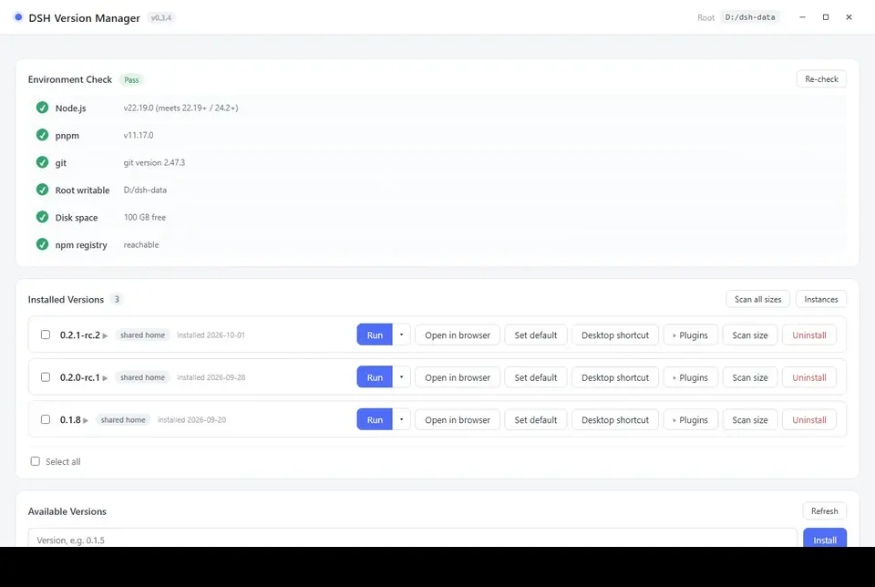

### Available Versions List

- Supports **searching** version numbers
- Supports **sorting** (newest first / oldest first)
- Click version number to **fill input box**, **simultaneously expand update notes for that version directly below** (click again to collapse)
- Update notes data comes from dsh upstream GitHub Releases, sanitized for display, with "Open Original in Browser" button;
  after viewing once for a version, clicking again (from either "Available Versions" or "Installed Versions") immediately shows notes
- **Grayed-out and strikethrough versions** are "Known Installation Failures" (e.g., dependencies removed from private registry); can click "Clear Mark" to retry

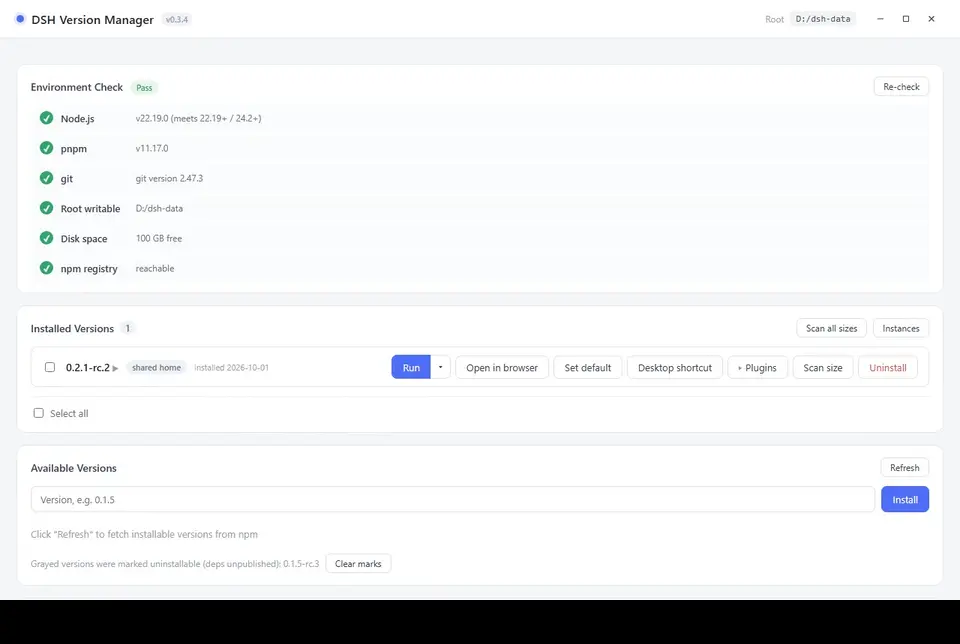

Installation progress bar:

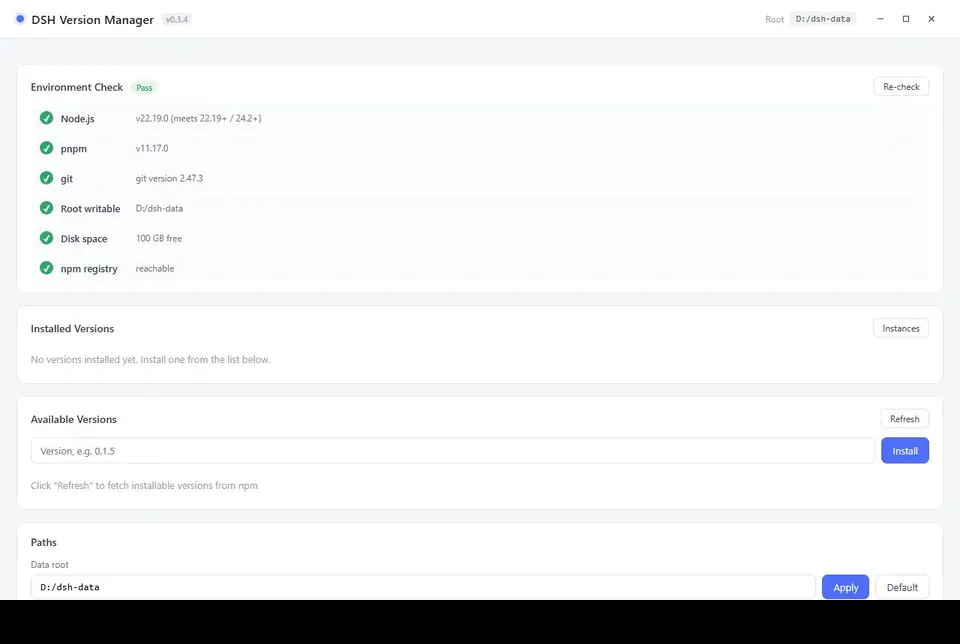

### Installation Failure Handling

Installation failures provide targeted prompts by error category:

| Category | Prompt |
| :--- | :--- |
| **Network issues** | Pop-up switch source dialog (Official / Aliyun / Tencent Cloud / Huawei Cloud / Custom), one-click retry |
| **Private package removed** | Version official release incomplete; cannot install from any source; version marked gray. Can try switching sources and retrying |
| **Incomplete version / Mirror not synced** | May be npmmirror hasn't synced a sub-package; dialog allows direct retry with official source; if still fails, try another version |

Switch source dialog for network issues:


Prompt for private package removal:

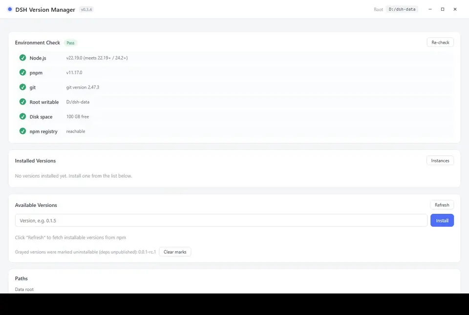

### Path Settings

Can modify **data root directory** (default same directory as exe; input automatically removes leading/trailing spaces). Changes sync update paths in terminal `dsh` script.

Below lists data directories; **click any row to open that directory in File Explorer**. Default shows 5 core directories
(`versions` / `home` / `store` / `cache` / `state`); click "**Expand All Directories**" to view
`logs` / `homes` / `webview` / `trash` / `assets` and others.

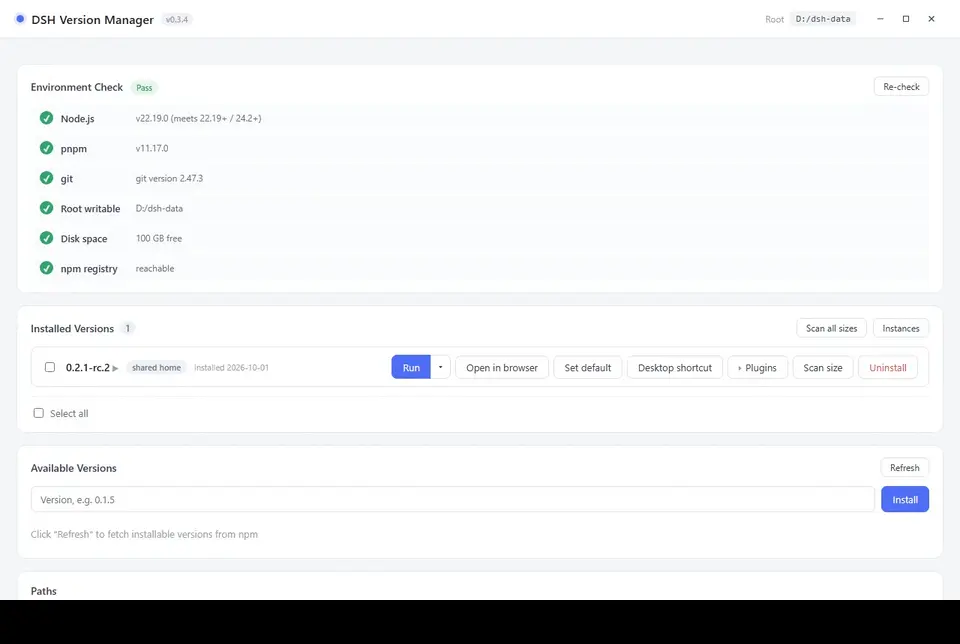

Panel also has "**Export Configuration**" and "**Import Configuration**" buttons:

- **Export Configuration**: Saves current configuration + installed version list as a JSON file (for machine migration, excludes dependencies/credentials)
- **Import Configuration**: Select a backup JSON → preview fields to be modified → apply after confirmation (restores configuration only; versions need separate installation)

Bottom also has **Maintenance Area** (see Section X).

---

<a id="s5"></a>

## V. Three Ways to Run dsh

After installation, each version has three startup methods:

### 1. Run (Embedded Window) — Recommended

Open the dsh Web interface directly within the application (default 1100×760).

- Each **version + target** uses an independent WebView2 data directory: shared window at `<data root>/webview/<version>/_shared`, instance window at `<data root>/webview/<version>/<instance id>`, with cookies/cache not polluting each other
- Closing a window only terminates the dsh process for that target; other instance windows of the same version are unaffected
- Running the same **target** again will **focus the existing window**; different instances of the same version can run simultaneously
- Window title is `DSH <version>`; instance window is `DSH <version> · <instance name>`
- A **small dot** is in the top-left corner of the window: hovering shows the version number, clicking opens a panel:
  - **Version number**: current running dsh version
  - **Full URL**: click to select and copy, paste into a browser to open the same instance
  - **Restart**: terminate the dsh process behind the embedded window of this version, relaunch with the same version, and navigate the window to the new address (session data retained, page state lost). Use this to take effect after installing/uninstalling plugins or changing dsh versions
  - **Collapse** (× in top-right of panel): only collapses the panel, does not close dsh. To stop dsh, close the window directly

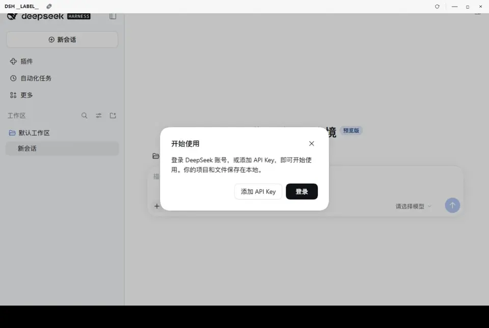

> The port is automatically assigned by the system (`--port 0`), avoiding conflicts.

### 2. Open in Browser

Start dsh with a **new console window**, and dsh opens the system default browser itself. Behavior is consistent with «opening a terminal and typing `dsh web`».

- **Use current main button target**: shared home or an instance's `DSH_HOME`; to switch instances, first switch the target in the instance floating layer
- **Keep console window**: dsh output (including full URL and token) is displayed in the window, which can be copied manually
- **Closing the console window stops the service**
- Linux: the manager will look for a system terminal emulator (`x-terminal-emulator` / `xterm` / `gnome-terminal` / `konsole` / `xfce4-terminal`, etc.) to host the window; if none are installed, it will explicitly prompt to install and retry
- Port is **fixed at 3080**
- **If 3080 is occupied**: a dialog pops up «Port 3080 is in use», with options:
  - «Use random port» — open using a free port (address is as shown in the console window)
  - «Cancel» — abort this operation
- If this version is already running in an embedded window, a confirmation dialog will first pop up asking whether to open another instance

> Suitable for scenarios where you want dsh to run in a real browser (e.g., using browser plugins), and convenient for observing dsh's real-time output.

### 3. Desktop Shortcut

Click «Shortcut» to generate `DSH <version number>.lnk` on the desktop for the current version.

- Double-click = **Streamlined startup**: does not show the manager main interface, directly opens the embedded window of this version
- When all windows are closed, the program exits automatically
- Suitable for pinning frequently used versions to the desktop / taskbar

---

<a id="s6"></a>

## VI. Terminal Short Command dsh

On a certain version, clicking **「Set as Default」** will generate a `dsh.cmd` forwarding script in `%APPDATA%\npm\` (this directory is usually already in the system PATH).

Afterwards, you can directly type in **any terminal**:

```bash
dsh web          # Launch the Web interface of the default version
dsh doctor       # Other subcommands also hit the default version
dsh --version
```

### How It Works

The script **hardcodes** the version number, root directory, and `DSH_HOME` (calculated when the program is generated, without parsing JSON). `DSH_HOME` points to the **current main button target** of that version: shared home, official `~/.dsh`, or an instance's `homes/<id>`. The content is roughly:

```bat
set "VER=0.2.0-rc.1"
set "ROOT=D:\dsh-multiver"
set "DSH_HOME_CANDIDATE=D:\dsh-multiver\home"
...
call "%ROOT%\versions\%VER%
ode_modules\.bin\dsh.cmd" %*
:: Shared home example; if the main button points to an instance, this would be D:\dsh-multiver\homes\i1
:: The above are example paths; actually generated by dsh-multiver when you click "Set as Default" according to your data root directory
```

> The script includes a safety mechanism: if the `DSH_HOME` directory does not exist, the variable is not set, and it falls back to dsh's default location (`~/.dsh`).

When **changing the default version, changing the root directory, changing the main button target, or uninstalling the default version**, this script is automatically regenerated. If there is no default version, it will be deleted. To temporarily specify a certain instance, use `dsh-multiver run <version> --instance <id>`, without changing the forwarding script.

### Coexistence with Other Ways of Installing dsh

dsh has multiple official distribution forms, and their relationship with this manager differs:

| Installation Method | Conflict Status | Description |
| :--- | :--- | :--- |
| `npm i -g @deepseek-ai/dsh` | **Will conflict, handled** | Both write a named `dsh` to `%APPDATA%\npm\` (Unix: `~/.local/bin`). When setting as default, it detects: if the command is not generated by this manager, it prompts for confirmation instead of silently overwriting; when uninstalling, it only deletes the one it generated, leaving the official one untouched. |
| `pnpm add -g @deepseek-ai/dsh` | **May conflict, not detected** | pnpm's global bin (e.g., `%LOCALAPPDATA%\pnpm`) is not within the detection scope of this manager. If this directory is at the front of PATH, typing `dsh` will use the pnpm version, bypassing this manager's forwarding script. |
| Python wheel | **May conflict, not detected** | Same as above. `dsh` is installed in Python's `Scripts/` or `bin/`, and who takes effect is determined by PATH order. |
| DeepSeek Harness Desktop | No conflict | The Electron app comes with its own runtime and does not install the `dsh` command to PATH. |

**To determine who the current `dsh` is**:

```powershell
# Windows
Get-Command dsh | Select-Object Source
```

```bash
# Linux / macOS
which -a dsh
```

- Path is `%APPDATA%\npm\dsh.cmd` (Unix: `~/.local/bin/dsh`) → This manager's forwarding script
- Path is in pnpm or Python's directory → That official installation

**To make this manager's version take priority**: move `%APPDATA%\npm\` (Unix: `~/.local/bin`) to a position earlier in PATH.

> ⚠️ **DSH_HOME Sharing Risk**: If **「Reuse official `~/.dsh`」** is enabled, this manager and the official installation will share the same `profiles/`, `sessions/`, and credentials. Different dsh versions may bundle different versions in their profiles, and overwriting `node_modules` between them carries a risk of errors. Before sharing, confirm that the required bundles are consistent across versions, or use data isolation instead.

> ⚠️ If the terminal prompts `'dsh' is not recognized as an internal or external command`, check if `%APPDATA%\npm\` is in PATH.

---

<a id="s7"></a>

## VII. Data Isolation and Instances

The dsh data directory (sessions, configuration, plugins, credentials) is determined by the `DSH_HOME` injected at startup:

| Target | DSH_HOME | Description |
| :--- | :--- | :--- |
| **Shared home** (default) | `<data-root>/home` | **Shared** by all non-isolated versions |
| **Official home** | `~/.dsh` | Used when "Reuse official configuration" is enabled; shared with official installation |
| **Instance** | `<data-root>/homes/<id>` | Exclusive to the instance; one home can be mounted by multiple versions |

**Instances are global entities**: A version can mount any number of instances; the same instance can also be mounted by multiple versions, sharing the same session/credentials/plugin configuration. Each version uses `selected_target` to remember its main button target (shared or a specific instance); this only affects the next run and does not impact already opened windows.

### When to Use Instances

- Testing incompatible plugins to avoid polluting the main environment
- Wanting to maintain a clean session history / configuration
- Wanting to run multiple independent environments of the same version simultaneously for comparison

> ⚠️ **Risk of Shared Home**: Non-isolated versions share the same data directory. If a new version's plugins/configuration are incompatible with an old version, it may **compromise the old version**. For example, if the "Open Folder" feature in dsh 0.1.7 fails, it will affect all versions under a shared home.
>
> If you encounter strange issues, you can attach an instance to the version, or see [FAQ](#s11).

### Instance Float Layer

The small triangle to the right of the version row's main button opens the **Instance Float Layer** (replacing the original "Isolated ▾" menu):

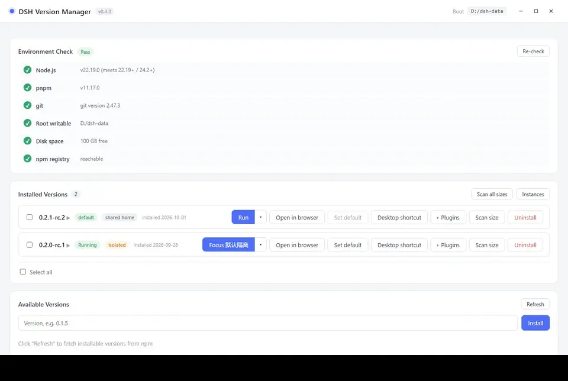

- **Shared home** row — Run using shared/official home; radio button decides the main button target
- **Instance row** — Run/Focus, Open Directory, Rename, Delete; displays "Running (version)" while running; delete button is disabled
- **+ New Instance** — Enter a name; after creation, continue mounting versions in the instance management panel
- **Radio Switch** — Main button immediately becomes "Run <Instance Name>"; repeatedly clicking run on the same instance will only focus existing windows

### Instance Management Panel

The "Instance Management" button in the top-right corner of the version list opens the full panel:

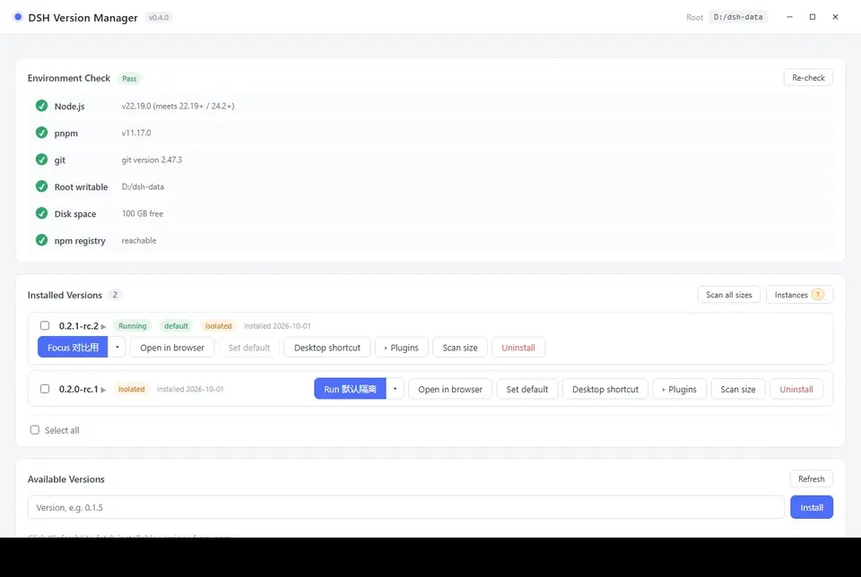

- Lists **all instances**; orphans (instances with no versions mounted) are **pinned to the top** and marked "Unmounted"; the button displays an orphan count badge
- Each row shows: Name, home path, usage (calculate by clicking "Scan Usage"), mounted versions, main button target, running status
- Actions: Run/Focus, Open Directory, Rename, Mount/Unmount, Delete
- **+ New Instance**: Enter a name and check the versions to mount; appears immediately in the list after creation
- Running instances cannot be deleted; renaming and unmounting are allowed

### Constraints and Migration

- Deleting an instance: First rename `homes/<id>` to `trash/instance-<id>-<timestamp>`, then clear configuration; background cleanup, falling back to direct deletion if it fails.
- Uninstalling a version: Only unmount the version, **keeping the instance as an orphan**; does not delete `homes/<id>`.
- Selected target invalid (instance deleted/unmounted): Silently fall back to shared home; will not automatically select the first mounted instance.
- The interface only shows instance names, not internal IDs (`i1`/`i2`…); IDs only appear in home paths, CLI/JSON, and logs.
- **v0.3.x upgrade**: Old `versions/<version>/home` will be migrated to `homes/<id>`; old `isolated_versions` will automatically generate a "Default Isolated" instance. Migration can be interrupted and retried without deleting user data; if the target already exists, it will be reused and logged.

---

<a id="s8"></a>

## 8. Command Line Mode (CLI)

> **Subcommand style introduced in v0.3.0** (`dsh-multiver list`), suitable for scripting, batch processing, and CI.

When any CLI subcommand is present, the program **does not start the graphical interface** and exits with the exit code upon completion (success `0` / failure `1`).

| Command | Purpose |
| :--- | :--- |
| `list` | List installed versions (one per line; default version marked with `* ` prefix) |
| `which` | Output the **absolute path** of the default version dsh entry (fails if no default version) |
| `info <version>` | View details of a single version (path / default / isolated / config directory / usage / instance and main button target) |
| `versions` | List available remote versions (queried from npm, newest first) |
| `env` | Environment check (Node / pnpm / root directory writable / disk / npm source connectivity; exit code 1 on fatal failure) |
| `isolate <version> [--off]` | Enable isolation (ensure default instance); `--off` unmounts all instances for that version (instances retained) |
| `isolate <version> --list [--json]` | List instances mounted for that version and main button target |
| `isolate <version> --attach <id>` / `--detach <id>` | Mount / unmount a single instance |
| `instance create --name <name> [--attach <version>...]` | Create instance (no directory creation; can create orphans first) |
| `instance list [--sizes] [--json]` | List all instances (including unmounted orphans); default does not scan usage, `--sizes` required to calculate |
| `instance rename <id> <newname>` | Modify instance display name |
| `instance remove <id>` | Delete instance (home moved to recycle bin) |
| `clean` | Clean orphaned cache + empty recycle bin (superset of `maintenance --cleanup`) |
| `doctor` | One-click diagnosis (directories / failure markers / installed / environment); exit code 1 on fatal failure |
| `shortcut <version>` | Create desktop shortcut for a version |
| `copy-shared <version> [--instance <id>]` | Copy shared home data to target instance home |
| `clear-isolated <version> [--instance <id>]` | Empty target instance home (retain version itself) |
| `export [<file>]` | Export configuration + version manifest (JSON), convenient for migration |
| `import <file>` | Import configuration from backup file (`--dry-run` previews fields to be changed) |
| `run <version> [--instance <id>]` | Start dsh web (new console window + auto-open system browser; stops when window closed) |
| `setup-runtime` | Detect and download missing portable runtime (Node / pnpm); `--dry-run` reports only |
| `update` | Check and execute auto-update (download → verify → replace self → restart); `--dry-run` checks only |
| `install <version> [--registry <url>]` | Headless install, can specify npm source |
| `uninstall <version>` | Headless uninstall |
| `set-default <version>` | Set as default version and regenerate terminal `dsh` command |
| `set-root <directory>` | Set data root directory (absolute path; create subdirectories and regenerate forwarding scripts) |
| `maintenance [--cleanup|--prune]` | Headless maintenance; without sub-switch both actions performed |
| `help` | Help |
| `version` | Version number |

**Modifiers** (keep `--` prefix):

| Modifier | Purpose |
| :--- | :--- |
| `--dry-run` | **Preview only, no execution** (with destructive commands: `install` / `uninstall` / `set-default` / `set-root` / `maintenance` / `isolate` / `instance` / `clean` / `shortcut` / `copy-shared` / `clear-isolated` / `import` / `setup-runtime` / `update`) |
| `--json` | **Structured output** (machine-readable JSON); affects format only, not behavior |
| `--force` | Override `dsh` command not generated by this manager (for `set-default`) |
| `--registry <url>` | Specify npm source (for `install`) |
| `--off` | Unmount all instances for that version (for `isolate`) |
| `--list` | List instances mounted for that version (for `isolate`) |
| `--name <name>` | Display name when creating instance (for `instance create`) |
| `--attach <version>` | Mount version when creating instance, can repeat (for `instance create`) |
| `--detach <id>` | Unmount version from instance (for `isolate`) |
| `--instance <id>` | Specify instance (for `run` / `copy-shared` / `clear-isolated`) |
| `--sizes` | Calculate instance usage simultaneously (for `instance list`; default does not scan to avoid hanging with many instances) |

> ⚠️ **v0.3.0 Breaking Change**: Old `--flag` syntax (e.g., `--list`) **has been removed**. See current command table in this chapter.

### Examples

```bash
# View installed versions (output can be piped)
dsh-multiver.exe list

# Install a version
dsh-multiver.exe install 0.2.0-rc.2

# Install with specified source (for poor network)
dsh-multiver.exe install 0.2.0-rc.2 --registry https://registry.npmmirror.com

# Set default
dsh-multiver.exe set-default 0.2.0-rc.2

# Switch data root (absolute path)
dsh-multiver.exe set-root D:/DSH-data

# Uninstall
dsh-multiver.exe uninstall 0.1.5-rc.3

# Clean orphaned cache
dsh-multiver.exe maintenance --cleanup

# Recycle dependency repositories
dsh-multiver.exe maintenance --prune

# Check details of a version
dsh-multiver.exe info 0.2.0-rc.2

# View available remote versions
dsh-multiver.exe versions

# Environment self-check (pre-deployment check / troubleshooting; exit code 1 on fatal failure)
dsh-multiver.exe env

# Enable/disable data isolation for a version
dsh-multiver.exe isolate 0.2.0-rc.2
dsh-multiver.exe isolate 0.2.0-rc.2 --off

# Create instance and mount two versions
dsh-multiver.exe instance create --name Comparison --attach 0.2.0-rc.2 --attach 0.2.1-rc.2
dsh-multiver.exe instance list --json

# Explicitly scan usage when needed (default list does not traverse home when many instances)
dsh-multiver.exe instance list --sizes --json

# Rename / delete instance (delete moves home to recycle bin)
dsh-multiver.exe instance rename i2 Comparison-2
dsh-multiver.exe instance remove i2

# View/adjust instances for a version
dsh-multiver.exe isolate 0.2.0-rc.2 --list
dsh-multiver.exe isolate 0.2.0-rc.2 --attach i2

# Start/clean with specified instance
dsh-multiver.exe run 0.2.0-rc.2 --instance i2
dsh-multiver.exe clear-isolated 0.2.0-rc.2 --instance i2

# Clean orphaned cache + empty recycle bin
dsh-multiver.exe clean

# One-click diagnosis (for troubleshooting)
dsh-multiver.exe doctor

# Export configuration (for migration)
dsh-multiver.exe export backup.json

# Import configuration (preview changes first)
dsh-multiver.exe import backup.json --dry-run
dsh-multiver.exe import backup.json

# Preview only, no actual execution (suitable for verifying parameters)
dsh-multiver.exe install 0.2.0-rc.2 --dry-run
dsh-multiver.exe uninstall 0.1.5-rc.3 --dry-run
dsh-multiver.exe maintenance --prune --dry-run
```

### Structured Output (--json)

For scripts/CI: add `--json` for machine-readable JSON (stdout contains only JSON, no other output).

```bash
# Version list (object array, includes is_default / isolated / installed_at, etc.)
dsh-multiver.exe list --json

# Absolute path of default version dsh entry
dsh-multiver.exe which --json

# Preview for destructive commands (dry-run + json)
dsh-multiver.exe install 0.2.0-rc.2 --dry-run --json

# Version details (full object, includes shared/exclusive sizes)
dsh-multiver.exe info 0.2.0-rc.2 --json

# Array of available remote versions
dsh-multiver.exe versions --json

# Array of environment check items (CheckItem: name/ok/detail/critical)
dsh-multiver.exe env --json
```

### Notes

<a id="s81"></a>

## 8.1 Appearance and Language

At the bottom of the **Path Settings** panel, there are **Appearance and Language** settings:

| Setting | Options |
| :--- | :--- |
| **Theme** | Follow System / Light / Dark |
| **Language** | Follow System / Simplified Chinese / Traditional Chinese / English / Japanese / Korean |

- Both preferences are **saved locally** and automatically restored on the next launch
- Applied **before the first screen renders**, preventing flickering
- "Follow System" responds in real-time to changes in the system theme/language


> CLI output is **not affected by language settings** (fixed to Chinese) — because CLI output is often parsed by scripts and needs to be stable.

---

<a id="s82"></a>

## 8.2. Managing Versions in dsh

After installing the "Version Management" plugin, a "Version Management" entry will appear on the **Settings page** of dsh. It reads from the same multiver data root, consistent with what you see in the multiver interface.

### Installing the Plugin

Starting from **dsh 0.2.0**, plugins are supported. You can directly install bridge plugins within dsh without first launching multiver.

1. Open the **Plugins page** in dsh → Click **Add Plugin** in the top-right corner
2. Enter the plugin package name `dsh-multiver-bridge` in the input box
3. Click **Install** and wait for the progress to complete

Once installed, the plugin will show as "Running", and the "Version Management" entry will immediately appear on the dsh settings page. No restart of dsh is required after installation.

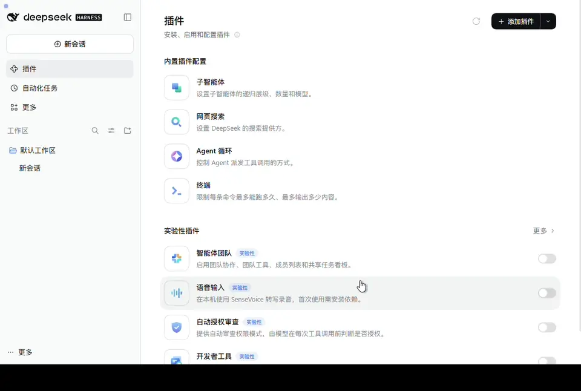

> Figure 16 shows the **dsh own plugin page**. The interface language is determined by dsh settings and does not change with multiver language switching.

> The plugin is only responsible for **viewing versions and switching the default version**; installation, uninstallation, and instances/isolation are still handled by multiver.

### What You Can See

| Area | Content |
| :--- | :--- |
| **Status Bar** | Default version; Running version (with source badge); "Effective after restart" notice when running version differs from default; Consistency check details |
| **Version Table** | Version number, Installation date, Tags (Default / Isolated / Shared home) |
| **Actions Area** | Open multiver directory, Open version directory, Copy diagnostic information, Open multiver |

The **Running version** has two sources:

- Environment variables injected by multiver when starting dsh (most reliable, shows "from multiver")
- Self-check from the process path (shows "Inferred")

When these two are inconsistent, it shows "Source Conflict". In this case, it will not falsely report "Effective after restart" — restart dsh first as prompted.

### What You Can Do

- **Set as Default**: Click "Set as Default" → Inline confirmation bar → Confirm. The interface will prompt "Effective after restarting dsh" — the running dsh cannot hot-replace itself.
- **Open multiver**: Directly launch the manager main window. This button is not shown in the embedded window (opening another manager instance is meaningless).
- **Copy Diagnostic Information**: Package the current status into JSON. If the clipboard is unavailable, it degrades to an optional text box in Chinese, facilitating troubleshooting.

### Updating multiver Itself

The "multiver update" section is at the bottom of the version management page:

- **Already Latest**: Shows the current version; you can click "Re-check"
- **New Version Available**: Shows the version number and Release link; click "Update" and confirm

**Two update methods, depending on where you open it**:

| Scenario | Behavior |
| :--- | :--- |
| **Embedded Window** (dsh started by multiver) | After clicking update, it is **staged** — the new exe is downloaded to `<data root>/.update/`, and the page shows "Pending Installation: vX.Y.Z". multiver **automatically completes the replacement on next start**, without affecting the current session. |
| **Standalone dsh** (started from terminal, not embedded in multiver) | After clicking update, it is **executed immediately** — download, verify, replace, and restart the manager. |

Why stage updates in the embedded window: The current dsh is a subprocess launched by multiver. Directly replacing the running exe would interrupt the session, and Windows does not allow overwriting running files. Staging allows replacement to occur when multiver is not running, affecting neither side.

### Refresh Timing

- Automatically refreshes every 60 seconds while the page is visible
- Immediately refreshes once when switching back from other tabs
- Stops polling when the page is not visible (each refresh requires starting an exe, which is costly)
- You can also manually trigger a refresh by clicking "Refresh" at the page footer

### Installation and Uninstallation

The plugin is not included in the exe and needs to be installed separately into dsh's profile:

```powershell
# In the dsh-plugin directory of dsh-multiver
pnpm pack
.\install.ps1 -DshCmd '<dsh.cmd path>' -Profile web -PackageDir '.\dsh-multiver-bridge-0.2.1.tgz'
```

**A restart of dsh is required after installation.** Uninstallation uses `uninstall.ps1`, which also requires a restart.

See [dsh-plugin/README](../dsh-plugin/README.md) for details.

> ⚠️ Can't see the plugin in the embedded window? Check whether the profile used by multiver to start dsh has the plugin installed — multiver always uses `dsh web` (equivalent to `--profile web`).

---

<a id="s9"></a>

## 9. Data Storage Structure

The default data root directory is the **directory where the executable resides**, which can be modified in the interface's "Path Settings". After running, the following are created under the root directory:

```
<data-root>/
├── config.json              # schema 2: version_instances / selected_target / instance_seq / instances
├── versions/<version>/      # Each version is installed independently (no longer includes home/)
│   ├── package.json
│   ├── .npmrc               # node-linker=hoisted
│   └── node_modules/
├── home/                    # Shared DSH_HOME (sessions/configs/credentials, equivalent to ~/.dsh)
├── homes/<id>/              # Instance DSH_HOME (one copy per instance, can mount multiple versions)
├── store/                   # pnpm store (hard-linked deduplication, shared across versions)
├── cache/                   # pnpm cache (can be deleted)
├── state/                   # pnpm state (can be deleted)
├── webview/<version>/
│   ├── _shared/             # WebView2 data shared by windows of this version
│   └── <id>/                # WebView2 data for windows of this version's instance
├── trash/                   # Uninstall/delete recycle bin (instance deletion is instance-<id>-<ts>)
├── .update/                 # Temporary multiver update packages (replaced on next start)
├── assets/                  # Internal resources (shortcut icons)
└── logs/                    # Startup error logs + maintenance logs
```

### What Can Be Safely Deleted

| Directory | Can Delete? | Description |
| :--- | :--- | :--- |
| `cache/` `state/` | ✅ Yes | pnpm cache; deleting will cause re-downloads |
| `webview/` | ✅ Yes | Embedded window cache; deleting will rebuild, but will lose login state/cookies |
| `assets/` | ✅ Yes | Internal resources like shortcut icons; will be rebuilt |
| `trash/` | ⚠️ Clear with caution | Recycle bin; clearing is **irreversible**, ensure no data to recover is inside |
| `store/` | ⚠️ Proceed with caution | **Dependencies of all versions point here via hard links**; deleting will break all versions |
| `versions/` | ❌ Do not delete manually | Use the interface's "Uninstall" |
| `home/` `homes/` | ❌ Do not delete manually | Your sessions, configurations, and credentials |
| `.update/` | ⚠️ Do not delete manually | Deleting will cancel the current update when pending installation |

### Self-Contained Principle

All pnpm directories (`store` / `cache` / `state`) are explicitly confined within the data root directory and **will not write to pnpm's global default locations** (e.g., `%LOCALAPPDATA%\pnpm`, root disk `.pnpm-store`).

### Saving Disk Space vs. "Looks Like It Didn't Save"

Dependencies of multiple versions share the same files in `store` via **hard links**, so only **one copy** is stored on disk.
However, **Windows folder attributes count shared files repeatedly**, making the displayed usage appear larger—that does not represent actual disk consumption.

See → **[Hard Links and Disk Usage](硬链接与磁盘占用.md)** (including how to view the real "reused / exclusive" usage).

---

<a id="s10"></a>

## 10. Automatic Maintenance

Upon startup, the program performs two tasks in the **background thread** (without blocking the interface):

1. **Clean orphaned webview caches** — Two-level check: if the version directory no longer exists → clear the entire `webview/<version>`; if the version still exists → only clear `webview/<version>/<instance-id>` that are no longer mounted, preserving `_shared`. This runs on every startup with negligible cost.
2. **Reclaim pnpm store** — If more than **7 days** have passed since the last run, execute `pnpm store prune` with low priority to reclaim dependencies no longer in use. This is delayed by 30 seconds to avoid startup I/O contention.

When deleting an instance, `homes/<id>` is first renamed to `trash/instance-<id>-<timestamp>` and cleaned up by the background process; the `clean` command empties the trash.

Logs are written to `<data-root>/logs/maintenance.log`.


### Maintenance Panel

At the bottom of the "Path Settings":

- **Automatic Maintenance Toggle** — Disabling it prevents the above two tasks from running on startup
- **Rule Description** + **Last Execution Status**
- **Manual Buttons**: "Clean Orphaned Caches", "Reclaim Dependency Store", "Open Log Directory"

> Manual maintenance executes immediately and updates the timestamp in the configuration.

---

<a id="s11"></a>

## XI. Frequently Asked Questions

### Q: Prompt "Failed to create window: failed to send message to the webview"

This is caused by a combination of two factors: the manager has a single-instance lock (v0.3.0+), so the second instance will immediately exit and focus the already running window; however, if the embedded window's WebView2 data directory is restarted immediately while the **previous instance is still starting up / shutting down**, this error may still occur.

**Solution**: Wait a few seconds and try again.

### Q: Startup reports `WebView2 error 0x800700AA / The resource is in use`

The WebView2 data directory is occupied by a **residual process**. This is common when the manager is forcefully terminated, crashes, or leaves zombie processes during testing—where `Get-Process` may show "Exited", but kernel objects are not released, still locking the directory.

**Solution**:

1. Open Task Manager and terminate all `dsh-multiver.exe` and `msedgewebview2.exe` processes;
2. If the process cannot be killed (Access Denied), **restart the computer**;
3. After restarting, launch the manager again.

The CLI is not affected by this issue (it does not require WebView2).

### Q: Embedded window displays 431 error / "Failed to load plugins"

In previous versions, **all windows shared the same WebView2 data directory**, leading to cookie accumulation and inflated request headers. This has been resolved in current versions, where each version uses an independent directory (`webview/<version>`).

If you still encounter this issue, delete the corresponding `webview/<version>` directory to let it rebuild.

### Q: Installation reports "Cannot find package ... cordis"

The dependency link mode is incorrect. Each version directory writes `.npmrc` → `node-linker=hoisted`, but dsh requires a flat `node_modules`.

If you have manually modified the version directory, delete it and reinstall.

### Q: Installation reports `ERR_PNPM_IGNORED_BUILDS`

pnpm 10+ does not execute dependency build scripts by default, causing native modules like node-pty / koffi to be missing. The tool installation already includes `--config.dangerouslyAllowAllBuilds=true`, so this should not normally occur.

### Q: A specific version keeps failing to install, spinning indefinitely then failing

Check the error message category:

- **Private package removed** — This version is not fully released by the official source, and **no source can install it**; try a different version.
- **Network issues** — Retry by switching sources (select Alibaba Cloud / Tencent Cloud).

> Known versions that cannot be installed: `0.0.1-rc.1`, `0.0.1-rc.2` (depend on private packages that have been removed). These versions will automatically be marked gray.

### Q: The "Open Folder" feature in dsh does not respond

This is an **upstream bug in dsh 0.1.7+**: passing `windowsHide:true` to `explorer.exe` causes the folder window to become invisible; additionally, the return code is misjudged, and the API still returns success.

**This affects all versions under a shared home.**

**Workarounds**:

1. Install the community fix plugin:
   ```bash
   dsh plugin --profile web add github:King20260919/dsh-open-folder-visible
   ```
2. Or enable **data isolation** for that version (see Section VII).

### Q: Typing `dsh` in the terminal prompts "command not found"

`%APPDATA%\npm\` needs to be in the system PATH. Check environment variables, or restart the terminal to apply the PATH.

### Q: Uninstalling a version prompts "File in use"

The dsh process for that version is still running.

**Solution**: Close the corresponding embedded window / terminal, then try again.

### Q: After updating the exe, the icon does not change

Windows icons are cached.

**Solution**: Run `ie4uinit.exe -show`, or restart Explorer.

### Q: Some versions in the version list are grayed out

These are **known failed installations** (depend on private packages that have been removed). It is normal that they cannot be installed.

If you confirm you want to retry, click "Clear Mark" to reinstall.

### Q: After upgrading to v0.4.0, where are the old isolated data?

The old `versions/<version>/home` has been migrated to `homes/<id>`, and the old `isolated_versions` automatically become "default isolated" instances. Migration does not delete user data; if the target directory already exists, it will be reused and the source path will be recorded in `logs/app.log`. If the old directory still exists simultaneously, you can manually clean it up after confirming the new instance opens normally.

### Q: Why does an instance show "Not mounted"?

The instance is not mounted to any installed version. This is common when the only version mounted to it has been uninstalled—the instance will be retained as an orphan and will not be automatically deleted. You can remount a version via the "Instance Management" panel, or delete it if the data is no longer needed.

### Q: Why can't two windows be opened for the same instance?

Writing to a single `homes/<id>` by two dsh processes simultaneously poses a risk of corruption; therefore, one instance supports at most one window. Repeatedly clicking "Run" will only focus the existing window; to run parallel comparisons, please create another instance.

### Q: Can data be recovered after deleting an instance?

Deletion first moves `homes/<id>` to `trash/instance-<id>-<timestamp>`, followed by background cleanup. Data can be recovered from the Recycle Bin before cleanup; after executing `clean` or background cleanup, data is **irrecoverable**.

### Q: Why does the main button show "Focus Instance A"?

This indicates the instance is already running. Clicking the main button will not reopen it but instead focus the existing window; to switch targets, click the small triangle on the right within the instance floating layer.

### Q: Which instance does `dsh` in the terminal use?

The forwarding script's `DSH_HOME` points to the main button target of the current default version (Shared / Official / Specific Instance). To temporarily specify an instance, use `dsh-multiver run <version> --instance <id>`, which will not modify the forwarding script.

---

<a id="s12"></a>

## XII. Uninstall

This tool is a **portable version**, does not write to the registry, and does not install services.

To completely uninstall:

1. Close all embedded windows
2. If a default version was set, first click the clear button for "Set as default", or directly delete `%APPDATA%\npm\dsh.cmd`
3. Delete `dsh-multiver.exe`
4. Delete the **data root directory** (by default, the directory where the exe is located, containing `versions/`, `home/`, `homes/`, `store/`, etc.)

> ⚠️ Step 4 will **permanently delete all dsh version and instance sessions, configurations, and credentials** (including `homes/`). If you only want to clean up a specific version, use the "Uninstall" button in the interface; when uninstalling only the version, instances will be retained as orphans and data will not be deleted.

---

<a id="s13"></a>

## 13. Linux Support (Not Yet Released)

v0.4.0 explicitly **does not bundle or release** Linux artifacts (no longer providing AppImage / deb). Linux retains only CI compilation and unit tests; instance functionality has not been validated on a real desktop (GAP-020) and will be addressed when Linux releases are resumed in the future.

Local debugging can be performed by running `pnpm tauri dev` from source; system dependencies are listed in [README · Environment Requirements](../README.en.md).

### Implemented Linux Capabilities (Development Only / Future Reference)

- **Features**: Install/uninstall/run/instance/CLI/forwarding scripts, etc., have all been adapted
- **Process Management**: Windows uses Job Objects; Linux uses process groups (manager exit/closing window cleans up dsh processes; if the manager is forcefully killed, residual processes will be cleaned up on next start)
- **Desktop Integration**: Windows generates `.lnk`; Linux generates `.desktop` (placed on desktop; prompts if no desktop environment is available)
- **Terminal Shortcuts**: Windows writes `%APPDATA%\npm\dsh.cmd`; Linux writes `~/.local/bin/dsh`

---

### Building from Source (Requires Installing Rust, Node, pnpm, and System Dependencies like WebKitGTK First)

~~~bash
pnpm install
pnpm tauri build --bundles appimage,deb   # or pnpm tauri dev for development
~~~

> **Fixed** (v0.2.4): Early versions may display "Reconnecting..." on embedded windows on Linux. The root cause is a process management defect in the manager itself (not a platform difference), **affecting all Linux environments**, and was fixed in v0.2.4. See [Development Gaps](开发缺口.md) GAP-008 for details.

---


## Related Links

- [Project Homepage](https://github.com/K1-lihongrong/dsh-multiver)
- [Releases (Download)](https://github.com/K1-lihongrong/dsh-multiver/releases)
- [Changelog](https://github.com/K1-lihongrong/dsh-multiver/blob/main/CHANGELOG.md)
- [Troubleshooting Guide](问题日志查看指南.md) — How to check logs when encountering issues
- [DeepSeek Harness](https://github.com/deepseek-ai/deepseek-harness) — The object managed by this project
