# DSH バージョンマネージャー —— 使用マニュアル

> **dsh-multiver v0.4.0+** 向け（Windows ポータブル版；Linux は現時点で配布予定なし）
> プロジェクトのホームページ：https://github.com/K1-lihongrong/dsh-multiver

<p align="center"><a href="使用手册.md">简体中文</a> | <a href="使用手册.zh-TW.md">繁體中文</a> | <a href="使用手册.en.md">English</a> | <strong>日本語</strong> | <a href="使用手册.ko.md">한국어</a></p>

---


## 目次

- [一、这是什么](#s1)
- [二、インストールと起動](#s2)
- [三、クイックスタート](#s3)
- [四、インターフェース機能](#s4)
- [五、dsh を実行する 3 つの方法](#s5)
- [六、ターミナルショートコマンド dsh](#s6)
- [七、データ隔離とインスタンス](#s7)
- [八、コマンドラインモード（CLI）](#s8)
- [八.1、外観と言語](#s81)
- [八.2、dsh 内でバージョン管理](#s82)
- [九、データストレージ構造](#s9)
- [十、自動メンテナンス](#s10)
- [十一、よくある質問](#s11)
- [十二、アンインストール](#s12)
- [十三、Linux サポート（暫定リリースなし）](#s13)

---

<a id="s1"></a>

## 一、这是什么

**DSH バージョンマネージャー**（dsh-multiver）は、軽量な Windows デスクトップツール（Linux ソースコードはコンパイル可能ですが、現在はパッケージ化して配布していません）であり、**DeepSeek Harness（dsh）** の複数のバージョンを管理するために使用されます。

以下の問題を解決します：

- 複数の dsh バージョンを同時にインストールしたいが、手動で `pnpm add` するのは面倒
- 複数の依存関係をインストールするとディスク容量を圧迫する
- バージョンの切り替えや `DSH_HOME` の設定で混乱しやすい
- テスト用バージョンに専用のデータディレクトリを割り当てて、メイン環境を汚染したくない
- 同じバージョンで複数の独立したインスタンスを開いて、異なるプラグインや設定を比較したい

**特徴**：単一ファイルの exe、インストール不要、ダブルクリックで即座に使用可能。

**v0.4.0 以降**：インスタンスはグローバルなエンティティとなり、1 つの `homes/<id>` を複数のバージョンにマウントでき、同じバージョンでも複数のインスタンスをマウントして同時にウィンドウを開くことができます。実行状態はバージョンを跨いで確認可能です。

---

<a id="s2"></a>

## 2. インストールと起動

### 環境要件

| 項目 | 要件 | 説明 |
| :--- | :--- | :--- |
| オペレーティングシステム | Windows 10 1803+ / Windows 11（x64） | Linux は CI でのコンパイルのみで、リリース製品は提供されません |
| WebView2（Windows 専用） | システム標準搭載 | Win11 および Win10 1803+ には標準搭載されています；非常に古いシステムの場合は [手動インストール](https://developer.microsoft.com/microsoft-edge/webview2/) が必要です |
| VC++ ランタイム（Windows 専用） | 追加インストール不要 | 現在のビルドは VC++ Redistributable に依存していません（Win10+ には UCRT が標準搭載されており、インポートテーブルで検証済みです） |
| Node.js | `^22.19.0` または `>=24.2` | dsh のインストールと実行に使用されます |
| git（オプション） | 任意の比較的新しいバージョン | GitHub / Git ソースのプラグインをインストールする必要がある場合のみ |
| pnpm | 10+（推奨 11+；ポータブル版には 12.11.2 が標準搭載） | dsh の依存関係の取得に使用されます；10 未満ではビルドスクリプトの承認ができません |

> Linux は現在**パッケージ化されず、リリースもされません**（AppImage/deb なし）；CI でのコンパイルとソースコードからのビルドのみを維持しています；システム依存関係については [第 13 節](#s13) を参照してください。

> Node および pnpm は、本ツールの**実行**の前提条件ではなく、**dsh バージョンのインストール**時の前提条件です。ツールが起動すると自動的にチェックが行われ、不足している場合はダウンロードリンクとインストール手順が表示されます。

### ダウンロードと起動

1. [Releases](https://github.com/K1-lihongrong/dsh-multiver/releases) から最新の `dsh-multiver.exe` をダウンロードします
2. **通常の書き込み可能なディレクトリ**に配置します（個別のディレクトリを作成することを推奨します；例えば `D:\dsh-multiver\`）；DSH ワークスペース、`C:\Program Files`、または読み取り専用ディレクトリには配置しないでください
3. ダブルクリックして実行します

> 💡 **個別のディレクトリを作成することを推奨する理由**：デフォルトのデータルートディレクトリは exe が配置されているディレクトリです。デスクトップに配置すると、デスクトップに `versions/`、`store/` などの多数のフォルダが生成されます。このディレクトリは書き込み可能である必要があります；DSH ワークスペースにはサンドボックス ACL が付与されており、WebView2 の初期化が失敗する可能性があります。後からインターフェースから別の場所に変更することもできます。

---

<a id="s3"></a>

## 三、クイックスタート


初めて開いた後、この 4 つのステップに従ってください：

1. **環境チェックを見る** —— 画面の上部で Node / pnpm / ディスク / npm ソースが自動的にチェックされます。不足している項目にはダウンロードリンクとインストール手順が表示されます。**致命的な項目（Node、pnpm）を先にインストールしてください**。
2. **「リストの更新」をクリック** —— npm からインストール可能なすべての dsh バージョンをプルします。
3. **バージョンを選択してインストール** —— 利用可能なバージョンリスト内のバージョン番号をクリックすると、**入力フィールドに埋め込まれます**。その後、「インストール」をクリックして、プログレスバーが完了するまで観察します。
4. **「実行」をクリック** —— アプリケーションの埋め込みウィンドウで、そのバージョンの dsh Web インターフェースを開きます。メインボタンは**現在のターゲット**に対して実行されます；もしそのバージョンが複数のインスタンスを起動している場合、右側の小さな三角をクリックしてまずインスタンスを選択してください（[第 7 節](#s7) を参照）。

これをターミナル内のデフォルトの `dsh` コマンドにしたいですか？[第 6 節](#s6) を参照してください。

---

<a id="s4"></a>

## 四、インターフェース機能

### 環境自己診断

Windows の起動時に自動的に 6 項目をチェックします：

| 項目 | 致命的か | 説明 |
| :--- | :--- | :--- |
| Node バージョン | ✅ 致命的 | `^22.19.0` または `>=24.2` が必要 |
| pnpm 利用可能 | ✅ 致命的 | pnpm 10+ が必要（10 未満の場合はアップグレードを促す） |
| データルートが書き込み可能 | ✅ 致命的 | |
| git 利用可能 | ⚠️ 致命的ではない | GitHub / Git ソースのプラグインをインストールする際に必要 |
| ディスク容量 | ⚠️ 致命的ではない | |
| npm ソースの接続 | ⚠️ 致命的ではない | 8s タイムアウト HTTP ping；オフラインの場合は明確に失敗（誤って到達可能と表示されない） |

不足している項目については、**ワンクリックダウンロードリンク**とインストール手順が表示されます：

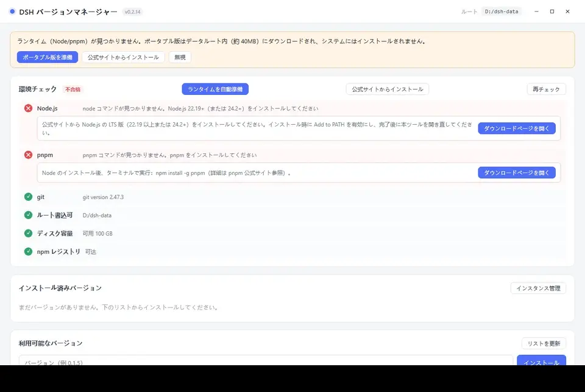

### ウィンドウタイトルバー

メインウィンドウは**自製トップバー**を使用し、システム固有のタイトルバーを表示しません。2 重のタイトルバーが重なるのを避けます。

- **ウィンドウのドラッグ**：トップバーの空白部分を押し込んでドラッグします。
- **トップバーのダブルクリック**：最大化 / 元に戻す。
- **右側の 3 つのボタン**：最小化 / 最大化（元に戻す）/ 閉じる。ボタンテキストはインターフェース言語に合わせて切り替わります。
- **起動ローディングページ**：これもドラッグ可能で、右上には独立した閉じるボタンがあります——起動が止まっている場合、終了を待つ必要はありません。

> タスクバーアイコンとウィンドウグループ化には影響しません：マネージャーウィンドウと dsh 埋め込みウィンドウは引き続き 2 つのグループに属します。

### 単一インスタンスについて

本ツールは**マネージャープロセスのみ 1 つ同時に実行**することを許可します（ここでいう「インスタンス」はマネージャープロセスを指し、第 7 節のデータインスタンスとは異なります）。アイコンを再度ダブルクリックすると、新しいプロセスは即座に終了し、既存のマネージャーウィンドウは最小化状態から復元されフォーカスされます。

- **複数のバージョン/インスタンスの比較**：同じマネージャー内でそれぞれ「実行」をクリックすると、各バージョン、各インスタンスについて 1 つずつ埋め込みウィンドウを開くことができ、互いに干渉しません。同じインスタンスについては最大 1 つのウィンドウのみです。
- **バージョンのデスクトップショートカット**（`DSH <バージョン番号>.lnk`）：マネージャーが実行中であっても有効です。新しいマネージャーは開かず、代わりに実行中のマネージャー内でそのバージョンの埋め込みウィンドウを開きます。
- **コマンドラインへの影響はありません**：マネージャーが実行中であっても `dsh-multiver list --json` などの CLI コマンドは通常通り即座に返され、グラフィカルインターフェースに引き継がれません。
- **異なるディレクトリのコピー**：単一インスタンスロックはアプリケーション識別子に基づいてグローバルに適用されます。同じユーザー下で 2 つの異なるディレクトリのコピーも同時に実行できません。この場合、後から起動したコピーは**ダイアログボックスで説明を表示**します（2 つのコピーのパスを含む）し、実行中のウィンドウにフォーカスを合わせます——沈黙して終了したり、バージョンショートカットの意図を別のコピーに転送したりしません。

### 已安装版本

各バージョンには、バージョン番号、インストール日、デフォルトかどうか、**共有 home / デフォルトインスタンス**、使用容量が表示されます。

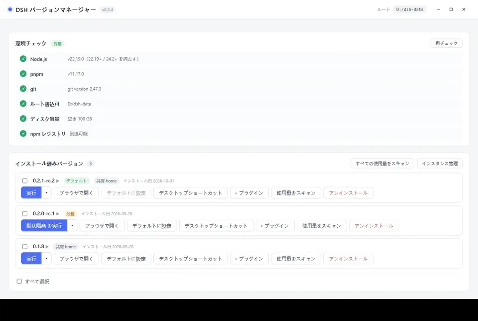

利用可能な操作：

- **実行（分割メインボタン）** —— 左側は現在のターゲットで埋め込みウィンドウを開きます；右側の小さな三角は**インスタンスフロー**（第 7 節参照）を開きます。ターゲットがインスタンスの場合、ボタンテキストは「実行 <インスタンス名>」または「フォーカス <インスタンス名>」に変更されます。
- **ブラウザで開く** —— 新しいコンソールウィンドウで dsh を実行し、dsh がシステムブラウザを開きます（ウィンドウを閉じると停止）；同じく現在のメインボタンのターゲットを使用します。
- **デフォルトに設定** —— ターミナル `dsh` ショートコマンドを生成します。
- **インスタンスドロップダウン** —— 共有 home / インスタンス切り替え、実行/フォーカス、ディレクトリを開く、名前変更、削除、新規作成（第 7 節参照）
- **ショートカット** —— デスクトップに `DSH <バージョン番号>.lnk` を生成します。
- **プラグイン** —— 該バージョンの dsh プラグインを管理します（下の「dsh プラグイン」参照）；パネルが展開された場合はこのボタンが**ハイライト状態**（薄い青背景、青枠、青文字、左側の三角矢印が 90°回転）になります。もう一度クリックして閉じます。
- **占有スキャン** —— `占用 1.38 GB（复用 1.10 GB / 独占 288 MB）` と表示します。
- **アンインストール**
- **インスタンス管理** —— バージョンリスト右上のグローバルボタン；孤児インスタンスの数はバッジで表示されます（第 7 節参照）

> **インターフェースボタンのフィードバック**（v0.3.4+）：マウスをホバーするとボタンが薄い背景 + メイン色でストロークになります；押下すると背景が暗くなり、わずかに縮みます；Tab キーでフォーカスを切り替えると 2px メイン色のフォーカスリングが表示されます。危険な操作ボタン（例：アンインストール）をホバーすると**実心の赤背景白文字**になり、通常のボタンと区別されます。すべてのボタンの文字色はホバー時に変化しません。

> **占有の中の「共有 / 独占」は何か**：複数のバージョンは pnpm store を介してハードリンクで同じ依存ファイルを共有します。「共有」は他のバージョンと共有される部分で、「独占」はこのバージョンに固有の部分です。したがって、**1 つのバージョンをアンインストールしても解放されるスペースは、表示された総占有量よりもはるかに小さい**ことが多いです。

### dsh プラグイン（v0.3.0+）

あるバージョンの「**プラグイン**」ボタンをクリックし、そのバージョンの dsh プラグインパネルを展開します：

- **インストール済み**タブ：該バージョンのすべての **profile**（通常は `web` のみ）とそのプラグイン（パッケージ名 + バージョン；`bundle` マークは profile 内蔵層）をリストします。

  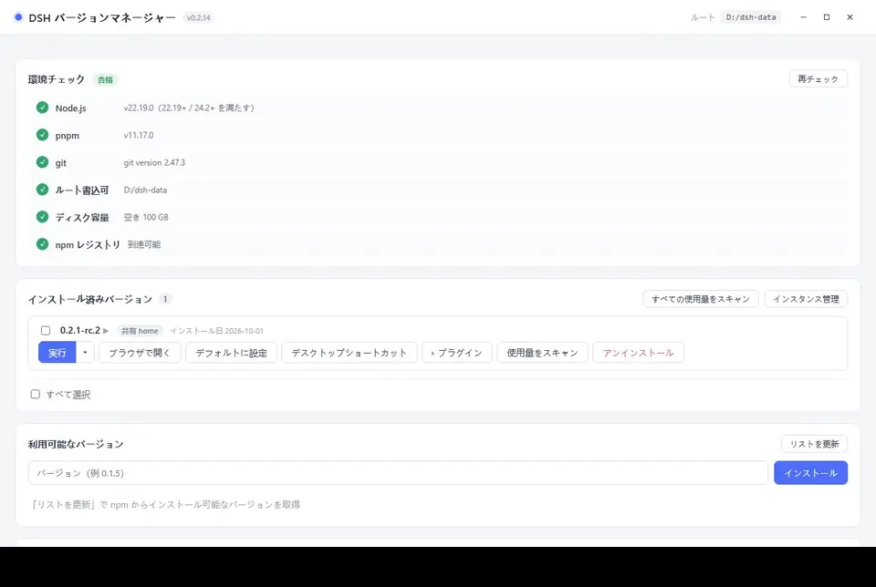

- **推奨**タブ：カテゴリでフィルタリングされたプラグインリストで、「インストール」をクリックすると直接現在の profile にインストールされます。

  

**インストール済みタブの操作**：

- **インストール**：「＋ プラグインを追加」をクリック → npm パッケージ名、GitHub アドレス、またはローカルディレクトリを入力 → インストールソースを選択 → 検査（inspect）→ 確認 → インストール完了。ダイアログボックスにはインストールされるパッケージ名/バージョン/説明、インストールソース、および信頼に関するヒントが表示されます。インストールに失敗した場合はカテゴリ別に処理できます。

  

- **アンインストール**：プラグイン右側の「アンインストール」をクリックします。大きなプラグインは数十秒かかる場合があり、項目には回転アイコンと経過秒数が表示されます。
- **更新の検査**：ツールバーの「更新の検査」をクリックします。新しいバージョンがある場合、項目には赤いバッジと「更新」ボタンが表示されます。「すべて更新」をクリックして順次更新することもできます（失敗した場合は自動的にその項目をロールバックします）。
- **共有 home の診断**：ツールバーの 🩺 ボタンをクリックし、共有 profile のリンクのみを只読スキャンし、古いバージョンの残留、浮遊リンク、重複ソースを報告します。ファイルを変更しません。
- **ディレクトリを開く**：パネル右上の 📂 ボタンで、リソースマネージャーで profile ディレクトリを開きます。

各プラグインは 2 行を占めます：1 行目はアイコンとパッケージ名（長いパッケージ名は改行して完全に表示）で、2 行目はバージョン、ソースタグ、および操作ボタンです。

**推奨タブの使い方**：

- 上部タブバーでカテゴリでフィルタリング（すべて / ツール強化 / コンテンツ集約 …）；カテゴリが多い場合は右側に `‹ ›` スクロールボタンが表示されます。
- カードの 1 行目はパッケージ名と「インストール」ボタンで、2 行目は GitHub / npmjs リンクと一言の説明です。
- 説明はインターフェース言語に合わせて切り替わります（簡体中国語 / 繁体中国語 / English / 日本語 / 한국어）；翻訳が提供されていない項目は中国語原文が表示されます。
- 説明が長すぎると右側がフェードアウトし、説明をホバーするか「完全な説明を表示」をクリックすると全文を見ることができます。
- カテゴリタブバーは左ボタンを押して左右にドラッグできます。
- ⭐ を付けた項目は推奨または同じ著者の作品で、リストの最初に表示されます。
- リストが開かれた時点で自動的に更新が検査されます（30 分以内に重複検査なし）；カテゴリバー右側の **↻** をクリックして強制的に検査できます。
- 検査に失敗した場合は上部に「推奨リストが最新ではない可能性があります」と表示され、リストは通常通り使用できます（前回取得したコンテンツまたはプログラムリリース時の内蔵コピーを使用）。
- リストの新旧は `updatedAt` タイムスタンプで比較されます：ローカルが遠端より新しい場合は上書きされません（古いキャッシュが新しいバージョンの内蔵コピーを隠さないように）。
- リストをプルする際に GitHub に直接接続が失敗すると、順次 `gh-proxy.com` → `cdn.jsdelivr.net` にフォールバックします（v0.3.2+）。

**原理**：dsh プラグインは npm パッケージで、`<DSH_HOME>/profiles/<profile>/` にインストールされます。本ツールは dsh 内蔵の `dsh plugin --profile <p> add/remove <パッケージ>` を介して実行します（手動で dsh コマンドを打つことと同等）。

> **前提**：該バージョンは dsh で**少なくとも 1 回起動**されている必要があります（profile ディレクトリが生成されるため）。「profile ディレクトリがありません」と表示された場合は、まず dsh で 1 回開いてください。

### バッチ操作

インストール済みリストは複数選択をサポートします：

- 各バージョンの左側にチェックボックスがあり、チェックすると下部にバッチ操作バーが表示されます
- 「すべて選択」でこのグループを選択し、「選択をクリア」で解除します
- 「バッチアンインストール」で 1 回確認すると順次実行され、進捗がリアルタイム表示され、失敗した項目は要約で提示されます
- バッチ実行中は、**選択された項目のボタンは無効化**されます（ミスを防ぐ）；選択されていない項目には影響しません

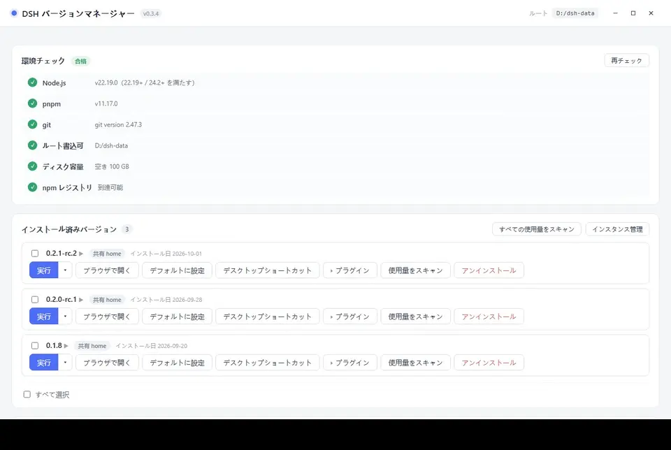

### 利用可能なバージョンリスト

- バージョン番号の**検索**をサポート
- **ソート**（最新順 / 最古順）をサポート
- バージョン番号をクリックして**入力欄に埋め込み**、**同時にその下にそのバージョンの更新説明を就地展開**（もう一度クリックして閉じる）
- 更新説明データは dsh 上流の GitHub Releases から取得し、消毒されて表示され、「ブラウザで原文を開く」ボタンが付いています；同じバージョンを 1 回見た後、再度クリックすると（「利用可能なバージョン」または「インストール済みバージョン」からでも）即座に表示されます
- **グレーで線引きされたバージョン**は「既知のインストール失敗」で（依存関係が削除されたプライベートパッケージなど）；「マークをクリア」をクリックして再試行できます

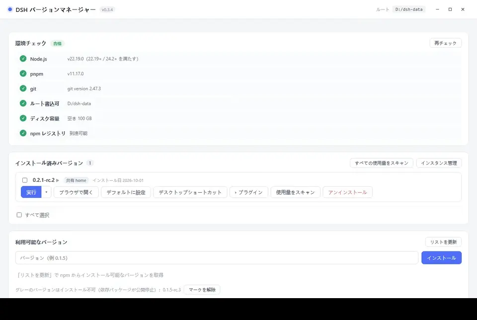

インストール中の進捗バー：


### インストール失敗の処理

インストールに失敗した場合は、エラーカテゴリに応じてターゲットされたヒントを表示します：

| カテゴリ | ヒント |
| :--- | :--- |
| **ネットワーク問題** | ソース変更ダイアログを表示（公式 / アリババクラウド / 騰訊クラウド / 華為クラウド / カスタム）；ワンクリックで再試行 |
| **プライベートパッケージの削除** | 該バージョンの公式リリースが不完全で、どのソースでもインストールできません；バージョンはグレー化されます。ソース変更で再試行することもできます |
| **バージョンの不完全 / ミラーの同期未完了** | npmmirror がまだサブパッケージを同期していない可能性があります；ポップアップで直接公式ソースに変更して再試行し、それでも失敗したらバージョンを変更します |

ネットワーク問題のソース変更ダイアログ：

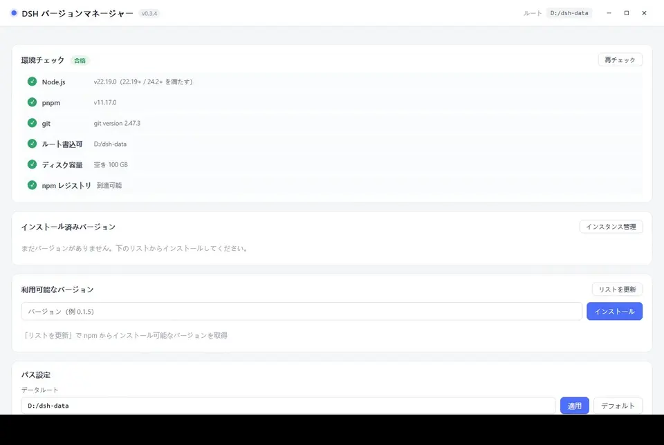

プライベートパッケージの削除のヒント：

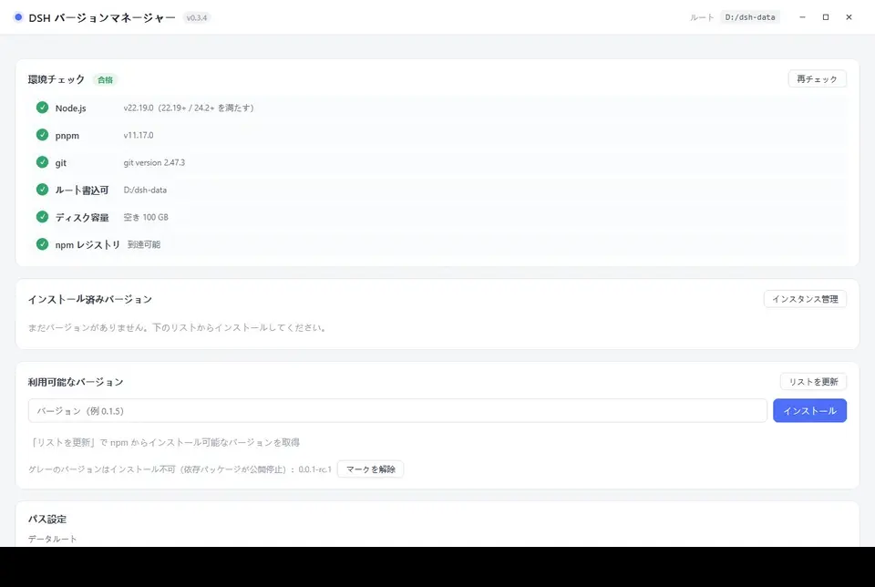

### パス設定

**データルートディレクトリ**を変更できます（デフォルトは exe と同じディレクトリ；入力時に自動的に前後の空白が削除されます）。変更後、ターミナル `dsh` スクリプト内のパスが同期して更新されます。

下部には各データディレクトリがリストされ、**任意の行をクリックするとファイルマネージャーで該ディレクトリが開きます**。デフォルトでは 5 つの主要ディレクトリが表示されます（`versions` / `home` / `store` / `cache` / `state`）；「**すべてのディレクトリを展開**」をクリックすると、`logs` / `homes` / `webview` / `trash` / `assets` などの他のディレクトリを表示できます。


パネルには**「設定のエクスポート」**と**「設定のインポート」**ボタンもあります：

- **設定のエクスポート**：現在の設定 + インストール済みバージョンリストを JSON ファイルとして保存します（マシン変更時の移行用で、依存関係/認証情報は含まない）
- **設定のインポート**：バックアップ JSON を選択 → 変更されるフィールドをプレビュー → 確認後適用（設定のみ復元し、バージョンは別途インストールする必要があります）

下部には**メンテナンスエリア**もあります（第 10 節参照）。

---

<a id="s5"></a>

## 5. dsh の 3 つの実行方法

インストール後、各バージョンには 3 つの起動方法があります：

### 1. 実行（埋め込みウィンドウ）—— 推奨

アプリケーション内で直接 dsh の Web インターフェースを開きます（デフォルト 1100×760）。

- 各**バージョン + 対象**は独立した WebView2 データディレクトリを使用します：共有ウィンドウは `<データ根>/webview/<バージョン>/_shared`、インスタンスウィンドウは `<データ根>/webview/<バージョン>/<インスタンス id>`、Cookie / キャッシュは相互に汚染されません
- ウィンドウを閉じると、その対象に対応する dsh プロセスのみが終了します。同じバージョンの他のインスタンスウィンドウには影響ありません
- 同じ**対象**を再度実行すると、既存のウィンドウにフォーカスが移ります。同じバージョンの異なるインスタンスは同時に実行できます
- ウィンドウタイトルは `DSH <バージョン>`、インスタンスウィンドウは `DSH <バージョン> · <インスタンス名>` です
- ウィンドウの左上には**小さな丸点**があります：ホバーするとバージョン番号が表示され、クリックするとパネルがポップアップします：
  - **バージョン番号**：現在実行中の dsh のバージョン
  - **完全な URL**：クリックするとすべて選択してコピーされ、ブラウザに貼り付けて同じインスタンスを開きます
  - **再起動**：そのバージョンの埋め込みウィンドウの背後にある dsh プロセスを終了し、同じバージョンで再起動し、ウィンドウを新しいアドレスにナビゲートします（セッションデータは保持されますが、ページの状態は失われます）。プラグインのインストール/アンインストールや dsh バージョンの切り替え後にこれを介して有効にします
  - **折りたたむ**（パネル右上の ×）：パネルのみを折りたたみ、dsh は閉じません。dsh を停止するには、直接ウィンドウを閉じます

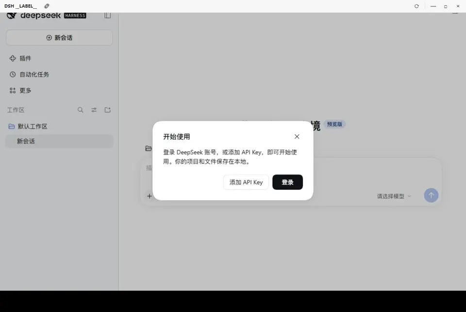

> ポートはシステムが自動的に割り当てます（`--port 0`）、競合しません。

### 2. ブラウザで開く

**新しいコンソールウィンドウ**で dsh を起動し、dsh がシステムデフォルトのブラウザを開きます。動作は「自分でターミナルを開いて `dsh web` を入力する」と同じです。

- **現在のメインボタン対象を使用**：共有 home または特定のインスタンスの `DSH_HOME` を使用します。インスタンスを変更するには、まずインスタンスフローティングレイヤーで対象を切り替えます
- **コンソールウィンドウを保持**：dsh の出力（完全な URL とトークンを含む）がウィンドウに表示され、自分でコピーできます
- **コンソールウィンドウを閉じるとサービスが停止します**
- Linux：マネージャーはシステムターミナルエミュレータ（`x-terminal-emulator` / `xterm` / `gnome-terminal` / `konsole` / `xfce4-terminal` など）を検索してそのウィンドウを担持します。すべてインストールされていない場合は、インストールして再試行するよう明確に提示します
- ポートは**固定 3080**です
- **3080 が使用中の場合**：ダイアログボックス「ポート 3080 は使用中」がポップアップし、次のオプションを選択できます：
  - 「ランダムポートを使用」—— 空きポートを別のものに変えて開きます（アドレスはコンソールウィンドウに表示されているものを使用します）
  - 「キャンセル」—— 操作を放棄します
- そのバージョンが既に埋め込みウィンドウで実行されている場合、最初にポップアップでもう 1 つ開くか確認します

> dsh を真のブラウザで実行させたい（ブラウザプラグインを使用したいなど）場合や、dsh のリアルタイム出力を観察したい場合に適しています。

### 3. デスクトップショートカット

「ショートカット」をクリックすると、現在のバージョンのデスクトップに `DSH <バージョン番号>.lnk` が生成されます。

- ダブルクリック = **簡易起動**：マネージャーメインインターフェースを表示せず、そのバージョンの埋め込みウィンドウを直接開きます
- すべてのウィンドウが閉じるとプログラムは自動的に終了します
- 頻繁に使用するバージョンをデスクトップ / タスクバーに固定する場合に適しています

---

<a id="s6"></a>

## 六、ターミナルショートコマンド dsh

あるバージョンで「**デフォルトに設定**」をクリックすると、`%APPDATA%\npm\` に `dsh.cmd` 転送スクリプトが生成されます（このディレクトリは通常システム PATH に含まれています）。

その後、**任意のターミナル**で直接入力します：

```bash
dsh web          # デフォルトバージョンの Web インターフェースを起動
dsh doctor       # 他のサブコマンドも同様にデフォルトバージョンに命中
dsh --version
```

### 仕組み

スクリプトにはバージョン番号、ルートディレクトリ、および `DSH_HOME` が**ハードコーディング**されています（プログラム生成時に計算済みで、JSON を解析しません）。`DSH_HOME` はそのバージョンの**現在のメインボタンターゲット**を指します：共有 home、公式 `~/.dsh`、またはインスタンスの `homes/<id>`。内容は概ね以下の通りです：

```bat
set "VER=0.2.0-rc.1"
set "ROOT=D:\dsh-multiver"
set "DSH_HOME_CANDIDATE=D:\dsh-multiver\home"
...
call "%ROOT%\versions\%VER%\node_modules\.bin\dsh.cmd" %*
:: 共有 home の例；メインボタンがインスタンスを指す場合、ここは D:\dsh-multiver\homes\i1 になります
:: 上記はサンプルパスであり、実際には dsh-multiver が「デフォルトに設定」時にデータルートディレクトリに従って生成されます
```

> スクリプトには保険機能があります：`DSH_HOME` ディレクトリが存在しない場合、その変数は設定されず、dsh のデフォルト位置（`~/.dsh`）にフォールバックします。

**デフォルトバージョンの変更、ルートディレクトリの変更、メインボタンターゲットの変更、デフォルトバージョンのアンインストール**時、このスクリプトは自動的に再生成されます。デフォルトバージョンがない場合はスクリプトを削除します。一時的に特定のインスタンスを指定するには、`dsh-multiver run <バージョン> --instance <id>` を使用し、転送スクリプトを変更する必要はありません。

### 他の方法でインストールした dsh との共存

dsh は複数の公式配布形態があり、それらは本マネージャーとの関係が異なります：

| インストール方法 | 競合状況 | 説明 |
| :--- | :--- | :--- |
| `npm i -g @deepseek-ai/dsh` | **競合あり、処理済み** | 両者とも `%APPDATA%\npm\`（Unix は `~/.local/bin`）に同名の `dsh` を書き込みます。デフォルトを設定する際に検出され、本マネージャーで生成されたコマンドでない場合は確認を促し、静かに上書きしません。アンインストール時にも生成されたものだけを削除し、公式のものは触れません。 |
| `pnpm add -g @deepseek-ai/dsh` | **競合あり、検出なし** | pnpm のグローバル bin（例：`%LOCALAPPDATA%\pnpm`）は本マネージャーの検出範囲外です。このディレクトリが PATH の先頭に並んでいる場合、`dsh` を入力すると pnpm のものが実行され、本マネージャーの転送スクリプトはバイパスされます。 |
| Python wheel | **競合あり、検出なし** | 同上です。`dsh` は Python の `Scripts/` または `bin/` にインストールされ、PATH の順序によってどちらが有効になるかが決まります。 |
| DeepSeek Harness デスクトップ版 | 競合なし | Electron アプリはランタイムを内蔵しており、PATH に `dsh` コマンドをインストールしません。 |

**現在入力している `dsh` が誰かを確認する方法**：

```powershell
# Windows
Get-Command dsh | Select-Object Source
```

```bash
# Linux / macOS
which -a dsh
```

- パスが `%APPDATA%\npm\dsh.cmd`（Unix は `~/.local/bin/dsh`）→ 本マネージャーの転送スクリプト
- パスが pnpm または Python のディレクトリにある → 公式インストール

**本マネージャーのバージョンを優先させたい場合**：`%APPDATA%\npm\`（Unix は `~/.local/bin`）を PATH の先頭に移動します。

> ⚠️ **DSH_HOME 共有リスク**：「公式 `~/.dsh` を再利用」を有効にすると、本マネージャーと公式インストールは同一の `profiles/`、`sessions/`、および認証情報を共有します。異なる dsh バージョンの profile にはバインドされたバージョンが異なり、互いに `node_modules` を上書きすることでエラーが発生する可能性があります。共有する前に、各バージョンに必要なバインドが一致するか確認するか、データ隔離に変更してください。

> ⚠️ ターミナルで `'dsh' は内部コマンドまたは外部コマンド、バッチファイル、オペアタではありません' と表示された場合は、`%APPDATA%\npm\` が PATH に含まれているか確認してください。

---

<a id="s7"></a>

## 七、データ隔離とインスタンス

dsh のデータディレクトリ（セッション、設定、プラグイン、認証情報）は、起動時に注入される `DSH_HOME` によって決定されます：

| 対象 | DSH_HOME | 説明 |
| :--- | :--- | :--- |
| **共有 home**（デフォルト） | `<データ根>/home` | すべての非隔離バージョンが**共有** |
| **公式 home** | `~/.dsh` | 「公式設定の再利用」を有効にした場合に使用され、公式インストールと共有されます |
| **インスタンス** | `<データ根>/homes/<id>` | インスタンス専用；1 つの home を複数のバージョンにマウント可能 |

**インスタンスはグローバルな実体**です：1 つのバージョンは任意の数のインスタンスをマウントでき、同じインスタンスも複数のバージョンにマウントできます。これにより、同じセッション/認証情報/プラグイン設定を共有します。各バージョンは `selected_target` を使用して、自分のメインボタンの目標（共有または特定のインスタンス）を記憶します。これは次回の実行のみを影響し、すでに開かれているウィンドウには影響しません。

### インスタンスを使うべき時

- 主力環境を汚染することを恐れて、互換性のないプラグインのテストを行う場合
- 清潔なセッション履歴/設定を維持したい場合
- 同一バージョンの複数の独立した環境を同時に開いて比較したい場合

> ⚠️ **共有 home のリスク**：非隔離バージョンは同じデータディレクトリを共有します。新しいバージョンのプラグイン/設定と古いバージョンが互換性がない場合、**古いバージョンにも影響**を与える可能性があります。例えば、dsh 0.1.7 の「フォルダを開く」機能が破損した場合、共有 home 下ではすべてのバージョンに影響します。
>
> 奇妙な問題に遭遇した場合は、バージョンにインスタンスをマウントするか、[よくある質問](#s11) を参照してください。

### インスタンスフロー

バージョン行のメインボタンの右側の小さな三角マークを開くと、**インスタンスフロー**が表示されます（元々の「隔離済み ▾」メニューはこれに置き換えられました）：

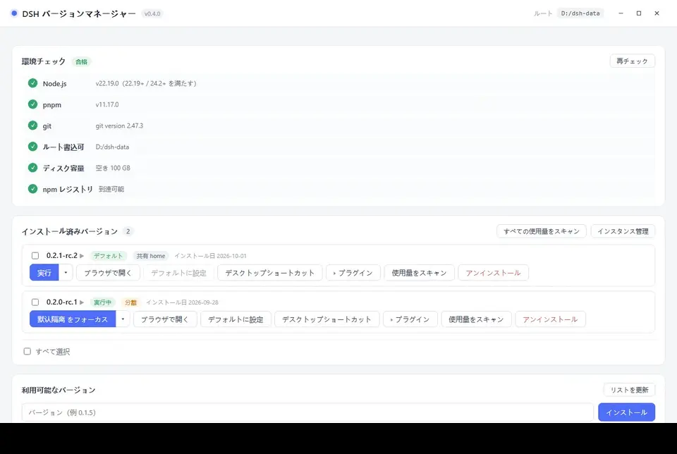

- **共有 home** 行 —— 共有/公式 home を使用して実行；ラジオボタンがメインボタンの目標を決定
- **インスタンス行** —— 実行/フォーカス、ディレクトリを開く、名前を変更、削除；実行中は「実行中（バージョン）」が表示され、削除ボタンは無効化されます
- **＋ 新規インスタンス** —— 名前を入力；作成後、インスタンス管理パネルで引き続きバージョンをマウントできます
- **ラジオボタン切り替え** —— メインボタンはすぐに「実行 <インスタンス名>」に変更されます；同じインスタンスを繰り返し実行しても、既存のウィンドウにのみフォーカスされます

### インスタンス管理パネル

バージョンリストの右上にある「インスタンス管理」ボタンをクリックすると、全体パネルが開きます：

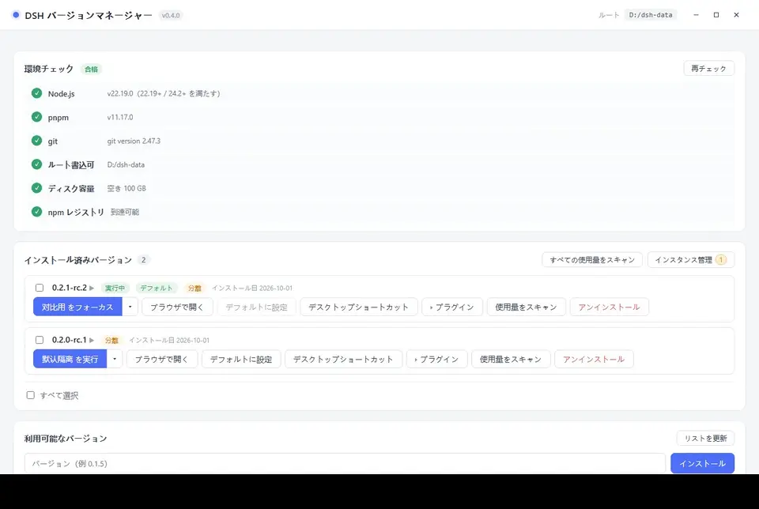

- **すべてのインスタンス**をリスト表示；孤児（マウントされていないインスタンス）は**最上位**に表示され、「未マウント」とマークされ、ボタンには孤児数の角標が表示されます
- 各行には：名前、home パス、使用状況（「使用状況のスキャン」をクリックして計算）、マウントされたバージョン、メインボタンの目標、実行状態が表示されます
- 操作：実行/フォーカス、ディレクトリを開く、名前を変更、マウント/マウント解除、削除
- **＋ 新規インスタンス**：名前を入力し、マウントするバージョンを選択；作成後、すぐにリストに表示されます
- 実行中のインスタンスは削除できません；名前の変更とマウント解除は可能です

### 制約と移行

- インスタンスの削除：まず `homes/<id>` を `trash/instance-<id>-<タイムスタンプ>` に名前を変更し、その後設定をクリアします；バックグラウンドでクリーンアップされ、失敗した場合は直接削除に退化します。
- バージョンのアンインストール：そのバージョンのマウントを解除するだけで、**インスタンスは孤児として保持**されます；`homes/<id>` は削除されません。
- 選択された目標が無効化（インスタンスが削除/マウント解除）：静かに共有 home に戻り、自動的に最初のマウントされたインスタンスを選択しません。
- インターフェースにはインスタンス名のみが表示され、内部 id（`i1`/`i2`…）は表示されません；id は home パス、CLI/JSON、およびログにのみ表示されます。
- **v0.3.x アップグレード**：古い `versions/<バージョン>/home` は `homes/<id>` に移行され、古い `isolated_versions` には自動的に「デフォルト隔離」インスタンスが生成されます；移行は中断して再試行でき、ユーザーデータは削除されません；目標が存在する場合は再利用され、ログに書き込まれます。

---

<a id="s8"></a>

## 八、コマンドラインモード（CLI）

> **v0.3.0 以降はサブコマンド形式**（`dsh-multiver list`）です。スクリプト化、バッチ処理、CI に適しています。

CLI サブコマンドを指定すると、プログラムは**グラフィカルインターフェースを起動せず**、実行が完了すると終了コードで終了します（成功 `0` / 失敗 `1`）。

| コマンド | 用途 |
| :--- | :--- |
| `list` | インストール済みのバージョンをリスト表示（1 行に 1 つ；デフォルトバージョンは `* ` でプレフィックス） |
| `which` | デフォルトバージョン dsh エントリの**絶対パス**を出力（デフォルトバージョンがない場合は失敗） |
| `info <バージョン>` | 単一バージョンの詳細を表示（パス / デフォルト / 隔離 / 設定ディレクトリ / 使用量 / インスタンスとメインボタンターゲット） |
| `versions` | 遠隔で利用可能なバージョンをリスト表示（npm から照会、最新が先頭） |
| `env` | 環境チェック（Node / pnpm / ルートディレクトリの書き込み可能 / ディスク / npm ソースの接続；致命的な項目で失敗すると終了コード 1） |
| `isolate <バージョン> [--off]` | 隔離を有効化（デフォルトインスタンスを確保）；`--off` でそのバージョンのすべてのインスタンスマウントを解除（インスタンスは保持） |
| `isolate <バージョン> --list [--json]` | そのバージョンにマウントされたインスタンスとメインボタンターゲットをリスト表示 |
| `isolate <バージョン> --attach <id>` / `--detach <id>` | 単一インスタンスのマウント / マウント解除 |
| `instance create --name <名称> [--attach <バージョン>...]` | インスタンスを作成（ディレクトリは作成しない；孤児を先に作成可能） |
| `instance list [--sizes] [--json]` | すべてのインスタンスをリスト表示（未マウントの孤児を含む）；デフォルトでは使用量をスキャンせず、`--sizes` を指定した場合のみ計算 |
| `instance rename <id> <新名>` | インスタンスの表示名を変更 |
| `instance remove <id>` | インスタンスを削除（home をリサイクルボックスに移動） |
| `clean` | 孤立したキャッシュをクリーンアップ + リサイクルボックスを空にする（`maintenance --cleanup` の超集合） |
| `doctor` | 1 回のクリックで診断（ディレクトリ / 失敗マーク / インストール済み / 環境）；致命的な項目で失敗すると終了コード 1 |
| `shortcut <バージョン>` | 特定のバージョンにデスクトップショートカットを作成 |
| `copy-shared <バージョン> [--instance <id>]` | 共有 home データをターゲットインスタンス home にコピー |
| `clear-isolated <バージョン> [--instance <id>]` | ターゲットインスタンス home を空にする（バージョン自体は保持） |
| `export [<ファイル>]` | 設定 + バージョンリスト（JSON）をエクスポートし、マシン変更時の移行に利用 |
| `import <ファイル>` | バックアップファイル内の設定をインポート（`--dry-run` は変更対象フィールドのみプレビュー） |
| `run <バージョン> [--instance <id>]` | dsh web を起動（新しいコンソールウィンドウ + システムブラウザの自動開き；ウィンドウを閉じると停止） |
| `setup-runtime` | 欠落しているポータブルランタイム（Node / pnpm）を検出およびダウンロード；`--dry-run` はダウンロードせず報告のみ |
| `update` | 自動更新をチェックおよび実行（ダウンロード → 検証 → 自身置換 → リスタート）；`--dry-run` は新バージョンがあるかのみチェック |
| `install <バージョン> [--registry <url>]` | ヘッドレスインストール、npm ソースを指定可能 |
| `uninstall <バージョン>` | ヘッドレスアンインストール |
| `set-default <バージョン>` | デフォルトバージョンを設定し、ターミナル `dsh` コマンドを再生成 |
| `set-root <ディレクトリ>` | データルートディレクトリを設定（絶対パス；サブディレクトリを作成しフォワードスクリプトを再生成） |
| `maintenance [--cleanup|--prune]` | ヘッドレスメンテナンス；サブスイッチなしの両方を両方実行 |
| `help` | ヘルプ |
| `version` | バージョン番号 |

**修飾子**（`--` プレフィックスを維持）：

| 修飾子 | 用途 |
| :--- | :--- |
| `--dry-run` | **実行せずプレビューのみ**（破壊的コマンドと併用：`install` / `uninstall` / `set-default` / `set-root` / `maintenance` / `isolate` / `instance` / `clean` / `shortcut` / `copy-shared` / `clear-isolated` / `import` / `setup-runtime` / `update`） |
| `--json` | **構造化出力**（機械可読 JSON）；形式のみ影響し動作は変更しない |
| `--force` | 非本マネージャー生成の `dsh` コマンドを上書き（`set-default` に使用） |
| `--registry <url>` | npm ソースを指定（`install` に使用） |
| `--off` | そのバージョンのすべてのインスタンスマウントを解除（`isolate` に使用） |
| `--list` | そのバージョンにマウントされたインスタンスをリスト表示（`isolate` に使用） |
| `--name <名称>` | インスタンス作成時の表示名（`instance create` に使用） |
| `--attach <バージョン>` | インスタンス作成時にバージョンをマウントし、複数回指定可能（`instance create` に使用） |
| `--detach <id>` | バージョンとインスタンスのマウントを解除（`isolate` に使用） |
| `--instance <id>` | インスタンスを指定（`run` / `copy-shared` / `clear-isolated` に使用） |
| `--sizes` | インスタンス使用量を同時に計算（`instance list` に使用；デフォルトではスキャンせず、インスタンスが多い場合のフリーズを回避） |

> ⚠️ **v0.3.0 破壊的変更**：古い `--flag` 構文（例：`--list`）**削除済み**。現在のコマンドは本章のコマンド表を参照してください。

### 例

```bash
# インストール済みのバージョンを表示（出力をパイプ可能）
dsh-multiver.exe list

# バージョンをインストール
dsh-multiver.exe install 0.2.0-rc.2

# 指定されたソースでインストール（ネットワークが悪い場合）
dsh-multiver.exe install 0.2.0-rc.2 --registry https://registry.npmmirror.com

# デフォルトを設定
dsh-multiver.exe set-default 0.2.0-rc.2

# データルートを変更（絶対パス）
dsh-multiver.exe set-root D:/DSH-data

# アンインストール
dsh-multiver.exe uninstall 0.1.5-rc.3

# 孤立キャッシュをクリーンアップ
dsh-multiver.exe maintenance --cleanup

# 依存リポジトリをリサイクル
dsh-multiver.exe maintenance --prune

# 特定のバージョンの詳細を表示
dsh-multiver.exe info 0.2.0-rc.2

# 遠隔で利用可能なバージョンを表示
dsh-multiver.exe versions

# 環境自己チェック（デプロイ前の予備チェック / トラブルシューティング；致命的な項目で失敗すると終了コード 1）
dsh-multiver.exe env

# 特定のバージョンにデータ隔離をオン/オフ
dsh-multiver.exe isolate 0.2.0-rc.2
dsh-multiver.exe isolate 0.2.0-rc.2 --off

# インスタンスを作成し 2 つのバージョンをマウント
dsh-multiver.exe instance create --name 比較用 --attach 0.2.0-rc.2 --attach 0.2.1-rc.2
dsh-multiver.exe instance list --json

# 使用量が必要な場合明示的にスキャン（インスタンスが多い場合デフォルトリストは home を巡回しない）
dsh-multiver.exe instance list --sizes --json

# インスタンスの名前変更 / 削除（削除は home をリサイクルボックスに移動）
dsh-multiver.exe instance rename i2 比較用-2
dsh-multiver.exe instance remove i2

# 特定のバージョンのインスタンスを表示/調整
dsh-multiver.exe isolate 0.2.0-rc.2 --list
dsh-multiver.exe isolate 0.2.0-rc.2 --attach i2

# 指定されたインスタンスで起動/クリーンアップ
dsh-multiver.exe run 0.2.0-rc.2 --instance i2
dsh-multiver.exe clear-isolated 0.2.0-rc.2 --instance i2

# 孤立キャッシュをクリーンアップ + リサイクルボックスを空にする
dsh-multiver.exe clean

# 1 回のクリックで診断（トラブルシューティング用）
dsh-multiver.exe doctor

# 設定をエクスポート（マシン変更時の移行用）
dsh-multiver.exe export backup.json

# 設定をインポート（変更対象フィールドを先にプレビュー）
dsh-multiver.exe import backup.json --dry-run
dsh-multiver.exe import backup.json

# 実行せずプレビューのみ（パラメータが正しいか確認に適しています）
dsh-multiver.exe install 0.2.0-rc.2 --dry-run
dsh-multiver.exe uninstall 0.1.5-rc.3 --dry-run
dsh-multiver.exe maintenance --prune --dry-run
```

### 構造化出力（--json）

スクリプト/CI に使用：`--json` を追加して機械可読 JSON を出力（stdout は JSON のみで他の出力はありません）。

```bash
# バージョンリスト（オブジェクト配列、is_default / isolated / installed_at などを含む）
dsh-multiver.exe list --json

# デフォルトバージョン dsh エントリの絶対パス
dsh-multiver.exe which --json

# 破壊的コマンドのプレビュー（dry-run + json）
dsh-multiver.exe install 0.2.0-rc.2 --dry-run --json

# バージョン詳細（完全なオブジェクト、共有/独占サイズを含む）
dsh-multiver.exe info 0.2.0-rc.2 --json

# 遠隔で利用可能なバージョン配列
dsh-multiver.exe versions --json

# 環境チェック項目配列（CheckItem：name/ok/detail/critical）
dsh-multiver.exe env --json
```

### 説明

- **非対話確認なし**：`install` / `uninstall` / `set-default` は「確定しますか」とは問いません。パラメータが正しいことを確認してください。
- **出力はパイプ可能**：`list` は 1 行に 1 つのバージョン番号；インストール進捗は **stderr** を使用し、stdout はクリーンに保たれます。
- **JSON 出力**：`--json` を追加して機械可読結果を取得（stdout は JSON のみ）。
- **進捗表示**：実際のターミナル下では単行の進捗のみ表示；ファイル/パイプにリダイレクトされた場合は自動的にサイレントになります。
- **CLI サブコマンドを指定しない場合**、以前の動作と完全に一致：グラフィカルインターフェースを起動します。


---

<a id="s81"></a>

## 8.1、外観と言語

「パス設定」パネルの下部には、「外観と言語」の設定があります：

| 設定 | オプション |
| :--- | :--- |
| **テーマ** | システムに従う / 明るい / 暗い |
| **言語** | システムに従う / 簡体中国語 / 繁体中国語 / English / 日本語 / 한국어 |

- 両方の設定は**ローカルに保存**され、次回起動時に自動的に復元されます
- **初期画面のレンダリング前**に適用され、ちらつきは発生しません
- 「システムに従う」は、システムテーマ/言語の変更に対してリアルタイムで応答します

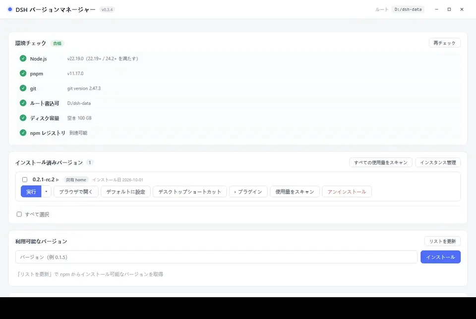

> CLI の出力は**言語設定の影響を受けない**（固定の中国語）—— CLI はスクリプトで解析されることが多いため、出力は安定している必要があります。

---

<a id="s82"></a>

## 8.2. dsh でのバージョン管理

「バージョン管理」プラグインをインストールすると、dsh の**設定ページ**に「バージョン管理」の入口が追加されます。これは同じ multiver データルートを読み取り、multiver インターフェースで表示されるものと同じです。

### プラグインのインストール

dsh **0.2.0 以降**はプラグインをサポートしており、multiver を起動する前に、dsh 内でブリッジプラグインを直接インストールできます。

1. dsh の**「プラグイン」ページ**を開く → 右上の**「プラグインを追加」**をクリック
2. 入力欄にプラグインパッケージ名 `dsh-multiver-bridge` を入力
3. **「インストール」**をクリックし、進捗が完了するのを待つ

インストールが完了するとプラグインは「実行中」と表示され、dsh の設定ページに「バージョン管理」の入口が即座に追加されます。インストール後、dsh を再起動する必要はありません。

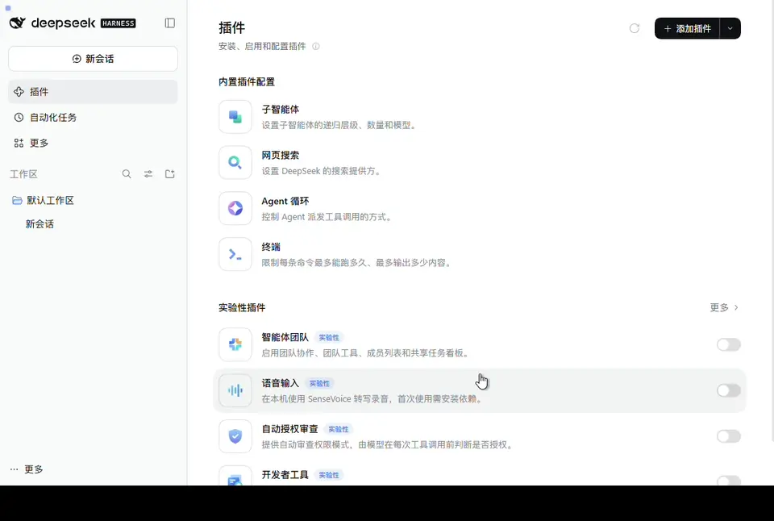

> 図 16 は **dsh 自身のプラグインページ**です。インターフェースの言語は dsh の設定で決まり、multiver の言語切り替えには従いません。

> プラグインは**バージョンの確認とデフォルトバージョンの切り替え**のみを担当します。インストール、アンインストール、インスタンス/隔離は multiver が担当します。

### 表示できる内容

| 領域 | 内容 |
| :--- | :--- |
| **ステータスバー** | デフォルトバージョン；実行バージョン（ソースのロゴ付き）；実行バージョンとデフォルトが異なる場合の「再起動後に有効」のヒント；整合性チェックの詳細 |
| **バージョン表** | バージョン番号、インストール日、タグ（デフォルト / 隔離 / 共有 home） |
| **アクションエリア** | multiver ディレクトリを開く、バージョンディレクトリを開く、診断情報をコピー、multiver を開く |

**実行バージョン**のソースは 2 つあります：

- multiver が dsh を起動する際に注入する環境変数（最も信頼性が高く、「multiver 由来」と表示）
- プロセスパスからの自己診断（「推定」と表示）

両者が不一致の場合、「ソースの競合」と表示され、「再起動後に有効」という誤検知は発生しません——まずヒントに従って dsh を再起動してください。

### できること

- **デフォルトに設定**：「デフォルトに設定」をクリック → 内联確認バー → 確認。インターフェースは「dsh を再起動後に有効」と表示します——実行中の dsh は自身をホットスワップできません。
- **multiver を開く**：マネージャーのメインウィンドウを直接起動します。埋め込みウィンドウにはこのボタンは表示されません（もう 1 つマネージャーを開く意味はありません）。
- **診断情報をコピー**：現在の状態を JSON にパックし、クリップボードが利用できない場合はオプションのテキストボックスに降级します。これによりトラブルシューティングが容易になります。

### multiver 自体の更新

バージョン管理ページの下部には「multiver の更新」セクションがあります：

- **最新バージョン**：現在のバージョンを表示し、「再チェック」をクリックできます
- **新しいバージョン**：バージョン番号と Release リンクを表示し、「更新」をクリックして確認します

**2 つの更新方法**は、どこで開いたかに依存します：

| シナリオ | 動作 |
| :--- | :--- |
| **埋め込みウィンドウ**（multiver が起動した dsh） | 更新をクリックすると**一時保存**されます——新しい exe は `<データルート>/.update/` にダウンロードされ、ページは「インストール待ち：vX.Y.Z」と表示します。multiver が**次回起動する際**に自動的に置換が完了し、現在のセッションには影響しません。 |
| **独立した dsh**（ターミナルで起動、multiver 埋め込みではない） | 更新をクリックすると**即座に実行**されます——ダウンロード、検証、置換、マネージャーの再起動を行います。 |

なぜ埋め込みウィンドウでは一時保存にするのか：現在の dsh は multiver が起動した子プロセスであり、実行中の exe を直接置換するとセッションが中断します。Windows 上では実行中のファイルを置換することも許可されていません。一時保存により、置換は multiver が実行されていない時に発生し、双方に影響を与えません。

### 更新タイミング

- ページが可視のたびに 60 秒ごとに自動的に更新されます
- 他のタブから切り替えた直後に即座に更新されます
- ページが非可視の時はポーリングが停止します（各更新で exe を 1 回起動する必要があり、コストが高い）
- ページフッターの「更新」をクリックして手動でトリガーすることもできます

### インストールとアンインストール

プラグインは exe 内に含まれておらず、dsh のプロファイルに個別にインストールする必要があります：

```powershell
# dsh-multiver の dsh-plugin ディレクトリ内
pnpm pack
.\install.ps1 -DshCmd '<dsh.cmd パス>' -Profile web -PackageDir '.\dsh-multiver-bridge-0.2.1.tgz'
```

**インストール後には dsh を再起動する必要があります。** アンインストールは `uninstall.ps1` を使用し、同様に再起動が必要です。

詳細は [dsh-plugin/README](../dsh-plugin/README.md) を参照してください。

> ⚠️ 埋め込みウィンドウでプラグインが見えない？multiver が dsh を起動する際に使用したプロファイルにプラグインがインストールされているか確認してください——multiver は固定で `dsh web`（`--profile web` に等価）を使用します。

---

<a id="s9"></a>

## 9. データストレージ構造

データルートディレクトリのデフォルト値は **exe があるディレクトリ** です。「パス設定」で変更できます。実行後、ルートディレクトリに以下が作成されます：

```
<データルート>/
├── config.json              # schema 2：version_instances / selected_target / instance_seq / instances
├── versions/<バージョン>/    # 各バージョンは独立してインストール（home/ は含まれない）
│   ├── package.json
│   ├── .npmrc               # node-linker=hoisted
│   └── node_modules/
├── home/                    # 共有 DSH_HOME（セッション/設定/認証情報、~/.dsh に相当）
├── homes/<id>/              # インスタンス DSH_HOME（各インスタンス 1 部、複数のバージョンをマウント可能）
├── store/                   # pnpm store（ハードリンクによる重複排除、複数バージョンで共有）
├── cache/                   # pnpm キャッシュ（削除可能）
├── state/                   # pnpm ステータス（削除可能）
├── webview/<バージョン>/
│   ├── _shared/             # そのバージョンで共有される WebView2 データ
│   └── <id>/                # そのバージョンのインスタンスウィンドウの WebView2 データ
├── trash/                   # アンインストール/削除用リサイクルボックス（インスタンス削除は instance-<id>-<ts>）
├── .update/                 # 一時保存された multiver 更新パッケージ（次回起動時に置換）
├── assets/                  # 内部リソース（ショートカットアイコンなど）
└── logs/                    # 起動エラーログ + メンテナンスログ
```

### 安全に削除できるもの

| ディレクトリ | 削除可能 | 説明 |
| :--- | :--- | :--- |
| `cache/` `state/` | ✅ 可能 | pnpm キャッシュ。削除すると再ダウンロードされます |
| `webview/` | ✅ 可能 | 埋め込みウィンドウキャッシュ。削除すると再構築されますが、ログイン状態/クッキーは失われます |
| `assets/` | ✅ 可能 | ショートカットアイコンなどの内部リソース。再構築されます |
| `trash/` | ⚠️ 整理可能 | リサイクルボックス。削除すると**復元できません**。復元したいデータがないか確認してください |
| `store/` | ⚠️ 注意 | **各バージョンの依存関係はここにあるファイルをハードリンクで参照しています**。削除するとすべてのバージョンが機能しなくなります |
| `versions/` | ❌ 手動削除禁止 | 画面の「アンインストール」を使用してください |
| `home/` `homes/` | ❌ 手動削除禁止 | あなたのセッション、設定、認証情報です |
| `.update/` | ⚠️ 手動削除禁止 | 未インストールの更新がある場合、削除すると今回の更新がキャンセルされます |

### 自己完結の原則

すべての pnpm ディレクトリ（`store` / `cache` / `state`）は明示的にデータルートディレクトリ内に限定されており、**pnpm のグローバルデフォルト位置には書き込まれません**（例：`%LOCALAPPDATA%\pnpm`、ディスクルート `.pnpm-store`）。

### ディスク容量節約と「節約に見えない」

複数のバージョンの依存関係は、`store` 内の同じファイルを**ハードリンク**で共有するため、ディスク上では**1 部のみ**保存されます。
ただし、**Windows のフォルダー属性は共有ファイルを重複して計算するため**、表示される使用量は大きく見えます——これは実際のディスク消費量ではありません。

詳細 → **[ハードリンクとディスク使用量](硬链接与磁盘占用.md)**（実際の「再利用 / 独占」の表示方法を含む）。

---

<a id="s10"></a>

## 10. 自動メンテナンス

プログラム起動時に、**バックグラウンドスレッド**（インターフェースをブロックしない）で以下の 2 つの処理を行います：

1. **孤立した WebView キャッシュの削除** —— 2 段階の判定：バージョンディレクトリが存在しない場合 → `webview/<バージョン>` をすべて削除；バージョンが存在する場合 → 現在マウントされていない `webview/<バージョン>/<インスタンス ID>` のみを削除し、`_shared` は保持します。起動ごとに実行され、コストは極めて低いです。
2. **pnpm ストアの回収** —— 前回から **7 日**以上経過した場合、低優先度で `pnpm store prune` を実行し、参照されていない依存パッケージを回収します。起動時の IO を避けるために 30 秒遅延します。

インスタンスを削除すると、`homes/<id>` はまず `trash/instance-<id>-<タイムスタンプ>` に名前変更され、バックグラウンドで削除されます。`clean` コマンドはゴミ箱を空にします。

ログは `<データルート>/logs/maintenance.log` に書き込まれます。

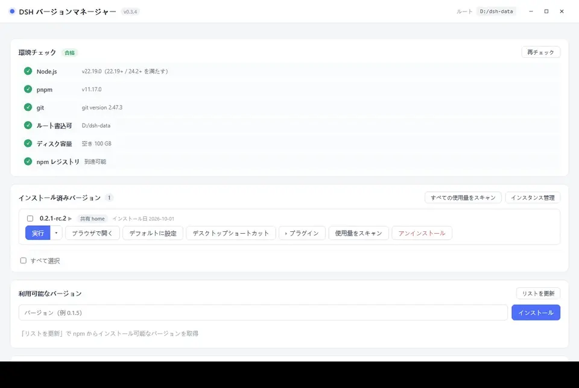

### メンテナンスパネル

「パス設定」の底部に：

- **自動メンテナンススイッチ** —— オフにすると起動時に上記の処理は行われません
- **ルール説明** + **前回の実行状態**
- **手動ボタン**：「孤立キャッシュを削除」「依存リポジトリを回収」「ログディレクトリを開く」

> 手動メンテナンスは即座に実行され、設定内のタイムスタンプが更新されます。

---

<a id="s11"></a>

## 十一、よくある質問

### Q: 「ウィンドウの作成に失敗しました: webview にメッセージを送信できませんでした」というメッセージが表示されます

2 つの要因が重なっています：マネージャーには単一インスタンスロック（v0.3.0+）があり、2 番目のインスタンスは即座に終了し、既に実行中のウィンドウにフォーカスを合わせます。しかし、埋め込みウィンドウの WebView2 データディレクトリが**前回のインスタンスが起動中 / 閉鎖中**の間に再起動されると、このエラーが発生する可能性があります。

**解決策**：数秒待ってから再度お試しください。

### Q: 起動時に `WebView2 error 0x800700AA / 使用されているリソース` と表示されます

WebView2 データディレクトリが**残留プロセス**によって占有されています。マネージャーが強制的に終了させられた、クラッシュした、またはテスト中にゾンビプロセスが残った場合に一般的です。この場合、`Get-Process` で「終了済み」と表示されても、カーネルオブジェクトが解放されておらず、ディレクトリがロックされたままです。

**解決策**：

1. タスクマネージャーを開き、すべての `dsh-multiver.exe` と `msedgewebview2.exe` を終了します；
2. プロセスが終了しない（アクセス拒否）場合は、**PC を再起動**します；
3. 再起動後、マネージャーを再度起動します。

CLI はこの問題の影響を受けません（WebView2 を必要としないため）。

### Q: 埋め込みウィンドウで 431 エラー / 「Failed to load plugins」が表示されます

過去のバージョンでは、**すべてのウィンドウが同じ WebView2 データディレクトリを共有**していたため、クッキーの蓄積やヘッダーの膨張を引き起こしました。現在、各バージョンは独立したディレクトリ（`webview/<バージョン>`）を使用しており、この問題は根本的に解決されています。

それでも発生する場合は、対応する `webview/<バージョン>` ディレクトリを削除して再構築させます。

### Q: インストール時に「Cannot find package ... cordis」と表示されます

依存関係のリンクモードが正しくありません。各バージョンディレクトリは `.npmrc` を書き込み、`node-linker=hoisted` を設定します。dsh は平坦な node_modules を必要とします。

手動でバージョンディレクトリを変更した場合は、削除して再度インストールします。

### Q: インストール時に `ERR_PNPM_IGNORED_BUILDS` と表示されます

pnpm 10+ はデフォルトで依存関係のビルドスクリプトを実行しないため、node-pty / koffi などのネイティブモジュールが不足します。ツールインストール時には `--config.dangerouslyAllowAllBuilds=true` が含まれているため、通常は発生しません。

### Q: 特定のバージョンがインストールできず、常に回転して失敗します

エラーメッセージのカテゴリを確認します：

- **プライベートパッケージの削除** —— そのバージョンは公式に完全にはリリースされておらず、**どのソースでもインストールできません**。他のバージョンに変更します。
- **ネットワーク問題** —— ソースを変更して再試行します（アリクラウド / 騰訊クラウドを選択）。

> 既知のインストール不能な早期バージョン：`0.0.1-rc.1`、`0.0.1-rc.2`（依存関係として削除されたプライベートパッケージ）。これらのバージョンは自動的にグレーアウトされます。

### Q: dsh の「フォルダーを開く」機能が反応しません

これは **dsh 0.1.7+ の上流バグ** です：`explorer.exe` に `windowsHide:true` を渡したため、フォルダーウィンドウが非表示になり、リターンコードが誤って判定され、API はまだ成功を返します。

**共有 home 下ではすべてのバージョンに影響します。**

**回避方法**：

1. コミュニティ修復プラグインをインストールします：
   ```bash
   dsh plugin --profile web add github:King20260919/dsh-open-folder-visible
   ```
2. または、そのバージョンに**データ隔離**を有効にします（第 7 節参照）

### Q: 端末で `dsh` と入力するとコマンドが見つからないと表示されます

`%APPDATA%\npm\` はシステム PATH 内に存在する必要があります。環境変数をチェックするか、PATH が有効になるように端末を再起動します。

### Q: バージョンをアンインストールすると「ファイルが使用中」と表示されます

そのバージョンの dsh プロセスがまだ実行中です。

**解決策**：対応する埋め込みウィンドウ / 端末を閉じてから再度お試しください。

### Q: exe を更新してもアイコンが変わりません

Windows アイコンにはキャッシュがあります。

**解決策**：`ie4uinit.exe -show` を実行するか、エクスプローラーを再起動します。

### Q: バージョンリストのいくつかのバージョンがグレーになっています

これらは**既知のインストール失敗**バージョン（依存関係として削除されたプライベートパッケージ）です。インストールできないのは正常です。

再試行を確認する場合は、「マークをクリア」をクリックして再度インストールできます。

### Q: v0.4.0 にアップグレードした後、古い隔離データはどこにありますか？

旧バージョンの `versions/<バージョン>/home` は `homes/<id>` に移行され、旧 `isolated_versions` は自動的に「デフォルト隔離」インスタンスになります。移行はユーザーデータを削除しません。ターゲットディレクトリが存在する場合、ターゲットを再利用し、`logs/app.log` にソースパスを記録します。旧ディレクトリがまだ同時に存在する場合、新しいインスタンスが正常に開けることを確認した後に手動でクリーンアップします。

### Q: なぜインスタンスが「マウントされていない」と表示されますか？

そのインスタンスはインストールされたバージョンのいずれかにマウントされていません。マウントしていた唯一のバージョンをアンインストールした場合に一般的です——インスタンスは孤児として保持され、自動的に削除されません。「インスタンス管理」パネルでバージョンを再マウントするか、データが不要であることを確認して削除します。

### Q: 同じインスタンスでなぜ 2 つのウィンドウを開けないのですか？

1 つの `homes/<id>` が 2 つの dsh プロセスによって同時に書き込まれると破損するリスクがあるため、1 つのインスタンスには最大 1 つのウィンドウしかありません。「実行」を再度クリックしても既存のウィンドウにフォーカスするだけです。並行して比較するには、別のインスタンスを新規作成します。

### Q: インスタンスを削除してもデータを回復できますか？

削除はまず `homes/<id>` を `trash/instance-<id>-<タイムスタンプ>` に移動し、バックグラウンドでクリーンアップします。クリーンアップ前にはゴミ箱から回復できますが、`clean` を実行するかバックグラウンドでクリーンアップした後には**回復できません**。

### Q: メインボタンがなぜ「フォーカス インスタンス A」と表示されますか？

そのインスタンスが既に実行中であることを示しています。メインボタンをクリックしても再度開くことはなく、既存のウィンドウにフォーカスします。ターゲットを変更するには、右側の小さな三角を押し、インスタンスフローティングレイヤーで切り替えます。

### Q: 端末内の `dsh` はどのインスタンスを使用していますか？

転送スクリプトの `DSH_HOME` は、共有 / 公式 / 特定のインスタンスのデフォルトバージョンの現在のメインボタンターゲットを指します。一時的にインスタンスを指定するには、`dsh-multiver run <バージョン> --instance <id>` を使用し、転送スクリプトを変更しません。

---

<a id="s12"></a>

## 十二、アンインストール

本ツールは**ポータブル版**であり、レジストリへの書き込みも、サービスのインストールも行いません。

完全なアンインストールには：

1. すべての埋め込みウィンドウを閉じます
2. デフォルトバージョンを設定している場合は、まず「デフォルトにする」のクリアボタンを押すか、または `%APPDATA%\npm\dsh.cmd` を直接削除します
3. `dsh-multiver.exe` を削除します
4. **データルートディレクトリ**（デフォルトは exe が配置されているディレクトリで、`versions/` `home/` `homes/` `store/` などが含まれています）を削除します

> ⚠️ 手順 4 は、**すべての dsh バージョンとインスタンスのセッション、設定、認証情報**（`homes/` を含む）を**永続的に削除**します。特定のバージョンのみのクリーンアップを行いたい場合は、インターフェース内の「アンインストール」を使用してください。バージョンのみのアンインストールでは、インスタンスは孤児として保持され、データは削除されません。

---

<a id="s13"></a>

## 十三、Linux 対応（一時的にリリースなし）

v0.4.0 では、Linux 向けアーティファクトを**パッケージ化せず、リリースしません**（AppImage / deb は提供されません）。Linux については CI でのビルドと単体テストのみを維持し、インスタンス機能は実際のデスクトップ環境での検証を行っていません（GAP-020）。Linux のリリースを再開する際は、その時点で補完します。

ローカルでのデバッグはソースコードから `pnpm tauri dev` を実行することで可能です。システム依存関係については [README · 環境要件](../README.ja.md) を参照してください。

### 実装済みの Linux 機能（開発用 / 将来の参考用）

- **機能**：インストール/アンインストール/実行/インスタンス/CLI/転送スクリプトなどがすべて対応済み
- **プロセス管理**：Windows は Job Object を使用；Linux はプロセスグループを使用（マネージャーが終了/ウィンドウを閉じた際に dsh プロセスをクリーンアップ；マネージャーが強制的に終了された場合、次回起動時に残留プロセスをクリーンアップ）
- **デスクトップ統合**：Windows は `.lnk` を生成；Linux は `.desktop` を生成（デスクトップに配置；デスクトップ環境がない場合は警告を表示）
- **ターミナルショートコマンド**：Windows は `%APPDATA%\npm\dsh.cmd` に記述；Linux は `~/.local/bin/dsh` に記述

### ソースからのビルド（Rust、Node、pnpm、WebKitGTK などの依存関係が必要）

~~~bash
pnpm install
pnpm tauri build --bundles appimage,deb   # または pnpm tauri dev で開発実行
~~~

> **修正済み**（v0.2.4）：早期バージョンでは Linux 上で埋め込みウィンドウが「再接続中」と表示される問題がありました。根本原因はマネージャー自身のプロセス管理の欠陥（プラットフォームの違いではありません）であり、**すべての Linux 環境に影響**していました。v0.2.4 で修正済み。詳細は [開発ギャップ](开发缺口.md) GAP-008 を参照。

---

## 関連リンク

- [プロジェクトのホームページ](https://github.com/K1-lihongrong/dsh-multiver)
- [リリース（ダウンロード）](https://github.com/K1-lihongrong/dsh-multiver/releases)
- [更新履歴](https://github.com/K1-lihongrong/dsh-multiver/blob/main/CHANGELOG.md)
- [問題ログの表示ガイド](问题日志查看指南.md) —— 問題が発生した際にログを確認する方法
- [DeepSeek Harness](https://github.com/deepseek-ai/deepseek-harness) —— 本プロジェクトで管理する対象
