# DSH 버전 관리자 — 사용 설명서

> **dsh-multiver v0.4.0+**에 적용됩니다(Windows 포터블 버전; Linux는 아직 배포되지 않음)
> 프로젝트 홈페이지: https://github.com/K1-lihongrong/dsh-multiver

<p align="center"><a href="使用手册.md">简体中文</a> | <a href="使用手册.zh-TW.md">繁體中文</a> | <a href="使用手册.en.md">English</a> | <a href="使用手册.ja.md">日本語</a> | <strong>한국어</strong></p>

---


## 목차

- [1. 이 도구는 무엇인가요?](#s1)
- [2. 설치 및 시작](#s2)
- [3. 빠른 시작](#s3)
- [4. 인터페이스 기능](#s4)
- [5. dsh 실행의 세 가지 방법](#s5)
- [6. 터미널 단축 명령어 dsh](#s6)
- [7. 데이터 격리 및 인스턴스](#s7)
- [8. 명령줄 모드 (CLI)](#s8)
  - [8.1. 외관 및 언어](#s81)
  - [8.2. dsh 에서 버전 관리](#s82)
- [9. 데이터 저장 구조](#s9)
- [10. 자동 유지보수](#s10)
- [11. 자주 묻는 질문](#s11)
- [12. 제거](#s12)
- [13. Linux 지원 (현재 출시되지 않음)](#s13)

---

<a id="s1"></a>

## 1.这是什么

**DSH 버전 관리자**(dsh-multiver) 는 **DeepSeek Harness**(dsh) 의 여러 버전을 관리하기 위한 경량 Windows 데스크톱 유틸리티입니다(Linux 소스 코드로 컴파일 가능하지만 현재는 패키지로 배포되지 않음).

다음 문제들을 해결합니다:

- 여러 dsh 버전을 동시에 설치하고 싶지만 수동으로 `pnpm add` 하는 것이 번거로움
- 여러 번의 의존성을 설치하면 디스크 공간이 많이 차지함
- 버전 전환 및 `DSH_HOME` 설정이 혼란스러움
- 테스트 버전을 위한 별도의 데이터 디렉토리를 만들고 싶지만 메인 환경을 오염시키지 않음
- 동일한 버전에서 여러 독립 인스턴스를 열어 다른 플러그인/구성을 비교하고 싶음

**특징**: 단일 파일 exe, 설치 불필요, 더블 클릭하여 즉시 사용 가능.

**v0.4.0 부터**: 인스턴스는 전역 엔티티입니다. 하나의 `homes/<id>` 는 여러 버전에서 사용할 수 있으며, 동일한 버전에서도 여러 인스턴스를 연결하여 동시에 창을 열 수 있습니다. 실행 상태는 버전 간에 공유됩니다.

---

<a id="s2"></a>

## 2. 설치 및 시작

### 환경 요구 사항

| 항목 | 요구 사항 | 설명 |
| :--- | :--- | :--- |
| 운영 체제 | Windows 10 1803+ / Windows 11(x64) | Linux 는 CI 만 컴파일되며 배포되지 않습니다 |
| WebView2(Windows 전용) | 시스템 기본 제공 | Win11 및 Win10 1803+ 에 내장되어 있습니다; 매우 오래된 시스템은 [수동 설치](https://developer.microsoft.com/microsoft-edge/webview2/)가 필요합니다 |
| VC++ 런타임 라이브러리(Windows 전용) | 별도 설치 불필요 | 현재 빌드는 VC++ Redistributable 에 의존하지 않습니다(Windows 10+ 에 기본 제공되는 UCRT 만 사용되며, 임포트 테이블로 검증됨) |
| Node.js | `^22.19.0` 또는 `>=24.2` | dsh 설치 및 실행에 사용 |
| git(선택 사항) | 최신 버전 중 임의 | GitHub / Git 소스 플러그인 설치 시에만 필요 |
| pnpm | 10+(11+ 권장; 포터블 버전에는 12.11.2 내장) | dsh 의존성 가져오기에 사용; 10 미만은 빌드 스크립트 승인 불가 |

> Linux 는 현재 **패키징 및 배포되지 않습니다**(AppImage/deb 없음); CI 컴파일 및 소스 코드 빌드만 유지하며, 시스템 의존성은 [13 장](#s13)을 참조하세요.

> Node 와 pnpm 은 이 도구를 **실행하기 위한** 전제 조건이 아니라, **dsh 버전을 설치할 때**의 전제 조건입니다. 도구가 시작되면 자동으로 확인하고 누락된 경우 다운로드 링크와 설치 단계를 제공합니다.

### 다운로드 및 시작

1. [Releases](https://github.com/K1-lihongrong/dsh-multiver/releases) 에서 최신 `dsh-multiver.exe` 를 다운로드하세요.
2. **일반적인 쓰기 가능 디렉토리**에 배치하세요(예: `D:\dsh-multiver\` 와 같이 별도의 디렉토리를 만드는 것이 좋습니다); DSH 워크스페이스, `C:\Program Files` 또는 읽기 전용 디렉토리에 배치하지 마세요.
3. 더블 클릭하여 실행하세요.

> 💡 **별도의 디렉토리를 만드는 것이 권장되는 이유**: 기본 데이터 루트 디렉토리는 exe 가 있는 디렉토리와 동일합니다. 데스크톱에 배치하면 데스크톱에 `versions/`, `store/` 등의 폴더가 생성됩니다. 이 디렉토리는 쓰기 가능해야 하며, DSH 워크스페이스는 샌드박스 ACL 을 가져 WebView2 가 초기화되지 못할 수 있습니다. 이후 인터페이스에서 다른 위치로 변경할 수도 있습니다.

---

<a id="s3"></a>

## 3. 빠른 시작

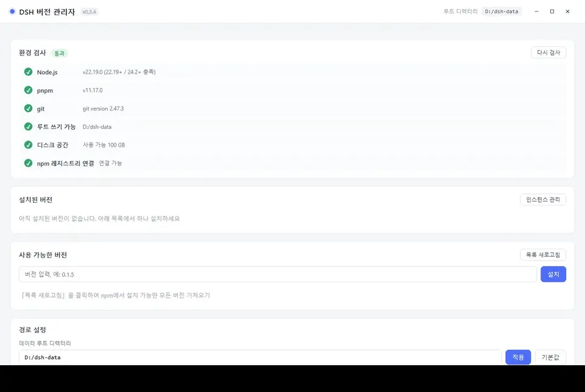

처음 열었을 때, 이 4 단계를 따르세요:

1. **환경 확인 보기** — 인터페이스 상단에 Node/pnpm/디스크/npm 소스가 자동으로 확인됩니다. 누락된 항목에 대해 다운로드 링크와 설치 단계가 표시됩니다.**먼저 치명적인 항목 (Node, pnpm) 을 설치하세요.**
2. **「목록 새로고침」을 누르세요** — npm 에서 설치할 수 있는 모든 dsh 버전을 가져옵니다.
3. **버전 하나를 선택하여 설치하세요** — 사용 가능한 버전 목록의 버전 번호를 클릭하면**입력 필드에 채워집니다**, 그 다음「설치」를 누르세요. 진행률 표시줄이 완료될 때까지 관찰하세요.
4. **「실행」을 누르세요** — 응용 프로그램 내장 창에서 해당 버전의 dsh 웹 인터페이스를 엽니다. 주 버튼은**현재 목표**에 따라 실행됩니다; 해당 버전이 여러 인스턴스를 실행 중이라면, 오른쪽 작은 삼각형을 클릭하여 먼저 인스턴스를 선택하세요 ([7 절](#s7) 참조).

터미널의 기본 `dsh` 명령으로 만들고 싶으시다면 [6 절](#s6) 을 참조하세요.

---

<a id="s4"></a>

## IV. 인터페이스 기능

### 환경 자체 점검

Windows 가 시작될 때 자동으로 6 개 항목을 점검합니다:

| 점검 항목 | 치명적 여부 | 설명 |
| :--- | :--- | :--- |
| Node 버전 | ✅ 치명적 | `^22.19.0` 또는 `>=24.2` 필요 |
| pnpm 사용 가능 | ✅ 치명적 | pnpm 10+ 필요 (10 미만일 경우 업그레이드 안내) |
| 데이터 루트 쓰기 가능 | ✅ 치명적 | |
| git 사용 가능 | ⚠️ 비치명적 | GitHub/Git 소스 플러그인 설치 시 필요 |
| 디스크 공간 | ⚠️ 비치명적 | |
| npm 소스 연결성 | ⚠️ 비치명적 | 8 초 타임아웃 HTTP ping; 오프라인일 경우 명확한 실패 (오인 방지) |

누락된 항목에는 **원클릭 다운로드 링크**와 설치 단계가 표시됩니다:

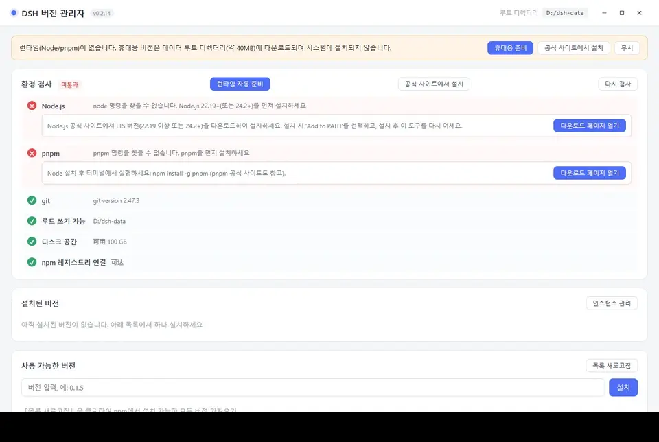

### 윈도우 제목 표시줄

메인 윈도우는 **자그림 상단 바**를 사용하여 시스템 네이티브 제목 표시줄을 표시하지 않아 두 개의 제목 표시줄이 겹치는 것을 방지합니다.

- **윈도우 드래그**: 상단 바의 빈 공간을 눌러 드래그합니다.
- **상단 바 더블 클릭**: 최대화/복원.
- **오른쪽 세 개의 버튼**: 최소화/최대화 (복원)/닫기. 버튼 텍스트는 인터페이스 언어에 따라 변경됩니다.
- **시작 로딩 페이지**: 드래그할 수 있으며, 오른쪽 상단에 독립적인 닫기 버튼이 있습니다. 시작이 멈췄을 때 이를 기다리지 않아도 됩니다.

> 작업 표시줄 아이콘 및 윈도우 그룹화는 영향을 받지 않습니다: 관리자 윈도우와 dsh 내장 윈도우는 여전히 두 개의 별도 그룹에 속합니다.

### 단일 인스턴스 설명

이 도구는 **관리자 프로세스 하나만 실행**할 수 있습니다 (여기서의 '인스턴스'는 관리자 프로세스를 의미하며, 7 절의 데이터 인스턴스가 아닙니다). 아이콘을 다시 더블 클릭하면 새 프로세스는 즉시 종료되고, 기존 관리자 윈도우는 최소화 상태에서 복원되어 포커스가 됩니다.

- **여러 버전/인스턴스 비교**: 같은 관리자에서 각각 '실행'을 누르면 각 버전, 각 인스턴스마다 내장 윈도우를 여며 서로 간섭하지 않습니다. 같은 인스턴스에는 최대 하나의 윈도우만 열립니다.
- **버전 데스크톱 단축키** (`DSH <버전번호>.lnk`) 는 관리자가 실행 중일 때도 유효합니다: 새로운 관리자를 여는 대신, 이미 실행 중인 관리자에서 해당 버전의 내장 윈도우를 엽니다.
- **명령줄은 영향받지 않습니다**: 관리자가 실행 중일 때 `dsh-multiver list --json` 등의 CLI 명령을 실행하면 즉시 반환되며, 그래픽 인터페이스로 전달되지 않습니다.
- **다른 디렉토리의 복사본**: 단일 인스턴스 잠금은 애플리케이션 식별자로 전역적으로 적용되므로, 같은 사용자 하에서 다른 디렉토리의 복사본도 동시에 실행할 수 없습니다. 이 경우 나중에 시작되는 복사본은 **대화상자가 표시**되어 설명합니다 (두 복사본의 경로 포함)并已 포커스가 있는 윈도우로 이동합니다. 침묵적으로 종료되지도, 버전 단축키 의 의도를 다른 복사본으로 전달하지도 않습니다.

### 설치된 버전

각 버전에는 버전 번호, 설치 날짜, 기본 여부, **공유 홈/기본 인스턴스**, 사용 크기가 표시됩니다.

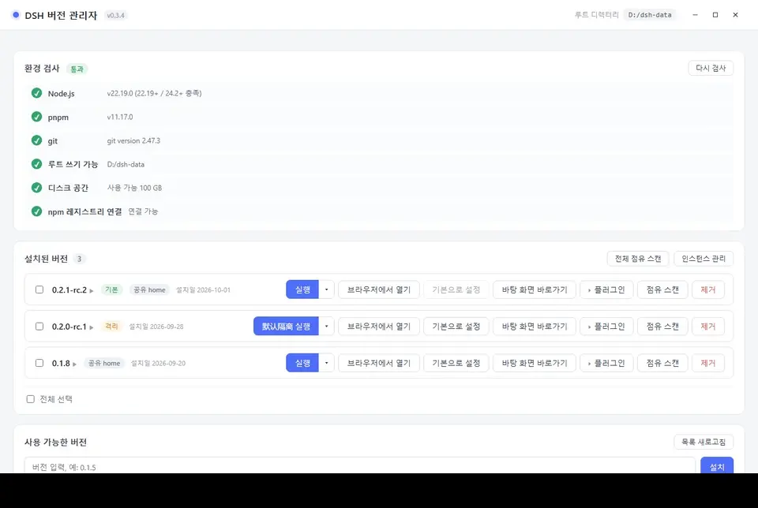

사용 가능한 작업:

- **실행 (분리된 메인 버튼)** —— 왼쪽은 현재 타겟으로 내장 윈도우를 엽니다. 오른쪽 작은 삼각형은 **인스턴스 플로팅 레이어**를 엽니다 (7 절 참조). 타겟이 인스턴스일 경우, 버튼 문구는 '실행 <인스턴스명>' 또는 '포커스 <인스턴스명>'으로 변경됩니다.
- **브라우저 열기** —— 새 콘솔 윈도우를 여어 dsh 를 실행하며, dsh 가 시스템 브라우저를 엽니다 (윈도우 닫기 시 중지). 또한 현재 메인 버튼 타겟을 사용합니다.
- **기본값 설정** —— 터미널 `dsh` 단축 명령 생성
- **인스턴스 드롭다운** —— 공유 홈/인스턴스 전환, 실행/포커스, 디렉토리 열기, 이름 변경, 삭제, 새로 만들기 (7 절 참조)
- **단축키** —— 데스크톱에 `DSH <버전번호>.lnk` 생성
- **플러그인** —— 해당 버전의 dsh 플러그인 관리 (아래 'dsh 플러그인' 참조); 패널이 확장되면 이 버튼이 **고려 상태**가 됩니다 (연한 파란 배경, 파란 테두리, 파란 글씨, 왼쪽 삼각형 화살표 90° 회전), 다시 한 번 누르면 접힙니다.
- **사용 중인 공간 스캔** —— `사용 1.38 GB (공유 1.10 GB / 독점 288 MB)` 표시
- **제거**
- **인스턴스 관리** —— 버전 목록 오른쪽 상단의 전역 버튼; 고아 인스턴스 수를 각본으로 표시 (7 절 참조)

> **인터페이스 버튼 피드백** (v0.3.4+): 마우스를 올렸을 때 버튼이 연한 배경 + 메인 색상 테두리로 변경됩니다. 누를 때 배경색이 진해지고 약간 축소됩니다. Tab 키로 포커스를 전환할 때 2px 메인 색상 포커스 링이 표시됩니다. 위험 작업 버튼 (예: 제거) 을 올렸을 때 **고려 빨간 배경 흰 글씨**로 변경되어 일반 버튼과 구별됩니다. 모든 버튼의 텍스트 색상은 올렸을 때 변하지 않습니다.

> **사용 중인 공간의 '공유/독점'이란**: 여러 버전은 pnpm store 하드 링크를 통해 동일한 의존성 파일을 공유합니다. '공유'는 다른 버전과 공유되는 부분이며, '독점'은 이 버전에만 있는 부분입니다. 따라서 **버전을 제거할 때 방출되는 공간은 표시된 총 사용 공간보다 훨씬 작을 수 있습니다**.

### dsh 플러그인 (v0.3.0+)

어떤 버전의 **'플러그인'** 버튼을 누르면 해당 버전의 dsh 플러그인 패널이 확장됩니다:

- **설치된** 탭: 해당 버전의 모든 **profile** (보통 `web` 만 있음) 및 플러그인 (패키지명 + 버전; `bundle` 마크는 profile 내장 레이어) 을 나열합니다.

  

- **추천** 탭: 분류로 필터링된 플러그인 목록이며, '설치'를 누르면 현재 profile 에 직접 설치됩니다.

  

**설치된 탭의 작업**:

- **설치**: '＋ 플러그인 추가'를 누르 → npm 패키지명, GitHub 주소 또는 로컬 디렉토리를 입력 → 설치 소스 선택 → 점검 (inspect) → 확인 → 설치 완료. 대화상자에 설치할 패키지명/버전/설명, 설치 소스 및 신뢰 경고가 표시됩니다. 설치 실패 시 카테고리별로 처리할 수 있습니다.

  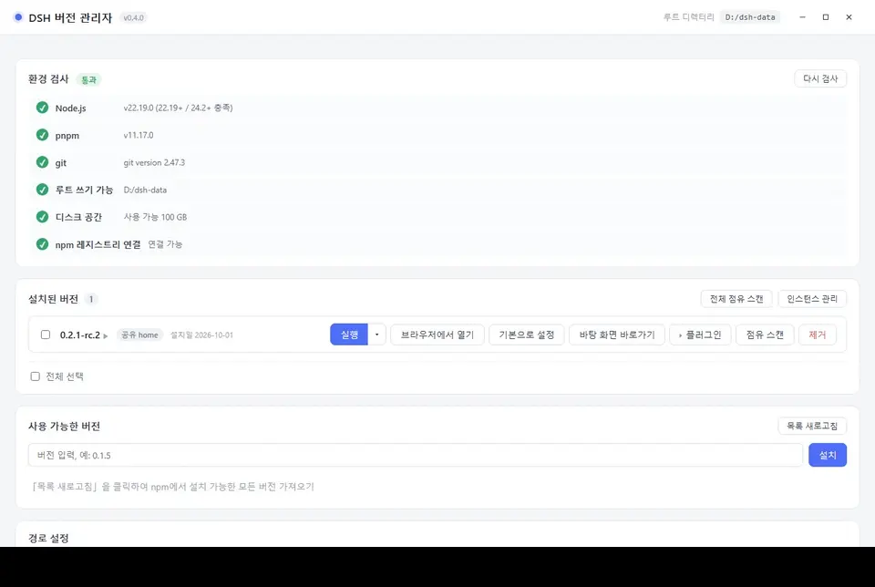

- **제거**: 플러그인 오른쪽의 '제거'를 누릅니다. 대형 플러그인은 수십 초가 걸릴 수 있으며, 항목에는 회전 표시와 실행된 초수가 표시됩니다.
- **업데이트 점검**: 도구바의 '업데이트 점검'을 누르면 새 버전이 있으면 항목에 빨간 배지 및 '업데이트' 버튼이 나타납니다. '전체 업데이트'를 눌러 항목별로 업데이트할 수도 있으며 (실패 시 해당 항목 자동 롤백).
- **공유 홈 건강 진단**: 도구바의 🩺 버튼을 누르면 공유 profile 의 링크만 읽기 전용으로 스캔하고, 오래된 버전 잔여물, 공중 링크, 중복 소스를 보고하며 파일을 변경하지 않습니다.
- **디렉토리 열기**: 패널 오른쪽 상단의 📂 버튼을 누르면 리소스 관리자로 profile 디렉토리를 엽니다.

각 플러그인은 두 줄을 차지합니다: 첫 줄은 아이콘과 패키지명 (긴 패키지명은 줄바꿈하여 전체 표시) 이며, 두 번째 줄은 버전, 소스 태그 및 작업 버튼입니다.

**추천 탭의 사용법**:

- 상단 탭바는 분류로 필터링합니다 (전체/도구 강화/콘텐츠 집계 ...). 분류가 많을 경우 오른쪽에 `‹ ›` 스크롤 버튼이 나타납니다.
- 카드 첫 줄은 패키지명과 '설치' 버튼이며, 두 번째 줄은 GitHub/npmjs 링크 및 한 줄 설명입니다.
- 설명은 인터페이스 언어에 따라 변경됩니다 (간체중/번체중/English/日本語/한국어). 번역이 제공되지 않은 항목은 중국어 원문을 표시합니다.
- 설명이 너무 길 경우 오른쪽이 점진적으로 숨어지며, 설명을 올렸거나 '전체 설명 보기'를 누르면 전체 내용을 볼 수 있습니다.
- 분류 탭바는 왼쪽 버튼을 누르고 좌우로 드래그할 수 있습니다.
- ⭐ 가 있는 항목은 추천 또는 같은 저자의 작품으로, 목록 맨 앞에 나옵니다.
- 목록이 열릴 때 자동으로 업데이트를 점검합니다 (30 분 내에 중복 점검 안 함). 분류바 오른쪽의 **↻** 를 눌러 강제로 점검할 수 있습니다.
- 점검 실패 시 상단에 '추천 목록이 최신이 아닐 수 있음'이 경고되며, 목록은 여전히 사용 가능합니다 (마지막으로 가져온 내용 또는 프로그램 배포 시 내장 복사본 사용).
- 목록의 신구성은 `updatedAt` 타임스탬프로 비교합니다: 로컬이 원격보다 새 경우 덮어쓰지 않습니다 (오래된 캐시가 새 버전 내장 복사판을 가리는 것을 방지).
- 목록을 가져올 때 GitHub 직접 연결이 실패하면 순서대로 `gh-proxy.com` → `cdn.jsdelivr.net` 로 회귀합니다 (v0.3.2+).

**원리**: dsh 플러그인은 npm 패키지이며, `<DSH_HOME>/profiles/<profile>/` 에 설치됩니다. 이 도구는 dsh 내장 `dsh plugin --profile <p> add/remove <패키지>` 를 실행합니다 (수동으로 dsh 명령을 치는 것과 동일).

> **전제**: 해당 버전이 dsh 에서 **최소 한 번 실행**되어야 합니다 (profile 디렉토리가 생성되기 때문). 'profile 디렉토리가 없음'이 표시되면 먼저 dsh 에서 한 번 여세요.

### 배치 작업

설치된 목록은 다중 선택을 지원합니다:

- 각 버전 왼쪽에 체크박스가 있으며, 선택하면 하단에 배치 작업바가 나타납니다.
- '전체 선택'은 이 그룹을 선택하고, '선택 해제'는 취소합니다.
- '배치 제거'는 한 번 확인 후 순차적으로 실행하며, 진행 상황을 실시간으로 표시하고 실패 항목을 요약합니다.
- 배치 작업 중에는 **선택된 항목의 버튼이 비활성화**됩니다 (오류 방지), 선택되지 않은 항목은 영향을 받지 않습니다.

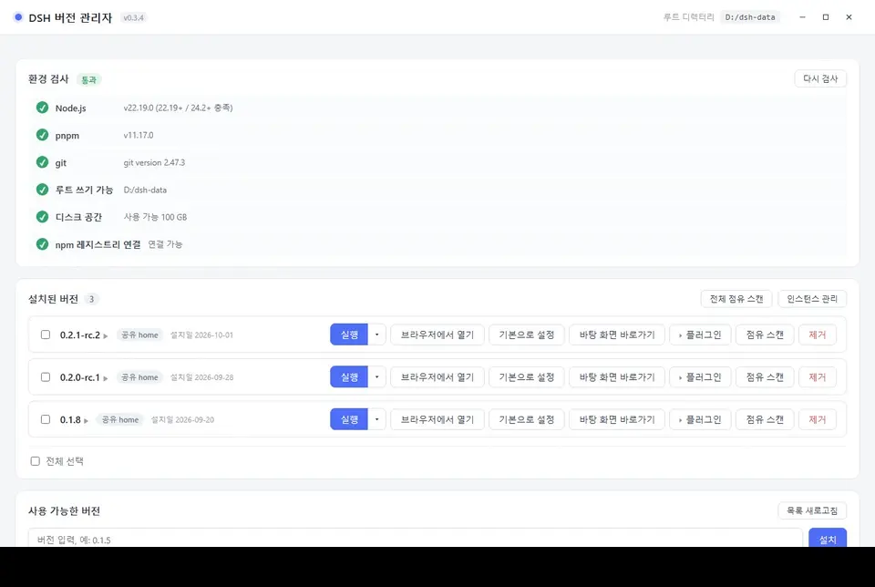

### 사용 가능한 버전 목록

- 버전 번호 **검색** 지원
- **정렬** 지원 (최신 우선/가장 오래된 우선)
- 버전 번호를 누르면 **입력란에 입력**되며, **동시에 그 아래에 해당 버전의 업데이트 설명이 즉시 확장**됩니다 (다시 한 번 누르면 접힘).
- 업데이트 설명 데이터는 dsh 상류 GitHub Releases 에서 가져와 소독 후 표시되며, '브라우저에서 원문 열기' 버튼이 있습니다.
- 같은 버전을 한 번 본 후, 다시 누르면 ( '사용 가능한 버전' 또는 '설치된 버전' 에서든) 즉시 표시됩니다.
- **회색으로 표시된 버전**은 '설치 실패' 버전입니다 (의존성 제거된 사설 패키지 등). '표시 제거'를 누른 후 다시 시도할 수 있습니다.

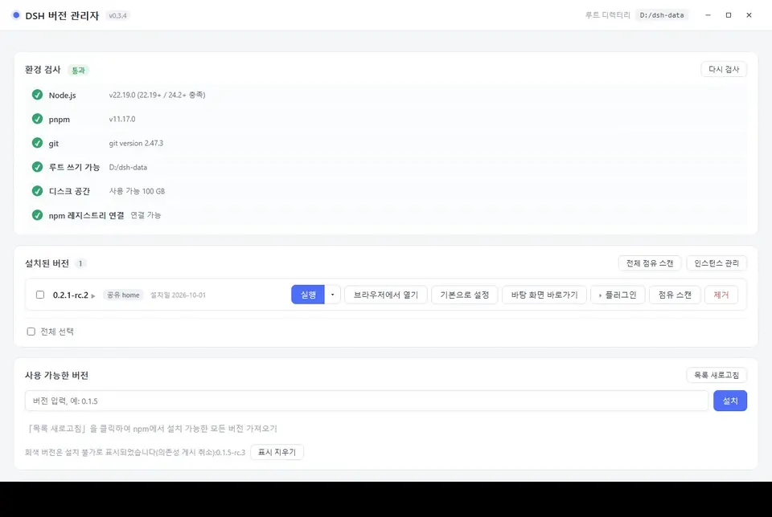

설치 중의 진행바:


### 설치 실패 처리

설치 실패 시 오류 카테고리에 따라 특정 안내를 제공합니다:

| 카테고리 | 안내 |
| :--- | :--- |
| **네트워크 문제** | 소스 변경 대화상자 표시 (공식/알리바바/텐센트/화웨이/사용자 정의), 원클릭 재시도 |
| **사설 패키지 제거** | 해당 버전 공식 릴리스 불완전하여 모든 소스에서 설치 불가; 버전은 회색으로 표시됩니다. 소스 변경 후 재시도 시도 가능 |
| **버전 불완전/미러 비동기** | npmmirror 가 특정 서브패키지를 아직 동기화하지 않았을 수 있음; 팝업에서 직접 공식 소스로 재시도 가능, 여전히 실패하면 버전 변경 |

네트워크 문제의 소스 변경 대화상자:

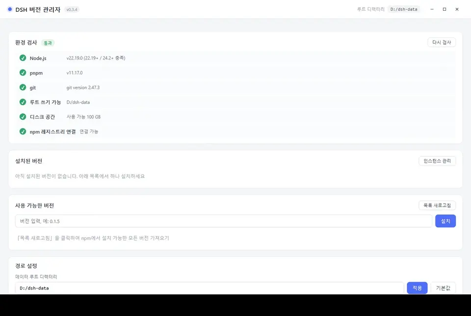

사설 패키지 제거 안내:

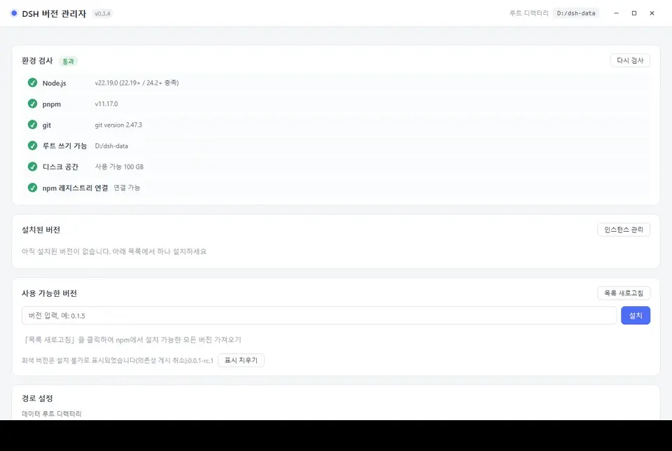

### 경로 설정

**데이터 루트 디렉토리**를 수정할 수 있습니다 (기본값: exe 와 같은 디렉토리; 입력 시 자동으로 앞뒤 공백 제거). 변경 시 터미널 `dsh` 스크립트 내 경로를 동기화 업데이트합니다.

아래에 각 데이터 디렉토리가 나열되며, **임의의 행을 클릭하면 파일 관리자에서 해당 디렉토리를 엽니다**. 기본적으로 5 개 핵심 디렉토리 (`versions` / `home` / `store` / `cache` / `state`) 를 표시하며, '**전체 디렉토리 확장**'을 눌러 `logs` / `homes` / `webview` / `trash` / `assets` 등 나머지 디렉토리를 볼 수 있습니다.


패널에는 **'구성 내보내기'**와 **'구성 가져오기'** 버튼도 있습니다:

- **구성 내보내기**: 현재 구성 + 설치된 버전 목록을 JSON 파일로 저장합니다 (기기 이동용, 의존성/인증 정보 포함 안 함).
- **구성 가져오기**: 백업 JSON 을 선택 → 변경될 필드 미리보기 → 확인 후 적용 (구성만 복원, 버전은 별도로 설치).

아래에는 **유지 관리 영역**이 있습니다 (10 절 참조).

---

<a id="s5"></a>

## 5. dsh 실행의 세 가지 방법

설치 완료 후, 각 버전마다 세 가지 시작 경로가 있습니다:

### 1. 실행 (내장 창) — 권장

앱 내에서 직접 dsh 웹 인터페이스를 엽니다 (기본값 1100×760).

- 각 **버전 + 대상**은 독립적인 WebView2 데이터 디렉토리를 사용합니다: 공유 창은 `<데이터근>/webview/<버전>/_shared`, 인스턴스 창은 `<데이터근>/webview/<버전>/<인스턴스 id>`, 쿠키/캐시는 서로 오염되지 않습니다.
- 창을 닫으면 해당 대상에 해당하는 dsh 프로세스만 종료되며, 같은 버전의 다른 인스턴스 창에는 영향이 없습니다.
- 같은 **대상**을 다시 실행하면 **기존 창에 포커스**가 가해지며, 같은 버전의 다른 인스턴스는 동시에 실행할 수 있습니다.
- 창 제목은 `DSH <버전>`이며, 인스턴스 창은 `DSH <버전> · <인스턴스명>`입니다.
- 창 왼쪽 상단에는 **작은 원점**이 있습니다: 마우스를 올리면 버전 번호가 표시되고, 클릭하면 패널이 팝업됩니다:
  - **버전 번호**: 현재 실행 중인 dsh 버전
  - **완전한 URL**: 클릭하여 전체 선택 및 복사할 수 있으며, 브라우저에 붙여넣어 같은 인스턴스를 엽니다.
  - **재시작**: 해당 버전 내장 창 뒤의 dsh 프로세스를 종료하고, 같은 버전으로 다시 시작하며, 창 내비게이션을 새 주소로 변경합니다 (세션 데이터는 유지되지만 페이지 상태는 손실됨). 플러그인을 설치/해제하거나 dsh 버전을 변경한 후 이를 통해 효과를 발휘합니다.
  - **수축** (패널 오른쪽 상단 ×): 패널만 수축하며 dsh는 종료하지 않습니다. dsh를 중지하려면 창을 직접 닫습니다.

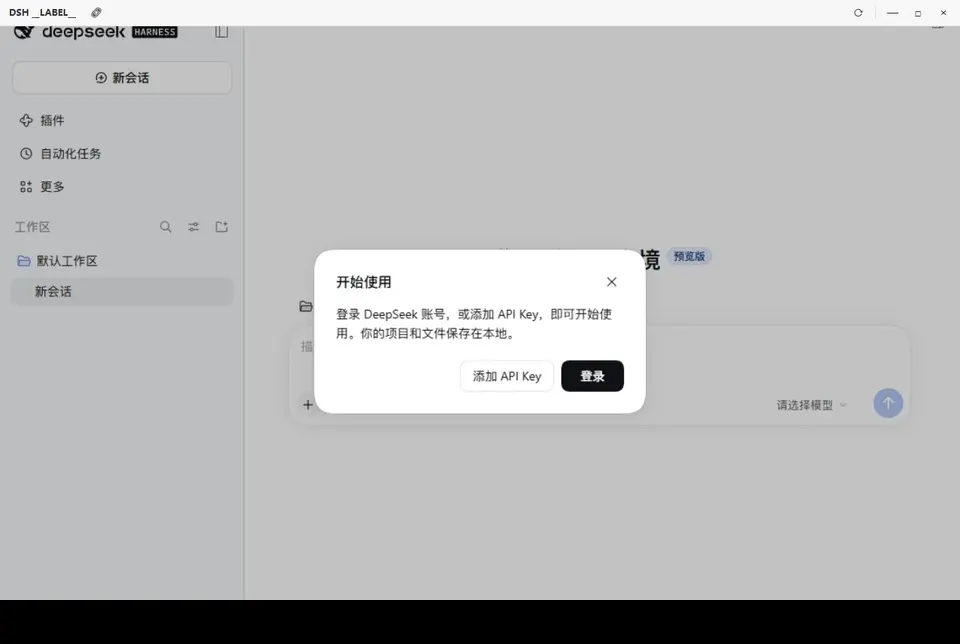

> 포트는 시스템이 자동으로 할당합니다 (`--port 0`) 충돌하지 않습니다.

### 2. 브라우저로 열기

**새 콘솔 창**으로 dsh를 시작하며, dsh가 자체적으로 시스템 기본 브라우저를 엽니다. 동작은 「자신으로 터미널을 열어 `dsh web` 입력」과 동일합니다.

- **현재 메인 버튼 대상 사용**: 공유 홈 또는 특정 인스턴스의 `DSH_HOME`을 사용합니다. 인스턴스를 변경하려면 먼저 인스턴스 플로팅 레이어에서 대상을 전환해야 합니다.
- **콘솔 창 유지**: dsh 출력 (완전한 URL 및 토큰 포함) 이 창에 표시되어 직접 복사할 수 있습니다.
- **콘솔 창을 닫으면 서비스 중지**
- Linux: 관리자는 시스템 터미널 시뮬레이터 (`x-terminal-emulator` / `xterm` / `gnome-terminal` / `konsole` / `xfce4-terminal` 등) 를 찾아 해당 창을 실행합니다. 모두 설치되지 않은 경우 설치 후 재시도할 것을 명확히 안내합니다.
- 포트는 **고정 3080**입니다.
- **3080 포트가 사용 중일 경우**: 「포트 3080 이 사용 중입니다」라는 대화 상자가 팝업되며, 다음을 선택할 수 있습니다:
  - 「임의 포트 사용」— 빈 포트를 찾아 엽니다 (주소는 콘솔 창에 표시된 대로입니다).
  - 「취소」— 이번 작업을 포기합니다.
- 해당 버전이 이미 내장 창으로 실행 중이면, 먼저 추가 실행 여부를 확인하는 팝업이 표시됩니다.

> dsh 를 진정한 브라우저에서 실행하고 싶거나 (예: 브라우저 플러그인을 사용하려면), dsh 실시간 출력을 관찰하기에도 적합합니다.

### 3. 데스크톱 단축키

「단축키」를 클릭하여 현재 버전의 데스크톱에 `DSH <버전번호>.lnk`를 생성합니다.

- 더블 클릭 = **간소화된 시작**: 관리자 메인 인터페이스를 표시하지 않고 해당 버전의 내장 창을 직접 엽니다.
- 모든 창이 닫히면 프로그램이 자동으로 종료됩니다.
- 자주 사용하는 버전을 데스크톱/작업 표시줄에 고정하는 데 적합합니다.

---

<a id="s6"></a>

## VI. 단말기 단축 명령어 dsh

어떤 버전에서「**기본값으로 설정**」을 누르면 `%APPDATA%\npm\` 디렉토리에 `dsh.cmd` 리다이렉트 스크립트가 생성됩니다 (이 디렉토리는 일반적으로 시스템 PATH 에 이미 존재합니다).

그 이후에 **어떤 단말기**에서 직접 입력하면:

```bash
dsh web          # 기본 버전의 웹 인터페이스 시작
dsh doctor       # 다른 하위 명령어도 기본 버전으로 매핑됨
dsh --version
```

### 작동 방식

스크립트에는 버전 번호, 루트 디렉토리 및 `DSH_HOME`(프로그램 생성 시 계산되며 JSON 을 파싱하지 않음) 이 **고정**되어 있습니다. `DSH_HOME` 은 해당 버전의 **현재 메인 버튼 대상**을 가리킵니다: 공유 홈, 공식 `~/.dsh`, 또는 인스턴스의 `homes/<id>`. 내용은 대략 다음과 같습니다:

```bat
set "VER=0.2.0-rc.1"
set "ROOT=D:\dsh-multiver"
set "DSH_HOME_CANDIDATE=D:\dsh-multiver\home"
...
call "%ROOT%\versions\%VER%
ode_modules\.bin\dsh.cmd" %*
:: 공유 홈 예시; 메인 버튼이 인스턴스를 가리킨다면 여기는 D:\dsh-multiver\homes\i1 이 될 것입니다
:: 위는 예시 경로이며, 실제로는 dsh-multiver 가「기본값으로 설정」할 때 사용자 데이터 루트 디렉토리에 따라 생성됩니다
```

> 스크립트에는 안전 장치가 포함되어 있습니다: `DSH_HOME` 디렉토리가 존재하지 않으면 해당 변수를 설정하지 않고 dsh 기본 위치(`~/.dsh`) 로 회귀합니다.

**기본 버전 변경, 루트 디렉토리 변경, 메인 버튼 대상 변경, 기본 버전 제거** 시 이 스크립트가 자동으로 다시 생성됩니다. 기본 버전이 없을 경우 이를 삭제합니다. 특정 인스턴스를 임시로 지정하려면 `dsh-multiver run <버전> --instance <id>`를 사용하며, 리다이렉트 스크립트는 변경하지 않습니다.

### 다른 방식으로 설치된 dsh 와의 공존

dsh 는 여러 가지 공식 배포 형태가 있으며, 이들은 본 관리자 (관리 프로그램) 와 다른 관계를 가집니다:

| 설치 방법 | 충돌 여부 | 설명 |
| :--- | :--- | :--- |
| `npm i -g @deepseek-ai/dsh` | **충돌 발생, 처리됨** | 둘 다 `%APPDATA%\npm\`(유닉스는 `~/.local/bin`) 에 동일한 이름의 `dsh` 를 작성합니다. 기본값을 설정할 때 검출하면 본 관리자가 생성한 명령어가 아니라는 것을 발견하면 확인을 요청하며, 침묵하여 덮어씌우지 않습니다. 제거할 때도 본 관리자가 생성한 것만 삭제하고 공식 버전은 건드리지 않습니다. |
| `pnpm add -g @deepseek-ai/dsh` | **충돌 가능, 검출 안됨** | pnpm 의 글로벌 bin(예: `%LOCALAPPDATA%\pnpm`) 은 본 관리자의 검출 범위에 포함되지 않습니다. 해당 디렉토리가 PATH 에서 앞에 오면 `dsh` 를 입력하면 pnpm 버전이 실행되고, 본 관리자의 리다이렉트 스크립트가 우회됩니다. |
| Python wheel | **충돌 가능, 검출 안됨** | 위와 같습니다. `dsh` 는 Python 의 `Scripts/` 또는 `bin/` 에 설치되며, PATH 순서에 따라 어떤 버전이 실행되는지 결정됩니다. |
| DeepSeek Harness 데스크톱 버전 | 충돌 없음 | Electron 앱은 자체 런타임을 가져 PATH 에 `dsh` 명령어를 설치하지 않습니다. |

**현재 입력한 `dsh` 가 누구인지 판단**:

```powershell
# Windows
Get-Command dsh | Select-Object Source
```

```bash
# Linux / macOS
which -a dsh
```

- 경로가 `%APPDATA%\npm\dsh.cmd`(유닉스는 `~/.local/bin/dsh`) → 본 관리자의 리다이렉트 스크립트
- 경로가 pnpm 또는 Python 디렉토리에 있음 → 공식 설치 버전

**본 관리자의 버전을 우선으로 하려면**: `%APPDATA%\npm\`(유닉스는 `~/.local/bin`) 을 PATH 의 앞부분으로 이동하세요.

> ⚠️ **DSH_HOME 공유 위험**:「공식 `~/.dsh` 재사용」을 활성화하면 본 관리자와 공식 설치가 동일한 `profiles/`, `sessions/` 및 인증 정보를 공유합니다. 서로 다른 dsh 버전의 profile 에 포함되는 버전이 다를 수 있으며, 서로 `node_modules` 를 덮어쓰면 오류가 발생할 수 있습니다. 공유 전 각 버전이 필요한 bundle 이 일치하는지 확인하거나 데이터 격리를 사용하세요.

> ⚠️ 단말기가 `'dsh' 는 내부 또는 외부 명령이 아닙니다'를 표시하면 `%APPDATA%\npm\` 가 PATH 에 있는지 확인하세요.

---

<a id="s7"></a>

## 7. 데이터 격리 및 인스턴스

dsh 의 데이터 디렉토리 (세션, 설정, 플러그인, 인증서) 는 시작 시 주입된 `DSH_HOME` 으로 결정됩니다:

| 대상 | DSH_HOME | 설명 |
| :--- | :--- | :--- |
| **공유 홈** (기본값) | `<데이터근>/home` | 모든 비격리 버전이 **공유**합니다 |
| **공식 홈** | `~/.dsh` | 「공식 설정 재사용」을 켜면 사용되며, 공식 설치와 공유됩니다 |
| **인스턴스** | `<데이터근>/homes/<id>` | 인스턴스 전용; 하나의 홈은 여러 버전으로 마운트할 수 있습니다 |

**인스턴스는 전역 엔티티**입니다: 하나의 버전은 임의의 여러 인스턴스를 마운트할 수 있으며, 동일한 인스턴스도 여러 버전으로 마운트되어 동일한 세션/인증서/플러그인 설정을 공유합니다. 각 버전은 `selected_target` 을 사용하여 자신의 메인 버튼 대상 (공유 또는 특정 인스턴스) 을 기억합니다; 이는 다음 실행에만 영향을 미치며 이미 열려 있는 창에는 영향을 미치지 않습니다.

### 인스턴스를 언제 사용해야 하는가

- 호환되지 않는 플러그인을 테스트하여 메인 환경을 오염시키지 않으려면
- 깨끗한 세션 이력/설정을 유지하려면
- 동일한 버전의 여러 독립 환경을 동시에 열어 비교하려면

> ⚠️ **공유 홈의 위험**: 비격리 버전은 동일한 데이터 디렉토리를 공유합니다. 새 버전의 플러그인/설정이 오래된 버전과 호환되지 않으면 **오래된 버전을 연루**시킬 수 있습니다. 예를 들어 dsh 0.1.7 의 「폴더 열기」기능이 고장 난 경우, 공유 홈 아래에서는 모든 버전에 영향을 미칩니다.
>
> 이상한 문제가 발생하면 버전에게 인스턴스를 붙이거나 [자주 묻는 질문](#s11) 을 참조하세요.

### 인스턴스 플로팅 레이어

버전 행 메인 버튼 오른쪽의 작은 삼각형이 **인스턴스 플로팅 레이어**를 엽니다 (원래의 「격리됨 ▾」메뉴가 이를 대체했습니다):

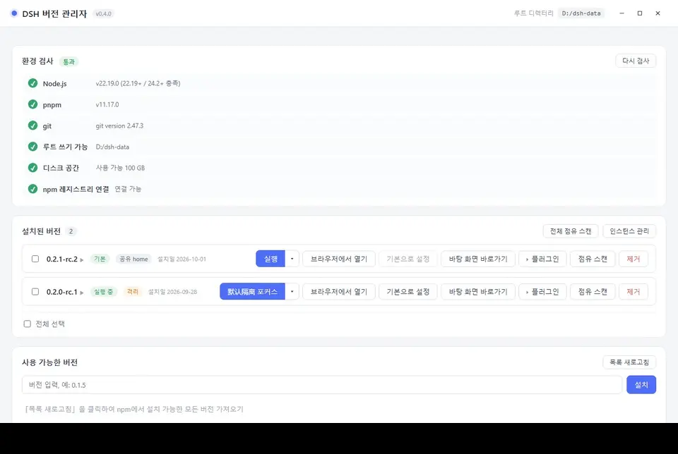

- **공유 홈** 행 — 공유/공식 홈으로 실행; 라디오 버튼이 메인 버튼 대상 결정
- **인스턴스 행** — 실행/초점, 디렉토리 열기, 이름 변경, 삭제; 실행 중에는 「실행 중 (버전)」이 표시되며 삭제 버튼은 비활성화됩니다.
- **＋ 새 인스턴스** — 이름을 입력; 생성 후 인스턴스 관리 패널에서 버전을 계속 마운트할 수 있습니다.
- **라디오 버튼 전환** — 메인 버튼이 즉시 「<인스턴스명> 실행」으로 변경; 동일한 인스턴스를 반복해서 실행하면 이미 있는 창만 초점을 맞춥니다.

### 인스턴스 관리 패널

버전 목록 오른쪽 상단의 「인스턴스 관리」버튼이 전체 패널을 엽니다:

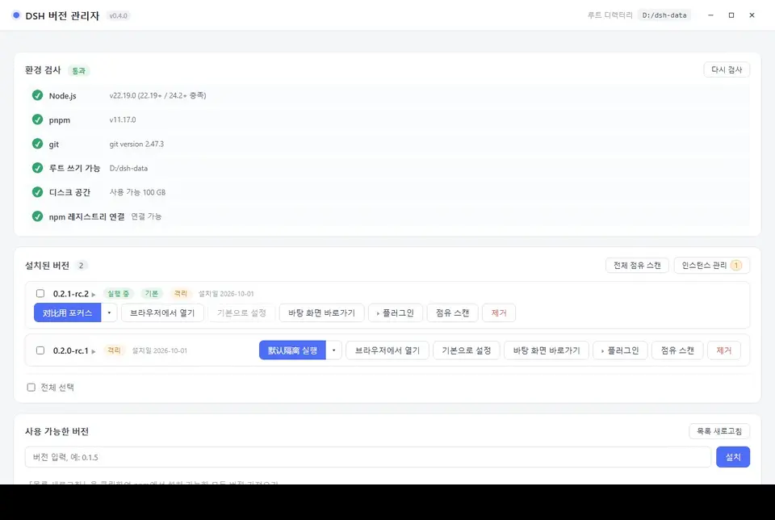

- **모든 인스턴스**를 나열; 고아 (마운트된 버전이 없는 인스턴스) 는 **상단**에 배치되고 「마운트되지 않음」으로 표시되며, 버튼에는 고아 수를 나타내는 각본이 표시됩니다.
- 각 행에는: 이름, 홈 경로, 사용량 (「사용량 스캔」을 눌러 계산), 마운트된 버전, 메인 버튼 대상, 실행 상태를 표시합니다.
- 작업: 실행/초점, 디렉토리 열기, 이름 변경, 마운트/해제 마운트, 삭제
- **＋ 새 인스턴스**: 이름을 입력하고 마운트할 버전을 선택; 생성하면 즉시 목록에 나타납니다.
- 실행 중인 인스턴스는 삭제할 수 없습니다; 이름 변경 및 해제 마운트는 허용됩니다.

### 제약 및 마이그레이션

- 인스턴스 삭제: `homes/<id>` 를 `trash/instance-<id>-<타임스탬프>` 로 먼저 이름 변경한 후 설정을 지웁니다. 백그라운드에서 정리되며 실패 시 직접 삭제로 퇴화합니다.
- 버전 제거: 해당 버전의 마운트만 해제하고, **인스턴스를 고아로 유지**합니다. `homes/<id>` 를 삭제하지 않습니다.
- 선택된 대상 무효화 (인스턴스 삭제/해제 마운트): 공유 홈으로 침묵하게 되돌아갑니다; 첫 번째 마운트된 인스턴스를 자동으로 선택하지 않습니다.
- 인터페이스는 인스턴스 이름만 표시하며 내부 id (`i1`/`i2`…) 를 표시하지 않습니다; id 는 홈 경로, CLI/JSON 및 로그에만 나타납니다.
- **v0.3.x 업그레이드**: 이전 `versions/<버전>/home` 은 `homes/<id>` 로 마이그레이션되며, 이전 `isolated_versions` 는 자동으로 「기본 격리」인스턴스를 생성합니다. 마이그레이션은 중단 및 재시도가 가능하며 사용자 데이터를 삭제하지 않습니다; 대상이 이미 존재하면 재사용하고 로그를 작성합니다.

---

<a id="s8"></a>

## 8. 명령줄 모드 (CLI)

> **v0.3.0 부터는 서브 명령어 스타일** (`dsh-multiver list`) 로 변경되었습니다. 스크립트, 배치 처리, CI 에 적합합니다.

CLI 서브 명령어 중 하나라도 포함되면 프로그램은 **그래픽 인터페이스를 시작하지 않으며**, 실행이 완료되면 종료 코드에 따라 종료됩니다 (성공 `0` / 실패 `1`).

| 명령 | 용도 |
| :--- | :--- |
| `list` | 설치된 버전을 나열합니다 (한 줄에 하나; 기본 버전은 `* ` 접두사로 표시됨) |
| `which` | 기본 버전 dsh 엔트리의 **절대 경로**를 출력합니다 (기본 버전이 없으면 실패) |
| `info <버전>` | 단일 버전의 세부 정보를 확인합니다 (경로 / 기본 / 격리 / 설정 디렉토리 / 사용량 / 인스턴스 및 메인 버튼 대상) |
| `versions` | 원격에서 사용할 수 있는 버전을 나열합니다 (npm 에서 조회, 최신 버전이 먼저 나옴) |
| `env` | 환경 확인 (Node / pnpm / 루트 디렉토리 쓰기 가능 / 디스크 / npm 소스 연결성; 치명적 항목 실패 시 종료 코드 1) |
| `isolate <버전> [--off]` | 격리를 활성화합니다 (기본 인스턴스 보장); `--off` 는 해당 버전의 모든 인스턴스 마운트를 해제합니다 (인스턴스 유지) |
| `isolate <버전> --list [--json]` | 해당 버전의 마운트된 인스턴스와 메인 버튼 대상을 나열합니다 |
| `isolate <버전> --attach <id>` / `--detach <id>` | 단일 인스턴스를 마운트하거나 마운트를 해제합니다 |
| `instance create --name <이름> [--attach <버전>...]` | 인스턴스를 생성합니다 (디렉토리 생성 안 함; 고아 먼저 생성 가능) |
| `instance list [--sizes] [--json]` | 모든 인스턴스를 나열합니다 (마운트되지 않은 고아 포함); 기본적으로 사용량을 스캔하지 않으며, `--sizes` 가 있어야 계산합니다 |
| `instance rename <id> <새이름>` | 인스턴스 표시 이름을 수정합니다 |
| `instance remove <id>` | 인스턴스를 삭제합니다 (home 을 휴지통으로 이동) |
| `clean` | 고립된 캐시 정리 + 휴지통 비우기 (`maintenance --cleanup` 의 상위 집합) |
| `doctor` | 원클릭 진단 (디렉토리 / 실패 표시 / 설치됨 / 환경); 치명적 항목 실패 시 종료 코드 1 |
| `shortcut <버전>` | 특정 버전의 데스크톱 단축키를 생성합니다 |
| `copy-shared <버전> [--instance <id>]` | 공유 home 데이터를 대상 인스턴스 home 으로 복사합니다 |
| `clear-isolated <버전> [--instance <id>]` | 대상 인스턴스 home 을 비웁니다 (버전 자체는 유지) |
| `export [<파일>]` | 설정 + 버전 명단을 (JSON) 으로 내보냅니다. 기기 변경 시 이주로 유용합니다 |
| `import <파일>` | 백업 파일의 설정을 가져옵니다 (`--dry-run` 은 수정될 필드만 미리보기) |
| `run <버전> [--instance <id>]` | dsh web 을 시작합니다 (새 콘솔 창 + 시스템 브라우저 자동 열기; 창 닫기 시 중지) |
| `setup-runtime` | 누락된 포터블 런타임 (Node / pnpm) 을 감지하고 다운로드합니다; `--dry-run` 은 다운로드 없이 보고만 합니다 |
| `update` | 자동 업데이트를 확인하고 실행합니다 (다운로드 → 검증 → 자체 교체 → 재시작); `--dry-run` 은 새 버전이 있는지만 확인합니다 |
| `install <버전> [--registry <url>]` | 헤드리스 설치로, npm 소스를 지정할 수 있습니다 |
| `uninstall <버전>` | 헤드리스 제거 |
| `set-default <버전>` | 기본 버전으로 설정하고 터미널 `dsh` 명령을 다시 생성합니다 |
| `set-root <디렉토리>` | 데이터 루트 디렉토리를 설정합니다 (절대 경로; 하위 디렉토리 생성 및 포워딩 스크립트 다시 생성) |
| `maintenance [--cleanup|--prune]` | 헤드리스 유지관리; 서브 스위치가 없으면 둘 다 수행합니다 |
| `help` | 도움말 |
| `version` | 버전 번호 |

**수식어** (`--` 접두사 유지):

| 수식어 | 용도 |
| :--- | :--- |
| `--dry-run` | **실행 없이 미리보기** (파괴적 명령어와 함께: `install` / `uninstall` / `set-default` / `set-root` / `maintenance` / `isolate` / `instance` / `clean` / `shortcut` / `copy-shared` / `clear-isolated` / `import` / `setup-runtime` / `update`) |
| `--json` | **구조화된 출력** (기계 판독 가능 JSON); 형식만 변경하고 동작은 변경하지 않습니다 |
| `--force` | 해당 관리자가 생성하지 않은 `dsh` 명령을 덮어씁니다 (`set-default` 용) |
| `--registry <url>` | npm 소스를 지정합니다 (`install` 용) |
| `--off` | 해당 버전의 모든 인스턴스 마운트를 해제합니다 (`isolate` 용) |
| `--list` | 해당 버전의 마운트된 인스턴스를 나열합니다 (`isolate` 용) |
| `--name <이름>` | 인스턴스 생성 시 표시 이름 (`instance create` 용) |
| `--attach <버전>` | 인스턴스 생성 시 버전 마운트, 반복 가능 (`instance create` 용) |
| `--detach <id>` | 버전과 인스턴스의 마운트를 해제합니다 (`isolate` 용) |
| `--instance <id>` | 인스턴스를 지정합니다 (`run` / `copy-shared` / `clear-isolated` 용) |
| `--sizes` | 인스턴스 사용량을 동시에 계산합니다 (`instance list` 용; 기본적으로 스캔하지 않아 인스턴스가 많을 때 멈추는 것을 방지) |

> ⚠️ **v0.3.0 파괴적 변경**: 이전 `--flag` 구문 (예: `--list`) 은 **제거**되었습니다. 현재 명령은 이 장의 명령 표를 참조하세요.

### 예시

```bash
# 설치된 버전을 확인합니다 (출력은 파이프 가능)
dsh-multiver.exe list

# 버전 설치
dsh-multiver.exe install 0.2.0-rc.2

# 지정된 소스로 설치 (네트워크가 좋지 않을 때)
dsh-multiver.exe install 0.2.0-rc.2 --registry https://registry.npmmirror.com

# 기본 설정
dsh-multiver.exe set-default 0.2.0-rc.2

# 데이터 루트 변경 (절대 경로)
dsh-multiver.exe set-root D:/DSH-data

# 제거
dsh-multiver.exe uninstall 0.1.5-rc.3

# 고립된 캐시 정리
dsh-multiver.exe maintenance --cleanup

# 의존성 저장소 정리
dsh-multiver.exe maintenance --prune

# 특정 버전의 세부 정보 확인
dsh-multiver.exe info 0.2.0-rc.2

# 원격에서 설치 가능한 버전을 확인
dsh-multiver.exe versions

# 환경 자체 확인 (배포 전 사전 확인 / 문제 해결; 치명적 항목 실패 시 종료 코드 1)
dsh-multiver.exe env

# 특정 버전의 데이터 격리 켜기/끄기
dsh-multiver.exe isolate 0.2.0-rc.2
dsh-multiver.exe isolate 0.2.0-rc.2 --off

# 인스턴스 생성 및 두 버전 마운트
dsh-multiver.exe instance create --name 비교용 --attach 0.2.0-rc.2 --attach 0.2.1-rc.2
dsh-multiver.exe instance list --json

# 사용량 표시 시 명시적 스캔 (인스턴스가 많을 때 기본 목록은 home 을 반복하지 않음)
dsh-multiver.exe instance list --sizes --json

# 인스턴스 이름 변경 / 삭제 (삭제는 home 을 휴지통으로 이동)
dsh-multiver.exe instance rename i2 비교용-2
dsh-multiver.exe instance remove i2

# 특정 버전의 인스턴스 확인/조정
dsh-multiver.exe isolate 0.2.0-rc.2 --list
dsh-multiver.exe isolate 0.2.0-rc.2 --attach i2

# 지정된 인스턴스로 시작/정리
dsh-multiver.exe run 0.2.0-rc.2 --instance i2
dsh-multiver.exe clear-isolated 0.2.0-rc.2 --instance i2

# 고립된 캐시 정리 + 휴지통 비우기
dsh-multiver.exe clean

# 원클릭 진단 (문제 해결용)
dsh-multiver.exe doctor

# 설정 내보내기 (기기 변경 시 이주용)
dsh-multiver.exe export backup.json

# 설정 가져오기 (수정될 필드 먼저 미리보기)
dsh-multiver.exe import backup.json --dry-run
dsh-multiver.exe import backup.json

# 미리보기만, 실제 실행 안 함 (파라미터 올바른지 확인용)
dsh-multiver.exe install 0.2.0-rc.2 --dry-run
dsh-multiver.exe uninstall 0.1.5-rc.3 --dry-run
dsh-multiver.exe maintenance --prune --dry-run
```

### 구조화된 출력 (--json)

스크립트/CI 용: `--json` 추가하여 기계 판독 가능 JSON 출력 (stdout 에는 JSON 만, 다른 출력 없음).

```bash
# 버전 목록 (객체 배열, is_default / isolated / installed_at 등 포함)
dsh-multiver.exe list --json

# 기본 버전 dsh 엔트리의 절대 경로
dsh-multiver.exe which --json

# 파괴적 명령어 미리보기 (dry-run + json)
dsh-multiver.exe install 0.2.0-rc.2 --dry-run --json

# 버전 세부 정보 (완전 객체, 공유/독점 크기 포함)
dsh-multiver.exe info 0.2.0-rc.2 --json

# 원격에서 사용할 수 있는 버전 배열
dsh-multiver.exe versions --json

# 환경 확인 항목 배열 (CheckItem: name/ok/detail/critical)
dsh-multiver.exe env --json
```

### 설명

- **비상호 확인**: `install` / `uninstall` / `set-default` 는 "확정하시겠습니까?"를 묻지 않습니다. 파라미터가 정확한지 확인하세요.
- **출력 파이프 가능**: `list` 는 한 줄에 하나의 버전 번호; 설치 진행도는 **stderr**로, stdout 은 깨끗하게 유지됩니다.
- **JSON 출력**: `--json` 추가하여 기계 판독 가능 결과 얻음 (stdout 에는 JSON 만).
- **진행 표시**: 실제 터미널 하에서만 한 줄 진행 표시; 파일/파이프로 리디렉션 시 자동으로 침묵합니다.
- **CLI 서브 명령어 없이**일 경우, 이전과 완전히 동일한 동작: 그래픽 인터페이스 시작.


---

<a id="s81"></a>

## 8.1. 외관 및 언어

「경로 설정」패널 하단에는 **「외관 및 언어」** 설정이 있습니다:

| 설정 | 옵션 |
| :--- | :--- |
| **테마** | 시스템跟随 / 밝은색 / 어두운색 |
| **언어** | 시스템跟随 / 간체중국어 / 번체중국어 / English / 日本語 / 한국어 |

- 두 가지 선호도는 **로컬에 저장**되어 다음에 열 때 자동으로 복원됩니다.
- **첫 화면 렌더링 전**에 적용되어 깜빡임을 방지합니다.
- 「시스템跟随」는 시스템 테마/언어 변경에 실시간으로 반응합니다.

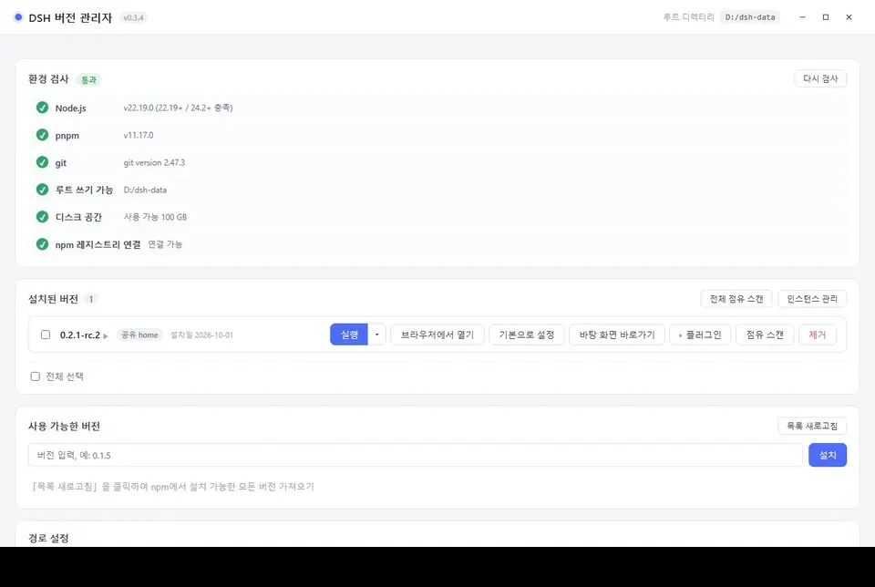

> CLI 출력은 **언어 설정의 영향을 받지 않습니다**(고정된 중국어)—— CLI 는 종종 스크립트로 파싱되므로 출력이 안정적이어야 합니다.

---

<a id="s82"></a>

## 8.2. dsh 에서 버전 관리

「버전 관리」플러그인을 설치하면 dsh 의 **설정 페이지**에 「버전 관리」입구가 추가됩니다. 동일한 multiver 데이터 루트를 읽으며 multiver 인터페이스에서 보는 것과 일치합니다.

### 플러그인 설치

dsh **0.2.0 버전부터** 플러그인을 지원하므로, 먼저 multiver를 켜지 않고 dsh 에서 바로 브릿지 플러그인을 설치할 수 있습니다.

1. dsh 의 **「플러그인」페이지**를 엽니다 → 우측 상단의 **「플러그인 추가」**를 누릅니다.
2. 입력란에 플러그인 패키지명 `dsh-multiver-bridge`를 입력합니다.
3. **「설치」**를 누르고 진행이 완료될 때까지 기다립니다.

설치가 완료되면 플러그인이 「실행 중」으로 표시되며, dsh 설정 페이지에 곧바로 「버전 관리」입구가 추가됩니다. 설치가 완료되면 dsh 를 재시작할 필요가 없습니다.

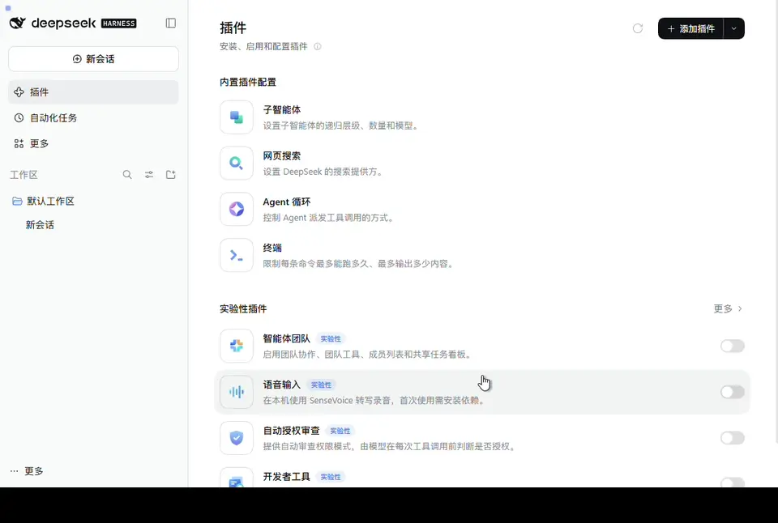

> 그림 16 은 **dsh 자체 플러그인 페이지**이며, 인터페이스 언어는 dsh 설정에 의해 결정되어 multiver 언어 전환과 함께 변경되지 않습니다.

> 플러그인은 **버전 확인 및 기본 버전 전환**에만 책임이 있으며, 설치/제거/인스턴스/격리는 multiver 가 수행합니다.

### 확인할 수 있는 내용

| 영역 | 내용 |
| :--- | :--- |
| **상태 표시줄** | 기본 버전; 실행 중인 버전 (출처 로고 포함); 기본 버전과 실행 중인 버전이 다를 경우의 「재시작 후 적용」알림; 일관성 교정 세부 정보 |
| **버전 표** | 버전 번호, 설치 날짜, 표시 (기본/격리/공유 home) |
| **동작 영역** | multiver 디렉터리 열기, 버전 디렉터리 열기, 진단 정보 복사, multiver 열기 |

**실행 중인 버전**의 출처는 두 가지입니다:

- multiver 가 dsh 를 시작할 때 주입하는 환경 변수 (가장 신뢰할 수 있으며, 「multiver 에서 온 것」표시)
- 프로세스 경로 자체 진단 (「추정」표시)

두 출처가 일치하지 않으면 「출처 충돌」이 표시되며, 이 경우 「재시작 후 적용」이 오인되지 않습니다. 먼저 안내에 따라 dsh 를 재시작합니다.

### 할 수 있는 일

- **기본 버전 설정**: 「기본 버전 설정」을 누르면 → 내联 확인 표시줄 → 확인. 인터페이스는 「dsh 를 재시작한 후 적용」을 표시합니다. 실행 중인 dsh 는 자체를 온화하게 교체할 수 없습니다.
- **multiver 열기**: 관리 프로그램 주 창을 바로 실행합니다. 내장 창에는 이 버튼이 표시되지 않습니다 (관리 프로그램을 다시 열는 것은 의미가 없습니다).
- **진단 정보 복사**: 현재 상태를 JSON 으로 패키징하여 클립보드 사용 불가 시 선택 가능한 텍스트 상자로降级하여 문제 해결을 용이하게 합니다.

### multiver 자체 업데이트

버전 관리 페이지 하단에는 「multiver 업데이트」구역이 있습니다:

- **최신 버전**: 현재 버전을 표시하며, 「다시 확인」을 누를 수 있습니다.
- **새 버전**: 버전 번호 및 릴리스 링크를 표시하며, 「업데이트」를 누른 후 확인합니다.

**두 가지 업데이트 방식**은 여기를 여는 위치에 따라 다릅니다:

| 시나리오 | 동작 |
| :--- | :--- |
| **내장 창**(multiver 가 시작한 dsh) | 업데이트를 누르면 **일시 저장**——새 exe 가 `<데이터 루트>/.update/` 로 다운로드되며, 페이지는 「설치 대기: vX.Y.Z」를 표시합니다. multiver **다음 시작 시** 자동으로 교체되며, 현재 세션에는 영향이 없습니다. |
| **독립 dsh**(터미널에서 시작, multiver 내장이 아님) | 업데이트를 누르면 **즉시 실행**——다운로드, 검증, 교체 및 관리 프로그램 재시작. |

내장 창이 일시 저장하는 이유: 현재 dsh 는 multiver 가 시작한 하위 프로세스이므로, 실행 중인 exe 를 직접 교체하면 세션을 중단하고 Windows 에서도 실행 중인 파일을 덮어쓰는 것은 허용되지 않습니다. 일시 저장은 양쪽 모두에 영향을 주지 않도록 multiver 가 실행되지 않을 때 교체가 발생합니다.

### 새로고침 타이밍

- 페이지가 가시화될 때마다 60 초마다 자동으로 새로고침
- 다른 탭에서 돌아올 때마다 즉시 새로고침
- 페이지가 비가시화되면 폴링이 중지 (각 새로고침마다 exe 를 한 번씩 시작해야 하므로 비용이 큼)
- 또는 페이지 하단의 「새로고침」을 눌러 수동으로 트리거할 수 있습니다.

### 설치 및 제거

플러그인은 exe 에 포함되지 않으므로 dsh 의 profile 로 별도로 설치해야 합니다:

```powershell
# dsh-multiver 의 dsh-plugin 디렉터리에서
pnpm pack
.\install.ps1 -DshCmd '<dsh.cmd 경로>' -Profile web -PackageDir '.\dsh-multiver-bridge-0.2.1.tgz'
```

**설치 후 반드시 dsh 를 재시작해야 합니다.** 제거는 `uninstall.ps1` 를 사용하며, 마찬가지로 재시작이 필요합니다.

자세한 내용은 [dsh-plugin/README](../dsh-plugin/README.md) 를 참조하세요.

> ⚠️ 내장 창에서 플러그인을 볼 수 없습니까? multiver 가 dsh 를 시작할 때 사용한 profile 이 플러그인을 설치했는지 확인하세요——multiver 는 고정적으로 `dsh web`(=`--profile web`과 동일) 을 사용합니다.

---

<a id="s9"></a>

## 9. 데이터 저장 구조

데이터 루트 디폴트 = **exe 가 있는 디렉토리**, 인터페이스「경로 설정」에서 수정할 수 있습니다. 실행 후 루트 디렉토리에 생성됩니다:

```
<데이터 루트>/
├── config.json              # schema 2: version_instances / selected_target / instance_seq / instances
├── versions/<버전>/         # 각 버전별 독립 설치 (home/ 더 이상 포함 안 함)
│   ├── package.json
│   ├── .npmrc               # node-linker=hoisted
│   └── node_modules/
├── home/                    # 공유 DSH_HOME (세션/설정/인증, ~/.dsh 와 유사)
├── homes/<id>/              # 인스턴스 DSH_HOME (각 인스턴스 1 개, 여러 버전挂载 가능)
├── store/                   # pnpm store (하드링크 중복 제거, 여러 버전 공유)
├── cache/                   # pnpm 캐시 (삭제 가능)
├── state/                   # pnpm 상태 (삭제 가능)
├── webview/<버전>/
│   ├── _shared/             # 해당 버전 공유 창口的 WebView2 데이터
│   └── <id>/                # 해당 버전 인스턴스 창口的 WebView2 데이터
├── trash/                   # 설치/삭제 휴지통 (인스턴스 삭제는 instance-<id>-<ts>)
├── .update/                 # 임시 저장 multiver 업데이트 패키지 (다음 시작 시 교체)
├── assets/                  # 내부 리소스 (바로가기 아이콘 등)
└── logs/                    # 시작 오류 로그 + 유지보수 로그
```

### 안전하게 삭제할 수 있는 항목

| 디렉토리 | 삭제 가능 여부 | 설명 |
| :--- | :--- | :--- |
| `cache/` `state/` | ✅ 삭제 가능 | pnpm 캐시, 삭제 시 다시 다운로드 |
| `webview/` | ✅ 삭제 가능 | 내장 창구 캐시; 삭제 시 재구성되지만 로그인 상태/쿠키 손실 |
| `assets/` | ✅ 삭제 가능 | 바로가기 아이콘 등 내부 리소스, 재구성됨 |
| `trash/` | ⚠️ 정리 가능 | 휴지통; 정리 시 **복구 불가**, 복구하려는 데이터가 있는지 확인 |
| `store/` | ⚠️ 신중하게 | **각 버전의 의존성은 여기에 있는 파일을 하드링크로 참조**, 삭제 시 모든 버전이 작동하지 않음 |
| `versions/` | ❌ 직접 삭제 금지 | 인터페이스「제거」사용 |
| `home/` `homes/` | ❌ 직접 삭제 금지 | 세션, 설정 및 인증 정보 |
| `.update/` | ⚠️ 직접 삭제 금지 | 설치 대기 중인 업데이트를 삭제 시 이번 업데이트가 취소됨 |

### 자체 포함 원칙

모든 pnpm 디렉토리 (`store` / `cache` / `state`) 는 명시적으로 데이터 루트 디렉토리 내에 제한되며, **pnpm 의 글로벌 기본 위치** (예: `%LOCALAPPDATA%\pnpm`, 디스크 루트 `.pnpm-store`) 에는 **쓰지 않습니다**.

### 디스크 절약 및 "보여지는 절약 없음"

여러 버전의 의존성은 **하드링크**를 통해 `store` 내의 동일한 파일을 공유하여 디스크에는 **1 개만 저장**됩니다.
하지만 **Windows 폴더 속성은 공유된 파일을 중복 계산**하여 표시하므로, 표시된 사용량은 실제 디스크 소비량보다 큽니다. 이는 실제 디스크 소비를 의미하지 않습니다.

자세히 → **[하드링크와 디스크 사용량](硬链接与磁盘占用.md)** (실제 "재사용/독점" 확인 방법 포함).

---

<a id="s10"></a>

## 10. 자동 유지보수

프로그램 시작 시 **백그라운드 스레드**(인터페이스를 차단하지 않음)에서 다음 두 가지 작업을 수행합니다:

1. **고립된 WebView 캐시 정리** —— 두 단계 판정: 버전 디렉토리가 이미 존재하지 않으면 전체 `webview/<버전>`를 삭제합니다. 버전이 여전히 존재하면 `_shared`를 제외하고 더 이상 마운트되지 않는 `webview/<버전>/<인스턴스 id>`만 삭제합니다. 매번 시작할 때마다 실행되며 비용은 매우 낮습니다.
2. **pnpm 스토어 회수** —— 마지막부터 **7 일**이 지났을 때, 낮은 우선순위로 `pnpm store prune`을 실행하여 더 이상 참조되지 않는 의존성 패키지를 회수합니다. 시작 IO를 피하기 위해 30 초 지연합니다.

인스턴스를 삭제할 때 `homes/<id>`는 먼저 `trash/instance-<id>-<타임스탬프>`로 이름이 변경되며, 백그라운드에서 정리가 수행됩니다. `clean` 명령은 휴지통을 비웁니다.

로그는 `<데이터 루트>/logs/maintenance.log`에 기록됩니다.


### 유지보수 패널

「경로 설정」의 하단에서:

- **자동 유지보수 스위치** —— 끄면 시작 시 위의 두 작업을 수행하지 않습니다.
- **규칙 설명** + **마지막 실행 상태**
- **수동 버튼**: 「고립된 캐시 정리」「의존성 저장소 회수」「로그 디렉토리 열기」

> 수동 유지보수는 즉시 실행되며, 설정의 타임스탬프를 업데이트합니다.

---

<a id="s11"></a>

## 11. 자주 묻는 질문

### Q: 창 생성 실패: 웹뷰에 메시지를 보낼 수 없음

두 가지 요인이 겹칩니다: 관리자는 단일 인스턴스 잠금 (v0.3.0+) 을 가지며, 두 번째 인스턴스는 즉시 종료되고 실행 중인 창에 포커스가 갑니다. 그러나 내장 창 WebView2 데이터 디렉토리는 **이전 인스턴스가 아직 시작 중이거나 종료 중일 때** 즉시 다시 시작될 수 있으며, 여전히 이 오류를 보고할 수 있습니다.

**해결**: 몇 초 기다린 후 다시 시도하세요.

### Q: 시작 시 `WebView2 error 0x800700AA / 요청된 리소스가 사용 중` 오류 발생

WebView2 데이터 디렉토리가 **잔류 프로세스**에 의해 점유됩니다. 이는 관리자가 강제 종료되거나 충돌하거나, 테스트 기간 동안 잔류 프로세스가 남을 때 흔히 발생합니다. 이때 `Get-Process` 는 "종료됨"으로 표시할 수 있지만, 커널 객체가 해제되지 않아 디렉토리를 여전히 잠가 둡니다.

**해결**:

1. 작업 관리자를 열고 모든 `dsh-multiver.exe` 및 `msedgewebview2.exe` 프로세스를 종료하세요;
2. 프로세스를 종료할 수 없다면 (접근 거부), **컴퓨터를 재시작**하세요;
3. 재시작 후 관리자를 다시 시작하세요.

CLI 는 이 문제의 영향을 받지 않습니다 (WebView2 가 필요 없음).

### Q: 내장 창에 431 오류 표시 / '플러그인 로드 실패'

과거 버전은 **모든 창이 동일한 WebView2 데이터 디렉토리를 공유**하여 쿠키가 누적되고 요청 헤드가 팽창되는 문제가 있었습니다. 이제 각 버전은 독립 디렉토리 (`webview/<버전>`) 를 사용하여 이 문제를 근본적으로 해결했습니다.

만약 여전히 문제가 발생하면, 해당 `webview/<버전>` 디렉토리를 삭제하여 다시 생성하세요.

### Q: 설치 시 '패키지를 찾을 수 없음 ... cordis' 오류 발생

의존성 링크 모드가 잘못되었습니다. 각 버전 디렉토리는 `.npmrc` → `node-linker=hoisted` 를 작성하며, dsh 는 평평한 node_modules 를 필요로 합니다.

만약 수동으로 버전 디렉토리를 수정했다면, 삭제하고 다시 설치하세요.

### Q: 설치 시 `ERR_PNPM_IGNORED_BUILDS` 오류 발생

pnpm 10+ 는 기본적으로 의존성 빌드 스크립트를 실행하지 않아 node-pty / koffi 등의 네이티브 모듈이 누락됩니다. 도구는 설치 시 `--config.dangerouslyAllowAllBuilds=true` 를 포함하므로, 정상적으로는 이 오류를 만나지 않습니다.

### Q: 특정 버전을 계속 설치할 수 없으며, 계속 회전한 후 실패

오류 메시지 유형을 확인하세요:

- **사유 패키지下架** — 해당 버전은 공식적으로 완전히 출시되지 않았으며, **어떤 소스에서도 설치할 수 없음**. 다른 버전으로 변경하세요.
- **네트워크 문제** — 소스를 변경하여 다시 시도하세요 (알리바바 클라우드 / 텐센트 클라우드 선택).

> 설치할 수 없는 알려진 초기 버전: `0.0.1-rc.1`, `0.0.1-rc.2` (이미下架된 사유 패키지에 대한 의존성). 이러한 버전은 자동으로 회색으로 표시됩니다.

### Q: dsh 의 '폴더 열기' 기능이 작동하지 않음

이는 **dsh 0.1.7+ 의 상위 버그**입니다: `explorer.exe` 에 `windowsHide:true` 를 전달하여 폴더 창이 숨겨지고, 반환 코드가 잘못 판단되어 API 가 여전히 성공을 반환합니다.

**공유 홈 하에서는 모든 버전을 연달아 영향을 받습니다.**

**회피 방법**:

1. 커뮤니티 수정 플러그인을 설치하세요:
   ```bash
   dsh plugin --profile web add github:King20260919/dsh-open-folder-visible
   ```
2. 또는 해당 버전에 **데이터 격리**를 활성화하세요 (7 절 참조).

### Q: 터미널에서 `dsh` 를 입력하면 명령어를 찾을 수 없음

`%APPDATA%\npm\` 이 시스템 PATH 에 있어야 합니다. 환경 변수를 확인하거나, PATH 가生效되도록 터미널을 재시작하세요.

### Q: 버전을 제거할 때 '파일이 사용 중' 오류 발생

해당 버전의 dsh 프로세스가 여전히 실행 중입니다.

**해결**: 해당 내장 창 / 터미널을 닫은 후 다시 시도하세요.

### Q: exe 를 업데이트한 후 아이콘이 변경되지 않음

Windows 아이콘에는 캐시가 있습니다.

**해결**: `ie4uinit.exe -show` 를 실행하거나, 리소스 관리자를 재시작하세요.

### Q: 버전 목록에서 일부 버전이 회색으로 표시됨

이것은 **이미 설치 실패한 버전**입니다 (이미下架된 사유 패키지에 대한 의존성). 설치할 수 없이는 정상입니다.

재시도하려는 경우, '표시 제거'를 클릭한 후 다시 설치할 수 있습니다.

### Q: v0.4.0 으로 업그레이드한 후, 이전 격리 데이터는 어디에?

이전 버전의 `versions/<버전>/home` 은 `homes/<id>` 로 이동되었으며, 이전 `isolated_versions` 는 자동으로 '기본 격리' 인스턴스가 됩니다. 이동은 사용자 데이터를 삭제하지 않습니다. 목표 디렉토리가 이미 존재하면, 목표 디렉토리를 재사용하고 `logs/app.log` 에 소스 경로를 기록합니다. 이전 디렉토리가 여전히 동시에 존재하면, 새 인스턴스가 정상적으로 열릴 수 있는지 확인한 후 수동으로 정리하세요.

### Q: 왜 인스턴스가 '마운트되지 않음'으로 표시됩니까?

해당 인스턴스는 설치된 버전 중 하나에도 마운트되지 않았습니다. 이는 유일한 마운트 버전을 제거했을 때 흔히 발생합니다. 인스턴스는 고아로 유지되며 자동으로 삭제되지 않습니다. '인스턴스 관리' 패널에서 버전을 다시 마운트하거나, 데이터가 필요 없으면 삭제하세요.

### Q: 동일한 인스턴스에서 왜 두 개의 창을 열 수 없습니까?

한 개의 `homes/<id>` 가 두 개의 dsh 프로세스에 의해 동시에 쓰이면 손상될 위험이 있으므로, 한 인스턴스당 최대 하나의 창만 가능합니다. '실행'을 반복하면 기존 창에 포커스만 갑니다. 병렬 비교하려면 새 인스턴스를 생성하세요.

### Q: 인스턴스를 삭제한 후 데이터를 복구할 수 있습니까?

삭제는 먼저 `homes/<id>` 를 `trash/instance-<id>-<타임스탬프>` 로 이동한 후, 백그라운드에서 정리합니다. 정리를 완료하기 전에 휴지통에서 복구할 수 있습니다. `clean` 을 실행하거나 백그라운드 정리를 완료한 후 **복구할 수 없음**.

### Q: 주요 버튼이 '인스턴스 A 포커스'로 표시되는 이유는?

해당 인스턴스가 실행 중임을 의미합니다. 주요 버튼을 클릭하면 다시 열리지 않고, 기존 창에 포커스만 갑니다. 타겟을 변경하려면, 인스턴스 플로팅 레이어에서 오른쪽 작은 삼각형을 클릭하여 전환하세요.

### Q: 터미널의 `dsh` 는 어떤 인스턴스를 사용하는가?

포워드 스크립트의 `DSH_HOME` 은 기본 버전의 현재 주요 버튼 타겟 (공유 / 공식 / 특정 인스턴스) 을 가리킵니다. 인스턴스를 임시로 지정하려면 `dsh-multiver run <버전> --instance <id>` 를 사용하며, 포워드 스크립트는 변경되지 않습니다.

---

<a id="s12"></a>

## 12. 제거

이 도구는 **휴대용 버전**으로, 레지스트리에 기록하지 않으며 서비스를 설치하지 않습니다.

완전히 제거하려면:

1. 모든 내장 창을 닫습니다.
2. 기본 버전을 설정한 경우 먼저「기본값 설정」을 해제하거나, 직접 `%APPDATA%\npm\dsh.cmd`를 삭제합니다.
3. `dsh-multiver.exe`를 삭제합니다.
4. **데이터 루트 디렉토리**를 삭제합니다(기본값은 exe가 있는 디렉토리로, 여기에는 `versions/`, `home/`, `homes/`, `store/` 등이 있습니다).

> ⚠️ 4 단계는 **모든 dsh 버전 및 인스턴스의 세션, 설정, 인증 정보를 영구적으로 삭제**합니다(`homes/` 포함). 특정 버전만 정리하고 싶다면 인터페이스의「제거」를 사용하세요. 버전만 제거할 경우 인스턴스는 고아 상태로 남아 데이터는 삭제되지 않습니다.

---

<a id="s13"></a>

## 十三、Linux 지원 (출시 예정 아님)

v0.4.0 에서 **Linux 아티팩트를 포함하지 않으며 출시하지 않습니다**(AppImage/deb 제공 중단). Linux 는 CI 컴파일 및 단위 테스트만 유지하며, 인스턴스 기능은 실제 데스크톱 환경에서 검증되지 않았습니다 (GAP-020). 향후 Linux 출시를 재개할 때 이를 보완합니다.

로컬 디버깅을 위해 소스 코드에서 `pnpm tauri dev`를 실행할 수 있으며, 시스템 의존성은 [README · 환경 요구 사항](../README.ko.md)을 참조하세요.

### 구현된 Linux 기능 (개발/미래 참조용)

- **기능**: 설치/제거/실행/인스턴스/CLI/포워딩 스크립트 등이 모두 호환됩니다.
- **프로세스 관리**: Windows 는 Job Object 사용; Linux 는 프로세스 그룹 사용 (관리자 종료/창 닫기 시 dsh 프로세스 정리; 관리자가 강제로 종료된 경우 다음 시작 시 잔여 프로세스 정리).
- **데스크톱 통합**: Windows 는 `.lnk` 생성; Linux 는 `.desktop` 생성 (데스크톱에 배치; 데스크톱 환경이 없는 경우 알림 표시).
- **터미널 단축 명령어**: Windows 는 `%APPDATA%\npm\dsh.cmd` 작성; Linux 는 `~/.local/bin/dsh` 작성.

### 소스 코드에서 빌드 (Rust, Node, pnpm 및 WebKitGTK 등 시스템 의존성 먼저 설치 필요)

~~~bash
pnpm install
pnpm tauri build --bundles appimage,deb   # 또는 pnpm tauri dev 로 개발 실행
~~~

> **수정됨**(v0.2.4): 초기 버전에서 Linux 에서 내장 창이「재연결 중」을 표시할 수 있었습니다. 근본 원인은 플랫폼 차이보다는 관리자 자체의 프로세스 관리 결함으로, **모든 Linux 환경에 영향**을 미쳤으며, v0.2.4 에서 수정되었습니다. 자세한 내용은 [개발 공백](开发缺口.md) GAP-008 을 참조하세요.

---

## 관련 링크

- [프로젝트 홈페이지](https://github.com/K1-lihongrong/dsh-multiver)
- [릴리스 (다운로드)](https://github.com/K1-lihongrong/dsh-multiver/releases)
- [업데이트 로그](https://github.com/K1-lihongrong/dsh-multiver/blob/main/CHANGELOG.md)
- [문제 로그 확인 가이드](问题日志查看指南.md) — 문제 발생 시 로그 확인 방법
- [DeepSeek Harness](https://github.com/deepseek-ai/deepseek-harness) — 이 프로젝트가 관리하는 대상
