# DSH 版本管理器 —— 使用手册

> 适用于 **dsh-multiver v0.4.0+**（Windows 便携版；Linux 暂不打包发布）
> 项目主页：https://github.com/K1-lihongrong/dsh-multiver

<p align="center"><strong>简体中文</strong> | <a href="使用手册.en.md">English</a> | <a href="使用手册.ja.md">日本語</a> | <a href="使用手册.ko.md">한국어</a> | <a href="使用手册.zh-TW.md">繁體中文</a></p>

---

## 目录

- [一、这是什么](#s1)
- [二、安装与启动](#s2)
- [三、快速上手](#s3)
- [四、界面功能](#s4)
- [五、运行 dsh 的三种方式](#s5)
- [六、终端短命令 dsh](#s6)
- [七、数据隔离与实例](#s7)
- [八、命令行模式（CLI）](#s8)
- [八.1、外观与语言](#s81)
- [八.2、在 dsh 里管理版本](#s82)
- [九、数据存储结构](#s9)
- [十、自动维护](#s10)
- [十一、常见问题](#s11)
- [十二、卸载](#s12)
- [十三、Linux 支持（暂不发布）](#s13)

---

<a id="s1"></a>

## 一、这是什么

**DSH 版本管理器**（dsh-multiver）是一个轻量的 Windows 桌面小工具（Linux 源码可编译，但当前不打包发布），用来管理 **DeepSeek Harness（dsh）** 的多个版本。

它解决这些问题：

- 想同时装多个 dsh 版本，手动 `pnpm add` 太麻烦
- 装多份依赖太占磁盘
- 切换版本、配 `DSH_HOME` 容易搞混
- 想给测试版本单独的数据目录，不污染主力环境
- 想同一版本开多个独立实例，对比不同插件/配置

**特点**：单文件 exe，免安装，双击即用。

**v0.4.0 起**：实例是全局实体——一份 `homes/<id>` 可挂到多个版本，同一版本也可挂多个实例并同时开窗；运行状态跨版本可见。

---

<a id="s2"></a>

## 二、安装与启动

### 环境要求

| 项 | 要求 | 说明 |
| :--- | :--- | :--- |
| 操作系统 | Windows 10 1803+ / Windows 11（x64） | Linux 仅 CI 编译，不发布产物 |
| WebView2（仅 Windows） | 系统自带 | Win11 及 Win10 1803+ 已内置；极老的系统需[手动安装](https://developer.microsoft.com/microsoft-edge/webview2/) |
| VC++ 运行库（仅 Windows） | 无需额外安装 | 当前构建不依赖 VC++ Redistributable（仅 Win10+ 自带 UCRT，已用导入表验证） |
| Node.js | `^22.19.0` 或 `>=24.2` | 用于安装、运行 dsh |
| git（可选） | 任意较新版本 | 仅安装 GitHub / Git 来源插件时需要 |
| pnpm | 10+（建议 11+；便携版内置 12.11.2） | 用于拉取 dsh 依赖；10 以下无法审批构建脚本 |

> Linux 当前**不打包、不发布**（无 AppImage/deb），仅保留 CI 编译与源码构建；系统依赖见[第十三节](#s13)。

> Node 和 pnpm **不是**运行本工具的前置条件，而是**安装 dsh 版本**时的前置条件。工具启动后会自动检查并在缺失时给出下载链接与安装步骤。

### 下载与启动

1. 到 [Releases](https://github.com/K1-lihongrong/dsh-multiver/releases) 下载最新的 `dsh-multiver.exe`
2. 放到**普通可写目录**（建议单独建一个目录，比如 `D:\dsh-multiver\`）；不要放 DSH workspace、`C:\Program Files` 或只读目录
3. 双击运行

> 💡 **为什么建议单独建目录**：默认的数据根目录就是 exe 所在目录。放在桌面上会在桌面生成 `versions/`、`store/` 等一堆文件夹。该目录还必须可写；DSH workspace 带沙箱 ACL，WebView2 可能无法初始化。后续也可以在界面里改到别处。

---

<a id="s3"></a>

## 三、快速上手

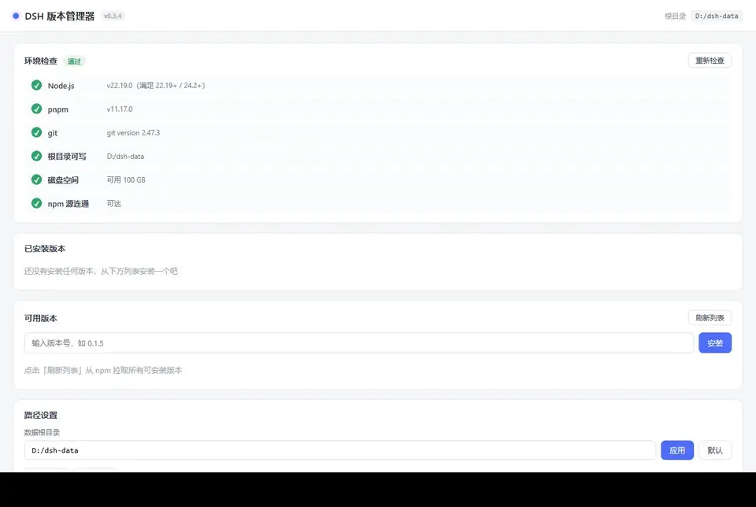

首次打开后，按这四步走：

1. **看环境检查** —— 界面顶部会自动检查 Node / pnpm / 磁盘 / npm 源。有缺失项会给出下载链接和安装步骤。**先把致命项（Node、pnpm）装好**。
2. **点「刷新列表」** —— 从 npm 拉取所有可安装的 dsh 版本。
3. **选一个版本安装** —— 点可用版本列表里的版本号，它会**填入输入框**，再点「安装」。观察进度条走完。
4. **点「运行」** —— 在应用内嵌窗口中打开该版本的 dsh Web 界面。主按钮按**当前目标**运行；若该版本挂了多个实例，点右侧小三角先选实例（见[第七节](#s7)）。

想让它成为终端里默认的 `dsh` 命令？见 [第六节](#s6)。

---

<a id="s4"></a>

## 四、界面功能

### 环境自检

Windows 启动时自动检查 6 项：

| 检查项 | 是否致命 | 说明 |
| :--- | :--- | :--- |
| Node 版本 | ✅ 致命 | 需 `^22.19.0` 或 `>=24.2` |
| pnpm 可用 | ✅ 致命 | 需 pnpm 10+（低于 10 会提示升级） |
| 数据根可写 | ✅ 致命 | |
| git 可用 | ⚠️ 非致命 | 安装 GitHub / Git 来源插件时需要 |
| 磁盘空间 | ⚠️ 非致命 | |
| npm 源连通 | ⚠️ 非致命 | 8s 超时 HTTP ping；离线会明确失败（不再误报可达） |

缺失项会给出**一键下载链接**和安装步骤：

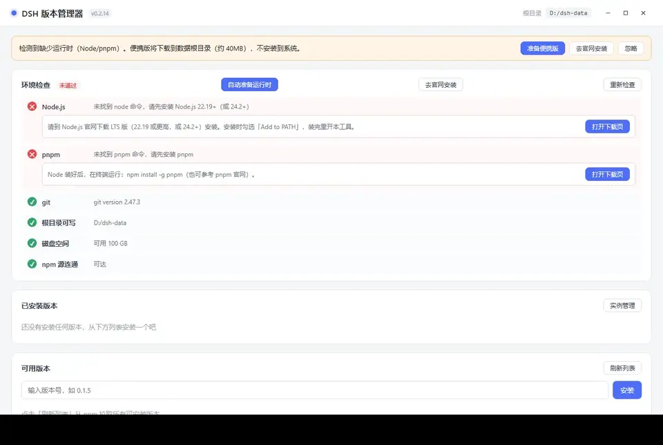

### 窗口标题栏

主窗口使用**自绘顶栏**，不显示系统原生标题栏，避免两层标题栏叠加。

- **拖动窗口**：按住顶栏空白处拖动。
- **双击顶栏**：最大化 / 还原。
- **右侧三个按钮**：最小化 / 最大化（还原）/ 关闭。按钮文字随界面语言切换。
- **启动加载页**：同样可拖动，右上角有独立的关闭按钮——启动卡住时不必等它结束。

> 任务栏图标与窗口分组不受影响：管理器窗口与 dsh 内嵌窗口仍分属两个分组。

### 单实例说明

本工具**只允许运行一个管理器进程**（这里的“实例”指管理器进程，不是第七节的数据实例）。再次双击图标时，新进程立即退出，已有的管理器窗口会从最小化恢复并聚焦。

- **对比多个版本/实例**：在同一个管理器里分别点「运行」，每个版本、每个实例都可各开一个内嵌窗口，互不干扰；同一实例最多一个窗口。
- **版本桌面快捷方式**（`DSH <版本号>.lnk`）在管理器已运行时同样有效：不会新开管理器，而是直接在已运行的管理器里打开该版本的内嵌窗口。
- **命令行不受影响**：管理器运行时执行 `dsh-multiver list --json` 等 CLI 命令照常立即返回，不会转交给图形界面。
- **不同目录的副本**：单实例锁按应用标识全局生效，同一用户下两个不同目录的副本也不能同时运行。此时后启动的副本会**弹出对话框说明**（含两个副本的路径），并聚焦已运行的窗口——不会静默退出，也不会把版本快捷方式的意图转给另一个副本。

### 已安装版本

每个版本显示：版本号、安装日期、是否默认、**共享 home / 默认实例**、占用大小。

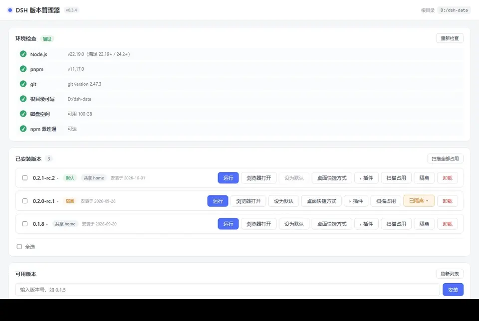

可用操作：

- **运行（分体主按钮）** —— 左侧按当前目标打开内嵌窗口；右侧小三角打开**实例浮层**（见第七节）。目标为实例时，按钮文案会变成「运行 <实例名>」或「聚焦 <实例名>」。
- **浏览器打开** —— 新开一个控制台窗口运行 dsh，由 dsh 打开系统浏览器（关窗口即停止）；同样使用当前主按钮目标。
- **设为默认** —— 生成终端 `dsh` 短命令
- **实例下拉** —— 共享 home / 实例切换、运行/聚焦、打开目录、改名、删除、新建（见第七节）
- **快捷方式** —— 在桌面生成 `DSH <版本号>.lnk`
- **插件** —— 管理该版本的 dsh 插件（见下方「dsh 插件」）；面板展开时此按钮变为**高亮态**（浅蓝底、蓝边、蓝字，左侧三角箭头旋转 90°），再点一次收起
- **扫描占用** —— 显示 `占用 1.38 GB（复用 1.10 GB / 独占 288 MB）`
- **卸载**
- **实例管理** —— 版本列表右上角的全局按钮；孤儿实例数量以角标显示（见第七节）

> **界面按钮的反馈**（v0.3.4+）：鼠标悬停时按钮变浅底 + 主色描边；按下时底色加深并略微缩小；用 Tab 键切换焦点时显示 2px 主色焦点环。危险操作按钮（如卸载）悬停时变为**实心红底白字**，与普通按钮区分。所有按钮的文字颜色在悬停时保持不变。

> **占用里的「复用 / 独占」是什么**：多个版本通过 pnpm store 硬链接共享同一份依赖文件。「复用」是与其他版本共享的部分，「独占」是这个版本独有的部分。所以**卸载一个版本释放的空间往往远小于它显示的总占用**。

### dsh 插件（v0.3.0+）

点某个版本的「**插件**」按钮，展开该版本的 dsh 插件面板：

- **已安装**标签：列出该版本所有 **profile**（通常只有 `web`）及其插件（包名 + 版本；`bundle` 标记是 profile 内置层）。

  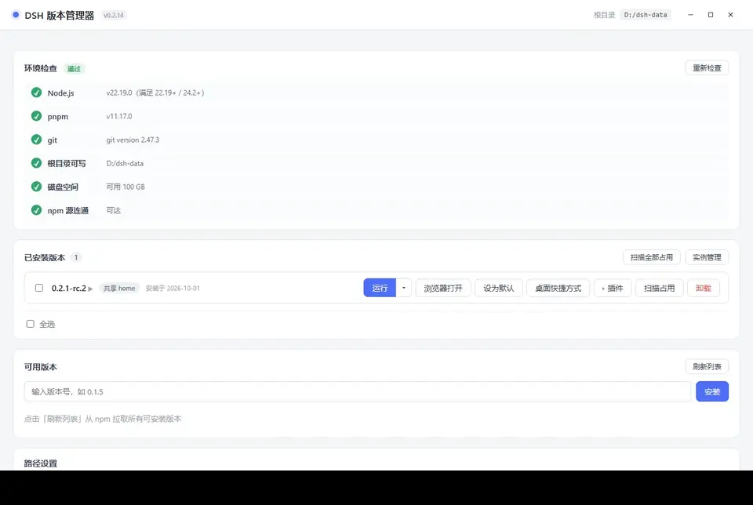

- **推荐**标签：一份插件清单，按分类筛选，点「安装」直接装到当前 profile。

  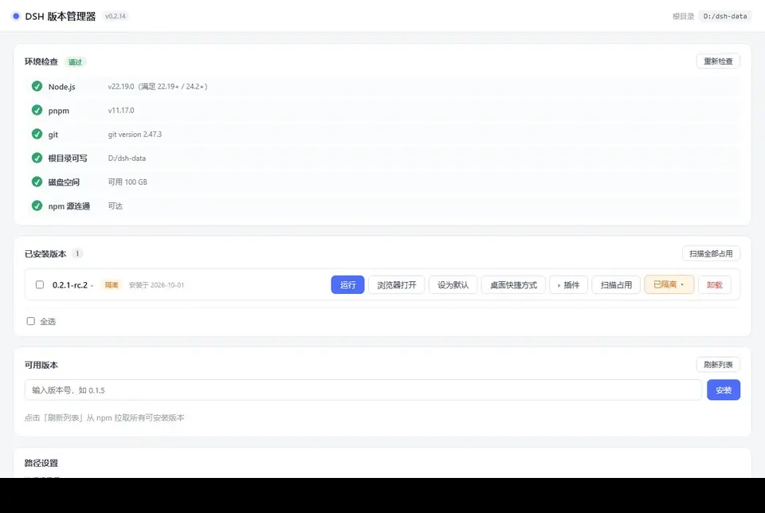

**已安装标签的操作**：

- **安装**：点「＋ 添加插件」→ 输入 npm 包名、GitHub 地址或本地目录 → 选安装源 → 检查（inspect）→ 确认 → 安装完成。对话框会显示将安装的包名/版本/描述、安装源与信任提示；安装失败时可按类别处理。

  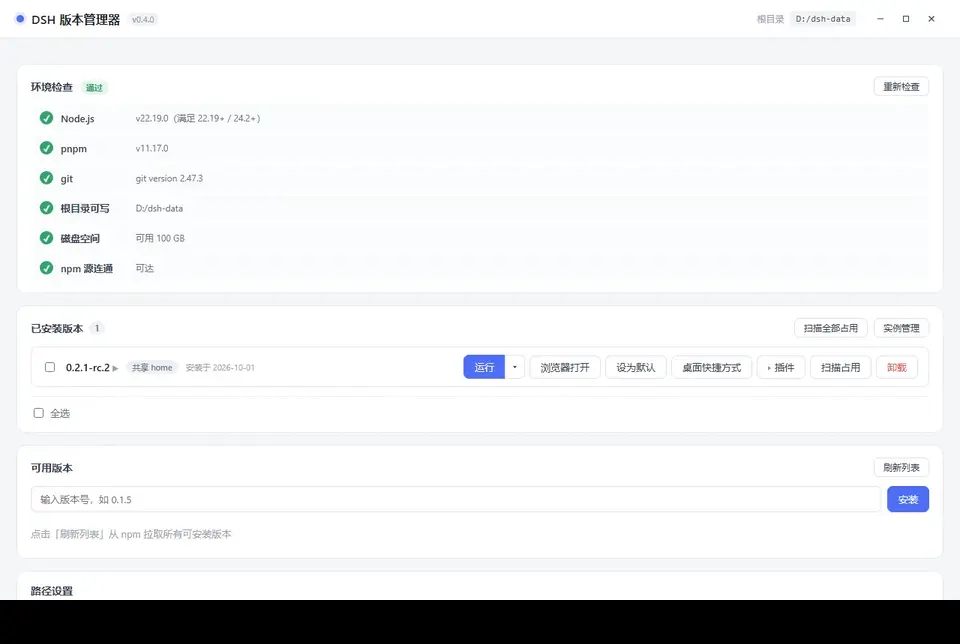

- **卸载**：点插件右侧的「卸载」。大插件可能要几十秒，条目上会显示转圈和已运行秒数。
- **检查更新**：点工具栏的「检查更新」，有新版时条目上出现红色徽标与「更新」按钮；也可点「全部更新」逐项更新（失败自动回滚该项）。
- **共享 home 体检**：点工具栏的 🩺 按钮，只读扫描共享 profile 的链接，报告旧版本残留、悬空链接与重复来源，不改文件。
- **打开目录**：面板右上角 📂 按钮，在资源管理器打开 profile 目录。

每个插件占两行：第一行是图标与包名（长包名会换行完整显示），第二行是版本、来源标签与操作按钮。

**推荐标签的用法**：

- 顶部标签栏按分类筛选（全部 / 工具增强 / 内容聚合 …），分类多时右侧出现 `‹ ›` 滚动按钮。
- 卡片第一行是包名与「安装」按钮；第二行是 GitHub / npmjs 链接与一句话描述。
- 描述跟随界面语言切换（简中 / 繁中 / English / 日本語 / 한국어），未提供翻译的条目显示中文原文。
- 描述过长时右侧渐隐，悬停描述或点「查看完整描述」可看全文。
- 分类标签栏可以按住左键左右拖动。
- 带 ⭐ 的条目是推荐或同作者作品，排在列表最前。
- 列表在打开时会自动检查更新（30 分钟内不重复检查）；点分类栏右侧的 **↻** 可强制检查。
- 检查失败时顶部会提示「推荐列表可能不是最新」，列表仍可正常使用（用的是上次拉到的内容或随程序发布的内置副本）。
- 清单的新旧按 `updatedAt` 时间戳比对：本地比远端新时不覆盖（避免旧缓存遮挡新版内置副本）。
- 拉取清单时直连 GitHub 失败，会按序回退 `gh-proxy.com` → `cdn.jsdelivr.net`（v0.3.2+）。

**原理**：dsh 插件就是 npm 包，装在 `<DSH_HOME>/profiles/<profile>/`。本工具通过 dsh 自带的 `dsh plugin --profile <p> add/remove <包>` 执行（等价于你手动敲 dsh 命令）。

> **前提**：该版本已在 dsh 里**启动过至少一次**（才会生成 profile 目录）。若提示"没有 profile 目录"，先在 dsh 里打开一次。

### 批量操作

已安装列表支持多选：

- 每个版本左侧有复选框，勾选后底部出现批量操作栏
- 「全选」选中本组，「清除选择」取消
- 「批量卸载」一次确认后逐个执行，实时显示进度，失败项汇总提示
- 批量进行中，**被选中条目的按钮会被禁用**（防呆），非选中条目不受影响

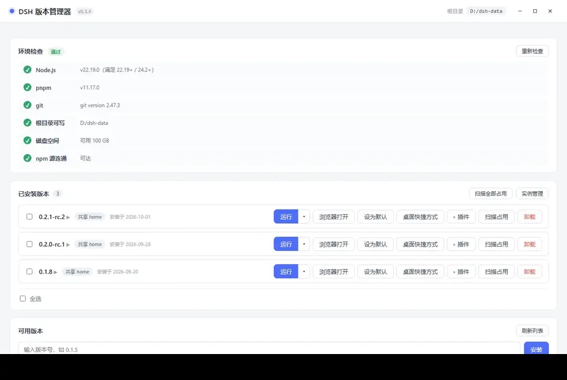

### 可用版本列表

- 支持**搜索**版本号
- 支持**排序**（最新在前 / 最早在前）
- 点版本号**填入输入框**，**同时在其下方就地展开该版本的更新说明**（再点一次收起）
- 更新说明数据来自 dsh 上游 GitHub Releases，经消毒后展示，附「在浏览器打开原文」按钮；
  同一版本看过一次后，再点（无论从「可用版本」还是「已安装版本」）都会立即显示
- **标灰划线的版本**是「已知安装失败」的（依赖已下架的私有包等），可以点「清除标记」后重试

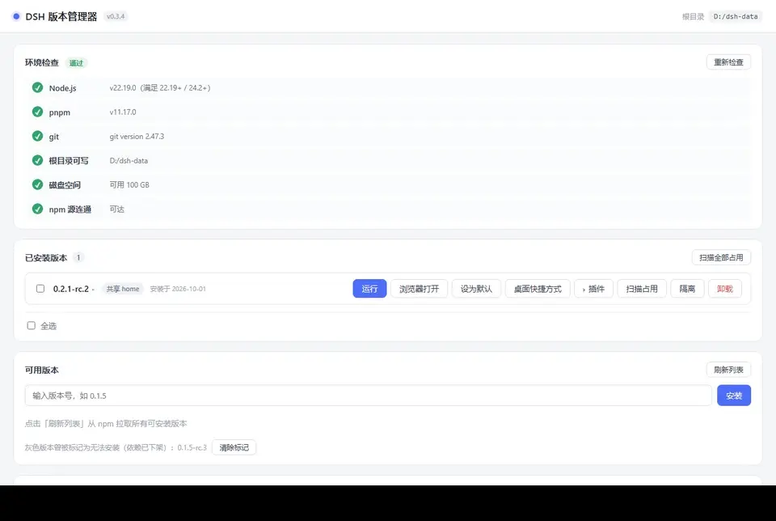

安装过程中的进度条：

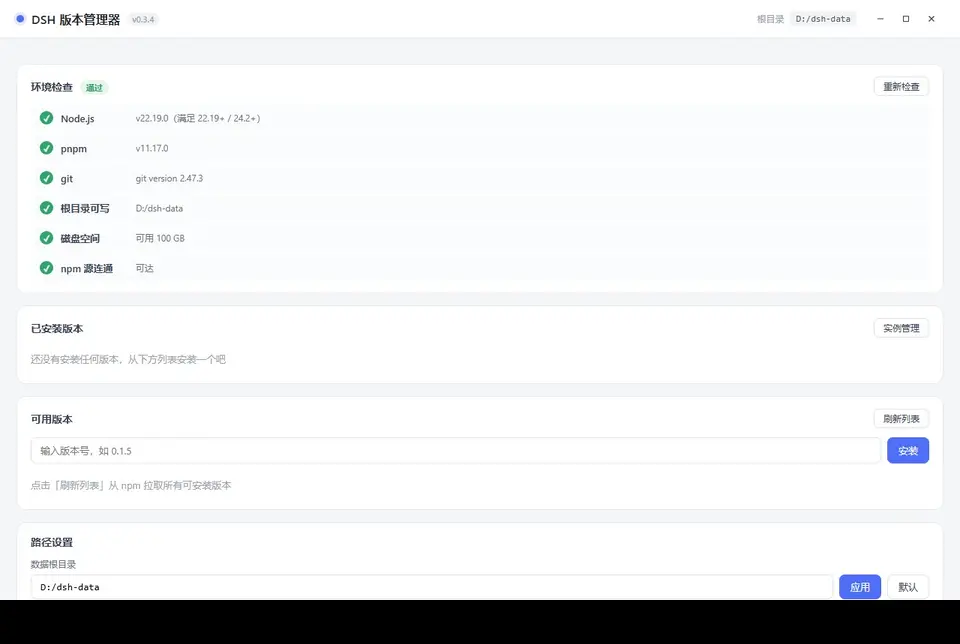

### 安装失败处理

安装失败时按错误类别给出针对性提示：

| 类别 | 提示 |
| :--- | :--- |
| **网络问题** | 弹出换源对话框（官方 / 阿里云 / 腾讯云 / 华为云 / 自定义），一键重试 |
| **私有包下架** | 该版本官方发布不全，任何源都装不了；版本会被标灰。也可尝试换源重试 |
| **版本不完整 / 镜像未同步** | 可能是 npmmirror 尚未同步某个子包；弹窗可直接换官方源重试，仍失败再换版本 |

网络问题的换源对话框：


私有包下架的提示：

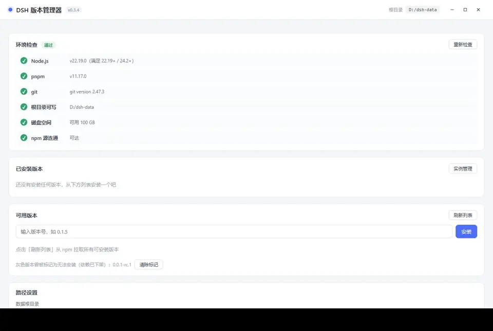

### 路径设置

可修改**数据根目录**（默认 exe 同目录；输入会自动去除首尾空格）。改完会同步更新终端 `dsh` 脚本里的路径。

下方列出各数据目录，**点击任意一行即在文件管理器打开**该目录。默认展示 5 个核心目录
（`versions` / `home` / `store` / `cache` / `state`），点「**展开全部目录**」可查看
`logs` / `homes` / `webview` / `trash` / `assets` 等其余目录。

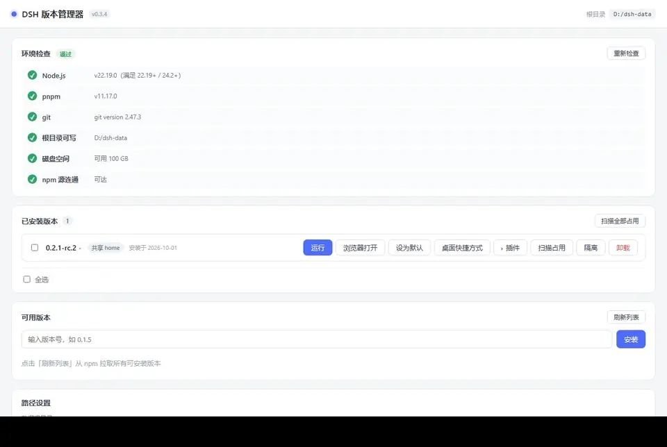

面板里还有**「导出配置」**和**「导入配置」**按钮：

- **导出配置**：把当前配置 + 已安装版本清单存为一个 JSON 文件（换机迁移用，不含依赖/凭据）
- **导入配置**：选一个备份 JSON → 预览将改动的字段 → 确认后应用（仅恢复配置，版本需另行安装）

底部还有**维护区**（见第十节）。

---

<a id="s5"></a>

## 五、运行 dsh 的三种方式

安装完成后，每个版本有三种启动途径：

### 1. 运行（内嵌窗口）—— 推荐

在应用内直接打开 dsh 的 Web 界面（默认 1100×760）。

- 每个**版本 + 目标**使用独立的 WebView2 数据目录：共享窗口为 `<数据根>/webview/<版本>/_shared`，实例窗口为 `<数据根>/webview/<版本>/<实例id>`，cookie / 缓存互不污染
- 关闭窗口只终止该目标对应的 dsh 进程；同一版本的其他实例窗口不受影响
- 同一**目标**再次运行会**聚焦已有窗口**；同一版本的不同实例可以同时运行
- 窗口标题为 `DSH <版本>`；实例窗口为 `DSH <版本> · <实例名>`
- 窗口左上角有一个**小圆点**：悬停显示版本号，点击弹出面板：
  - **版本号**：当前运行的 dsh 版本
  - **完整 URL**：点击可全选复制，粘到浏览器打开同一实例
  - **重启**：结束该版本内嵌窗口背后的 dsh 进程，用同版本重新拉起，并让窗口导航到新地址（会话数据保留，页面状态丢失）。装/卸插件、换 dsh 版本后靠它生效
  - **收起**（面板右上角 ×）：仅收起面板，不关闭 dsh。要停掉 dsh，直接关窗口

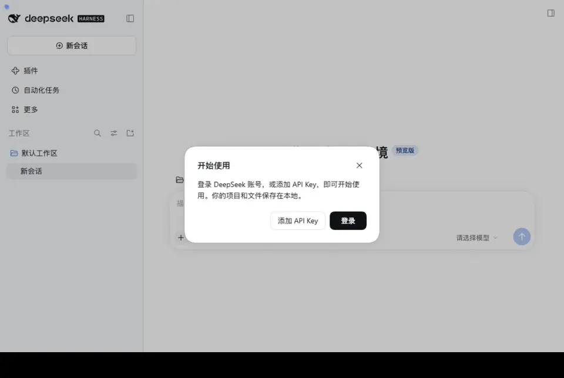

> 端口由系统自动分配（`--port 0`），不会冲突。

### 2. 浏览器打开

用一个**新控制台窗口**启动 dsh，dsh 自己打开系统默认浏览器。行为与「自己开终端敲 `dsh web`」一致。

- **使用当前主按钮目标**：共享 home 或某个实例的 `DSH_HOME`；要换实例，先在实例浮层里切换目标
- **保留控制台窗口**：dsh 的输出（含完整 URL 与 token）显示在窗口里，可自行复制
- **关闭控制台窗口即停止服务**
- Linux：管理器会查找系统终端模拟器（`x-terminal-emulator` / `xterm` / `gnome-terminal` / `konsole` / `xfce4-terminal` 等）承载该窗口；若都未安装会明确提示安装后重试
- 端口**固定 3080**
- **若 3080 被占用**：弹出对话框「端口 3080 已被占用」，可选择：
  - 「用随机端口」——换一个空闲端口打开（地址以控制台窗口里显示的为准）
  - 「取消」——放弃本次操作
- 若该版本已在内嵌窗口运行，会先弹窗确认是否再开一个

> 适合想让 dsh 跑在真正的浏览器里（比如要用浏览器插件）的场景，也方便观察 dsh 的实时输出。

### 3. 桌面快捷方式

点「快捷方式」为当前版本在桌面生成 `DSH <版本号>.lnk`。

- 双击 = **精简启动**：不显示管理器主界面，直接打开该版本的内嵌窗口
- 所有窗口关闭后程序自动退出
- 适合把常玩的版本固定到桌面 / 任务栏

---

<a id="s6"></a>

## 六、终端短命令 dsh

在某个版本上点「**设为默认**」，会在 `%APPDATA%\npm\` 生成一个 `dsh.cmd` 转发脚本（该目录通常已在系统 PATH）。

之后在**任意终端**直接敲：

```bash
dsh web          # 启动默认版本的 Web 界面
dsh doctor       # 其他子命令同样命中默认版本
dsh --version
```

### 它是怎么工作的

脚本里**写死了**版本号、根目录和 `DSH_HOME`（由程序生成时算好，不解析 JSON）。`DSH_HOME` 指向该版本**当前主按钮目标**：共享 home、官方 `~/.dsh`，或某个实例的 `homes/<id>`。内容大致是：

```bat
set "VER=0.2.0-rc.1"
set "ROOT=D:\dsh-multiver"
set "DSH_HOME_CANDIDATE=D:\dsh-multiver\home"
...
call "%ROOT%\versions\%VER%
ode_modules\.bin\dsh.cmd" %*
:: 共享 home 示例；若主按钮指向实例，这里会是 D:\dsh-multiver\homes\i1
:: 以上为示例路径，实际由 dsh-multiver 在「设为默认」时按你的数据根目录生成
```

> 脚本内带保险：若 `DSH_HOME` 目录不存在，则不设该变量，回退到 dsh 默认位置（`~/.dsh`）。

**改默认版本、改根目录、改主按钮目标、卸载默认版本**时，这个脚本会自动重新生成。没有默认版本时会删除它。要临时指定某个实例，用 `dsh-multiver run <版本> --instance <id>`，不改转发脚本。

### 与其它方式装的 dsh 共存

dsh 有多种官方分发形态，它们与本管理器的关系不同：

| 安装方式 | 冲突情况 | 说明 |
| :--- | :--- | :--- |
| `npm i -g @deepseek-ai/dsh` | **会冲突，已处理** | 两者都往 `%APPDATA%\npm\`（Unix 为 `~/.local/bin`）写同名 `dsh`。设默认时会检测：发现不是本管理器生成的命令就提示确认，不静默覆盖；卸载时也只删自己生成的，不动官方那份。 |
| `pnpm add -g @deepseek-ai/dsh` | **可能冲突，未检测** | pnpm 的全局 bin（如 `%LOCALAPPDATA%\pnpm`）不在本管理器的检测范围内。若该目录在 PATH 中排在前面，敲 `dsh` 会走 pnpm 那份，本管理器的转发脚本被绕过。 |
| Python wheel | **可能冲突，未检测** | 同上。`dsh` 装在 Python 的 `Scripts/` 或 `bin/`，由 PATH 顺序决定谁生效。 |
| DeepSeek Harness 桌面版 | 不冲突 | Electron 应用自带运行时，不往 PATH 装 `dsh` 命令。 |

**判断当前敲的 `dsh` 是谁**：

```powershell
# Windows
Get-Command dsh | Select-Object Source
```

```bash
# Linux / macOS
which -a dsh
```

- 路径是 `%APPDATA%\npm\dsh.cmd`（Unix 为 `~/.local/bin/dsh`）→ 本管理器的转发脚本
- 路径在 pnpm 或 Python 的目录下 → 那一份官方安装

**想让本管理器的版本优先**：把 `%APPDATA%\npm\`（Unix 为 `~/.local/bin`）移到 PATH 靠前的位置。

> ⚠️ **DSH_HOME 共用风险**：若开启了「复用官方 `~/.dsh`」，本管理器与官方安装会共用同一份 `profiles/`、`sessions/` 与凭据。不同 dsh 版本的 profile 里 bundle 版本可能不同，互相覆盖 `node_modules` 有出错风险。共用前请确认各版本所需 bundle 一致，或改用数据隔离。

> ⚠️ 若终端提示 `'dsh' 不是内部或外部命令`，检查 `%APPDATA%\npm\` 是否在 PATH 里。

---

<a id="s7"></a>

## 七、数据隔离与实例

dsh 的数据目录（会话、配置、插件、凭据）由启动时注入的 `DSH_HOME` 决定：

| 目标 | DSH_HOME | 说明 |
| :--- | :--- | :--- |
| **共享 home**（默认） | `<数据根>/home` | 所有非隔离版本**共用** |
| **官方 home** | `~/.dsh` | 开启「复用官方配置」时使用，与官方安装共用 |
| **实例** | `<数据根>/homes/<id>` | 实例独占；一份 home 可挂到多个版本 |

**实例是全局实体**：一个版本可挂载任意多个实例；同一实例也可挂到多个版本，共用同一份会话/凭据/插件配置。每个版本用 `selected_target` 记住自己的主按钮目标（共享或某个实例）；只影响下次运行，不影响已经打开的窗口。

### 什么时候该用实例

- 测试不兼容的插件，怕污染主力环境
- 想保持干净的会话历史 / 配置
- 想同时开同一版本的多个独立环境做对比

> ⚠️ **共用 home 的风险**：非隔离版本共用同一个数据目录。若新版本的插件/配置与旧版本不兼容，可能**连累旧版本**。例如 dsh 0.1.7 的「打开文件夹」功能失效，在共享 home 下会影响所有版本。
>
> 遇到奇怪问题，可以给版本挂一个实例，或参见[常见问题](#s11)。

### 实例浮层

版本行主按钮右侧的小三角打开**实例浮层**（原「已隔离 ▾」菜单已由它替代）：

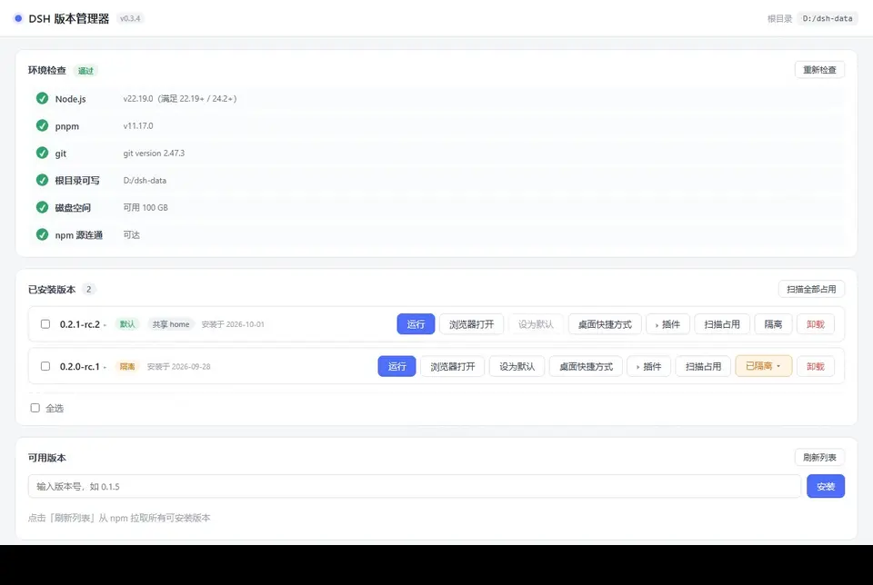

- **共享 home** 行 —— 用共享/官方 home 运行；单选框决定主按钮目标
- **实例行** —— 运行/聚焦、打开目录、改名、删除；运行中会显示「运行中（版本）」，删除按钮禁用
- **＋ 新建实例** —— 输入名称；创建后可继续在实例管理面板里挂载版本
- **单选切换** —— 主按钮立即变为「运行 <实例名>」；同一实例重复点运行只会聚焦已有窗口

### 实例管理面板

版本列表右上角的「实例管理」按钮打开全局面板：

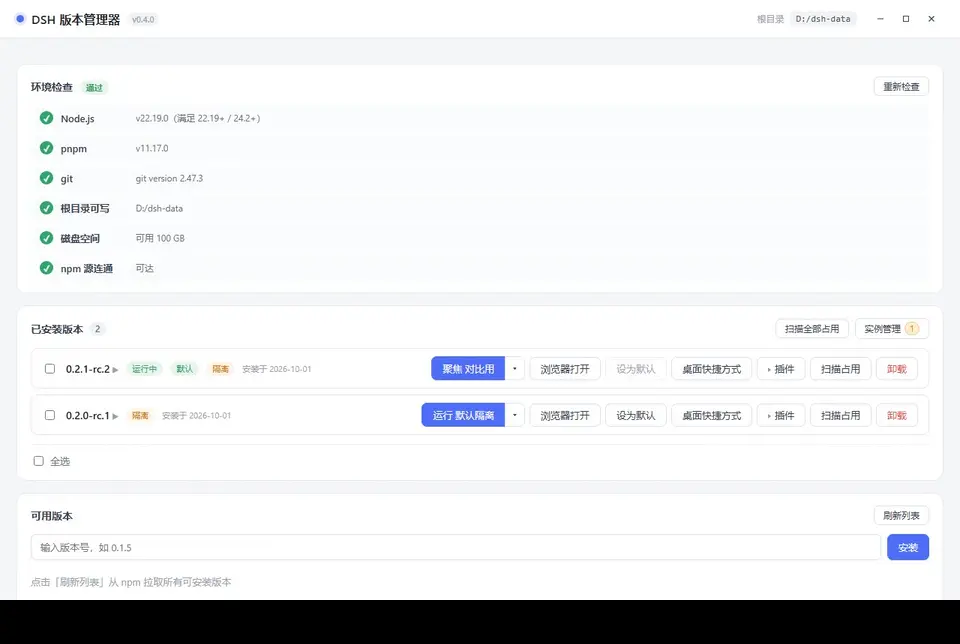

- 列出**全部实例**；孤儿（没有任何版本挂载）**置顶**并标「未挂载」，按钮上显示孤儿数量角标
- 每行显示：名称、home 路径、占用（点「扫描占用」计算）、挂载版本、主按钮目标、运行状态
- 操作：运行/聚焦、打开目录、改名、挂载/解除挂载、删除
- **＋ 新建实例**：输入名称并勾选要挂载的版本；创建后立即出现在列表
- 运行中的实例不能删除；改名与解除挂载允许

### 约束与迁移

- 删除实例：先把 `homes/<id>` 改名到 `trash/instance-<id>-<时间戳>`，再清配置；后台清理，失败退化为直接删。
- 卸载版本：只解除该版本的挂载，**保留实例为孤儿**；不会删除 `homes/<id>`。
- 选中目标失效（实例被删/解除挂载）：静默回落共享 home，不会自动选第一个挂载实例。
- 界面只显示实例名称，不显示内部 id（`i1`/`i2`…）；id 只出现在 home 路径、CLI/JSON 与日志中。
- **v0.3.x 升级**：旧的 `versions/<版本>/home` 会迁移到 `homes/<id>`；旧 `isolated_versions` 自动生成「默认隔离」实例。迁移可中断重试，不删除用户数据；目标已存在时复用并写日志。

---

<a id="s8"></a>

## 八、命令行模式（CLI）

> **v0.3.0 起为子命令风格**（`dsh-multiver list`），适合脚本化、批处理、CI。

带任一 CLI 子命令时，程序**不会启动图形界面**，执行完按退出码退出（成功 `0` / 失败 `1`）。

| 命令 | 用途 |
| :--- | :--- |
| `list` | 列出已安装版本（一行一个；默认版本以 `* ` 前缀标记） |
| `which` | 输出默认版本 dsh 入口的**绝对路径**（无默认版本则失败） |
| `info <版本>` | 查看单个版本详情（路径 / 默认 / 隔离 / 配置目录 / 占用 / 实例与主按钮目标） |
| `versions` | 列出远端可用版本（从 npm 查询，最新在前） |
| `env` | 环境检查（Node / pnpm / 根目录可写 / 磁盘 / npm 源连通；有致命项失败时退出码 1） |
| `isolate <版本> [--off]` | 开启隔离（确保默认实例）；`--off` 解除该版本全部实例挂载（实例保留） |
| `isolate <版本> --list [--json]` | 列出该版本挂载的实例与主按钮目标 |
| `isolate <版本> --attach <id>` / `--detach <id>` | 挂载 / 解除挂载单个实例 |
| `instance create --name <名称> [--attach <版本>...]` | 创建实例（不建目录；可先建孤儿） |
| `instance list [--sizes] [--json]` | 列出全部实例（含未挂载孤儿）；默认不扫占用，`--sizes` 才计算 |
| `instance rename <id> <新名>` | 修改实例显示名 |
| `instance remove <id>` | 删除实例（home 移入回收站） |
| `clean` | 清理孤立缓存 + 清空回收站（`maintenance --cleanup` 的超集） |
| `doctor` | 一键诊断（目录 / 失败标记 / 已安装 / 环境）；有致命项失败时退出码 1 |
| `shortcut <版本>` | 为某版本创建桌面快捷方式 |
| `copy-shared <版本> [--instance <id>]` | 把共享 home 数据复制到目标实例 home |
| `clear-isolated <版本> [--instance <id>]` | 清空目标实例 home（保留版本本身） |
| `export [<文件>]` | 导出配置 + 版本清单（JSON），便于换机迁移 |
| `import <文件>` | 导入备份文件里的配置（`--dry-run` 只预览将改动的字段） |
| `run <版本> [--instance <id>]` | 启动 dsh web（新控制台窗口 + 自动打开系统浏览器；关窗口即停止） |
| `setup-runtime` | 检测并下载缺失的便携运行时（Node / pnpm）；`--dry-run` 只报告不下载 |
| `update` | 检查并执行自动更新（下载 → 校验 → 替换自身 → 重启）；`--dry-run` 只检查是否有新版 |
| `install <版本> [--registry <url>]` | 无头安装，可指定 npm 源 |
| `uninstall <版本>` | 无头卸载 |
| `set-default <版本>` | 设为默认版本，并重生成终端 `dsh` 命令 |
| `set-root <目录>` | 设置数据根目录（绝对路径；创建子目录并重生成转发脚本） |
| `maintenance [--cleanup\|--prune]` | 无头维护；不带子开关则两者都做 |
| `help` | 帮助 |
| `version` | 版本号 |

**修饰符**（保持 `--` 前缀）：

| 修饰符 | 用途 |
| :--- | :--- |
| `--dry-run` | **只预览不执行**（搭配破坏性命令：`install` / `uninstall` / `set-default` / `set-root` / `maintenance` / `isolate` / `instance` / `clean` / `shortcut` / `copy-shared` / `clear-isolated` / `import` / `setup-runtime` / `update`） |
| `--json` | **结构化输出**（机读 JSON）；只影响格式，不改行为 |
| `--force` | 覆盖非本管理器生成的 `dsh` 命令（用于 `set-default`） |
| `--registry <url>` | 指定 npm 源（用于 `install`） |
| `--off` | 解除该版本全部实例挂载（用于 `isolate`） |
| `--list` | 列出该版本挂载的实例（用于 `isolate`） |
| `--name <名称>` | 创建实例时的显示名（用于 `instance create`） |
| `--attach <版本>` | 创建实例时挂载版本，可重复（用于 `instance create`） |
| `--detach <id>` | 解除版本与实例的挂载（用于 `isolate`） |
| `--instance <id>` | 指定实例（用于 `run` / `copy-shared` / `clear-isolated`） |
| `--sizes` | 同时计算实例占用（用于 `instance list`；默认不扫，避免实例多时卡住） |

> ⚠️ **v0.3.0 破坏性变更**：旧的 `--flag` 语法（如 `--list`）**已移除**。当前命令见本章命令表。

### 示例

```bash
# 看装了哪些版本（输出可直接管道）
dsh-multiver.exe list

# 装一个版本
dsh-multiver.exe install 0.2.0-rc.2

# 用指定源装（网络不好时）
dsh-multiver.exe install 0.2.0-rc.2 --registry https://registry.npmmirror.com

# 设默认
dsh-multiver.exe set-default 0.2.0-rc.2

# 切换数据根（绝对路径）
dsh-multiver.exe set-root D:/DSH-data

# 卸载
dsh-multiver.exe uninstall 0.1.5-rc.3

# 清理孤立缓存
dsh-multiver.exe maintenance --cleanup

# 回收依赖仓库
dsh-multiver.exe maintenance --prune

# 查某个版本的详情
dsh-multiver.exe info 0.2.0-rc.2

# 看远端有哪些版本可装
dsh-multiver.exe versions

# 环境自检（部署前预检 / 排障；有致命项失败时退出码 1）
dsh-multiver.exe env

# 给某版本开/关数据隔离
dsh-multiver.exe isolate 0.2.0-rc.2
dsh-multiver.exe isolate 0.2.0-rc.2 --off

# 创建实例并挂两个版本
dsh-multiver.exe instance create --name 对比用 --attach 0.2.0-rc.2 --attach 0.2.1-rc.2
dsh-multiver.exe instance list --json

# 需要占用时显式扫描（实例多时默认列表不会遍历 home）
dsh-multiver.exe instance list --sizes --json

# 改名 / 删除实例（删除会把 home 移入回收站）
dsh-multiver.exe instance rename i2 对比用-2
dsh-multiver.exe instance remove i2

# 查看/调整某版本的实例
dsh-multiver.exe isolate 0.2.0-rc.2 --list
dsh-multiver.exe isolate 0.2.0-rc.2 --attach i2

# 用指定实例启动/清理
dsh-multiver.exe run 0.2.0-rc.2 --instance i2
dsh-multiver.exe clear-isolated 0.2.0-rc.2 --instance i2

# 清理孤立缓存 + 清空回收站
dsh-multiver.exe clean

# 一键诊断（排障用）
dsh-multiver.exe doctor

# 导出配置（换机迁移用）
dsh-multiver.exe export backup.json

# 导入配置（先预览将改动的字段）
dsh-multiver.exe import backup.json --dry-run
dsh-multiver.exe import backup.json

# 只预览，不真的执行（适合确认参数是否正确）
dsh-multiver.exe install 0.2.0-rc.2 --dry-run
dsh-multiver.exe uninstall 0.1.5-rc.3 --dry-run
dsh-multiver.exe maintenance --prune --dry-run
```

### 结构化输出（--json）

给脚本/CI 用：加 `--json` 输出机读 JSON（stdout 只有 JSON，无其他输出）。

```bash
# 版本列表（对象数组，含 is_default / isolated / installed_at 等）
dsh-multiver.exe list --json

# 默认版本 dsh 入口的绝对路径
dsh-multiver.exe which --json

# 破坏性命令的预览（dry-run + json）
dsh-multiver.exe install 0.2.0-rc.2 --dry-run --json

# 版本详情（完整对象，含共享/独占大小）
dsh-multiver.exe info 0.2.0-rc.2 --json

# 远端可用版本数组
dsh-multiver.exe versions --json

# 环境检查项数组（CheckItem：name/ok/detail/critical）
dsh-multiver.exe env --json
```

### 说明

- **无交互确认**：`install` / `uninstall` / `set-default` 不会问「确定吗」，请确保参数正确
- **输出可管道**：`list` 一行一个版本号；安装进度走 **stderr**，stdout 保持干净
- **JSON 输出**：加 `--json` 得到机读结果（stdout 只有 JSON）
- **进度显示**：只在真实终端下显示单行进度；重定向到文件/管道时自动静默
- **不带任何 CLI 子命令**时，行为与之前完全一致：启动图形界面


---

<a id="s81"></a>

## 八.1、外观与语言

在「路径设置」面板底部，有 **「外观与语言」** 设置：

| 设置 | 选项 |
| :--- | :--- |
| **主题** | 跟随系统 / 亮色 / 暗色 |
| **语言** | 跟随系统 / 简体中文 / 繁體中文 / English / 日本語 / 한국어 |

- 两项偏好都**保存在本地**，下次打开自动恢复
- **首屏渲染前**就应用，不会闪烁
- 「跟随系统」会实时响应系统主题/语言的变化

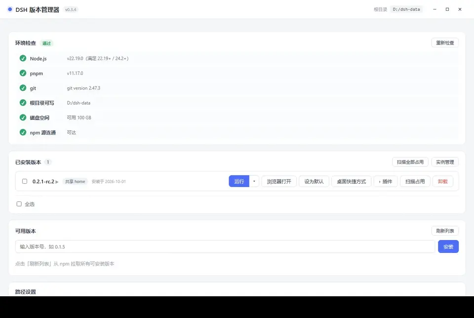

> CLI 的输出**不受语言设置影响**（固定中文）—— 因为 CLI 常被脚本解析，输出需要稳定。

---

<a id="s82"></a>

## 八.2、在 dsh 里管理版本

装好「版本管理」插件后，dsh 的**设置页**会多一个「版本管理」入口。它读的是同一个 multiver 数据根，与 multiver 界面看到的一致。

### 装插件

dsh **0.2.0 起**支持插件，可直接在 dsh 里装桥接插件，不必先开 multiver。

1. 打开 dsh 的**「插件」页** → 点右上角**「添加插件」**
2. 在输入框填插件包名 `dsh-multiver-bridge`
3. 点**「安装」**，等进度走完

装好后插件显示「运行中」，dsh 设置页随即多出「版本管理」入口。装完无需重启 dsh。

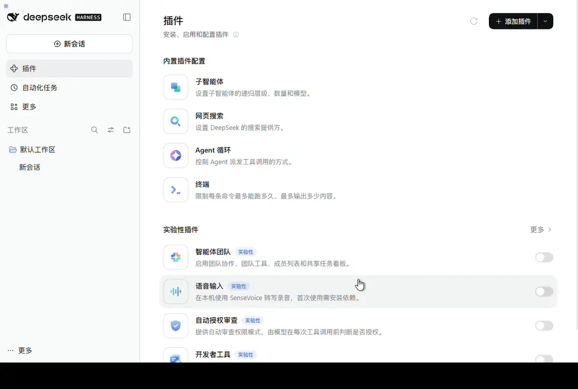

> 图 16 是 **dsh 自身插件页**，界面语言由 dsh 设置决定，不随 multiver 语言切换。

> 插件只负责**查看版本与切换默认版本**；安装、卸载、实例/隔离仍由 multiver 完成。

### 能看到什么

| 区域 | 内容 |
| :--- | :--- |
| **状态条** | 默认版本；运行版本（附来源徽标）；运行版本与默认不一致时的「重启后生效」提示；一致性校对详情 |
| **版本表** | 版本号、安装日期、标记（默认 / 隔离 / 共享 home） |
| **动作区** | 打开 multiver 目录、打开版本目录、复制诊断信息、打开 multiver |

**运行版本**的来源有两个：

- multiver 启动 dsh 时注入的环境变量（最可靠，显示「来自 multiver」）
- 从进程路径自检（显示「推断」）

两者不一致时显示「来源冲突」，此时不会误报「重启后生效」——先按提示重启 dsh。

### 能做什么

- **设为默认**：点「设为默认」→ 内联确认条 → 确认。界面会提示「重启 dsh 后生效」——运行中的 dsh 无法热替换自身。
- **打开 multiver**：直接拉起管理器主窗口。内嵌窗口里不显示这个按钮（再开一个管理器没有意义）。
- **复制诊断信息**：把当前状态打包成 JSON，剪贴板不可用时降级为可选中文本框，便于排障。

### 更新 multiver 本身

版本管理页底部有「multiver 更新」区块：

- **已是最新**：显示当前版本，可点「重新检查」
- **有新版本**：显示版本号与 Release 链接，点「更新」后确认

**两种更新方式，取决于你在哪里打开**：

| 场景 | 行为 |
| :--- | :--- |
| **内嵌窗口**（multiver 启动的 dsh） | 点更新后**暂存**——新 exe 下载到 `<数据根>/.update/`，页面显示「待安装：vX.Y.Z」。multiver **下次启动时**自动完成替换，当前会话不受影响。 |
| **独立 dsh**（终端启动，非 multiver 内嵌） | 点更新后**立即执行**——下载、校验、替换并重启管理器。 |

为什么内嵌窗口要暂存：当前 dsh 正是 multiver 拉起的子进程，直接替换正在运行的 exe 会中断会话，Windows 上也不允许覆盖运行中的文件。暂存让替换发生在 multiver 未运行时，两侧都不受影响。

### 刷新时机

- 页面可见时每 60 秒自动刷新一次
- 从其他标签页切回来时立即刷新一次
- 页面不可见时停止轮询（每次刷新都要启动一次 exe，代价不低）
- 也可点页脚的「刷新」手动触发

### 安装与卸载

插件不在 exe 内，需要单独装进 dsh 的 profile：

```powershell
# 在 dsh-multiver 的 dsh-plugin 目录下
pnpm pack
.\install.ps1 -DshCmd '<dsh.cmd 路径>' -Profile web -PackageDir '.\dsh-multiver-bridge-0.2.1.tgz'
```

**装完必须重启 dsh。** 卸载用 `uninstall.ps1`，同样需要重启。

详见 [dsh-plugin/README](../dsh-plugin/README.md)。

> ⚠️ 内嵌窗口里看不到插件？检查 multiver 启动 dsh 时用的 profile 是否装了插件——multiver 固定用 `dsh web`（等价 `--profile web`）。

---

<a id="s9"></a>

## 九、数据存储结构

数据根目录默认 = **exe 所在目录**，可在界面「路径设置」里修改。运行后会在根目录下创建：

```
<数据根>/
├── config.json              # schema 2：version_instances / selected_target / instance_seq / instances
├── versions/<版本>/         # 各版本独立安装（不再含 home/）
│   ├── package.json
│   ├── .npmrc               # node-linker=hoisted
│   └── node_modules/
├── home/                    # 共享 DSH_HOME（会话/配置/凭据，相当于 ~/.dsh）
├── homes/<id>/              # 实例 DSH_HOME（每个实例一份，可挂多个版本）
├── store/                   # pnpm store（硬链接去重，多版本共享）
├── cache/                   # pnpm 缓存（可删）
├── state/                   # pnpm 状态（可删）
├── webview/<版本>/
│   ├── _shared/             # 该版本共享窗口的 WebView2 数据
│   └── <id>/                # 该版本实例窗口的 WebView2 数据
├── trash/                   # 卸载/删除回收站（实例删除为 instance-<id>-<ts>）
├── .update/                 # 暂存的 multiver 更新包（下次启动替换）
├── assets/                  # 内部资源（快捷方式图标）
└── logs/                    # 启动错误日志 + 维护日志
```

### 哪些可以安全删除

| 目录 | 能否删 | 说明 |
| :--- | :--- | :--- |
| `cache/` `state/` | ✅ 可删 | pnpm 缓存，删了会重新下载 |
| `webview/` | ✅ 可删 | 内嵌窗口缓存；删了会重建，但会丢登录态/cookie |
| `assets/` | ✅ 可删 | 快捷方式图标等内部资源，会重建 |
| `trash/` | ⚠️ 可清 | 回收站；清了**不可恢复**，确认里面没有要找回的数据 |
| `store/` | ⚠️ 谨慎 | **各版本依赖通过硬链接指向这里**，删了所有版本都失效 |
| `versions/` | ❌ 不要手删 | 请用界面「卸载」 |
| `home/` `homes/` | ❌ 不要手删 | 你的会话、配置与凭据 |
| `.update/` | ⚠️ 不要手删 | 有待安装更新时删除会取消本次更新 |

### 自包含原则

所有 pnpm 目录（`store` / `cache` / `state`）都被显式限定在数据根目录内，**不会写入 pnpm 的全局默认位置**（如 `%LOCALAPPDATA%\pnpm`、盘根 `.pnpm-store`）。

### 省磁盘与"看着没省"

多个版本的依赖通过**硬链接**共享 `store` 里的同一份文件，磁盘上**只存一份**。
但 **Windows 文件夹属性会把共享文件重复计算**，显示的占用偏大——那不代表真实磁盘消耗。

详见 → **[硬链接与磁盘占用](硬链接与磁盘占用.md)**（含如何查看真实的"复用 / 独占"）。

---

<a id="s10"></a>

## 十、自动维护

程序启动时会在**后台线程**（不阻塞界面）做两件事：

1. **清理孤立 webview 缓存** —— 两级判定：版本目录已不存在 → 清整个 `webview/<版本>`；版本仍存在 → 只清不再挂载的 `webview/<版本>/<实例id>`，保留 `_shared`。每次启动都跑，成本极低。
2. **回收 pnpm store** —— 距上次 **7 天**以上时，以低优先级运行 `pnpm store prune`，回收不再被引用的依赖包。会延迟 30 秒错开启动 IO。

删除实例时 `homes/<id>` 会先改名到 `trash/instance-<id>-<时间戳>`，由后台清理；`clean` 命令会清空回收站。

日志写在 `<数据根>/logs/maintenance.log`。

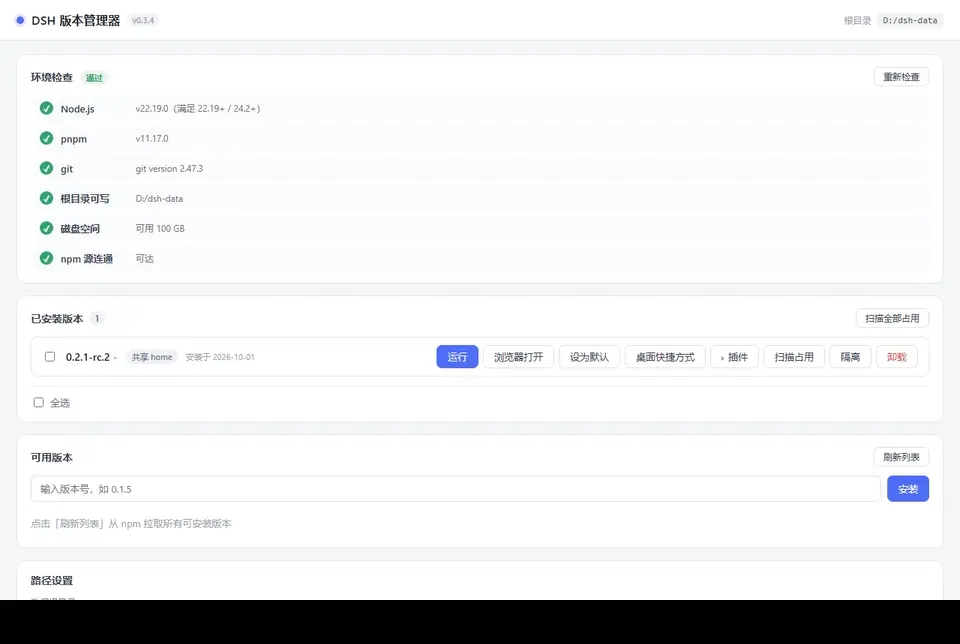

### 维护面板

在「路径设置」底部：

- **自动维护开关** —— 关掉则启动时不做上述两件事
- **规则说明** + **上次执行状态**
- **手动按钮**：「清理孤立缓存」「回收依赖仓库」「打开日志目录」

> 手动维护会立即执行，并更新配置里的时间戳。

---

<a id="s11"></a>

## 十一、常见问题

### Q: 提示「创建窗口失败: failed to send message to the webview」

两个因素叠加：管理器有单实例锁（v0.3.0+），第二个实例会立即退出并聚焦已运行的窗口；但内嵌窗口的 WebView2 数据目录在**上一个实例还在启动中 / 关闭中**时立刻再启，仍可能报此错。

**解决**：等几秒再试。

### Q: 启动报 `WebView2 error 0x800700AA / 请求的资源在使用中`

WebView2 数据目录被**残留进程**占着。常见于管理器被强杀、崩溃，或测试期间留下僵尸进程——此时 `Get-Process` 可能显示"已退出"，但内核对象未释放，仍锁着目录。

**解决**：

1. 打开任务管理器，结束所有 `dsh-multiver.exe` 与 `msedgewebview2.exe`；
2. 若进程杀不掉（拒绝访问），**重启电脑**；
3. 重启后重新启动管理器即可。

CLI 不受此问题影响（不需要 WebView2）。

### Q: 内嵌窗口显示 431 错误 /「Failed to load plugins」

历史版本曾因**所有窗口共享同一个 WebView2 数据目录**，导致 cookie 累积、请求头膨胀。现在每个版本用独立目录（`webview/<版本>`）已根治。

若仍遇到，删掉对应的 `webview/<版本>` 目录让它重建。

### Q: 安装报「Cannot find package ... cordis」

依赖链接模式不对。每个版本目录会写 `.npmrc` → `node-linker=hoisted`，dsh 需要扁平的 node_modules。

若手工动过版本目录，删掉重新装。

### Q: 安装报 `ERR_PNPM_IGNORED_BUILDS`

pnpm 10+ 默认不执行依赖构建脚本，导致 node-pty / koffi 等原生模块缺失。工具安装时已带 `--config.dangerouslyAllowAllBuilds=true`，正常不会遇到。

### Q: 某个版本一直装不上，一直转圈然后失败

看错误提示类别：

- **私有包下架** —— 该版本官方发布不全，**任何源都装不了**，换版本
- **网络问题** —— 用换源重试（选阿里云 / 腾讯云）

> 已知装不了的早期版本：`0.0.1-rc.1`、`0.0.1-rc.2`（依赖已下架的私有包）。这类版本会自动标灰。

### Q: dsh 的「打开文件夹」功能没反应

这是 **dsh 0.1.7+ 的上游 bug**：给 `explorer.exe` 传了 `windowsHide:true`，导致文件夹窗口隐形；且返回码误判，API 仍返回成功。

**在共享 home 下会连累所有版本。**

**规避方式**：

1. 安装社区修复插件：
   ```bash
   dsh plugin --profile web add github:King20260919/dsh-open-folder-visible
   ```
2. 或给该版本开启**数据隔离**（见第七节）

### Q: 终端敲 `dsh` 提示找不到命令

`%APPDATA%\npm\` 需要在系统 PATH 里。检查环境变量，或重启终端让 PATH 生效。

### Q: 卸载版本时提示「文件被占用」

该版本的 dsh 进程还在运行。

**解决**：关掉对应的内嵌窗口 / 终端，再重试。

### Q: 更新 exe 后图标没变

Windows 图标有缓存。

**解决**：执行 `ie4uinit.exe -show`，或重启资源管理器。

### Q: 版本列表里有些版本是灰的

这些是**已知安装失败**的版本（依赖已下架的私有包）。装不上是正常的。

若确认要重试，点「清除标记」后即可再次安装。

### Q: 升级到 v0.4.0 后，旧的隔离数据在哪？

旧版的 `versions/<版本>/home` 已迁移到 `homes/<id>`，旧 `isolated_versions` 自动变成「默认隔离」实例。迁移不删除用户数据；若目标目录已存在，会复用目标并在 `logs/app.log` 记录源路径。旧目录若仍同时存在，确认新实例能正常打开后可手动清理。

### Q: 为什么实例显示「未挂载」？

该实例没有挂到任何已安装版本。常见于卸载了唯一挂载它的版本——实例会保留为孤儿，不会被自动删除。到「实例管理」面板重新挂载一个版本，或确认数据无用后删除。

### Q: 同一实例为什么不能开两个窗口？

一份 `homes/<id>` 同时被两个 dsh 进程写有损坏风险，因此一个实例最多一个窗口。重复点「运行」只会聚焦已有窗口；要并行对比，请新建另一个实例。

### Q: 删除实例后数据还能恢复吗？

删除会先把 `homes/<id>` 移到 `trash/instance-<id>-<时间戳>`，再由后台清理。清理前可以从回收站找回；执行 `clean` 或后台清理后**不可恢复**。

### Q: 主按钮为什么显示「聚焦 实例 A」？

说明该实例已在运行。点主按钮不会重开，而是聚焦已有窗口；要换目标，点右侧小三角在实例浮层里切换。

### Q: 终端里的 `dsh` 用的是哪个实例？

转发脚本的 `DSH_HOME` 指向默认版本当前的主按钮目标（共享 / 官方 / 某实例）。要临时指定实例，用 `dsh-multiver run <版本> --instance <id>`，不会改转发脚本。

---

<a id="s12"></a>

## 十二、卸载

本工具是**便携版**，不写注册表、不装服务。

要完全卸载：

1. 关闭所有内嵌窗口
2. 如果设过默认版本，先点「设为默认」的清除，或直接删掉 `%APPDATA%\npm\dsh.cmd`
3. 删掉 `dsh-multiver.exe`
4. 删掉**数据根目录**（默认是 exe 所在目录，里面有 `versions/` `home/` `homes/` `store/` 等）

> ⚠️ 第 4 步会**永久删除所有 dsh 版本与实例的会话、配置、凭据**（含 `homes/`）。如果只想清理某个版本，用界面里的「卸载」；只卸载版本时实例会保留为孤儿，不会删数据。

---

<a id="s13"></a>

## 十三、Linux 支持（暂不发布）

v0.4.0 明确**不打包、不发布** Linux 产物（不再提供 AppImage / deb）。Linux 只保留 CI 编译与单测；实例功能未在真桌面验收（GAP-020），未来恢复 Linux 发布时再补。

本地调试可从源码运行 `pnpm tauri dev`，系统依赖见 [README · 环境要求](../README.md#环境要求)。

### 已实现的 Linux 能力（仅开发/未来参考）

- **功能**：安装/卸载/运行/实例/CLI/转发脚本等均已适配
- **进程管理**：Windows 用 Job Object；Linux 用进程组（管理器退出 / 关窗时清理 dsh 进程；若管理器被强杀，下次启动会清理残留）
- **桌面集成**：Windows 生成 `.lnk`，Linux 生成 `.desktop`（放桌面；无桌面环境时给出提示）
- **终端短命令**：Windows 写 `%APPDATA%\npm\dsh.cmd`，Linux 写 `~/.local/bin/dsh`

### 从源码构建（需先装 Rust、Node、pnpm 及 WebKitGTK 等系统依赖）

~~~bash
pnpm install
pnpm tauri build --bundles appimage,deb   # 或 pnpm tauri dev 开发运行
~~~

> **已修复**（v0.2.4）：早期版本在 Linux 上内嵌窗口可能显示「重新连接中」。根因是管理器自身的
> 进程管理缺陷（非平台差异），**影响所有 Linux 环境**，已在 v0.2.4 修复。详见 [开发缺口](开发缺口.md) GAP-008。

---

## 相关链接

- [项目主页](https://github.com/K1-lihongrong/dsh-multiver)
- [Releases（下载）](https://github.com/K1-lihongrong/dsh-multiver/releases)
- [更新日志](https://github.com/K1-lihongrong/dsh-multiver/blob/main/CHANGELOG.md)
- [问题日志查看指南](问题日志查看指南.md) —— 遇到问题时如何查日志
- [DeepSeek Harness](https://github.com/deepseek-ai/deepseek-harness) —— 本项目管理的对象
