# DSH 版本管理器 —— 使用手冊

> 適用於 **dsh-multiver v0.4.0+**（Windows 便攜版；Linux 暫不打包發布）
> 專案主頁：https://github.com/K1-lihongrong/dsh-multiver

<p align="center"><a href="使用手册.md">简体中文</a> | <strong>繁體中文</strong> | <a href="使用手册.en.md">English</a> | <a href="使用手册.ja.md">日本語</a> | <a href="使用手册.ko.md">한국어</a></p>

---


## 目錄

- [一、這是什麼](#s1)
- [二、安裝與啟動](#s2)
- [三、快速上手](#s3)
- [四、介面功能](#s4)
- [五、執行 dsh 的三種方式](#s5)
- [六、終端短命令 dsh](#s6)
- [七、資料隔離與執行個體](#s7)
- [八、命令列模式（CLI）](#s8)
- [八.1、外觀與語言](#s81)
- [八.2、在 dsh 裡管理版本](#s82)
- [九、資料儲存結構](#s9)
- [十、自動維護](#s10)
- [十一、常見問題](#s11)
- [十二、解除安裝](#s12)
- [十三、Linux 支援（暫不發布）](#s13)

---

<a id="s1"></a>

## 一、這是什麼

**DSH 版本管理器**（dsh-multiver）是一個輕量的 Windows 桌面小工具（Linux 原始碼可編譯，但當前不打包發布），用來管理 **DeepSeek Harness（dsh）** 的多個版本。

它解決這些問題：

- 想同時裝多個 dsh 版本，手動 `pnpm add` 太麻煩
- 裝多份依賴太佔磁碟
- 切換版本、配 `DSH_HOME` 容易搞混
- 想給測試版本單獨的資料目錄，不污染主力環境
- 想同一版本開多個獨立執行個體，對比不同外掛/設定

**特點**：單檔案 exe，免安裝，雙擊即用。

**v0.4.0 起**：執行個體是全域實體——一份 `homes/<id>` 可掛到多個版本，同一版本也可掛多個執行個體並同時開窗；運行狀態跨版本可見。

---

<a id="s2"></a>

## 二、安裝與啟動

### 環境要求

| 項 | 要求 | 說明 |
| :--- | :--- | :--- |
| 作業系統 | Windows 10 1803+ / Windows 11（x64） | Linux 僅 CI 編譯，不發布產物 |
| WebView2（僅 Windows） | 系統自帶 | Win11 及 Win10 1803+ 已內建；極老的系統需[手動安裝](https://developer.microsoft.com/microsoft-edge/webview2/) |
| VC++ 運行庫（僅 Windows） | 無需額外安裝 | 當前構建不依賴 VC++ Redistributable（僅 Win10+ 自帶 UCRT，已用導入表驗證） |
| Node.js | `^22.19.0` 或 `>=24.2` | 用於安裝、運行 dsh |
| git（可選） | 任意較新版本 | 僅安裝 GitHub / Git 來源外掛時需要 |
| pnpm | 10+（建議 11+；便攜版內建 12.11.2） | 用於拉取 dsh 依賴；10 以下無法審批構建腳本 |

> Linux 當前**不打包、不發布**（無 AppImage/deb），僅保留 CI 編譯與原始碼構建；系統依賴見[第十三節](#s13)。

> Node 和 pnpm **不是**運行本工具的前置條件，而是**安裝 dsh 版本**時的前置條件。工具啟動後會自動檢查並在缺失時給出下載連結與安裝步驟。

### 下載與啟動

1. 到 [Releases](https://github.com/K1-lihongrong/dsh-multiver/releases) 下載最新的 `dsh-multiver.exe`
2. 放到**普通可寫目錄**（建議單獨建一個目錄，比如 `D:\dsh-multiver\`）；不要放 DSH workspace、`C:\Program Files` 或只讀目錄
3. 雙擊運行

> 💡 **為什麼建議單獨建目錄**：預設的資料根目錄就是 exe 所在目錄。放在桌面上會在桌面生成 `versions/`、`store/` 等一堆資料夾。該目錄還必須可寫；DSH workspace 帶沙箱 ACL，WebView2 可能無法初始化。後續也可以在介面裡改到別處。

---

<a id="s3"></a>

## 三、快速上手

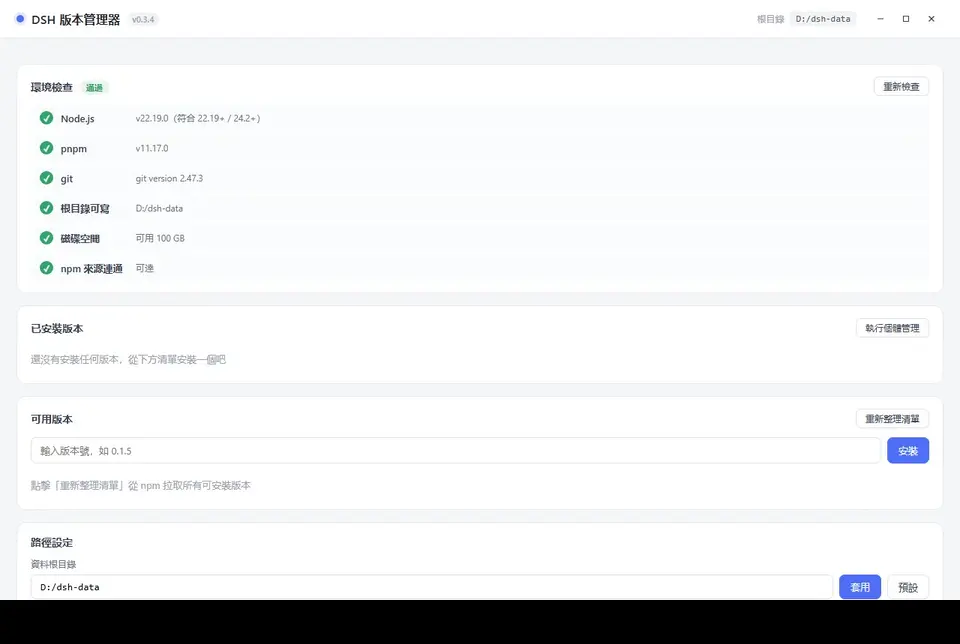

首次打開後，按這四步走：

1. **看環境檢查** —— 介面頂部會自動檢查 Node / pnpm / 磁碟 / npm 源。有缺失項會給出下載連結和安裝步驟。**先把致命項（Node、pnpm）裝好**。
2. **點「刷新列表」** —— 從 npm 拉取所有可安裝的 dsh 版本。
3. **選一個版本安裝** —— 點可用版本列表裡的版本號，它會**填入輸入框**，再點「安裝」。觀察進度條走完。
4. **點「執行」** —— 在應用程式內嵌視窗中打開該版本的 dsh Web 介面。主按鈕按**當前目標**執行；若該版本掛了多個執行個體，點右側小三角先選執行個體（見[第七節](#s7)）。

想讓它成為終端裡預設的 `dsh` 命令？見 [第六節](#s6)。

---

<a id="s4"></a>

## 四、介面功能

### 環境自檢

Windows 啟動時自動檢查 6 項：

| 檢查項 | 是否致命 | 說明 |
| :--- | :--- | :--- |
| Node 版本 | ✅ 致命 | 需 `^22.19.0` 或 `>=24.2` |
| pnpm 可用 | ✅ 致命 | 需 pnpm 10+（低於 10 會提示升級） |
| 資料根可寫 | ✅ 致命 | |
| git 可用 | ⚠️ 非致命 | 安裝 GitHub / Git 來源外掛時需要 |
| 磁碟空間 | ⚠️ 非致命 | |
| npm 源連通 | ⚠️ 非致命 | 8s 超時 HTTP ping；離線會明確失敗（不再誤報可達） |

缺失項會給出**一鍵下載連結**和安裝步驟：

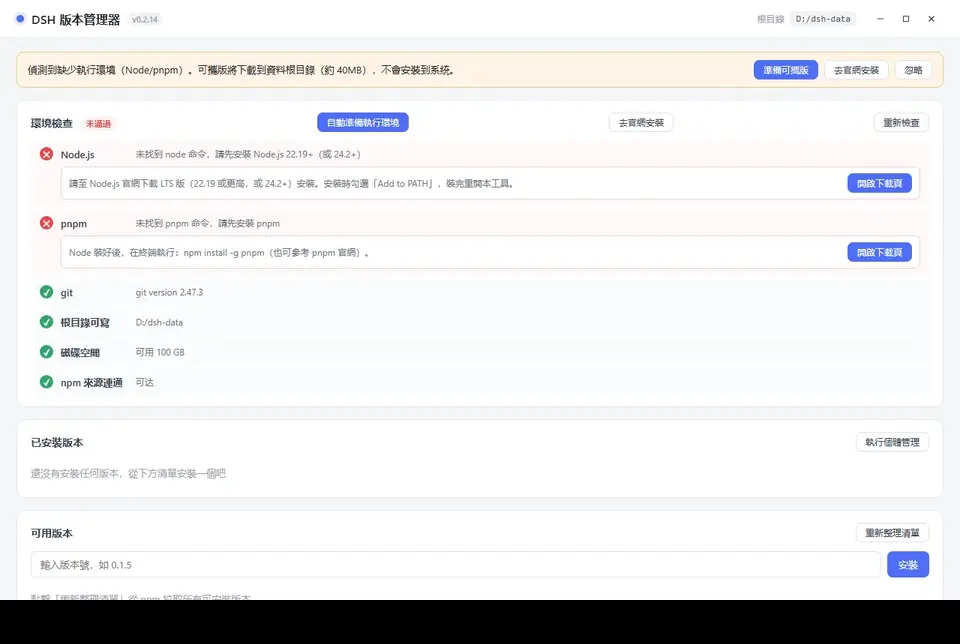

### 視窗標題列

主視窗使用**自繪頂列**，不顯示系統原生標題列，避免兩層標題列疊加。

- **拖動視窗**：按住頂列空白處拖動。
- **雙擊頂列**：最大化 / 還原。
- **右側三個按鈕**：最小化 / 最大化（還原）/ 關閉。按鈕文字隨介面語言切換。
- **啟動載入頁**：同樣可拖動，右上角有獨立的關閉按鈕——啟動卡住時不必等它結束。

> 工作列圖示與視窗分組不受影響：管理員視窗與 dsh 內嵌視窗仍分屬兩個分組。

### 單一執行個體說明

本工具**只允許運行一個管理員進程**（這裡的「執行個體」指管理員進程，不是第七節的資料執行個體）。再次雙擊圖示時，新進程立即退出，已有的管理員視窗會從最小化恢復並聚焦。

- **對比多個版本/執行個體**：在同一个管理員裡分別點「運行」，每個版本、每個執行個體都可各開一個內嵌視窗，互不干擾；同一執行個體最多一個視窗。
- **版本桌面快捷方式**（`DSH <版本號>.lnk`）在管理員已運行時同樣有效：不會新開管理員，而是直接在已運行的管理員裡打開該版本的內嵌視窗。
- **命令列不受影響**：管理員運行時執行 `dsh-multiver list --json` 等 CLI 命令照常立即返回，不會轉交給圖形介面。
- **不同目錄的副本**：單一執行個體鎖按應用程式標識全局生效，同一使用者下兩個不同目錄的副本也不能同時運行。此時後啟動的副本會**彈出對話框說明**（含兩個副本的路徑），並聚焦已運行的視窗——不會靜默退出，也不會把版本快捷方式的意圖轉給另一個副本。

### 已安裝版本

每個版本顯示：版本號、安裝日期、是否預設、**共享 home / 預設執行個體**、佔用大小。

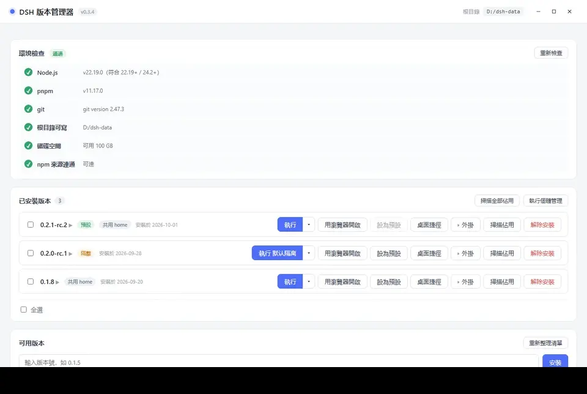

可用操作：

- **運行（分體主按鈕）** —— 左側按當前目標打開內嵌視窗；右側小三角打開**執行個體浮層**（見第七節）。目標為執行個體時，按鈕文案會變成「運行 <執行個體名>」或「聚焦 <執行個體名>」。
- **瀏覽器打開** —— 新開一個控制台視窗運行 dsh，由 dsh 打開系統瀏覽器（關視窗即停止）；同樣使用當前主按鈕目標。
- **設為預設** —— 生成終端 `dsh` 短命令
- **執行個體下拉** —— 共用 home / 執行個體切換、運行/聚焦、打開目錄、改名、刪除、新建（見第七節）
- **快捷方式** —— 在桌面生成 `DSH <版本號>.lnk`
- **外掛** —— 管理該版本的 dsh 外掛（見下方「dsh 外掛」）；面板展開時此按鈕變為**高亮態**（淺藍底、藍邊、藍字，左側三角箭頭旋轉 90°），再點一次收起
- **掃描佔用** —— 顯示 `占用 1.38 GB（复用 1.10 GB / 独占 288 MB）`
- **解除安裝**
- **執行個體管理** —— 版本列表右上角的全局按鈕；孤兒執行個體數量以角標顯示（見第七節）

> **介面按鈕的回饋**（v0.3.4+）：滑鼠懸停時按鈕變淺底 + 主色描邊；按下時底色加深並略微縮小；用 Tab 鍵切換焦點時顯示 2px 主色焦點環。危險操作按鈕（如解除安裝）懸停時變為**實心紅底白字**，與普通按鈕區分。所有按鈕的文字顏色在懸停時保持不變。

> **佔用裡的「共用 / 獨佔」是什麼**：多個版本透過 pnpm store 硬連結共用同一份依賴檔案。「共用」是與其他版本共用的部分，「獨佔」是這個版本獨有的部分。所以**解除安裝一個版本釋放的空間往往遠小於它顯示的總佔用**。

### dsh 外掛（v0.3.0+）

點某個版本的「**外掛**」按鈕，展開該版本的 dsh 外掛面板：

- **已安裝**標籤：列出該版本所有 **profile**（通常只有 `web`）及其外掛（包名 + 版本；`bundle` 標記是 profile 內置層）。

  

- **推薦**標籤：一份外掛清單，按分類篩選，點「安裝」直接裝到當前 profile。

  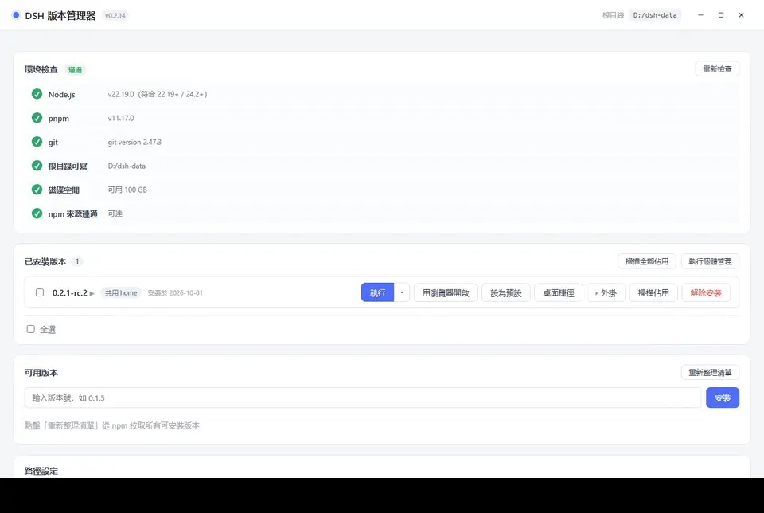

**已安裝標籤的操作**：

- **安裝**：點「＋ 添加外掛」→ 輸入 npm 包名、GitHub 地址或本地目錄 → 選安裝源 → 檢查（inspect）→ 確認 → 安裝完成。對話框會顯示將安裝的包名/版本/描述、安裝源與信任提示；安裝失敗時可按類別處理。

  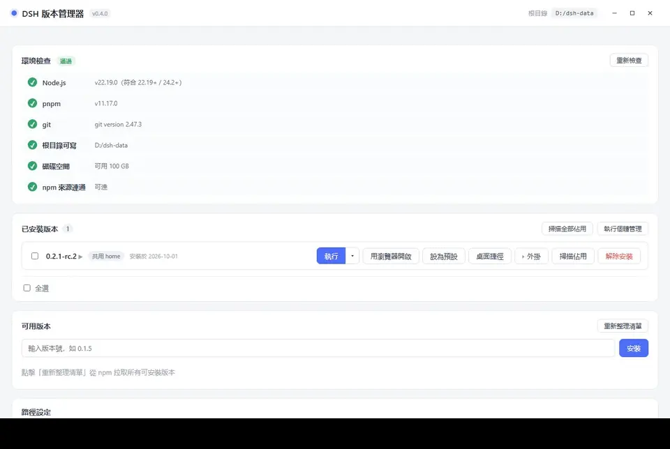

- **解除安裝**：點外掛右側的「解除安裝」。大外掛可能要幾十秒，條目上會顯示轉圈和已運行秒數。
- **檢查更新**：點工具列的「檢查更新」，有新版時條目上出現紅色徽標與「更新」按鈕；也可點「全部更新」逐項更新（失敗自動回滾該項）。
- **共用 home 體檢**：點工具列的 🩺 按鈕，只讀掃描共用 profile 的連結，報告舊版本殘留、懸空連結與重複來源，不改檔案。
- **打開目錄**：面板右上角 📂 按鈕，在資源管理器打開 profile 目錄。

每個外掛佔兩行：第一行是圖示與包名（長包名會換行完整顯示），第二行是版本、來源標籤與操作按鈕。

**推薦標籤的用法**：

- 頂部標籤列按分類篩選（全部 / 工具增強 / 內容聚合 …），分類多時右側出現 `‹ ›` 滾動按鈕。
- 卡片第一行是包名與「安裝」按鈕；第二行是 GitHub / npmjs 連結與一句話描述。
- 描述隨介面語言切換（簡中 / 繁中 / English / 日本語 / 한국어），未提供翻譯的條目顯示中文原文。
- 描述過長時右側漸隱，懸停描述或點「查看完整描述」可看全文。
- 分類標籤列可以按住左鍵左右拖動。
- 帶 ⭐ 的條目是推薦或同作者作品，排在列表最前。
- 列表在打開時會自動檢查更新（30 分鐘內不重複檢查）；點分類列右側的 **↻** 可強制檢查。
- 檢查失敗時頂部會提示「推薦列表可能不是最新」，列表仍可正常使用（用的是上次拉到的內容或隨程式發布的內置副本）。
- 清單的新舊按 `updatedAt` 時間戳比對：本地比遠端新時不覆蓋（避免舊快取遮擋新版內置副本）。
- 拉取清單時直連 GitHub 失敗，會按序回退 `gh-proxy.com` → `cdn.jsdelivr.net`（v0.3.2+）。

**原理**：dsh 外掛就是 npm 包，裝在 `<DSH_HOME>/profiles/<profile>/`。本工具透過 dsh 自帶的 `dsh plugin --profile <p> add/remove <包>` 執行（等價於你手動敲 dsh 命令）。

> **前提**：該版本已在 dsh 裡**啟動過至少一次**（才會生成 profile 目錄）。若提示"沒有 profile 目錄"，先在 dsh 裡打開一次。

### 批量操作

已安裝列表支援多選：

- 每個版本左側有複選框，勾選後底部出現批量操作列
- 「全選」選中本組，「清除選擇」取消
- 「批量解除安裝」一次確認後逐個執行，即時顯示進度，失敗項匯總提示
- 批量進行中，**被選中條目的按鈕會被禁用**（防呆），非選中條目不受影響

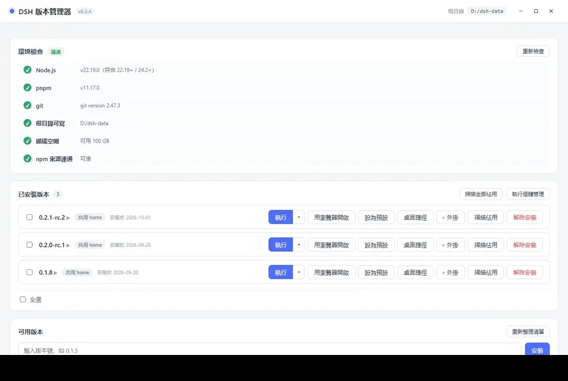

### 可用版本列表

- 支援**搜尋**版本號
- 支援**排序**（最新在前 / 最早在前）
- 點版本號**填入輸入框**，**同時在其下方就地展開該版本的更新說明**（再點一次收起）
- 更新說明資料來自 dsh 上游 GitHub Releases，經消毒後展示，附「在瀏覽器打開原文」按鈕；
  同一版本看過一次後，再點（無論從「可用版本」還是「已安裝版本」）都會立即顯示
- **標灰劃線的版本**是「已知安裝失敗」的（依賴已下架的私有包等），可以點「清除標記」後重試

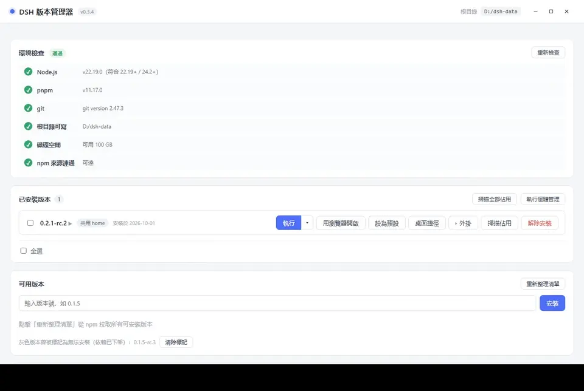

安裝過程中的進度列：

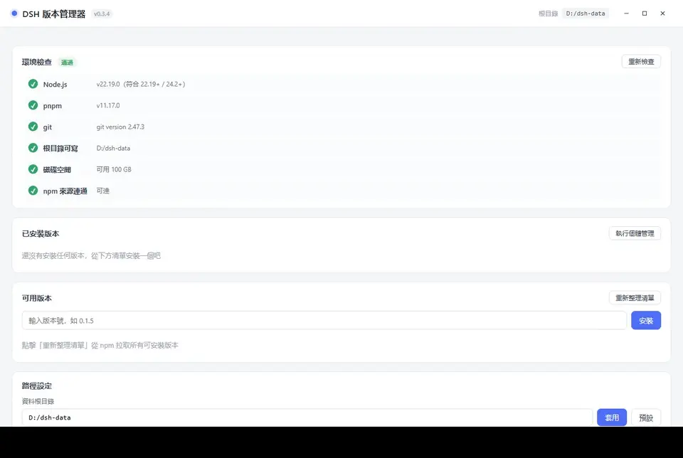

### 安裝失敗處理

安裝失敗時按錯誤類別給出針對性提示：

| 類別 | 提示 |
| :--- | :--- |
| **網路問題** | 彈出換源對話框（官方 / 阿里雲 / 騰訊雲 / 華為雲 / 自定義），一鍵重試 |
| **私有包下架** | 該版本官方發布不全，任何源都裝不了；版本會被標灰。也可嘗試換源重試 |
| **版本不完整 / 鏡像未同步** | 可能是 npmmirror 尚未同步某個子包；彈窗可直接換官方源重試，仍失敗再換版本 |

網路問題的換源對話框：

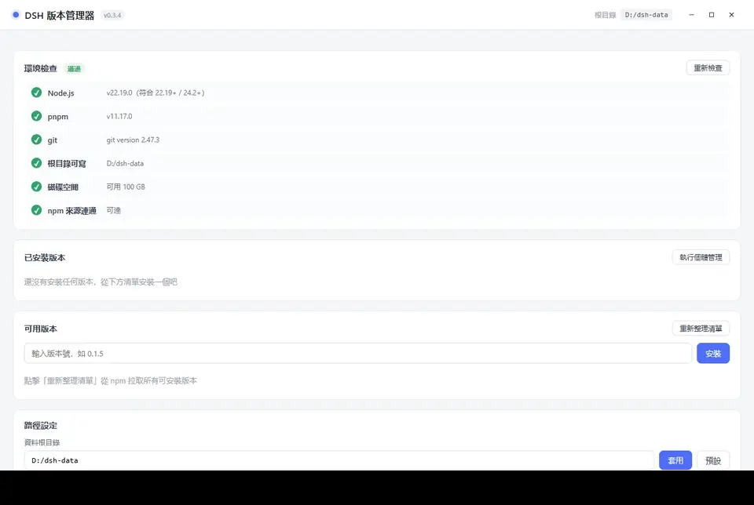

私有包下架的提示：

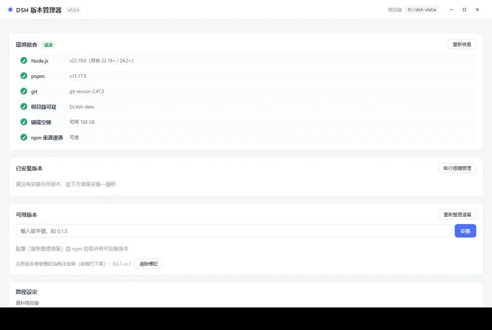

### 路徑設定

可修改**資料根目錄**（預設 exe 同目錄；輸入會自動去除首尾空格）。改完會同步更新終端 `dsh` 腳本裡的路徑。

下方列出各資料目錄，**點擊任意一行即在檔案管理器打開**該目錄。預設展示 5 個核心目錄
（`versions` / `home` / `store` / `cache` / `state`），點「**展開全部目錄**」可查看
`logs` / `homes` / `webview` / `trash` / `assets` 等其餘目錄。

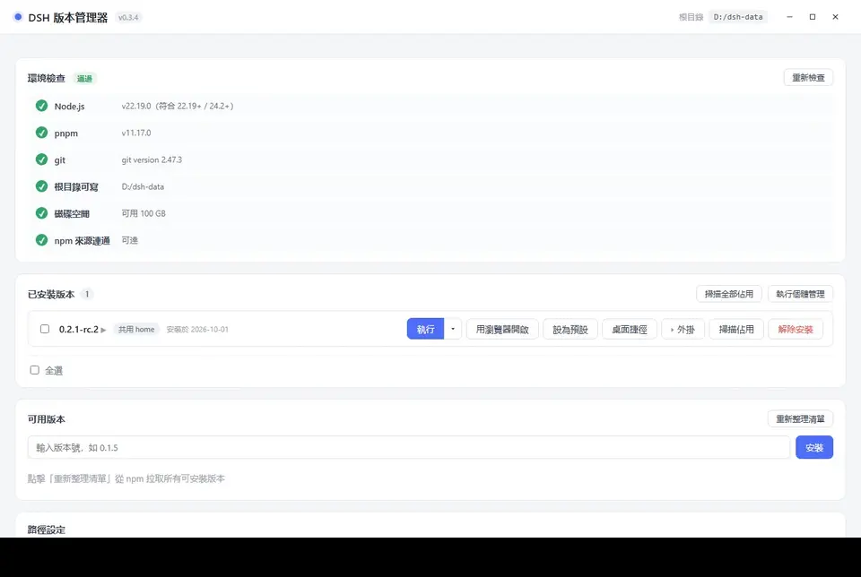

面板裡還有**「導出設定」**和**「導入設定」**按鈕：

- **導出設定**：把當前設定 + 已安裝版本清單存為一個 JSON 檔案（換機遷移用，不含依賴/憑證）
- **導入設定**：選一個備份 JSON → 預覽將改動的欄位 → 確認後應用（僅恢復設定，版本需另行安裝）

底部還有**維護區**（見第十節）。

---

<a id="s5"></a>

## 五、运行 dsh 的三种方式

安裝完成後，每個版本有三種啟動途徑：

### 1. 運行（內嵌視窗）—— 推薦

在應用內直接打開 dsh 的 Web 介面（預設 1100×760）。

- 每個**版本 + 目標**使用獨立的 WebView2 資料目錄：共享視窗為 `<資料根>/webview/<版本>/_shared`，執行個體視窗為 `<資料根>/webview/<版本>/<執行個體 id>`，cookie / 快取互不干擾
- 關閉視窗只終止該目標對應的 dsh 進程；同一版本的其他執行個體視窗不受影響
- 同一**目標**再次運行會**聚焦已有視窗**；同一版本的不同執行個體可以同時運行
- 視窗標題為 `DSH <版本>`；執行個體視窗為 `DSH <版本> · <執行個體名>`
- 視窗左上角有一個**小圓點**：懸停顯示版本號，點擊彈出面板：
  - **版本號**：當前運行的 dsh 版本
  - **完整 URL**：點擊可全選複製，粘到瀏覽器打開同一執行個體
  - **重啟**：結束該版本內嵌視窗背後的 dsh 進程，用同版本重新拉起，並讓視窗導航到新地址（會話資料保留，頁面狀態丟失）。裝/卸外掛、換 dsh 版本後靠它生效
  - **收起**（面板右上角 ×）：僅收起面板，不關閉 dsh。要停掉 dsh，直接關視窗

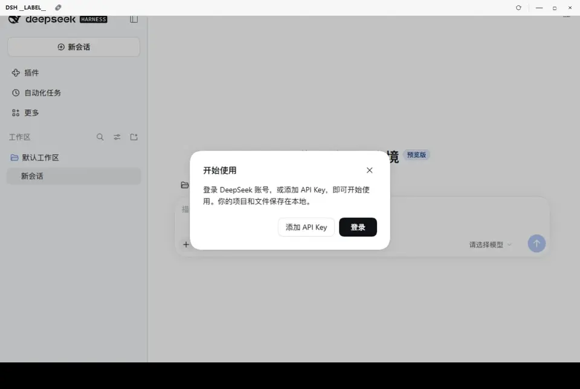

> 端口由系統自動分配（`--port 0`），不會衝突。

### 2. 瀏覽器打開

用一個**新主控台視窗**啟動 dsh，dsh 自己打開系統預設瀏覽器。行為與「自己開終端敲 `dsh web`」一致。

- **使用當前主按鈕目標**：共享 home 或某個執行個體的 `DSH_HOME`；要換執行個體，先在執行個體浮層裡切換目標
- **保留主控台視窗**：dsh 的輸出（含完整 URL 與 token）顯示在視窗裡，可自行複製
- **關閉主控台視窗即停止服務**
- Linux：管理器會查找系統終端模擬器（`x-terminal-emulator` / `xterm` / `gnome-terminal` / `konsole` / `xfce4-terminal` 等）承載該視窗；若都未安裝會明確提示安裝後重試
- 端口**固定 3080**
- **若 3080 被占用**：彈出對話框「端口 3080 已被占用」，可選擇：
  - 「用隨機端口」——換一個空閒端口打開（地址以主控台視窗裡顯示為準）
  - 「取消」——放棄本次操作
- 若該版本已在內嵌視窗運行，會先彈窗確認是否再開一個

> 適合想讓 dsh 跑在真正的瀏覽器裡（比如要用瀏覽器外掛）的場景，也方便觀察 dsh 的即時輸出。

### 3. 桌面快捷方式

點「快捷方式」為當前版本在桌面生成 `DSH <版本號>.lnk`。

- 雙擊 = **精簡啟動**：不顯示管理器主介面，直接打開該版本的內嵌視窗
- 所有視窗關閉後程式自動退出
- 適合把常玩的版本固定到桌面 / 任務列

---

<a id="s6"></a>

## 六、終端短命令 dsh

在某個版本上點「**設為預設**」，會在 `%APPDATA%\npm\` 生成一個 `dsh.cmd` 轉發腳本（該目錄通常已在系統 PATH）。

之後在**任意終端**直接敲：

```bash
dsh web          # 啟動預設版本的 Web 介面
dsh doctor       # 其他子命令同樣命中預設版本
dsh --version
```

### 它是怎麼工作的

腳本裡**寫死了**版本號、根目錄和 `DSH_HOME`（由程式生成時算好，不解析 JSON）。`DSH_HOME` 指向該版本**當前主按鈕目標**：共享 home、官方 `~/.dsh`，或某個執行個體的 `homes/<id>`。內容大致是：

```bat
set "VER=0.2.0-rc.1"
set "ROOT=D:\dsh-multiver"
set "DSH_HOME_CANDIDATE=D:\dsh-multiver\home"
...
call "%ROOT%\versions\%VER%
ode_modules\.bin\dsh.cmd" %*
:: 共享 home 範例；若主按鈕指向執行個體，這裡會是 D:\dsh-multiver\homes\i1
:: 以上為範例路徑，實際由 dsh-multiver 在「設為預設」時按你的資料根目錄生成
```

> 腳本內帶保險：若 `DSH_HOME` 目錄不存在，則不設該變數，回退到 dsh 預設位置（`~/.dsh`）。

**改預設版本、改根目錄、改主按鈕目標、解除安裝預設版本**時，這個腳本會自動重新生成。沒有預設版本時會刪除它。要臨時指定某個執行個體，用 `dsh-multiver run <版本> --instance <id>`，不改轉發腳本。

### 與其它方式裝的 dsh 共存

dsh 有多種官方分發形態，它們與本管理器的關係不同：

| 安裝方式 | 衝突情況 | 說明 |
| :--- | :--- | :--- |
| `npm i -g @deepseek-ai/dsh` | **會衝突，已處理** | 兩者都往 `%APPDATA%\npm\`（Unix 為 `~/.local/bin`）寫同名 `dsh`。設預設時會檢測：發現不是本管理器生成的命令就提示確認，不靜默覆蓋；解除安裝時也只刪自己生成的，不動官方那份。 |
| `pnpm add -g @deepseek-ai/dsh` | **可能衝突，未檢測** | pnpm 的全局 bin（如 `%LOCALAPPDATA%\pnpm`）不在本管理器的檢測範圍內。若該目錄在 PATH 中排在前面，敲 `dsh` 會走 pnpm 那份，本管理器的轉發腳本被繞過。 |
| Python wheel | **可能衝突，未檢測** | 同上。`dsh` 裝在 Python 的 `Scripts/` 或 `bin/`，由 PATH 順序決定誰生效。 |
| DeepSeek Harness 桌面版 | 不衝突 | Electron 應用程式自帶運行時，不往 PATH 裝 `dsh` 命令。 |

**判斷當前敲的 `dsh` 是誰**：

```powershell
# Windows
Get-Command dsh | Select-Object Source
```

```bash
# Linux / macOS
which -a dsh
```

- 路徑是 `%APPDATA%\npm\dsh.cmd`（Unix 為 `~/.local/bin/dsh`）→ 本管理器的轉發腳本
- 路徑在 pnpm 或 Python 的目錄下 → 那一份官方安裝

**想讓本管理器的版本優先**：把 `%APPDATA%\npm\`（Unix 為 `~/.local/bin`）移到 PATH 靠前的位置。

> ⚠️ **DSH_HOME 共用風險**：若開啟了「復用官方 `~/.dsh`」，本管理器與官方安裝會共用同一份 `profiles/`、`sessions/` 與憑證。不同 dsh 版本的 profile 裡 bundle 版本可能不同，互相覆蓋 `node_modules` 有出錯風險。共用前請確認各版本所需 bundle 一致，或改用資料隔離。

> ⚠️ 若終端提示 `'dsh' 不是內部或外部命令`，檢查 `%APPDATA%\npm\` 是否在 PATH 裡。

---

<a id="s7"></a>

## 七、資料隔離與執行個體

dsh 的資料目錄（會話、設定、外掛、憑證）由啟動時注入的 `DSH_HOME` 決定：

| 目標 | DSH_HOME | 說明 |
| :--- | :--- | :--- |
| **共享 home**（預設） | `<資料根>/home` | 所有非隔離版本**共用** |
| **官方 home** | `~/.dsh` | 開啟「複用官方設定」時使用，與官方安裝共用 |
| **執行個體** | `<資料根>/homes/<id>` | 執行個體獨占；一份 home 可掛到多個版本 |

**執行個體是全局實體**：一個版本可掛載任意多個執行個體；同一執行個體也可掛到多個版本，共用同一份會話/憑證/外掛設定。每個版本用 `selected_target` 記住自己的主按鈕目標（共享或某個執行個體）；只影響下次執行，不影響已經打開的視窗。

### 什麼時候該用執行個體

- 測試不兼容的外掛，怕汙染主力環境
- 想保持乾淨的會話歷史 / 設定
- 想同時開同一版本的多個獨立環境做對比

> ⚠️ **共用 home 的風險**：非隔離版本共用同一個資料目錄。若新版本的外掛/設定與舊版本不兼容，可能**連累舊版本**。例如 dsh 0.1.7 的「打開資料夾」功能失效，在共享 home 下會影響所有版本。
>
> 遇到奇怪問題，可以給版本掛一個執行個體，或參見[常見問題](#s11)。

### 執行個體浮層

版本列主按鈕右側的小三角打開**執行個體浮層**（原「已隔離 ▾」選單已由它替代）：

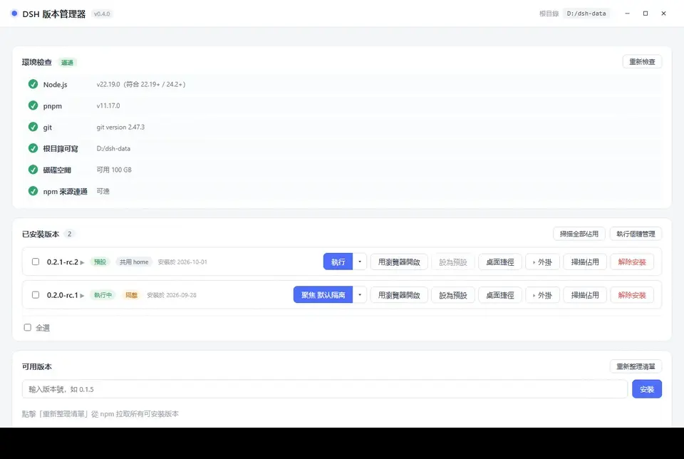

- **共享 home** 行 —— 用共享/官方 home 執行；單選框決定主按鈕目標
- **執行個體行** —— 執行/聚焦、打開目錄、改名、刪除；執行中會顯示「執行中（版本）」，刪除按鈕停用
- **＋ 新建執行個體** —— 輸入名稱；建立後可繼續在執行個體管理面板裡掛載版本
- **單選切換** —— 主按鈕立即變為「執行 <執行個體名>」；同一執行個體重複點執行只會聚焦已有視窗

### 執行個體管理面板

版本列表右上角的「執行個體管理」按鈕打開全局面板：

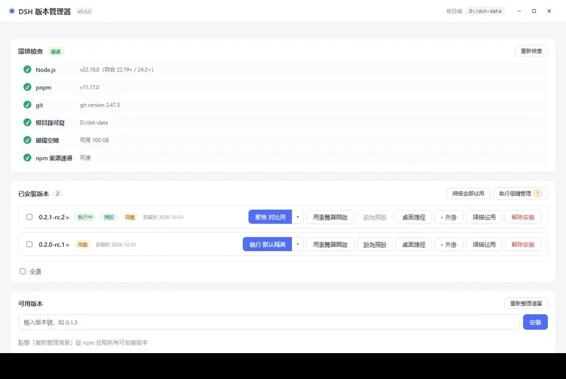

- 列出**全部執行個體**；孤兒（沒有任何版本掛載）**置頂**並標「未掛載」，按鈕上顯示孤兒數量角標
- 每行顯示：名稱、home 路徑、占用（點「掃描占用」計算）、掛載版本、主按鈕目標、執行狀態
- 操作：執行/聚焦、打開目錄、改名、掛載/解除掛載、刪除
- **＋ 新建執行個體**：輸入名稱並勾選要掛載的版本；建立後立即出現在列表
- 執行中的執行個體不能刪除；改名與解除掛載允許

### 約束與遷移

- 刪除執行個體：先把 `homes/<id>` 改名到 `trash/instance-<id>-<時間戳>`，再清設定；後台清理，失敗退化為直接刪。
- 解除安裝版本：只解除該版本的掛載，**保留執行個體為孤兒**；不會刪除 `homes/<id>`。
- 選中目標失效（執行個體被刪/解除掛載）：靜默回落共享 home，不會自動選第一個掛載執行個體。
- 介面只顯示執行個體名稱，不顯示內部 id（`i1`/`i2`…）；id 只出現在 home 路徑、CLI/JSON 與日誌中。
- **v0.3.x 升級**：舊的 `versions/<版本>/home` 會遷移到 `homes/<id>`；舊 `isolated_versions` 自動生成「預設隔離」執行個體。遷移可中斷重試，不刪除使用者資料；目標已存在時複用並寫日誌。

---

<a id="s8"></a>

## 八、命令行模式（CLI）

> **自 v0.3.0 起採用子命令風格**（`dsh-multiver list`），適合腳本化、批處理、CI。

帶任一 CLI 子命令時，程式**不會啟動圖形介面**，執行完按退出碼退出（成功 `0` / 失敗 `1`）。

| 命令 | 用途 |
| :--- | :--- |
| `list` | 列出已安裝版本（一行一個；預設版本以 `* ` 前綴標記） |
| `which` | 輸出預設版本 dsh 入口的**絕對路徑**（無預設版本則失敗） |
| `info <版本>` | 查看單個版本詳情（路徑 / 預設 / 隔離 / 設定目錄 / 占用 / 執行個體與主按鈕目標） |
| `versions` | 列出遠端可用版本（從 npm 查詢，最新在前） |
| `env` | 環境檢查（Node / pnpm / 根目錄可寫 / 磁碟 / npm 源連通；有致命項失敗時退出碼 1） |
| `isolate <版本> [--off]` | 開啟隔離（確保預設執行個體）；`--off` 解除該版本全部執行個體掛載（執行個體保留） |
| `isolate <版本> --list [--json]` | 列出該版本掛載的執行個體與主按鈕目標 |
| `isolate <版本> --attach <id>` / `--detach <id>` | 掛載 / 解除掛載單個執行個體 |
| `instance create --name <名稱> [--attach <版本>...]` | 建立執行個體（不建目錄；可先建孤兒） |
| `instance list [--sizes] [--json]` | 列出全部執行個體（含未掛載孤兒）；預設不掃占用，`--sizes` 才計算 |
| `instance rename <id> <新名>` | 修改執行個體顯示名 |
| `instance remove <id>` | 刪除執行個體（home 移入回收站） |
| `clean` | 清理孤立快取 + 清空回收站（`maintenance --cleanup` 的超集） |
| `doctor` | 一鍵診斷（目錄 / 失敗標記 / 已安裝 / 環境）；有致命項失敗時退出碼 1 |
| `shortcut <版本>` | 為某版本建立桌面快捷方式 |
| `copy-shared <版本> [--instance <id>]` | 把共享 home 資料複製到目標執行個體 home |
| `clear-isolated <版本> [--instance <id>]` | 清空目標執行個體 home（保留版本本身） |
| `export [<檔案>]` | 導出設定 + 版本清單（JSON），便於換機遷移 |
| `import <檔案>` | 導入備份檔案裡的設定（`--dry-run` 只預覽將改動的欄位） |
| `run <版本> [--instance <id>]` | 啟動 dsh web（新控制台視窗 + 自動開啟系統瀏覽器；關視窗即停止） |
| `setup-runtime` | 檢測並下載缺失的便攜運行時（Node / pnpm）；`--dry-run` 只報告不下載 |
| `update` | 檢查並執行自動更新（下載 → 校驗 → 替換自身 → 重啟）；`--dry-run` 只檢查是否有新版 |
| `install <版本> [--registry <url>]` | 無頭安裝，可指定 npm 源 |
| `uninstall <版本>` | 無頭解除安裝 |
| `set-default <版本>` | 設為預設版本，並重生成終端 `dsh` 命令 |
| `set-root <目錄>` | 設定資料根目錄（絕對路徑；建立子目錄並重生成轉發腳本） |
| `maintenance [--cleanup\|--prune]` | 無頭維護；不帶子開關則兩者都做 |
| `help` | 幫助 |
| `version` | 版本號 |

**修飾符**（保持 `--` 前綴）：

| 修飾符 | 用途 |
| :--- | :--- |
| `--dry-run` | **只預覽不執行**（搭配破壞性命令：`install` / `uninstall` / `set-default` / `set-root` / `maintenance` / `isolate` / `instance` / `clean` / `shortcut` / `copy-shared` / `clear-isolated` / `import` / `setup-runtime` / `update`） |
| `--json` | **結構化輸出**（機讀 JSON）；只影響格式，不改行為 |
| `--force` | 覆蓋非本管理器生成的 `dsh` 命令（用於 `set-default`） |
| `--registry <url>` | 指定 npm 源（用於 `install`） |
| `--off` | 解除該版本全部執行個體掛載（用於 `isolate`） |
| `--list` | 列出該版本掛載的執行個體（用於 `isolate`） |
| `--name <名稱>` | 建立執行個體時的顯示名（用於 `instance create`） |
| `--attach <版本>` | 建立執行個體時掛載版本，可重複（用於 `instance create`） |
| `--detach <id>` | 解除版本與執行個體的掛載（用於 `isolate`） |
| `--instance <id>` | 指定執行個體（用於 `run` / `copy-shared` / `clear-isolated`） |
| `--sizes` | 同時計算執行個體占用（用於 `instance list`；預設不掃，避免執行個體多時卡住） |

> ⚠️ **v0.3.0 破壞性變更**：舊的 `--flag` 語法（如 `--list`）**已移除**。當前命令見本章命令表。

### 範例

```bash
# 看裝了哪些版本（輸出可直接管道）
dsh-multiver.exe list

# 裝一個版本
dsh-multiver.exe install 0.2.0-rc.2

# 用指定源裝（網路不好時）
dsh-multiver.exe install 0.2.0-rc.2 --registry https://registry.npmmirror.com

# 設預設
dsh-multiver.exe set-default 0.2.0-rc.2

# 切換資料根（絕對路徑）
dsh-multiver.exe set-root D:/DSH-data

# 解除安裝
dsh-multiver.exe uninstall 0.1.5-rc.3

# 清理孤立快取
dsh-multiver.exe maintenance --cleanup

# 回收依賴倉庫
dsh-multiver.exe maintenance --prune

# 查某個版本的詳情
dsh-multiver.exe info 0.2.0-rc.2

# 看遠端有哪些版本可裝
dsh-multiver.exe versions

# 環境自檢（部署前預檢 / 排障；有致命項失敗時退出碼 1）
dsh-multiver.exe env

# 給某版本開/關資料隔離
dsh-multiver.exe isolate 0.2.0-rc.2
dsh-multiver.exe isolate 0.2.0-rc.2 --off

# 建立執行個體並掛兩個版本
dsh-multiver.exe instance create --name 對比用 --attach 0.2.0-rc.2 --attach 0.2.1-rc.2
dsh-multiver.exe instance list --json

# 需要占用時顯式掃描（執行個體多時預設列表不會遍歷 home）
dsh-multiver.exe instance list --sizes --json

# 改名 / 刪除執行個體（刪除會把 home 移入回收站）
dsh-multiver.exe instance rename i2 對比用-2
dsh-multiver.exe instance remove i2

# 查看/調整某版本的執行個體
dsh-multiver.exe isolate 0.2.0-rc.2 --list
dsh-multiver.exe isolate 0.2.0-rc.2 --attach i2

# 用指定執行個體啟動/清理
dsh-multiver.exe run 0.2.0-rc.2 --instance i2
dsh-multiver.exe clear-isolated 0.2.0-rc.2 --instance i2

# 清理孤立快取 + 清空回收站
dsh-multiver.exe clean

# 一鍵診斷（排障用）
dsh-multiver.exe doctor

# 導出設定（換機遷移用）
dsh-multiver.exe export backup.json

# 導入設定（先預覽將改動的欄位）
dsh-multiver.exe import backup.json --dry-run
dsh-multiver.exe import backup.json

# 只預覽，不真的執行（適合確認參數是否正確）
dsh-multiver.exe install 0.2.0-rc.2 --dry-run
dsh-multiver.exe uninstall 0.1.5-rc.3 --dry-run
dsh-multiver.exe maintenance --prune --dry-run
```

### 結構化輸出（--json）

給腳本/CI 用：加 `--json` 輸出機讀 JSON（stdout 只有 JSON，無其他輸出）。

```bash
# 版本列表（物件陣列，含 is_default / isolated / installed_at 等）
dsh-multiver.exe list --json

# 預設版本 dsh 入口的絕對路徑
dsh-multiver.exe which --json

# 破壞性命令的預覽（dry-run + json）
dsh-multiver.exe install 0.2.0-rc.2 --dry-run --json

# 版本詳情（完整物件，含共享/獨佔大小）
dsh-multiver.exe info 0.2.0-rc.2 --json

# 遠端可用版本陣列
dsh-multiver.exe versions --json

# 環境檢查項陣列（CheckItem：name/ok/detail/critical）
dsh-multiver.exe env --json
```

### 說明

- **無互動確認**：`install` / `uninstall` / `set-default` 不會問「確定嗎」，請確保參數正確
- **輸出可管道**：`list` 一行一個版本號；安裝進度走 **stderr**，stdout 保持乾淨
- **JSON 輸出**：加 `--json` 得到機讀結果（stdout 只有 JSON）
- **進度顯示**：只在真實終端下顯示單行進度；重定向到檔案/管道時自動靜默
- **不帶任何 CLI 子命令**時，行為與之前完全一致：啟動圖形介面

---

<a id="s81"></a>

## 八.1、外觀與語言

在「路徑設定」面板底部，有 **「外觀與語言」** 設定：

| 設定 | 選項 |
| :--- | :--- |
| **主題** | 跟隨系統 / 亮色 / 暗色 |
| **語言** | 跟隨系統 / 簡體中文 / 繁體中文 / English / 日本語 / 한국어 |

- 兩項偏好都**保存在本地**，下次開啟自動恢復
- **首屏渲染前**就應用，不會閃爍
- 「跟隨系統」會即時回應系統主題/語言的變化


> CLI 的輸出**不受語言設定影響**（固定中文）—— 因為 CLI 常被腳本解析，輸出需要穩定。

---

<a id="s82"></a>

## 八.2、在 dsh 里管理版本

装好「版本管理」外掛后，dsh 的**设置页**会多一个「版本管理」入口。它读的是同一个 multiver 数据根，与 multiver 界面看到的一致。

### 装外掛

dsh **0.2.0 起**支持外掛，可直接在 dsh 里装桥接外掛，不必先开 multiver。

1. 打开 dsh 的**「外掛」页** → 点右上角**「添加外掛」**
2. 在输入框填外掛包名 `dsh-multiver-bridge`
3. 点**「安装」**，等进度走完

装好后外掛显示「运行中」，dsh 设置页随即多出「版本管理」入口。装完无需重启 dsh。

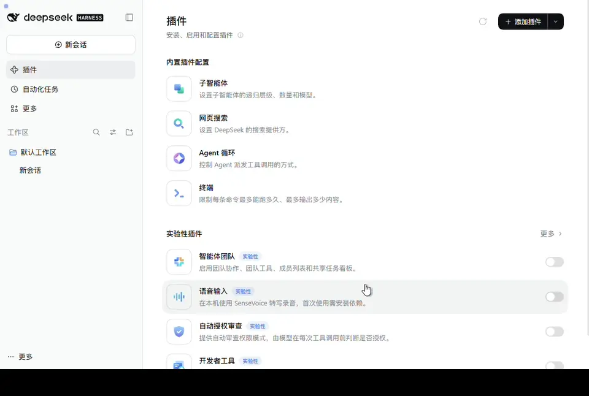

> 图 16 是 **dsh 自身外掛页**，界面语言由 dsh 设置决定，不随 multiver 语言切换。

> 外掛只负责**查看版本与切换默认版本**；安装、卸载、实例/隔离仍由 multiver 完成。

### 能看到什么

| 区域 | 内容 |
| :--- | :--- |
| **状态条** | 默认版本；运行版本（附来源徽标）；运行版本与默认不一致时的「重启后生效」提示；一致性校对详情 |
| **版本表** | 版本号、安装日期、标记（默认 / 隔离 / 共享 home） |
| **动作区** | 打开 multiver 目录、打开版本目录、复制诊断信息、打开 multiver |

**运行版本**的来源有两个：

- multiver 启动 dsh 时注入的环境变量（最可靠，显示「来自 multiver」）
- 从进程路径自检（显示「推断」）

两者不一致时显示「来源冲突」，此时不会误报「重启后生效」——先按提示重启 dsh。

### 能做什么

- **设为默认**：点「设为默认」→ 内联确认条 → 确认。界面会提示「重启 dsh 后生效」——运行中的 dsh 无法热替换自身。
- **打开 multiver**：直接拉起管理器主窗口。内嵌窗口里不显示这个按钮（再开一个管理器没有意义）。
- **复制诊断信息**：把当前状态打包成 JSON，剪贴板不可用时降级为可选中文本框，便于排障。

### 更新 multiver 本身

版本管理页底部有「multiver 更新」区块：

- **已是最新**：显示当前版本，可点「重新检查」
- **有新版本**：显示版本号与 Release 链接，点「更新」后确认

**两种更新方式，取决于你在哪里打开**：

| 场景 | 行为 |
| :--- | :--- |
| **内嵌窗口**（multiver 启动的 dsh） | 点更新后**暂存**——新 exe 下载到 `<数据根>/.update/`，页面显示「待安装：vX.Y.Z」。multiver **下次启动时**自动完成替换，当前会话不受影响。 |
| **独立 dsh**（终端启动，非 multiver 内嵌） | 点更新后**立即执行**——下载、校验、替换并重启管理器。 |

为什么内嵌窗口要暂存：当前 dsh 正是 multiver 拉起的子进程，直接替换正在运行的 exe 会中断会话，Windows 上也不允许覆盖运行中的檔案。暂存让替换发生在 multiver 未运行时，两侧都不受影响。

### 刷新时机

- 页面可见时每 60 秒自动刷新一次
- 从其他标签页切回来时立即刷新一次
- 页面不可见时停止轮询（每次刷新都要启动一次 exe，代价不低）
- 也可点页脚的「刷新」手动触发

### 安装与卸载

外掛不在 exe 内，需要单独装进 dsh 的 profile：

```powershell
# 在 dsh-multiver 的 dsh-plugin 目录下
pnpm pack
.\install.ps1 -DshCmd '<dsh.cmd 路径>' -Profile web -PackageDir '.\dsh-multiver-bridge-0.2.1.tgz'
```

**装完必须重启 dsh。** 卸载用 `uninstall.ps1`，同样需要重启。

详见 [dsh-plugin/README](../dsh-plugin/README.md)。

> ⚠️ 内嵌窗口里看不到外掛？检查 multiver 启动 dsh 时用的 profile 是否装了外掛——multiver 固定用 `dsh web`（等价 `--profile web`）。

---

<a id="s9"></a>

## 九、資料存儲結構

資料根目錄預設 = **exe 所在目錄**，可在介面「路徑設定」裡修改。運行後會在根目錄下創建：

```
<資料根>/
├── config.json              # schema 2：version_instances / selected_target / instance_seq / instances
├── versions/<版本>/         # 各版本獨立安裝（不再含 home/）
│   ├── package.json
│   ├── .npmrc               # node-linker=hoisted
│   └── node_modules/
├── home/                    # 共享 DSH_HOME（會話/設定/憑證，相當於 ~/.dsh）
├── homes/<id>/              # 執行個體 DSH_HOME（每個執行個體一份，可掛多個版本）
├── store/                   # pnpm store（硬連結去重，多版本共享）
├── cache/                   # pnpm 快取（可刪）
├── state/                   # pnpm 狀態（可刪）
├── webview/<版本>/
│   ├── _shared/             # 該版本共享視窗的 WebView2 資料
│   └── <id>/                # 該版本執行個體視窗的 WebView2 資料
├── trash/                   # 解除安裝/刪除回收站（執行個體刪除為 instance-<id>-<ts>）
├── .update/                 # 暫存的 multiver 更新套件（下次啟動替換）
├── assets/                  # 內部資源（捷徑圖示）
└── logs/                    # 啟動錯誤日誌 + 維護日誌
```

### 哪些可以安全刪除

| 目錄 | 能否刪 | 說明 |
| :--- | :--- | :--- |
| `cache/` `state/` | ✅ 可刪 | pnpm 快取，刪了會重新下載 |
| `webview/` | ✅ 可刪 | 內嵌視窗快取；刪了會重建，但會丟登入態/cookie |
| `assets/` | ✅ 可刪 | 捷徑圖示等內部資源，會重建 |
| `trash/` | ⚠️ 可清 | 回收站；清了**不可恢復**，確認裡面沒有要找回的資料 |
| `store/` | ⚠️ 謹慎 | **各版本依賴通過硬連結指向這裡**，刪了所有版本都失效 |
| `versions/` | ❌ 不要手刪 | 請用介面「解除安裝」 |
| `home/` `homes/` | ❌ 不要手刪 | 你的會話、設定與憑證 |
| `.update/` | ⚠️ 不要手刪 | 有待安裝更新時刪除會取消本次更新 |

### 自包含原則

所有 pnpm 目錄（`store` / `cache` / `state`）都被顯式限定在資料根目錄內，**不會寫入 pnpm 的全局預設位置**（如 `%LOCALAPPDATA%\pnpm`、盤根 `.pnpm-store`）。

### 省磁碟與"看著沒省"

多個版本的依賴通過**硬連結**共享 `store` 裡的同一份檔案，磁碟上**只存一份**。
但 **Windows 資料夾屬性會把共享檔案重複計算**，顯示的佔用偏大——那不代表真實磁碟消耗。

詳見 → **[硬連結與磁碟佔用](硬链接与磁盘占用.md)**（含如何查看真實的"複用 / 獨占"）。

---

<a id="s10"></a>

## 十、自動維護

程序啟動時會在**後台線程**（不阻擋介面）做兩件事：

1. **清理孤立 webview 快取** —— 兩級判定：版本目錄已不存在 → 清整個 `webview/<版本>`；版本仍存在 → 只清不再掛載的 `webview/<版本>/<執行個體 id>`，保留 `_shared`。每次啟動都跑，成本極低。
2. **回收 pnpm store** —— 距上次 **7 天**以上時，以低優先級運行 `pnpm store prune`，回收不再被引用的相依套件包。會延遲 30 秒錯開啟動 IO。

刪除執行個體時 `homes/<id>` 會先改名到 `trash/instance-<id>-<時間戳>`，由後台清理；`clean` 命令會清空回收站。

日誌寫在 `<資料根>/logs/maintenance.log`。


### 維護面板

在「路徑設定」底部：

- **自動維護開關** —— 關掉則啟動時不做上述兩件事
- **規則說明** + **上次執行狀態**
- **手動按鈕**：「清理孤立快取」「回收相依套件倉庫」「開啟日誌目錄」

> 手動維護會立即執行，並更新設定檔中的時間戳。

---

<a id="s11"></a>

## 十一、常見問題

### Q: 提示「建立視窗失敗：failed to send message to the webview」

兩個因素疊加：管理器有單執行個體鎖（v0.3.0+），第二個執行個體會立即退出並聚焦已運行的視窗；但內嵌視窗的 WebView2 資料目錄在**上一個執行個體還在啟動中 / 關閉中**時立刻再啟，仍可能報此錯。

**解決**：等幾秒再試。

### Q: 啟動報 `WebView2 error 0x800700AA / 請求的資源在使用中`

WebView2 資料目錄被**殘留進程**佔著。常見於管理器被強殺、崩潰，或測試期間留下殭屍進程——此時 `Get-Process` 可能顯示"已退出"，但內核物件未釋放，仍鎖著目錄。

**解決**：

1. 打開工作管理員，結束所有 `dsh-multiver.exe` 與 `msedgewebview2.exe`；
2. 若進程殺不掉（拒絕存取），**重啟電腦**；
3. 重啟後重新啟動管理器即可。

CLI 不受此問題影響（不需要 WebView2）。

### Q: 內嵌視窗顯示 431 錯誤 /「Failed to load plugins」

歷史版本曾因**所有視窗共用同一個 WebView2 資料目錄**，導致 cookie 累積、請求標頭膨脹。現在每個版本用獨立目錄（`webview/<版本>`）已根治。

若仍遇到，刪掉對應的 `webview/<版本>` 目錄讓它重建。

### Q: 安裝報「Cannot find package ... cordis」

依賴連結模式不對。每個版本目錄會寫 `.npmrc` → `node-linker=hoisted`，dsh 需要扁平的 node_modules。

若手工動過版本目錄，刪掉重新裝。

### Q: 安裝報 `ERR_PNPM_IGNORED_BUILDS`

pnpm 10+ 預設不執行依賴建構腳本，導致 node-pty / koffi 等原生模組缺失。工具安裝時已帶 `--config.dangerouslyAllowAllBuilds=true`，正常不會遇到。

### Q: 某個版本一直裝不上，一直轉圈然後失敗

看錯誤提示類別：

- **私有包下架** —— 該版本官方發布不全，**任何源都裝不了**，換版本
- **網路問題** —— 用換源重試（選阿里雲 / 騰訊雲）

> 已知裝不上的早期版本：`0.0.1-rc.1`、`0.0.1-rc.2`（依賴已下架的私有包）。這類版本會自動標灰。

### Q: dsh 的「打開資料夾」功能沒反應

這是 **dsh 0.1.7+ 的上游 bug**：給 `explorer.exe` 傳了 `windowsHide:true`，導致資料夾視窗隱形；且返回碼誤判，API 仍返回成功。

**在共用 home 下會連累所有版本。**

**規避方式**：

1. 安裝社群修復外掛：
   ```bash
   dsh plugin --profile web add github:King20260919/dsh-open-folder-visible
   ```
2. 或給該版本開啟**資料隔離**（見第七節）

### Q: 終端敲 `dsh` 提示找不到命令

`%APPDATA%\npm\` 需要在系統 PATH 裡。檢查環境變數，或重啟終端讓 PATH 生效。

### Q: 解除安裝版本時提示「檔案被佔用」

該版本的 dsh 進程還在運行。

**解決**：關掉對應的內嵌視窗 / 終端，再重試。

### Q: 更新 exe 後圖示沒變

Windows 圖示有快取。

**解決**：執行 `ie4uinit.exe -show`，或重啟資源管理員。

### Q: 版本列表裡有些版本是灰的

這些是**已知安裝失敗**的版本（依賴已下架的私有包）。裝不上是正常的。

若確認要重試，點「清除標記」後即可再次安裝。

### Q: 升級到 v0.4.0 後，舊的隔離資料在哪？

舊版的 `versions/<版本>/home` 已遷移到 `homes/<id>`，舊 `isolated_versions` 自動變成「預設隔離」執行個體。遷移不刪除使用者資料；若目標目錄已存在，會共用目標並在 `logs/app.log` 記錄源路徑。舊目錄若仍同時存在，確認新執行個體能正常打開後可手動清理。

### Q: 為什麼執行個體顯示「未掛載」？

該執行個體沒有掛到任何已安裝版本。常見於解除安裝了唯一掛載它的版本——執行個體會保留為孤兒，不會被自動刪除。到「執行個體管理」面板重新掛載一個版本，或確認資料無用後刪除。

### Q: 同一執行個體為什麼不能開兩個視窗？

一份 `homes/<id>` 同時被兩個 dsh 進程寫有損壞風險，因此一個執行個體最多一個視窗。重複點「運行」只會聚焦已有視窗；要並行對比，請新建另一個執行個體。

### Q: 刪除執行個體後資料還能恢復嗎？

刪除會先把 `homes/<id>` 移到 `trash/instance-<id>-<時間戳>`，再由後台清理。清理前可以從回收站找回；執行 `clean` 或後台清理後**不可恢復**。

### Q: 主按鈕為什麼顯示「聚焦 執行個體 A」？

說明該執行個體已在運行。點主按鈕不會重開，而是聚焦已有視窗；要換目標，點右側小三角在執行個體浮層裡切換。

### Q: 終端裡的 `dsh` 用的是哪個執行個體？

轉發腳本的 `DSH_HOME` 指向預設版本當前的主按鈕目標（共用 / 官方 / 某執行個體）。要臨時指定執行個體，用 `dsh-multiver run <版本> --instance <id>`，不會改轉發腳本。

---

<a id="s12"></a>

## 十二、解除安裝

本工具為**便攜版**，不會寫入登錄檔、不安裝服務。

若要完全解除安裝：

1. 關閉所有內嵌視窗
2. 如果設過預設版本，先點「設為預設」的清除，或直接刪除 `%APPDATA%\npm\dsh.cmd`
3. 刪除 `dsh-multiver.exe`
4. 刪除**資料根目錄**（預設為 exe 所在目錄，其中有 `versions/` `home/` `homes/` `store/` 等）

> ⚠️ 第 4 步會**永久刪除所有 dsh 版本與執行個體的會話、設定、憑證**（含 `homes/`）。如果只想清理某個版本，使用介面中的「解除安裝」；僅解除安裝版本時執行個體會保留為孤兒，不會刪除資料。

---

<a id="s13"></a>

## 十三、Linux 支援（暫不發布）

v0.4.0 明確**不打包、不發布** Linux 產物（不再提供 AppImage / deb）。Linux 僅保留 CI 編譯與單測；執行個體功能未在真桌面驗收（GAP-020），未來恢復 Linux 發布時再補。

本地調試可從源碼運行 `pnpm tauri dev`，系統依賴見 [README · 環境要求](../README.zh-TW.md)。

### 已實現的 Linux 能力（僅開發/未來參考）

- **功能**：安裝/解除安裝/運行/執行個體/CLI/轉發腳本等均已適配
- **進程管理**：Windows 用 Job Object；Linux 用進程組（管理器退出 / 關窗時清理 dsh 進程；若管理器被強殺，下次啟動會清理殘留）
- **桌面整合**：Windows 生成 `.lnk`，Linux 生成 `.desktop`（放桌面；無桌面環境時給出提示）
- **終端短命令**：Windows 寫 `%APPDATA%\npm\dsh.cmd`，Linux 寫 `~/.local/bin/dsh`

### 從源碼構建（需先裝 Rust、Node、pnpm 及 WebKitGTK 等系統依賴）

~~~bash
pnpm install
pnpm tauri build --bundles appimage,deb   # 或 pnpm tauri dev 開發運行
~~~

> **已修復**（v0.2.4）：早期版本在 Linux 上內嵌視窗可能顯示「重新連接中」。根本原因是管理器自身的進程管理缺陷（非平台差異），**影響所有 Linux 環境**，已在 v0.2.4 修復。詳見 [開發缺口](开发缺口.md) GAP-008。

---


## 相關連結

- [專案主頁](https://github.com/K1-lihongrong/dsh-multiver)
- [Releases（下載）](https://github.com/K1-lihongrong/dsh-multiver/releases)
- [更新日誌](https://github.com/K1-lihongrong/dsh-multiver/blob/main/CHANGELOG.md)
- [問題日誌查看指南](问题日志查看指南.md) —— 遇到問題時如何查日誌
- [DeepSeek Harness](https://github.com/deepseek-ai/deepseek-harness) —— 本專案管理的物件
